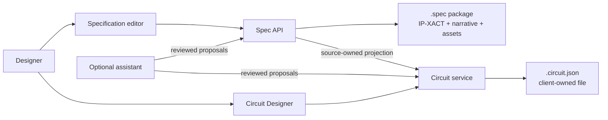

# spec2gds

`spec2gds` is a specification-first hardware design workspace. It combines a
structured specification editor, an independent circuit editor, and an
optional review-oriented assistant.

The repository no longer ships a gallery of demos or benchmark corpora. New
sample applications are developed one at a time through the complete system,
then kept only when they remain useful and reproducible.

## System at a glance



The two editors have different source-of-truth rules:

- A `.spec` package is owned and saved by the Spec API.
- A local circuit is owned by its client and saved as `.circuit.json`.
- A circuit projected from a specification is read-only in Circuit Designer;
  changes return to the specification source.
- Assistant changes are proposals until a user accepts them.

See [the documentation index](docs/README.md) for the architecture and flow
details.

## Configure service addresses

All three applications read [`config/services.json`](config/services.json).
It contains the host, port, and base path for each API and browser UI. Change
that file before starting the services when the defaults are not appropriate;
set `SPEC2GDS_SERVICE_CONFIG` to point at an alternate registry. Existing
per-service environment variables remain supported as overrides.

Unified file logging is disabled by default. Enable concise operational logs
with `SPEC2GDS_LOGGING=ON`; add boundary data and owned OpenAI request/response
objects with `SPEC2GDS_LOG_LEVEL=debug`. All applications append to the single
file configured under `logging.file`. At its configured size limit the file is
compacted in place so only the newest complete entries remain; no backups are
created. Start the color-coded local viewer with:

```bash
uv run spec2gds-log-viewer
```

See [the logging guide](docs/logging.md) for filters, redaction, and the event
format.

The editors expose **AI Assistant ↗** in their upper-right toolbar. Circuit
Designer opens a chat already bound to the active circuit. Spec Editor opens
a chat bound to the complete active specification. That document chat can
propose new top-level components or designs (including a design's initial
instances); use an entity's **Options → More actions… → Explore with AI
Assistant** when a reviewed change should target an existing entity.

## Run the specification editor

Python development uses `uv` and the repository virtual environment.

```bash
uv sync
uv run spec2gds-server
```

Open <http://127.0.0.1:8000/editor>. Use **File → New Specification** or
**File → Open Specification**. New asks for a human-readable specification
name plus a server-local `.spec` path; Open asks only for the path. The visible
name is editable from the document cover and is stored separately from the
stable internal document ID. The File menu can also refresh the active package
from disk; accepted changes are saved automatically. **New Specification**
refuses to replace an existing path.

Use the top-level **Components → Options → Add component** and **Designs →
Options → Add design** commands to create name-only IP-XACT entities. New
entities use the editor defaults `spec2gds.local:work:<name>:1.0`, and new
designs become entry designs. These underlying IP-XACT identity fields are not
shown in the normal document view. Component and design sections provide
**Edit text** for the introductory paragraph beneath the heading. Entry-design
sections also provide **Add component instance**: enter a unique instance name
and choose any component defined at the specification’s top level.
Leaf-component sections provide separate **Add wire port**, **Add
transactional port**, and **Add structured port** commands. All ports are shown
as editable rows in one Ports table. Wire ports use
an optional Range such as `DATA_WIDTH-1:0`; transactional ports capture their
initiative and optional kind; structured ports are generated as packed structs
with their required IP-XACT type definition maintained internally. Save
validates and persists the complete change, while Cancel discards the
browser-only draft.

The **Circuit** menu lists available designs and components. Eligible document
sections also expose **Options → Open circuit** beside their headings, while
**Options → More actions** opens the entity action workflow. The server exposes
interactive API docs at <http://127.0.0.1:8000/docs>.

Launching a leaf component shows one read-only component preview with its wire
ports attached to that component. Ports are not presented as separate design
boundary objects. Components that own an internal design continue to open that
internal design instead.

The current editor intentionally accepts the narrow IP-XACT profile authored
by spec2gds. Circuit Designer remains wire-only: unused transactional and
structured ports are reported as omitted, while a design that connects either
family is rejected with a validation diagnostic.

## Run all local services

After installing the Python and Node.js dependencies described below, start the
Spec Editor, Circuit Designer service and UI, and AI Assistant together:

```bash
scripts/serve-all.sh start
```

Stop the tracked processes and any other services listening on the same default
ports with:

```bash
scripts/serve-all.sh stop
```

The launcher uses the default ports from `config/services.json` and writes its
PID files and per-service logs under `logs/serve-all/`. Its `stop` command also
uses `lsof` to clean up untracked listeners on ports `8000`, `4100`, `4180`, and
`4200`. Set `OPENAI_API_KEY` before starting if the AI Assistant should make
OpenAI requests.

## Build specification Activities

Python teams can build host-neutral Activities against a deterministic, full
source snapshot. Activity code selects information through the stable
`context.spec.high` query API or the detailed typed `context.spec.low` API, and
returns a validated report, artifacts, and optional review-gated source
proposals. It never reads or mutates the live editor session.

The public contracts live in `spec2gds.agent_spec.activities`. See the
[Activity Snapshot v1 format](docs/activity-snapshot-v1.md) and
[Activity SDK guide](docs/activity-sdk.md). The SDK intentionally does not
choose a queue, worker process, storage service, or monitoring mechanism.

For frontend work:

```bash
# terminal 1
uv run spec2gds-server --reload

# terminal 2
cd circuit-designer
npm install
npm run dev:editor
```

Open <http://127.0.0.1:4190>. Rebuild the Python-packaged editor with
`npm run build:editor` before committing UI changes.

## Run Circuit Designer

Node.js 24 or newer is required.

```bash
cd circuit-designer
npm install
npm run dev
```

Open <http://127.0.0.1:4180>. The app starts with an empty circuit. Use
**Unlock** to edit it, **Save** to accept the draft and download a canonical
file, or **Open file** to load an existing `.circuit.json`.

To use **Open circuit** from the specification editor, run both services. The
default Spec API (`8000`) and Circuit service (`4100`) already use compatible
settings from `config/services.json`.

## Optional AI Assistant

```bash
cd ai-assistant
uv sync
cd web && npm install && cd ..
export OPENAI_API_KEY="..."
uv run spec2gds-ai-assistant
```

The AI Assistant is optional and does not sit on either editor's critical path.
It checks the configured Spec and Circuit health endpoints when its workspace
chooser opens. Circuit chats can prepare reviewed logical proposals for
component definitions and instances, top-level ports, nets, and endpoint
connections; Spec chats remain bound to one existing entity. See
[ai-assistant/README.md](ai-assistant/README.md).

## Verify changes

```bash
uv run python -m pytest -q
uv run ruff check spec2gds runtime/src
uv run vulture spec2gds runtime/src --min-confidence 90

cd circuit-designer
npm run generate:check
npm test
npm run test:e2e          # Circuit Designer only
npm run test:e2e:editor   # specification editor only

cd ../ai-assistant
uv run python -m pytest -q
cd web && npm run build
```

Detailed source locations and focused commands are in
[docs/development.md](docs/development.md).
