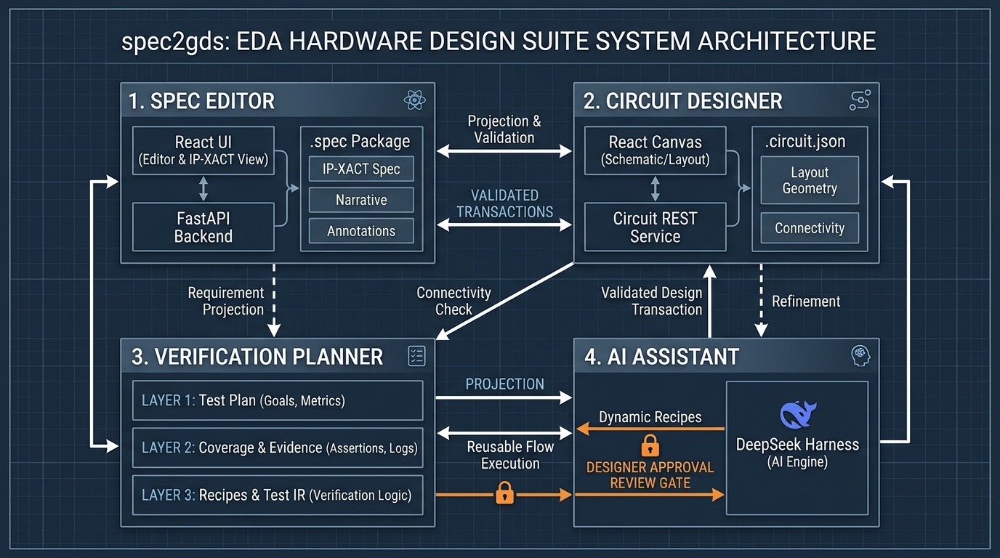
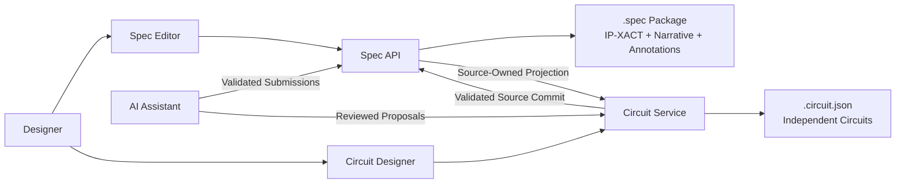

# spec2gds

`spec2gds` is a specification-first hardware design platform.
It combines a structured Spec Editor, an independent Circuit Designer, an integrated Verification Planner, and an AI Assistant with service-validated transactions.

## Learn the system

Start with the [short HTML tutorials](docs/tutorials/index.html). Nine core guides
take a 16-bit adder from its first Spec to a saved circuit and an RTL project.
Each guide includes a prepared start and a saved-state check. Optional guides
cover Circuit Designer, AI Assistant controls, Verification Planner, and SystemC.
See [environment setup and checkpoints](docs/tutorials/setup.html) before starting.

## System at a Glance





### Source of Truth Rules
- A `.spec` package is authoritative and saved by the Spec API.
- A local circuit is managed by the Circuit client and saved as `.circuit.json`.
- A source-bound circuit is an editable projection; **Save to Spec** commits validated changes back to the `.spec` container.
- Leaf-component previews remain read-only.
- Valid Spec assistant proposals save automatically by default. Launch with `--require-designer-approval` to require manual review.
- On a source-bound circuit, accepting a proposal stages a private draft; **Save to Spec** commits to the `.spec` file.

See the [Documentation Index](docs/README.md) for architecture and workflow references.

### Core Documentation Guides
- **Architecture**: [System Architecture](docs/architecture.md) and [End-to-End Flows](docs/flows.md).
- **Spec Editor**: [Spec Editor and Specification Service](docs/spec-editor.md).
- **Circuit Designer**: [Circuit Designer](docs/circuit-designer.md) and [Spec-Circuit Integration Architecture](docs/spec-circuit-integration-architecture.md).
- **Verification Planner**: [Verification Planner](docs/verification-planner.md).
- **AI Assistant**: [System Contract](docs/ai-assistant.md), [Operations & Verification](docs/ai-assistant-operations.md), and [Reusable Flows](docs/ai-assistant-flows.md).
- **Activities & Code Generation**: [Activity SDK](docs/activity-sdk.md), [Deterministic RTL Generation](docs/rtl-generation.md), [RTL Language Examples](docs/rtl-language-examples.md), and [SystemC Activities](docs/systemc-activities.md).
- **Development & Standards**: [Development Guide](docs/development.md), [Python Code Guide](docs/python-code-guide.md), [Testing Strategy](docs/testing-strategy.md), and [Canonical Terminology](docs/TERMINOLOGY.md).

### Verification Planner Service
The independent **Verification Planner** (`testplan-service`, port `6016`) provides snapshot-bound Test Plan authoring, Coverage & Evidence evaluation, and reference artifact generation.
Run it separately in the root virtual environment:

```bash
uv sync
uv run testplan-service --host 127.0.0.1 --port 6016 --storage-dir verification-data
uv run python -m pytest testplan-service/tests -q
```

## Prerequisites

Install these tools before setting up the repository:

- Python 3.12 or newer and [`uv`](https://docs.astral.sh/uv/);
- Node.js 24.2+ for the combined stack (Circuit alone requires 24+;
  Assistant alone also supports 22.19+ in the 22.x line);
- `setsid`, which the combined launcher uses to manage process groups;
- `lsof`, which the launcher uses when stopping untracked default-port
  listeners; and
- GNU Make and Verilator 5.x when running the complete Python/RTL test suite.

`uv` creates and manages the root `.venv`; the AI Assistant is a Node/Harness
product and has no Python environment.
The combined `scripts/serve-all.sh` launcher targets Linux or WSL because it
uses `setsid` and other Unix process-management commands.

## Set up and run everything

From a clean checkout, install the root Python project and both JavaScript
workspaces. The Assistant build compiles its host plugin and product-owned DSH
client bundle, so it is part of setup even when using the combined launcher.

```bash
# Run the complete environment setup (Python, Circuit Designer, DSH, and AI Assistant)
scripts/setup-all.sh
```

Use [Assistant operations](docs/ai-assistant-operations.md#setup-and-package-release)
for package setup, tests, state, and packaging. The application uses published
Harness packages. A local Harness checkout is not required.

The focused Python CLIs use the root uv environment and the built internal Harness
product. See [CLI workflows](docs/ai-assistant-operations.md#cli-flows) for architecture
approval, restricted content decisions, exact-file targets, conflicts, and run records.

To enable model-backed Assistant replies, export an API key before launch.
Without it, the Spec Editor and Circuit Designer still run and the Assistant
can open, but proposal generation reports that the key is missing.

```bash
export OPENAI_API_KEY="..."  # optional
scripts/serve-all.sh start
```

The launcher prints browser URLs using the detected LAN IPv4 address. From
another computer, open the printed Spec Editor (`6010`), Circuit Designer
(`6012`), or AI Assistant (`6013`) URL. If automatic detection selects the
wrong interface, set the advertised IP address or resolvable hostname first:

```bash
export SPEC2GDS_PUBLIC_HOST="192.168.1.50"  # or design-host.example
scripts/serve-all.sh start
```

Services bind to `0.0.0.0` by default. If the host firewall is enabled, allow
TCP ports `6010` through `6014` for the LAN. Logs and PID files are under
`logs/serve-all/`.

```bash
scripts/serve-all.sh stop
```

After rebuilding or changing source, replace the running development stack so
the browser cannot remain attached to an older Assistant bundle:

```bash
scripts/serve-all.sh restart
```

`start` refuses a partial or untracked stack on the default ports instead of
reporting success while an older process continues serving the UI.

The commands above use the tracked defaults in `config/services.json`. See
the [Development Guide](docs/development.md#2-shared-service-configuration) before using different
addresses or ports.

## Configure service addresses

The combined spec2gds launcher and its three applications read
[`config/services.json`](config/services.json).
It contains the host, port, and base path for each API and browser UI. Change
that file before starting the services when the defaults are not appropriate;
set `SPEC2GDS_SERVICE_CONFIG` to point at an alternate registry. Existing
per-service environment variables remain supported as overrides.

The tracked registry uses `host: "0.0.0.0"` for listeners and
`public_host: "auto"` for browser URLs. `SPEC2GDS_PUBLIC_HOST` overrides the
advertised host without changing the bind address. Never give another system a
URL containing `0.0.0.0`; use the detected/overridden public host instead.

Unified file logging is disabled by default. Enable concise operational logs
with `SPEC2GDS_LOGGING=ON`; add boundary data and model request/response
objects with `SPEC2GDS_LOG_LEVEL=debug`. All applications append to the single
file configured under `logging.file`. At its configured size limit the file is
compacted in place so only the newest complete entries remain; no backups are
created. Start the color-coded local viewer with:

```bash
uv run spec2gds-log-viewer
```

See the [Development Guide](docs/development.md#3-unified-logging-system) for filters, redaction, and the event
format.

The Circuit service can also run independently without the shared registry:

```bash
cd circuit-designer
CIRCUIT_DESIGNER_PORT=6011 npm run service
```

For a standalone Circuit UI with custom service URLs, set
`VITE_AI_ASSISTANT_UI_URL` and `VITE_CIRCUIT_DESIGNER_SERVICE_URL` before
starting or building the UI. The Tools link uses these exact URLs, including
HTTPS, custom ports, and base paths. Without explicit values it reads the
Circuit service directory; without a directory it falls back to the local
Assistant port 6013 and Circuit port 6011.

In independent mode, discover optional functionality through
`GET /api/circuit-designer/v1/capabilities`. Set
`SPEC2GDS_SERVICE_CONFIG` only when the legacy shared `/services` directory is
required.

The Spec Editor exposes **AI Assistant ↗** in its toolbar; Circuit Designer
uses **Tools → AI Assistant** in its compact menubar. Circuit Designer opens a
chat already bound to the active circuit. Spec Editor opens
a chat bound to the complete active Spec, or an unbound chat when no
specification is open. A document chat can create and refine supported entities
throughout its package. An entity's **Options → Explore with AI
Assistant** creates a narrower entity-bound conversation.

Unbound Assistant conversations discuss general hardware topics and create a new
specification document. Editing an existing document requires an exact document binding.
The system contract defines approval, scope, and validation rules.

Use `uv run spec2gds-spec-service --require-designer-approval` or
`scripts/serve-all.sh start --require-designer-approval` for restricted Spec content
saves. Idle views follow incoming changes. Inline drafts retain their text and
original revision. See [Spec Editor and Specification Service](docs/spec-editor.md#4-spec-service-revisions-and-approval-modes)
and [Assistant acceptance checks](docs/ai-assistant-operations.md#acceptance-matrix).
Configuration and execution limits are defined in
[Assistant operations](docs/ai-assistant-operations.md#configuration-and-limits).

## Run only the Spec Editor

Python development uses `uv` and the repository virtual environment.

```bash
uv sync
uv run spec2gds-server
```

Open `http://SERVER_IP:6010/editor`. Use **File → New Spec** or
**File → Open Spec**. New asks for a human-readable specification
name plus a server-local `.spec` path; Open asks only for the path. The visible
name is editable from the document cover and is stored separately from the
stable internal document ID. The File menu can also refresh the active package
from disk; accepted changes are saved automatically. **New Spec**
refuses to replace an existing path.

Use the top-level **Components → Options → Add component** and **Designs →
Options → Add design** commands to create name-only IP-XACT entities. New
entities use the editor defaults `spec2gds.local:work:<name>:1.0`, and new
designs become entry designs. These underlying IP-XACT identity fields are not
shown in the normal document view. Component and design sections provide
**Edit text** for the introductory paragraph beneath the heading. Entry-design
sections also provide **Add component instance**: enter a unique instance name
and choose any component defined at the specification’s top level.
Every design section begins with a revision-derived SVG circuit preview before
its authoritative instance and connection tables. The preview uses the same
automatic layout and visual exporter as Circuit Designer, can be expanded or
downloaded, or opened directly in Circuit Designer for round-trip editing. It
is regenerated after every accepted source change without
adding an image asset to the `.spec` package. Unsupported interface topology
is reported beside the preview; a connection that cannot be represented safely
shows an unavailable message while leaving the source tables accessible.
Saved Circuit Designer cycle edges appear in this preview and in SVG/PNG
exports. They divide the canvas into pipeline stages, default to
one implicit `clk` domain, and are persisted as validated semantic timing
annotations; see [the Circuit Designer guide](docs/circuit-designer.md#4-pipeline-stages-and-timing-analysis).
Leaf Component sections provide **Add wire port…**. Existing transaction and
structured ports remain visible and read-only. All ports appear in one Ports
table. Wire ports use an optional Range such as `DATA_WIDTH-1:0`. Use
**Save to Spec** to validate and save a draft, or **Cancel** to discard it.

Components and designs also expose **Options → Add SystemVerilog section…**.
The optional singleton is an IEEE 1800-2017 module body, edited with CodeMirror
and validated with Verilator 5.x when available. Saved bodies render inline;
Edit preserves rejected/stale drafts and Delete requires confirmation. See
[Spec Editor sections](docs/spec-editor.md#3-component-and-design-sections) for package layout, API, limits,
validation, and extension instructions.

The **Circuit** menu lists available designs and components. Eligible document
sections also expose **Options → Open in Circuit Designer** beside their headings, while
**Options** lists AI Assistant exploration, registered actions, and compatible Activities directly. Empty menus show **No options available**. The server exposes
interactive API docs at `http://SERVER_IP:6010/docs`.

Launching a leaf component shows one read-only component preview with its wire
ports attached to that component. Ports are not presented as separate design
boundary objects. Components that own an internal design continue to open that
internal design instead.

The current editor intentionally accepts the narrow IP-XACT profile authored
by spec2gds. To keep the document focused, it does not display bus interfaces,
port maps, channels, interface connections, or bus/abstraction protocol
definitions; existing values remain preserved in the `.spec` source. Circuit
Designer remains wire-only: unused transactional and structured ports are
reported as omitted, while a design that connects either family is rejected
with a validation diagnostic.

## Combined launcher details

After completing [the setup above](#set-up-and-run-everything), start the Spec
Editor, Circuit Designer service and UI, and AI Assistant together:

```bash
scripts/serve-all.sh start
```

Use `scripts/serve-all.sh restart` after rebuilding or changing source; it
stops tracked and stale default-port listeners before starting the new stack.

Stop the tracked processes and any other services listening on the same default
ports with:

```bash
scripts/serve-all.sh stop
```

Each service reads its address from `config/services.json`; the launcher's
displayed URLs and untracked-listener cleanup cover the tracked default ports
`6010` through `6014`. It writes PID files and per-service logs
under `logs/serve-all/`. The launcher prints the three application URLs but
does not open them in a browser. Set `OPENAI_API_KEY` before starting if the AI
Assistant should make OpenAI requests.

## Build specification Activities

Python teams can build host-neutral Activities against a deterministic, full
source snapshot. Activity code selects information through the stable
`context.spec.high` query API or the detailed typed `context.spec.low` API, and
returns a validated report, artifacts, and optional review-gated source
proposals. It never reads or mutates the live editor session.

The public contracts live in `spec2gds.spec.activities`. See the
[Activity SDK guide](docs/activity-sdk.md). The SDK intentionally does not
choose a queue, worker process, storage service, or monitoring mechanism.

The Spec Editor supplies the product host for these contracts. Open a design,
choose **Options**, and select a compatible Activity. The menu shows availability warnings and disables unavailable Activities. Accepted runs move to the **Activity** tab, where queued and
running jobs can be cancelled and reports update live. Completed Activity
output is left on the server at the absolute path shown in the report; it is
not downloaded by the browser.

The host persists its single-worker queue in
`generated/.spec2gds/activity-jobs.sqlite3` and immutable run inputs under
`generated/.spec2gds/snapshots/` by default. Queued work survives a service
restart, interrupted running work is requeued from its saved snapshot, and
terminal provenance is saved inside the `.spec` package without changing its
source revision hash. Configure the root and optional extension registrations
through the `activities` object in `config/services.json`.

The deterministic `systemc.generate_at_skeleton` Activity generates a
structural C++17/SystemC TLM 2.0 AT project for one selected design. It preserves
reachable hierarchy, creates supported initiator/target socket bindings, and
publishes a managed project beside the active package under
`<spec-folder>/systemc-at/<document-name>/<entity-name>/`. The Activity returns a
typed report and JSON report artifact. Phase one has no LLM dependency or inferred
performance behavior. Packaged Jinja2 templates format normalized render
contexts while all topology and naming decisions remain in deterministic
Python code. See the [SystemC Activities guide](docs/systemc-activities.md)
for invocation, supported topology, template constraints, and build
instructions.

The `systemc.generate_cycle_accurate` Activity generates a native SystemC
`SC_MODULE` project from a selected design's wire hierarchy and stored
SystemVerilog bodies. It uses a configured Slang-enabled CIRCT installation and
a CIRCT-linked emitter, and publishes separately under
`<spec-folder>/systemc-rtl/<document-name>/<entity-name>/`. Set `CIRCT_PREFIX` to
the installation containing `circt-verilog` and `spec2gds-systemc-emit`; build
the generated project against SystemC 2.3.3 or later. The
[SystemC Activities guide](docs/systemc-activities.md) gives
the source profile, setup, invocation, and build instructions.

The deterministic `rtl.generate` Activity generates a SystemVerilog 2017
project for any selected design. It emits one reusable module per
reachable component, preserves component-owned hierarchy, connects supported
ad-hoc physical wire nets, and publishes a managed project under
`<spec-folder>/rtl/<document-name>/<entity-name>/`. Leaf outputs use explicit
compile-safe defaults unless explicit component/design SV bodies provide
behavior; no clocks, resets, parameters, or testbench are inferred. Bus
interfaces, non-wire ports, symbolic ranges, and
unsupported net shapes are rejected during preflight. See the
[Deterministic RTL Generation guide](docs/rtl-generation.md) for the exact
source profile, report contract, invocation, semantics, and required Verilator 5.x lint
workflow. Generate examples under the configured Activity scratch directory with:

```bash
uv run python scripts/generate_rtl_examples.py --check
uv run python scripts/generate_rtl_examples.py --update
```

For frontend work:

```bash
# terminal 1
uv run spec2gds-server --reload

# terminal 2
cd circuit-designer
npm install
npm run dev:editor
```

Open `http://SERVER_IP:6015`. Rebuild the Python-packaged editor with
`npm run build:editor` before committing UI changes.

The sample **Export target details (JSON)** Activity exports all source Sections
for the selected Component or Design and its dependencies. Use **Download JSON**
on its `spec.summary` artifact in the Activity view. The export uses an immutable
saved snapshot, includes hidden protocol details and SystemVerilog content, and
does not run a compiler or change source.

## Run only Circuit Designer

Node.js 24 or newer is required.

```bash
cd circuit-designer
npm install
npm run dev
```

Open `http://SERVER_IP:6012`. The app starts with an empty circuit. Use
**Edit → Begin editing** to edit it, **File → Save changes** to accept the
draft and download a canonical file, or **File → Open circuit** to load an
existing `.circuit.json`.

The canvas has no separate interaction modes. Its compact menubar contains
File, Edit, Components, Selection, Connect, Route, Timing, View, Tools, and Help; the
Inspector defaults closed so the canvas can span the window. Direct gestures
include dragging between free ports, dragging a selected route, wheel zoom,
left-drag pan on empty canvas, and target-aware right-click menus for canvas,
components, selections, routes, bends, junctions, and ports. The Context Menu
key and Shift+F10 provide the same menus from the keyboard. Use **Edit →
Preferences → Actions and shortcuts** to configure shared keyboard and mouse
inputs; right-click itself is reserved for context menus. See the
[Circuit Designer guide](docs/circuit-designer.md).

To use **Open circuit** from the Spec Editor, run both services. A
design projection supports **Edit → Begin Editing** and **Save to
Specification**; the save validates and atomically updates IP-XACT topology and
its semantic layout annotation. Leaf-component previews remain read-only. The
default Spec API (`6010`) and Circuit service (`6011`) already use compatible
settings from `config/services.json`. See the
[Spec-Circuit Integration Architecture](docs/spec-circuit-integration-architecture.md) for
save, conflict, layout, and recovery behavior.

## Run only the optional AI Assistant

```bash
# Setup all workspaces including DeepSeek Harness and AI Assistant
scripts/setup-all.sh

cd ai-assistant
export OPENAI_API_KEY="..."
npm run dev
```

Open `http://SERVER_IP:6013`. Repeat `npm run build` after changing Assistant
server or web code.

The AI Assistant is optional and does not sit on either editor's critical path.
It checks the configured Spec and Circuit health endpoints when its workspace
chooser opens. Circuit chats can prepare reviewed logical proposals for
component definitions and instances, top-level ports, nets, and endpoint
connections. Spec chats can be bound either to the complete document for
top-level creation or to one existing entity for focused edits. See
[ai-assistant/README.md](ai-assistant/README.md).

## Verify changes

After implementation, run the local fast profile and relevant integration
scopes. Run full regression for broad or high-risk changes and release preparation.

```bash
scripts/test-all.sh fast
scripts/test-all.sh integration --scope spec,assistant
scripts/test-all.sh regression
scripts/test-all.sh regression --dry-run
scripts/test-all.sh integration --scope spec --coverage
```

Fast includes two deterministic real-service Spec Editor smoke flows and exactly
three short live model browser checks. Full regression
includes broader live evaluation. Use Node.js 24.2+ and set `OPENAI_API_KEY` in
the invoking environment. Missing required prerequisites produce an incomplete
result and nonzero exit status. Each run writes a report to an ignored repository
`TEMP_tests-*` directory by default; `--output` selects a new or empty directory
under an ignored repository `TEMP_` folder. See
[the software testing strategy](docs/testing-strategy.md) for scope selection,
coverage limits, and capability matrix.

The legacy fundamental and extensive tiers remain available. The two tiers
are complementary; `all` retains its legacy meaning and runs each once.

```bash
scripts/test-all.sh fundamental       # default: fast Python and JS unit/API checks
scripts/test-all.sh extensive         # toolchains, CLI, Harness integration, browsers
scripts/test-all.sh all               # both tiers
scripts/test-all.sh extensive --no-browser
scripts/test-all.sh all --dry-run      # inspect the selected commands
```

Run `scripts/setup-all.sh` first. Fundamental does not build frontends or run
hardware simulations. Extensive requires Verilator 5.x and GNU Make; optional
SystemC/CIRCT tests retain their configuration-based skips. Browser dependencies
come from Circuit Designer setup, including the Assistant's browser checks.
Both tiers use deterministic model fixtures and require no model API key.
See [the test-tier guide](docs/development.md#test-tiers) for selection rules,
prerequisites, and separately invoked Spec service/Spec Editor scenarios and evaluations.

The existing focused and full-suite commands remain available:

```bash
uv run python -m pytest -q tests testplan-service/tests
uv run ruff check spec2gds runtime/src
uv run vulture spec2gds runtime/src --min-confidence 90

cd circuit-designer
npm run generate:check
npm test
npm run test:e2e          # Circuit Designer only
npm run test:e2e:editor   # Spec Editor only

cd ../ai-assistant
npm run typecheck
npm test
npm run build
npm run test:harness
# Browser dependency setup: docs/ai-assistant-operations.md#browser-checks
npm run test:ui
npm run eval -- --output ../TEMP_assistant_eval

# Separately invoked Spec service and editor UI scenarios
cd ..
bash tests/ui-scenarios/run-test.sh --scenario automatic
bash tests/ui-scenarios/run-test.sh --scenario restricted --approval-mode review
```

Detailed source locations and focused commands are in
[docs/development.md](docs/development.md).

Readable document and entity names are independent of stable internal IDs and hardware symbols.
Creation accepts a Name; display renames preserve the saved source path. See
[Names and identifiers](docs/naming-and-identifiers.md) for naming rules, migration,
name-based commands, and technical details.
