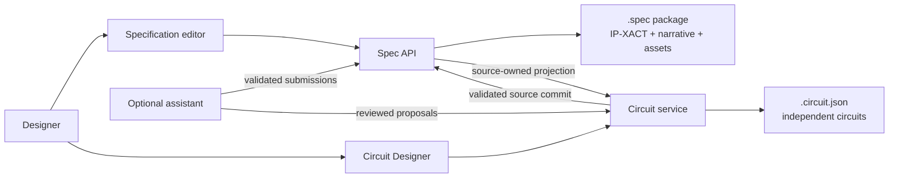

# spec2gds

`spec2gds` is a specification-first hardware design workspace. It combines a
structured specification editor, an independent circuit editor, and an
optional assistant with owner-validated submissions.

The repository no longer ships a gallery of demos or benchmark corpora. New
sample applications are developed one at a time through the complete system,
then kept only when they remain useful and reproducible.

## System at a glance



The two editors have different source-of-truth rules:

- A `.spec` package is owned and saved by the Spec API.
- A local circuit is owned by its client and saved as `.circuit.json`.
- A source-bound circuit is an editable projection; **Save to Specification**
  commits validated topology and layout changes back to the `.spec` package.
- Leaf-component previews and unsupported projections remain read-only.
- Valid Spec assistant submissions save automatically by default. Launch with
  `--require-human-approval` to require review. On a source-bound Circuit,
  Accept stages a private draft; **Save to Specification** writes the package.

See [the documentation index](docs/README.md) for the architecture and flow
details.

The AI Assistant is implemented as a focused DeepSeek Harness product with
deterministic domain context, strict proposal schemas, review diffs, and
conversation archive/rename support. It owns the canonical `ai-assistant/`
workspace and port `6013`; see the [AI Assistant guide](docs/ai-assistant.md).

In a browser chat, ask **“Create a new spec document”** and include the circuit
description. In automatic mode the Assistant creates the package under
`SPEC_DOCUMENT_ROOT` and continues the request in a new document-bound chat.
Restricted owners show a creation card for review. No existing package needs
to be open. Circuit changes retain their existing approval and save workflow.
See [specification creation from chat](docs/assistant-spec-creation.md) for
configuration and recovery.

For proposed fixed workflows and durable event-driven agents, read the
[agentic systems architecture report](docs/agentic-systems-architecture-report.md).
It records the broader design discussion. For implemented conversation agents
and native goals with HTTP monitoring and waiting, use the [Phase 2 guide](docs/event-driven-assistant-phase2.md).

The [three-phase event driven assistant plan](docs/event-driven-assistant-plan.md)
updates `orchestrated` and `goal` first, then adds external triggers and
durable waiting, then visual tooling. Workflow setup is deferred.

For a focused explanation of how the two editors cooperate, including launch,
projection, save, refresh, conflict, and security diagrams, read
[Spec Editor and Circuit Designer integration architecture](docs/spec-circuit-integration-architecture.md).

Circuit Designer's application shell is also available as the compiled private
package `@spec2gds/circuit-app-react`. It can be embedded with host-provided
file, preference, source, telemetry, event, and tool adapters; see
[Embedding Circuit Designer](docs/circuit-designer-embedding.md). Its
[Blueprint Slate visual profile](docs/circuit-designer-visual-profile.md) and
[Chipmind feature-gap inventory](docs/circuit-designer-chipmind-gap-analysis.md)
document the current professionalization direction.

The independent **Verification Planner** (`testplan-service`) implements the complete
three-layer verification architecture specified in [Verification Planner Architecture](docs/testplan-service-architecture.md),
[Layer 1 Test Plan](docs/verification-layer-1-test-plan.md),
[Layer 2 Coverage & Evidence](docs/verification-layer-2-coverage.md), and
[Layer 3 Implementation & Plugins](docs/verification-layer-3-implementation.md). It features
content-addressed Activity Snapshot binding, manual requirement and intent authoring, multi-family coverage
objectives and policies, campaigns, language-neutral Test IR ASTs, target bindings, pluggable backend generators,
immutable P1, C1, and I1 review checkpoints, deterministic status evaluation, and a high-density Blueprint Slate UI on port `6016`.

## Prerequisites

Install these tools before setting up the repository:

- Python 3.12 or newer and [`uv`](https://docs.astral.sh/uv/);
- Node.js 22.19+ or 24+ (including npm);
- `setsid`, which the combined launcher uses to manage process groups;
- `lsof`, which the launcher uses when stopping untracked default-port
  listeners; and
- GNU Make and Verilator 5.x when running the complete Python/RTL test suite.

`uv` creates and manages the root `.venv`; the AI Assistant is a Node/Harness
product and has no Python environment.
The combined `scripts/serve-all.sh` launcher targets Linux or WSL because it
uses `setsid` and other Unix process-management commands.

## Set up and run everything

From a clean checkout, install the root Python project and both JavaScript
workspaces. The Assistant build compiles its host plugin and product-owned DSH
client bundle, so it is part of setup even when using the combined launcher.

```bash
# Run the complete environment setup (Python, Circuit Designer, DSH, and AI Assistant)
scripts/setup-all.sh
```

See [AI Assistant](docs/ai-assistant.md) for Harness checkout setup, owner
allowlists, tests, state, and packaging constraints.

For a single focused Spec turn, the two Python CLIs live in
[`scripts/spec2gds_assistant.py`](scripts/spec2gds_assistant.py) and
[`scripts/spec2gds_spec.py`](scripts/spec2gds_spec.py). They use the root
`uv`/`.venv` environment and the built internal Harness product:

```bash
uv sync
scripts/setup-all.sh
export OPENAI_API_KEY="..."
uv run spec2gds-assistant ./work/timer --preset focused -- "Propose a timer."
# For a restricted turn, leave the proposal pending for an explicit decision:
uv run spec2gds-assistant ./work/timer --require-human-approval -- "Refine the timer."
uv run spec2gds-spec reviews ./work/timer
uv run spec2gds-spec approve ./work/timer proposal_...
# Or discard one pending proposal:
uv run spec2gds-spec reject ./work/timer proposal_...
```

The assistant command creates or opens the workspace's `.spec` and saves valid
submissions automatically unless `--require-human-approval` is set. The Spec
command owns explicit review decisions and paginated history. See the
[focused Spec workspace guide](docs/spec-workspace-cli.md) for exact-file targets,
conflicts, saved run records, and future `agent_eval` integration.

To enable model-backed Assistant replies, export an API key before launch.
Without it, the Spec Editor and Circuit Designer still run and the Assistant
can open, but proposal generation reports that the key is missing.

```bash
export OPENAI_API_KEY="..."  # optional
scripts/serve-all.sh start
```

The launcher prints browser URLs using the detected LAN IPv4 address. From
another computer, open the printed Spec Editor (`6010`), Circuit Designer
(`6012`), or AI Assistant (`6013`) URL. If automatic detection selects the
wrong interface, set the advertised IP address or resolvable hostname first:

```bash
export SPEC2GDS_PUBLIC_HOST="192.168.1.50"  # or design-host.example
scripts/serve-all.sh start
```

Services bind to `0.0.0.0` by default. If the host firewall is enabled, allow
TCP ports `6010` through `6014` for the LAN. Logs and PID files are under
`logs/serve-all/`.

```bash
scripts/serve-all.sh stop
```

After rebuilding or changing source, replace the running development stack so
the browser cannot remain attached to an older Assistant bundle:

```bash
scripts/serve-all.sh restart
```

`start` refuses a partial or untracked stack on the default ports instead of
reporting success while an older process continues serving the UI.

The commands above use the tracked defaults in `config/services.json`. See
[Service configuration](docs/service-configuration.md) before using different
addresses or ports.

## Configure service addresses

The combined spec2gds launcher and its three applications read
[`config/services.json`](config/services.json).
It contains the host, port, and base path for each API and browser UI. Change
that file before starting the services when the defaults are not appropriate;
set `SPEC2GDS_SERVICE_CONFIG` to point at an alternate registry. Existing
per-service environment variables remain supported as overrides.

The tracked registry uses `host: "0.0.0.0"` for listeners and
`public_host: "auto"` for browser URLs. `SPEC2GDS_PUBLIC_HOST` overrides the
advertised host without changing the bind address. Never give another system a
URL containing `0.0.0.0`; use the detected/overridden public host instead.

Unified file logging is disabled by default. Enable concise operational logs
with `SPEC2GDS_LOGGING=ON`; add boundary data and owned OpenAI request/response
objects with `SPEC2GDS_LOG_LEVEL=debug`. All applications append to the single
file configured under `logging.file`. At its configured size limit the file is
compacted in place so only the newest complete entries remain; no backups are
created. Start the color-coded local viewer with:

```bash
uv run spec2gds-log-viewer
```

See [the logging guide](docs/logging.md) for filters, redaction, and the event
format.

The Circuit service can also run independently without the shared registry:

```bash
cd circuit-designer
CIRCUIT_DESIGNER_PORT=6011 npm run service
```

For a standalone Circuit UI with custom service URLs, set
`VITE_AI_ASSISTANT_UI_URL` and `VITE_CIRCUIT_DESIGNER_SERVICE_URL` before
starting or building the UI. The Tools link uses these exact URLs, including
HTTPS, custom ports, and base paths. Without explicit values it reads the
Circuit service directory; without a directory it falls back to the local
Assistant port 6013 and Circuit port 6011.

In independent mode, discover optional functionality through
`GET /api/circuit-designer/v1/capabilities`. Set
`SPEC2GDS_SERVICE_CONFIG` only when the legacy shared `/services` directory is
required.

The Spec Editor exposes **AI Assistant ↗** in its toolbar; Circuit Designer
uses **Tools → AI Assistant** in its compact menubar. Circuit Designer opens a
chat already bound to the active circuit. Spec Editor opens
a chat bound to the complete active specification, or an unbound chat when no
specification is open. A document chat can create and refine supported entities
throughout its package. An entity's **Options → More actions… → Explore with AI
Assistant** creates a narrower entity-bound conversation.

Unbound Assistant conversations fail closed with no design context or proposal
tools; mutations require a binding to an exact editor document or entity. The
browser offers focused, goal, and orchestrated presets;
all preserve owner validation and revision checks. Spec owners save valid
submissions automatically by default; restricted owners retain explicit review.
Fully specified automatic requests skip confirmation cards and record defaults
as assumptions. Missing required values still request clarification. Operation
shapes come from the bound owner
through the [owner schema contract](docs/assistant-owner-operation-contract.md).

Use `uv run spec2gds-editor --require-human-approval` or
`bash scripts/serve-all.sh start --require-human-approval` for restricted mode.
Chats stay bound to their package when another specification opens. Idle views
follow incoming changes, while inline drafts retain their text and original
revision. See [iterative refinement](docs/spec-editor-iterative-refinement.md)
and its [test plan](docs/spec-editor-iterative-refinement-test-plan.md).
Focused turns are capped at three model steps, with one additional step only
after a visible structured-question call, and every model response is capped
at 1,200 output tokens. Goal and orchestrated work use separate bounded
execution budgets. See the Assistant guide for the full capability and limit
matrix.

## Run only the specification editor

Python development uses `uv` and the repository virtual environment.

```bash
uv sync
uv run spec2gds-server
```

Open `http://SERVER_IP:6010/editor`. Use **File → New Specification** or
**File → Open Specification**. New asks for a human-readable specification
name plus a server-local `.spec` path; Open asks only for the path. The visible
name is editable from the document cover and is stored separately from the
stable internal document ID. The File menu can also refresh the active package
from disk; accepted changes are saved automatically. **New Specification**
refuses to replace an existing path.

Use the top-level **Components → Options → Add component** and **Designs →
Options → Add design** commands to create name-only IP-XACT entities. New
entities use the editor defaults `spec2gds.local:work:<name>:1.0`, and new
designs become entry designs. These underlying IP-XACT identity fields are not
shown in the normal document view. Component and design sections provide
**Edit text** for the introductory paragraph beneath the heading. Entry-design
sections also provide **Add component instance**: enter a unique instance name
and choose any component defined at the specification’s top level.
Every design section begins with a revision-derived SVG circuit preview before
its authoritative instance and connection tables. The preview uses the same
automatic layout and visual exporter as Circuit Designer, can be expanded or
downloaded, or opened directly in Circuit Designer for round-trip editing. It
is regenerated after every accepted source change without
adding an image asset to the `.spec` package. Unsupported interface topology
is reported beside the preview; a connection that cannot be represented safely
shows an unavailable message while leaving the source tables accessible.
Saved Circuit Designer cycle edges appear in this preview and in SVG/PNG
exports. They divide the canvas into pipeline stages, default to
one implicit `clk` domain, and are persisted as validated semantic timing
annotations; see [the timing-stage guide](docs/circuit-designer-timing-stages.md).
Leaf-component sections provide separate **Add wire port**, **Add
transactional port**, and **Add structured port** commands. All ports are shown
as editable rows in one Ports table. Wire ports use
an optional Range such as `DATA_WIDTH-1:0`; transactional ports capture their
initiative and optional kind; structured ports are generated as packed structs
with their required IP-XACT type definition maintained internally. Save
validates and persists the complete change, while Cancel discards the
browser-only draft.

Components and designs also expose **Options → Add section → SystemVerilog**.
The optional singleton is an IEEE 1800-2017 module body, edited with CodeMirror
and validated with Verilator 5.x when available. Saved bodies render inline;
Edit preserves rejected/stale drafts and Delete requires confirmation. See the
[entity sections guide](docs/entity-sections.md) for package layout, API, limits,
validation, and extension instructions.

The **Circuit** menu lists available designs and components. Eligible document
sections also expose **Options → Open circuit** beside their headings, while
**Options → More actions** opens the entity action workflow. The server exposes
interactive API docs at `http://SERVER_IP:6010/docs`.

Launching a leaf component shows one read-only component preview with its wire
ports attached to that component. Ports are not presented as separate design
boundary objects. Components that own an internal design continue to open that
internal design instead.

The current editor intentionally accepts the narrow IP-XACT profile authored
by spec2gds. To keep the document focused, it does not display bus interfaces,
port maps, channels, interface connections, or bus/abstraction protocol
definitions; existing values remain preserved in the `.spec` source. Circuit
Designer remains wire-only: unused transactional and structured ports are
reported as omitted, while a design that connects either family is rejected
with a validation diagnostic.

## Combined launcher details

After completing [the setup above](#set-up-and-run-everything), start the Spec
Editor, Circuit Designer service and UI, and AI Assistant together:

```bash
scripts/serve-all.sh start
```

Use `scripts/serve-all.sh restart` after rebuilding or changing source; it
stops tracked and stale default-port listeners before starting the new stack.

Stop the tracked processes and any other services listening on the same default
ports with:

```bash
scripts/serve-all.sh stop
```

Each service reads its address from `config/services.json`; the launcher's
displayed URLs and untracked-listener cleanup cover the tracked default ports
`6010` through `6014`. It writes PID files and per-service logs
under `logs/serve-all/`. The launcher prints the three application URLs but
does not open them in a browser. Set `OPENAI_API_KEY` before starting if the AI
Assistant should make OpenAI requests.

## Build specification Activities

Python teams can build host-neutral Activities against a deterministic, full
source snapshot. Activity code selects information through the stable
`context.spec.high` query API or the detailed typed `context.spec.low` API, and
returns a validated report, artifacts, and optional review-gated source
proposals. It never reads or mutates the live editor session.

The public contracts live in `spec2gds.agent_spec.activities`. See the
[Activity Snapshot v1 format](docs/activity-snapshot-v1.md) and
[Activity SDK guide](docs/activity-sdk.md). The SDK intentionally does not
choose a queue, worker process, storage service, or monitoring mechanism.

The Spec Editor supplies the product host for these contracts. Open a design,
choose **Options → More actions… → Launch activity…**, and select an
available generator. The dialog shows preflight failures without allowing an
invalid run. Accepted runs move to the **Activity** tab, where queued and
running jobs can be cancelled and reports update live. Completed generator
output is left on the server at the absolute path shown in the report; it is
not downloaded by the browser.

The host persists its single-worker queue in
`generated/.spec2gds/activity-jobs.sqlite3` and immutable run inputs under
`generated/.spec2gds/snapshots/` by default. Queued work survives a service
restart, interrupted running work is requeued from its saved snapshot, and
terminal provenance is saved inside the `.spec` package without changing its
source revision hash. Configure the root and optional extension registrations
through the `activities` object in `config/services.json`.

The deterministic `systemc.generate_at_skeleton` Activity generates a
structural C++17/SystemC TLM 2.0 AT project for one selected design. It preserves
reachable hierarchy, creates supported initiator/target socket bindings, and
publishes a managed project beside the active package under
`<spec-folder>/systemc-at/<document-id>/<design-id>/`. The Activity returns a
typed report and JSON report artifact. Phase one has no LLM dependency or inferred
performance behavior. Packaged Jinja2 templates format normalized render
contexts while all topology and naming decisions remain in deterministic
Python code. See the [SystemC AT Activity guide](docs/systemc-at-activity.md)
for invocation, supported topology, template constraints, and build
instructions.

The `systemc.generate_cycle_accurate` Activity generates a native SystemC
`SC_MODULE` project from a selected design's wire hierarchy and stored
SystemVerilog bodies. It uses a configured Slang-enabled CIRCT installation and
a CIRCT-linked emitter, and publishes separately under
`<spec-folder>/systemc-rtl/<document-id>/<design-id>/`. Set `CIRCT_PREFIX` to
the installation containing `circt-verilog` and `spec2gds-systemc-emit`; build
the generated project against SystemC 2.3.3 or later. The
[cycle-accurate SystemC guide](docs/systemc-cycle-accurate-activity.md) gives
the source profile, setup, invocation, and build instructions.

The deterministic `rtl.generate` Activity generates a SystemVerilog 2017
project for any selected design. It emits one reusable module per
reachable component, preserves component-owned hierarchy, connects supported
ad-hoc physical wire nets, and publishes a managed project under
`<spec-folder>/rtl/<document-id>/<design-id>/`. Leaf outputs use explicit
compile-safe defaults unless explicit component/design SV bodies provide
behavior; no clocks, resets, parameters, or testbench are inferred. Bus
interfaces, non-wire ports, symbolic ranges, and
unsupported net shapes are rejected during preflight. See the
[RTL Generation Activity guide](docs/rtl-generation-activity.md) for the exact
source profile, report contract, invocation, and required Verilator 5.x lint
workflow. The
[one-cycle and two-cycle semantics examples](docs/rtl-semantics-examples.md)
show the body-only source contract and can be generated under the configured
Activity workspace with:

```bash
uv run python scripts/generate_rtl_examples.py --check
uv run python scripts/generate_rtl_examples.py --update
```

For frontend work:

```bash
# terminal 1
uv run spec2gds-server --reload

# terminal 2
cd circuit-designer
npm install
npm run dev:editor
```

Open `http://SERVER_IP:6015`. Rebuild the Python-packaged editor with
`npm run build:editor` before committing UI changes.

## Run only Circuit Designer

Node.js 24 or newer is required.

```bash
cd circuit-designer
npm install
npm run dev
```

Open `http://SERVER_IP:6012`. The app starts with an empty circuit. Use
**Edit → Begin editing** to edit it, **File → Save changes** to accept the
draft and download a canonical file, or **File → Open circuit** to load an
existing `.circuit.json`.

The canvas has no separate interaction modes. Its compact menubar contains
File, Edit, Components, Selection, Connect, Route, View, Tools, and Help; the
Inspector defaults closed so the canvas can span the window. Direct gestures
include dragging between free ports, dragging a selected route, wheel zoom,
left-drag pan on empty canvas, and target-aware right-click menus for canvas,
components, selections, routes, bends, junctions, and ports. The Context Menu
key and Shift+F10 provide the same menus from the keyboard. Use **Edit →
Preferences → Actions and shortcuts** to configure shared keyboard and mouse
inputs; right-click itself is reserved for context menus. See the
[Circuit Designer interaction guide](docs/circuit-designer-interactions.md).

To use **Open circuit** from the specification editor, run both services. A
design projection supports **Edit → Begin Editing** and **Save to
Specification**; the save validates and atomically updates IP-XACT topology and
its semantic layout annotation. Leaf-component previews remain read-only. The
default Spec API (`6010`) and Circuit service (`6011`) already use compatible
settings from `config/services.json`. See the
[specification synchronization guide](docs/circuit-designer-spec-sync.md) for
save, conflict, layout, and recovery behavior.

## Run only the optional AI Assistant

```bash
# Setup all workspaces including DeepSeek Harness and AI Assistant
scripts/setup-all.sh

cd ai-assistant
export OPENAI_API_KEY="..."
npm run dev
```

Open `http://SERVER_IP:6013`. Repeat `npm run build` after changing Assistant
server or web code.

The AI Assistant is optional and does not sit on either editor's critical path.
It checks the configured Spec and Circuit health endpoints when its workspace
chooser opens. Circuit chats can prepare reviewed logical proposals for
component definitions and instances, top-level ports, nets, and endpoint
connections. Spec chats can be bound either to the complete document for
top-level creation or to one existing entity for focused edits. See
[ai-assistant/README.md](ai-assistant/README.md).

## Verify changes

Install Verilator 5.x and GNU Make before running the Python suite; RTL Activity
tests execute the generated `make lint` target without a skip.

```bash
uv run python -m pytest -q
uv run ruff check spec2gds runtime/src
uv run vulture spec2gds runtime/src --min-confidence 90

cd circuit-designer
npm run generate:check
npm test
npm run test:e2e          # Circuit Designer only
npm run test:e2e:editor   # specification editor only

cd ../ai-assistant
npm run typecheck
npm test
npm run build
npm run test:harness
npm run eval -- --output /tmp/spec2gds-assistant-eval

# Separately invoked UI pass; deferred for the iterative-refinement phase
cd ..
bash tests/ui-scenarios/run-test.sh --scenario automatic
bash tests/ui-scenarios/run-test.sh --scenario restricted --approval-mode review
```

Detailed source locations and focused commands are in
[docs/development.md](docs/development.md).

HTTP condition monitoring, durable waiting, and controlled retries are implemented in [the Phase 2 guide](docs/event-driven-assistant-phase2.md).

For visual event setup, causal inspection, and hands-on examples of both presets, see [the event/plugin guide](docs/event-driven-assistant-system.md) and [the tutorial](docs/event-driven-assistant-tutorial.md).
