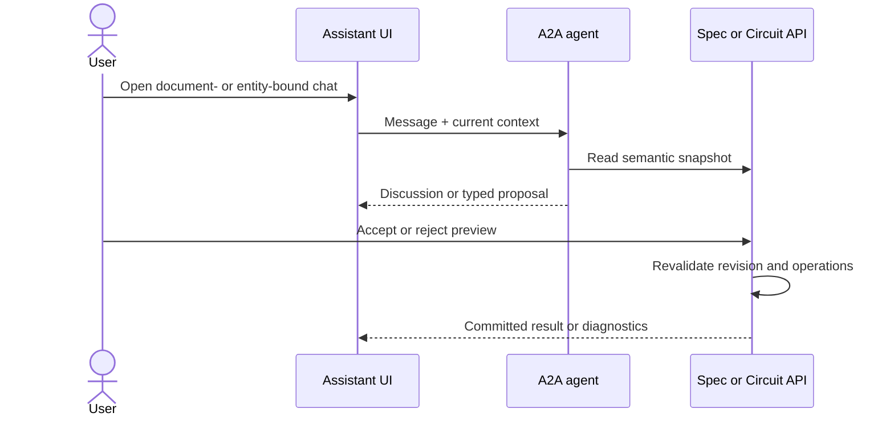

# Optional AI Assistant

This local application provides document- or entity-bound conversations and
reviewed change proposals for the Spec Editor and Circuit Designer. Both
editors remain fully usable when it is stopped.

## Run

Requirements: Python 3.12+, `uv`, Node.js 24+, npm, and at least one owning
editor service.

```bash
uv sync
cd web
npm install
npm run build
cd ..

export OPENAI_API_KEY="..."
uv run spec2gds-ai-assistant
```

Open <http://127.0.0.1:4200>. For frontend development, run `npm run dev` in
`web/` and open <http://127.0.0.1:4201>.

The default hosted addresses come from `../config/services.json`. On opening
an unbound chat, the Assistant probes the configured Spec and Circuit health
endpoints, displays their status, and pre-fills the corresponding connection
form. Set `SPEC2GDS_SERVICE_CONFIG` to use another registry.

When creating a chat directly in the AI Assistant, first choose **Circuit
Designer** or **Spec Editor**. Circuit chats accept a Circuit Designer service
URL and document ID. The Spec Editor toolbar opens a chat with the complete
active specification as context. It can propose a new top-level component or
design, including initial instances that reference existing component VLNVs.
To change an existing entity, use its **Options → More actions… → Explore with
AI Assistant** command; it supplies the document and entity identity
automatically. A manual entity connection form is also available for known
identifiers.

The default model is `gpt-4o-mini`; override it with `OPENAI_MODEL`. The local
SQLite database defaults to `data/assistant.db`.

The API serves the production frontend from `web/dist`, which is why the setup
above runs `npm run build`. `npm run dev` uses port `4201` only for frontend
development and does not replace the API/A2A service on port `4200`.

Unified logging uses the root `config/services.json`. Set
`SPEC2GDS_LOGGING=ON` and optionally `SPEC2GDS_LOG_LEVEL=debug` before starting
the service to include Assistant activity in the shared log. Debug mode records
the redacted request immediately before each OpenAI call and its response
immediately afterward.

## Flow and safety



Conversation does not mutate source. A user must request a proposal and accept
its preview. The owning API performs the final revision and validation checks.
If an owning editor rejects a preview, the review card shows its returned error
codes, messages, and affected element, operation, or path so the next proposal
can address the concrete failure.

Circuit Designer chats can propose logical component definitions, placed
instances, component pins, top-level design ports, nets, and endpoint
connections. The Assistant maps short requests such as “add a component,”
“create an input port,” and “connect these ports” to typed Circuit Designer
operations. Existing semantic IDs and the endpoint catalog in the current
snapshot are authoritative. Geometry, routes, labels, and layout are not
AI-authored.

Document-bound Spec Editor chats can propose only a new top-level component or
design. A new design may include all requested initial instances as one atomic
operation; each instance must use the exact VLNV of an existing component.
Existing entities remain read-only in that scope. Entity-bound chats can propose
metadata, component-instance, and editor-profiled port changes. Port proposals
use the same Wire, Transactional, and packed Structured families as the editor.
Port names and families remain fixed, and ports on components with internal
designs remain read-only. Specification renaming remains outside both workflows.

For design connections, available component references include their exact
ports and interfaces. Ad-hoc connections use port endpoints, while interface
connections use bus-interface endpoints; the Assistant does not invent missing
endpoint names or propose connections when directions or interfaces are
incompatible.

Spec and Circuit service URLs must match the allowlists derived from the shared
registry. `SPEC_SERVICE_ALLOWLIST` and `CIRCUIT_SERVICE_ALLOWLIST` can override
them. The reference deployment has no user authentication.

## Useful configuration

| Variable | Default |
| --- | --- |
| `OPENAI_MODEL` | `gpt-4o-mini` |
| `ASSISTANT_HOST` | `127.0.0.1` |
| `ASSISTANT_PORT` | `4200` |
| `ASSISTANT_DATABASE_PATH` | `data/assistant.db` |
| `ASSISTANT_WEB_DIST_PATH` | `web/dist` |
| `CIRCUIT_REQUEST_TIMEOUT_SECONDS` | `30` |
| `SPEC_REQUEST_TIMEOUT_SECONDS` | `30` |
| `SPEC_SERVICE_ALLOWLIST` | local Spec API origins on port `8000` |
| `CIRCUIT_SERVICE_ALLOWLIST` | configured Circuit API base URL |
| `SPEC2GDS_SERVICE_CONFIG` | `../config/services.json` |

## Verify

```bash
uv run python -m pytest -q
cd web
npm run build
```

System boundaries and full sequences are documented in
[`../docs/architecture.md`](../docs/architecture.md) and
[`../docs/flows.md`](../docs/flows.md).
