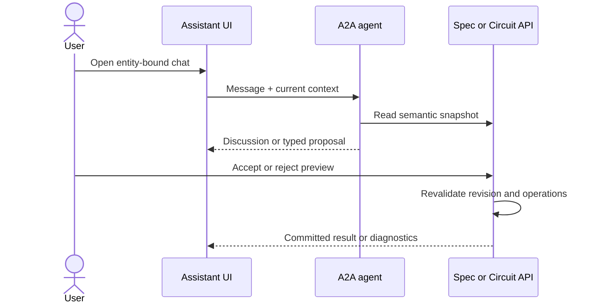

# Optional AI Assistant

This local application provides entity-bound conversations and reviewed change
proposals for the Spec Editor and Circuit Designer. Both editors remain fully
usable when it is stopped.

## Run

Requirements: Python 3.12+, `uv`, Node.js 24+, npm, and at least one owning
editor service.

```bash
uv sync
cd web
npm install
npm run build
cd ..

export OPENAI_API_KEY="..."
uv run spec2gds-ai-assistant
```

Open <http://127.0.0.1:4200>. For frontend development, run `npm run dev` in
`web/` and open <http://127.0.0.1:4201>.

The default hosted addresses come from `../config/services.json`. On opening
an unbound chat, the Assistant probes the configured Spec and Circuit health
endpoints, displays their status, and pre-fills the corresponding connection
form. Set `SPEC2GDS_SERVICE_CONFIG` to use another registry.

When creating a chat directly in the AI Assistant, first choose **Circuit
Designer** or **Spec Editor**. Circuit chats accept a Circuit Designer service
URL and document ID. For Spec chats, the recommended flow from an entity in
Spec Editor is **Options → More actions… → Explore with AI Assistant**. This
supplies the document and entity identity automatically. A manual Spec
connection form is also available for known document/entity IDs.

The default model is `gpt-4o-mini`; override it with `OPENAI_MODEL`. The local
SQLite database defaults to `data/assistant.db`.

`spec2gds-external-assistant` remains available as a transitional command
alias. Existing local launch configurations can migrate without changing the
assistant database or its conversation history.

## Flow and safety



Conversation does not mutate source. A user must request a proposal and accept
its preview. The owning API performs the final revision and validation checks.

Spec Editor chats are bound to one existing entity. They can propose metadata,
component-instance, and editor-profiled port changes. Port proposals use the
same Wire, Transactional, and packed Structured families as the editor. Port
names and families remain fixed, and ports on components with internal designs
remain read-only. Specification renaming and top-level entity creation are not
part of the entity-bound assistant workflow.

Spec and Circuit service URLs must match the allowlists derived from the shared
registry. `SPEC_SERVICE_ALLOWLIST` and `CIRCUIT_SERVICE_ALLOWLIST` can override
them. The reference deployment has no user authentication.

## Useful configuration

| Variable | Default |
| --- | --- |
| `OPENAI_MODEL` | `gpt-4o-mini` |
| `ASSISTANT_HOST` | `127.0.0.1` |
| `ASSISTANT_PORT` | `4200` |
| `ASSISTANT_DATABASE_PATH` | `data/assistant.db` |
| `CIRCUIT_REQUEST_TIMEOUT_SECONDS` | `30` |
| `SPEC_REQUEST_TIMEOUT_SECONDS` | `30` |
| `SPEC_SERVICE_ALLOWLIST` | local Spec API origins on port `8000` |
| `CIRCUIT_SERVICE_ALLOWLIST` | configured Circuit API base URL |
| `SPEC2GDS_SERVICE_CONFIG` | `../config/services.json` |

## Verify

```bash
uv run python -m pytest -q
cd web
npm run build
```

System boundaries and full sequences are documented in
[`../docs/architecture.md`](../docs/architecture.md) and
[`../docs/flows.md`](../docs/flows.md).
