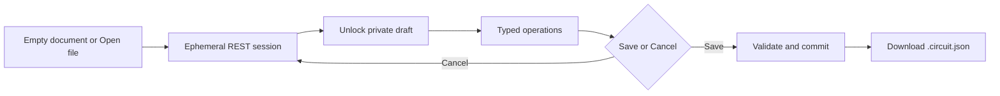

# Circuit Designer web client

This React client edits independent circuit documents through the versioned
Circuit Designer REST service. It starts with an empty document; no example
gallery or bundled circuit corpus is part of the product.

## Run

From `circuit-designer/`:

```bash
npm install
npm run dev
```

Open `http://SERVER_IP:6012`. The command starts both the Vite client and the
ephemeral Node service. `npm run dev:standalone` starts only the client;
`npm run service` starts only the service.

## File and edit flow



The service owns live revisions and leases, but not durable storage. Save
downloads a new canonical file and never overwrites the input file. A circuit
opened from the Spec Editor is source-owned and read-only.

## Canvas interactions

The canvas has no separate tool modes. Its Selection, Connect, Route, and View
action menus expose every primary operation. Direct gestures remain available:

- click or marquee to select, and drag selected instances to move them;
- drag between two free terminals to create a full-terminal net;
- select one net to reveal and drag its route handles;
- use the wheel to zoom and middle-drag or Space+drag to pan.

Use **Connect…** for named or sliced nets. View and selection commands work in
read-only documents; circuit-changing commands require **Unlock**. See the
[interaction guide](../../../docs/circuit-designer-interactions.md) for the
complete mouse and keyboard contract.

See [`../../../docs/architecture.md`](../../../docs/architecture.md) and
[`../../../docs/flows.md`](../../../docs/flows.md).
