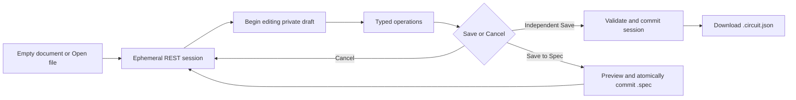

# Circuit Designer web client

This React client edits independent circuit documents through the versioned
Circuit Designer REST service. It starts with an empty document; no example
gallery or bundled circuit corpus is part of the product.

## Run

From `circuit-designer/`:

```bash
npm install
npm run dev
```

Open `http://SERVER_IP:6012`. The command starts both the Vite client and the
ephemeral Node service. `npm run dev:standalone` starts only the client;
`npm run service` starts only the service.

## File and edit flow



The service owns live revisions and leases, but not durable storage. Save
downloads a new canonical file and never overwrites the input file. Eligible
designs opened from the Spec Editor are writable source bindings; **Save to
Specification** updates the authoritative IP-XACT topology and semantic layout
annotation. Leaf-component previews remain read-only.
SVG and PNG downloads use the currently visible effective canvas layout; PNG
is rasterized from the same SVG representation so their geometry and styling
remain aligned.

## Menus and canvas interactions

The desktop menubar contains File, Edit, Components, Selection, Connect, Route,
Timing, View, Tools, and Help. The compact toolbar keeps common actions visible.
Use **Edit → Begin editing** before changing the circuit. **Panels** or
**View → Show sidebar** opens Inspector, Ports, and Timing in one 320 px sidebar.
Each tab keeps its scroll position and selection. Ports selects and centers an
object without changing tabs. Collapse the sidebar to use the full canvas width.

Standalone Circuit Designer supports desktop windows of at least 1280 × 720 px.
Each node shows one Component name, with the instance name in Inspector,
tooltips, and accessible labels. The visible name uses 12–20 screen pixels as
canvas zoom changes. SVG and PNG exports use intrinsic geometry.

The canvas has no separate tool modes. Direct gestures remain available:

- click or Shift+drag to select, and drag selected instances to move them;
- drag between two free terminals to create a full-terminal net;
- select one net to reveal and drag its route handles;
- use the wheel to zoom and left-drag empty canvas to pan without Space.
- right-click a canvas object, route subpart, or port for a semantic menu; use
  the Context Menu key or Shift+F10 for keyboard access.

Open **Edit → Preferences → Actions and shortcuts** to configure the keyboard
and mouse input for every action. Preferences are shared by every browser using
the service and are saved to the server-managed JSON profile. The browser keeps
only a failed-save/migration cache.
Right-click is reserved inside the canvas and is not assignable to an action;
right-drag panning remains available and suppresses a context menu after drag.

Use **Connect → New connection** for named or sliced nets. View and selection
commands work in read-only documents; circuit-changing commands require an
active private draft. See the
[Circuit Designer guide](../../../docs/circuit-designer.md) for the
complete mouse, keyboard, and preference contract.
See the [Spec and Circuit integration architecture](../../../docs/spec-circuit-integration-architecture.md)
for source save, conflict, and recovery behavior.

See [`../../../docs/architecture.md`](../../../docs/architecture.md) and
[`../../../docs/flows.md`](../../../docs/flows.md).
