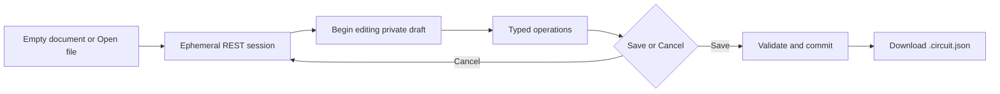

# Circuit Designer web client

This React client edits independent circuit documents through the versioned
Circuit Designer REST service. It starts with an empty document; no example
gallery or bundled circuit corpus is part of the product.

## Run

From `circuit-designer/`:

```bash
npm install
npm run dev
```

Open `http://SERVER_IP:6012`. The command starts both the Vite client and the
ephemeral Node service. `npm run dev:standalone` starts only the client;
`npm run service` starts only the service.

## File and edit flow



The service owns live revisions and leases, but not durable storage. Save
downloads a new canonical file and never overwrites the input file. A circuit
opened from the Spec Editor is source-owned and read-only.

## Menus and canvas interactions

The compact desktop-style menubar contains File, Edit, Components, Selection,
Connect, Route, View, Tools, and Help. The former component sidebar and canvas
action strip are dialogs and menu commands, so the canvas uses the complete
width when the optional Inspector is closed. Use **Edit → Begin editing**
before making circuit changes; **View → Show Inspector** controls the
properties-only Inspector.

The canvas has no separate tool modes. Direct gestures remain available:

- click or Shift+drag to select, and drag selected instances to move them;
- drag between two free terminals to create a full-terminal net;
- select one net to reveal and drag its route handles;
- use the wheel to zoom and left-drag empty canvas to pan without Space.

Open **Edit → Preferences → Actions and shortcuts** to configure the keyboard
and mouse input for every action. Preferences are shared by every browser using
the service and are saved to the server-managed JSON profile. The browser keeps
only a failed-save/migration cache.

Use **Connect → New connection** for named or sliced nets. View and selection
commands work in read-only documents; circuit-changing commands require an
active private draft. See the
[interaction guide](../../../docs/circuit-designer-interactions.md) for the
complete mouse and keyboard contract.

See [`../../../docs/architecture.md`](../../../docs/architecture.md) and
[`../../../docs/flows.md`](../../../docs/flows.md).
