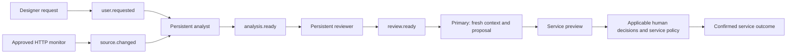

# Orchestrated preset: design and event-driven readiness

Assessment date: 2026-10-09. Audience: developers and architecture reviewers.

**Readiness judgement:** The AI Assistant has an implemented, persistent event
runtime for bounded work in one bound conversation. It can route a designer's
request or an approved HTTP observation through analysis and review. It is a
usable foundation for supervised event-driven work. It is not yet a complete
unattended system that executes and verifies results across services.

This is temporary analysis, not a new behavior contract or an implementation
commitment. [The system contract](ai-assistant.md) defines required behavior.
[Implementation gaps](TEMP-ai-assistant-implementation-gaps.md) record accepted
requirements that remain incomplete. [Future work](ai-assistant-future-work.md)
records proposals. Those three categories must remain separate.

The assessment includes local changes present before this work. The repository
HEAD was `461ad2847e83993a5a594078b1104fd0a648ae89`. The linked DeepSeek Harness
checkout was clean and matched the [source pin](../ai-assistant/harness.lock.json),
`3c98c5108b672280e862a4c85914f5808878aa09`. This is an assessment of that
working-tree state, not a claim about an unchanged release.

Interactive explanations:

- [Event chain, stale review, and restart](TEMP-orchestrated-event-flow.html).
- [Readiness, gaps, and proposed extensions](TEMP-orchestrated-readiness.html).

The HTML pages are local teaching aids. They make no model calls or service
writes. Their example IDs and transitions are illustrative.

## 1. What the current design does

Orchestrated uses a persistent primary, analyst, and reviewer. Each specialist
has its own retained conversation. A member activation is bounded; it is not a
new generic coding subagent. The [preset description](../ai-assistant/profile/presets/orchestrated/preset.yml)
still says "one-shot subagents". That description is stale: the host rejects
one-shot delegation and uses event-system membership to attach specialists.

The [Spec template](../ai-assistant/profile/catalog/event-systems/spec-orchestrated.yaml)
and [Circuit template](../ai-assistant/profile/catalog/event-systems/circuit-orchestrated.yaml)
define the same required reaction chain:

| Boundary | Current responsibility |
| --- | --- |
| Harness | Native conversations, model execution, event ledger, delivery attempts, waits, cancellation, and resource accounting. |
| Assistant host | Exact binding, member capability restrictions, instructions, architecture decisions, proposals, service adapters, and outcome reconciliation. |
| Analyst | Read bound context and publish `analysis.ready`. No proposals or human questions. |
| Reviewer | Read bound context, check findings, and publish `review.ready`. No proposals or approvals. |
| Primary | Read fresh context, ask permitted questions, and prepare proposals through registered tools. |
| Spec service | Validate scope and semantics, preview, enforce revision and save policy, and return durable receipts. |
| Circuit service | Validate Circuit changes and receive proposals. Source-bound changes require the explicit Save to Spec flow. |

These boundaries are enforced through membership, registered tools, event
publication permissions, and service checks. Prompts describe behavior but do
not grant permissions. The model has no general shell, filesystem, browser,
Activity execution, or approval tool. See [host composition](../ai-assistant/src/index.ts).

Focused is a bounded direct turn. Goal adds native single-primary continuation.
Orchestrated adds the standing analysis/review chain; it does not automatically
create a Goal or a general execution graph.

## 2. Event contracts, control, and limits

### Causality and publication

Native human input becomes `user.requested` with a `text` field. An approved HTTP
source publishes `source.changed` with its trigger ID, URL, observed JSON value,
and previous/current digests. The analyst publishes a `findings` string; the
reviewer publishes a `result` string.

The native event envelope records an ID, producer, deduplication key, causation,
root correlation, and depth. Publication validates the declared payload. Reusing
a producer's deduplication key with different content fails. The specialist
prompts require the triggering event ID as the stable publication key.

[Proposal admission](../ai-assistant/src/execution-policy.ts) requires active
execution and primary membership. It finds the latest `user.requested` or
`source.changed` and requires a `review.ready` ancestor chain back to that input.
A review for an earlier request cannot authorize the newer input.

This guard establishes causal review. It does not encode a typed positive or
negative review verdict, or prove that authored operations follow the review's
prose. Those remain separate content and service checks. A model review is also
separate from human architecture approval.

Subscriptions match exact event types. Human-edited templates can add read-only
observers, custom events, and bounded cycles. They must retain the required
chain, host payload contracts, approved model route, and capability ceilings.
Cycles produce a warning; they are not treated as dependency graphs. There are
no subscription payload predicates, joins, committed execution stages, or typed
stage-to-stage mappings. See [configuration admission](../ai-assistant/src/event-configuration.ts).

### Waits and decisions

`wait_for_event` stores a future human, declared-event, or review wait. A review
wait matches an exact string field and value. Human answers require the current
wait ID and execution revision. Old events cannot resolve a newly created wait.
Waiting does not consume model turns; another permitted member can still work.

The host publishes architecture decisions and proposal outcomes. It creates an
architecture wait when the Spec primary prepares a pending review. Automatic
pending-content wait creation in `publishPreparedReview` is specific to Goal;
Orchestrated has the wait tool but does not automatically get the same
content-wait behavior. The stock templates do not subscribe the primary to
`review.applied` or `review.discarded`. Declaring those events alone does not
create a complete post-save verification loop.

### Deployment defaults

The [deployment composition](../ai-assistant/profile/cordis.patch.yml) sets these
Orchestrated defaults. They are aggregate bounds across the conversation's
members, not fresh allowances for each trigger.

| Bound | Default |
| --- | --- |
| Native turn admissions, `maxRounds` | 8 |
| Model requests | 48 |
| Aggregate model tokens | 500,000 |
| Aggregate active model-request time | 2,700,000 ms, or 45 minutes |
| Member capacity / concurrency | 7 / 3; the stock roster has 3 members |
| Pending deliveries / ledger events | 1,000 / 1,000 |
| Event payload / causal depth | 131,072 bytes / 16 |
| Output tokens per model request | 16,384, unless configured otherwise |

The primary's Goal/Orchestrated turn limit is eight model execution passes.
Specialists inherit their native preset behavior. Active time is accumulated
model-request time; it is not a 45-minute wall-clock monitor lifetime. Resume
retains spending. Exhaustion stops execution; it does not prove completion.
These settings suit bounded work, not an indefinitely funded service.

### HTTP monitoring

The implemented source adapter is service-bound HTTP polling. The host checks
the bound service origin and path prefix. The native adapter also checks startup
origins, URL credentials, redirects, response size, JSON pointers, event schemas,
and configured credential availability.

Changed/equality conditions, debounce, retained cursors, and a durable publication
outbox are already implemented. Unchanged observations make no model requests.
Defaults permit two sources per conversation, a five-second minimum interval,
two concurrent HTTP checks, 64 KiB responses, and suspension after five
consecutive failures. Sources can be enabled or disabled; editing and deletion
are unsupported. A source can reference an environment credential name, not
store its secret value.

An observation is untrusted data. Monitoring approval permits observation and
the bounded reaction chain; it does not approve a Spec change. A source change
also does not carry a typed persistent design objective. A stronger autonomous
monitor would need an explicit reaction intent and completion criteria.

## 3. Persistence and proof of outcome

| Store | Authority and recovery limit |
| --- | --- |
| Native JSONL | Member transcripts and native conversation history. |
| Product SQLite | Binding, immutable instruction/configuration pins, architecture reviews, creation progress, and proposals. |
| Native event/source storage | Events, attempts, waits, source cursors/outboxes, and retained spending. |
| Spec service persistence | Saved Spec content, revisions, submissions, and exact save receipts. |
| Circuit service | Circuit documents and pending proposals are process-local; reopen them after a service restart. |

One Assistant process must use one state root. On restart, native active
execution becomes `needs-resume`; dispatching/accepted deliveries become
interrupted. A designer must Resume before new model work. Uncertain attempts
require explicit acknowledgement before retry. Product recovery marks
interrupted writes for reconciliation instead of assuming failure.

The stock analyst/reviewer subscriptions permit replay-safe retries: at most
three attempts, with one-second initial and ten-second maximum backoff. That is
a read-only transport/activation policy. It must not become automatic repair of
a request stopped for validation. First-failure enforcement remains an accepted
gap, described below.

No one store proves an external save. Keep event deduplication separate from
service write idempotency. A delivered event, completed activation, prepared
proposal, and saved Spec are different outcomes.

For Spec content, require the exact applied receipt and saved revision. For new
documents, `continued` proves admission into the destination conversation, not
saved content. For Circuit, `sent` proves handoff only. Accepting a source-bound
Circuit proposal stages a private draft; **Save to Spec** needs the successful
Spec save result. `review.applied` can represent Circuit handoff, so its name
alone cannot establish source completion. See [AS-24–AS-27](ai-assistant.md#as-24).

## 4. Readiness by capability

Here, **implemented** means supported by inspected code. It is not a blanket
production certification. **Partial** means important behavior or evidence is
incomplete. **Missing** means the capability is absent from this preset.

| Capability | State | Practical conclusion |
| --- | --- | --- |
| Designer request → analysis → review → proposal | Implemented | Native integration exercised the Spec chain with a fixture model. |
| Approved HTTP change → same chain | Implemented | Changed observations react; unchanged checks remain model-free. |
| Exact binding, read-only specialists, and latest-input causal guard | Implemented | The basic authority and routing boundary exists. |
| Immutable template/instruction pins, bounded custom reactions | Implemented | Changes affect new conversations; models cannot widen permissions. |
| Durable events, attempts, waits, source cursors, and spending | Implemented | State survives restart, subject to human recovery controls. |
| Continuous unattended restart recovery | Missing by policy | Human Resume is required; automatic recovery would change AS-24. |
| Complete architecture and first-failure enforcement | Partial | Accepted safety requirements remain incomplete. |
| Proposal outcome → verified requested result | Partial | Stock subscriptions do not provide a general completion loop. |
| Durable downstream Circuit save tracking | Partial | Assistant handoff does not establish acceptance or source save. |
| Executable stages, joins, predicates, and typed output mappings | Missing | Event routing is not an execution graph scheduler. |
| Webhooks, file watchers, cross-conversation/distributed dispatch | Missing | Current external input is bound-service HTTP polling. |
| Activity jobs and Verification Planner as Assistant capabilities | Missing | Separate services exist; no corresponding preset tools/adapters are registered. |
| Long-run cost, overload, feedback-loop, and live-model quality evidence | Unverified | Small fixture checks do not establish these properties. |

**Supervised use:** Suitable for bounded exploration and reviewed proposals,
with known contract gaps and explicit service outcome checks. The assessment
does not establish full acceptance of the behavior contract.

**Unattended use:** Not ready for general structural/RTL changes or complete
cross-service execution. Human architecture approval and restart Resume are
intentional rules, not accidental defects. Existing automatic Spec save policy
does not remove the architecture decision.

## 5. What is required, proposed, or newly recommended

### Required contract fixes

These findings are supported by the current source, including the local edits.
They are not inferred only from the older TEMP gap list.

| Priority | Accepted gap | Current evidence and required result |
| --- | --- | --- |
| P0 | GAP-04: first validation failure | Tool failures return repair instructions; bounded execution has no general request-terminal validation guard. Stop the affected request and its event/Goal continuations until explicit designer retry. |
| P0 | GAP-01 / GAP-05: architecture coverage | The Spec structural classifier omits stored SV changes and uses older section operation names. The plan checker handles new Component/Design names and initial ports, not complete existing topology changes. Enforce the actual operation vocabulary and full affected approved structure. |
| P0 | GAP-02: restricted content decision | Assistant `reviewAction` still accepts Spec `apply`. Receipt reconciliation already exists. Align browser approval with Spec Editor and keep exact decision/wait updates. |
| P1 | GAP-06 / GAP-07: failure and completion state | Diagnostics do not consistently identify stage/write outcome; creation continuation and saved content remain separate. Preserve accurate state after failure and restart. |
| P1 | GAP-11 / GAP-13: lifecycle and evidence | Close/reopen evidence, metric correlation, and acceptance fixtures remain incomplete. Measure actual saved outcomes and distinguish fixture, live-model, and hardware results. |

Key code evidence: [Spec proposal admission](../ai-assistant/src/tools/prepare_spec_proposal.ts),
[architecture plan checks](../ai-assistant/src/architecture-review.ts),
[host decisions and event publication](../ai-assistant/src/index.ts),
[creation state](../ai-assistant/src/source-creation.ts), and
[metrics](../ai-assistant/src/eval-metrics.ts).

### Existing proposals

| Proposal | What must be designed before implementation |
| --- | --- |
| RT-01: executable flow stages | Host-managed dependencies, typed mappings, tool-only stages, committed results, conditions/joins, cycle rules, cancellation, and recovery. |
| RT-02: broader inputs and dispatch | Webhook/watch authority, source identity, delivery lifetime, cross-conversation boundaries, budgets, and recovery. Distributed execution also needs an accepted coordination design. |
| ISSUE-CD-03: downstream Circuit status | Durable identities and events/polling for sent, accepted draft, rejected, and saved source. |
| OW-01: Verification Planner integration | Exact binding, context/schema, preview, approval, and receipt adapters. |
| AA-06: additional specialists | Measured quality, cost, and latency gains under an accepted routing policy. The template editor already permits restricted observers. |

These are proposals, not scheduled delivery commitments. TD-05 instruction
pinning and native contract work are already implemented; do not list them as
missing. UI-02 remains the future-work list's stated first priority. The sequence
below is specific to event-system readiness, not a replacement for that backlog.

### Additional recommendations for unattended operation

1. Define each monitor's durable reaction intent, allowed outputs, approval
   boundary, and completion criterion. Avoid an open-ended "react to any change"
   instruction.
2. Consider typed review verdicts and durable evidence references when stage
   decisions must be enforced automatically. Current findings/results are strings.
3. Measure input bursts, overlapping requests, obsolete results, self-triggered
   source edits, and repeated failures. Current caps bound growth; they do not
   supply coalescing, origin filtering, or an indefinite retention policy.
4. Add Activity execution/result adapters only through a service boundary.
   Retain immutable Spec snapshots and deterministic Activities. The
   [Activity SDK](activity-sdk.md) does not define queue/process/HTTP execution;
   v1 also does not take previous Activity artifacts as arbitrary chained inputs.
5. Define observability for source suspension, pending age, failure stage,
   spending, and confirmed outcomes. The existing inspector already shows
   causal events, attempts, waits, sources, and request charges.

These recommendations need accepted requirements before implementation. They
do not authorize automatic approval, new capabilities, or budget increases.

## 6. Suggested delivery gates

| Gate | Work | Acceptance evidence |
| --- | --- | --- |
| A: enforce the contract | Close P0 validation/architecture/approval gaps. | Invalid authoring stops once; unapproved RTL/topology cannot save; Editor decisions reconcile the exact proposal without another write. |
| B: prove supervised completion | Resolve result tracking and lifecycle gaps. | Spec receipts, creation/content stages, Circuit draft/source outcomes, waits, and UI state agree after reload/restart. |
| C: add bounded execution capabilities | Accept and implement the needed subset of RT-01, Activity adapters, or OW-01. | Typed stage outputs, duplicate admission, cancellation, stale snapshots, partial failure, and exact final service state are tested. |
| D: decide unattended policy | Accept broader input/recovery policy and operational limits. | Restart, uncertainty, overload, self-trigger loops, retained spending, source suspension, and outcome alerts meet the agreed criteria. |

Required scenarios include a newer human request before an older review returns;
a newer source observation; duplicate publication; stale wait answers; restart
during delivery or a service write; malformed tool arguments; stale service
revision; budget exhaustion; restricted Editor approval/rejection; and Circuit
handoff followed by source-save failure. Add browser protection where visible
behavior or human controls matter. Use live-model and hardware checks for claims
that fixtures and service receipts cannot prove.

## 7. Evidence and limits

Before document creation, these focused checks passed:

| Command, run from `ai-assistant` | Result and coverage |
| --- | --- |
| `npm run build:server` | Passed, including generated tool-contract consistency. |
| `node --test --import tsx tests/execution-policy.test.ts tests/event-configuration.test.ts tests/instruction-snapshots.test.ts` | 14 passed using Node 24.13.1. Causal admission, budgets, configuration restrictions, and pinned instructions. |
| `node --test tests/event-runtime.integration.test.mjs` | 2 passed using Node 24.13.1. Goal and Orchestrated with real native execution, a fixture model, and an HTTP fixture service. The Orchestrated case exercised the review chain and HTTP change reaction. |

The native integration check initially could not bind its local HTTP listener
inside the sandbox (`EPERM`). The permitted run outside the sandbox passed.
That initial result is a test-environment limit, not evidence of a product fault.

Fast and Assistant integration selections were checked with `--dry-run`.
Full-profile and HTML verification results are recorded below.
Missing required credentials/tools make a profile incomplete; they
must not be replaced by fixtures or reported as a pass.

### Final verification

Profile commands used Node 24.13.1 through the configured command PATH. Each
profile used isolated local services and a separate evidence directory.

| Executed command | Outcome | Evidence |
| --- | --- | --- |
| `scripts/test-all.sh fast --output /tmp/spec2gds-orchestrated-readiness-20261009-fast` | **Failed:** 10 check groups passed; `live-wire-range` failed. All three required live checks ran. Both live description checks passed. No group was unverified. | [Fast report](/tmp/spec2gds-orchestrated-readiness-20261009-fast/summary.html) |
| `scripts/test-all.sh integration --scope assistant --output /tmp/spec2gds-orchestrated-readiness-20261009-integration` | **Passed:** 13 check groups, including native Harness execution, fixture browsers, real-service scenarios, and Assistant end-to-end checks. | [Integration report](/tmp/spec2gds-orchestrated-readiness-20261009-integration/summary.html) |
| `node /tmp/spec2gds-orchestrated-readiness-html/verify.mjs http://127.0.0.1:35295` with the installed Chromium cache | **Passed:** five examples, admission transitions, restart acknowledgement, Circuit outcomes, keyboard activation/focus, filters, navigation, disclosures, local links, standalone file opening, and zero browser JavaScript errors. Layouts checked at 390, 1440, and 1728 px. | [HTML results](/tmp/spec2gds-orchestrated-readiness-html/verification.json) |

The failed wire-range case did not observe a changed saved source revision
within its 90-second wait in `smoke_flow.ts`. This is a failed live product
scenario, not a missing-credential result. Its root cause was not established
by this documentation work. It does not by itself isolate a fault in the
Orchestrated preset. See the retained
[failure log](/tmp/spec2gds-orchestrated-readiness-20261009-fast/live-wire-range/command.log).
The fast profile must not be reported as passed.

Integration is deterministic model evidence. The group named `scenario-live`
in that profile also uses a fixture model; its name does not establish live
inference. The two successful fast live checks establish only their exercised
description-save cases.

HTML verification used a temporary local preview. The pages also work when
opened directly from disk, with no server or external assets. Screenshots and
verification code remain in `/tmp/spec2gds-orchestrated-readiness-html`.
The preview server was stopped after verification. These examples test the
explanation, not product execution. No runtime code or service contract was
changed for this report. Full regression was not selected for these documentation
and standalone teaching-page additions.

No result in this report proves general live-model accuracy, functional RTL
equivalence, distributed reliability, or all native-shell browser behavior.
