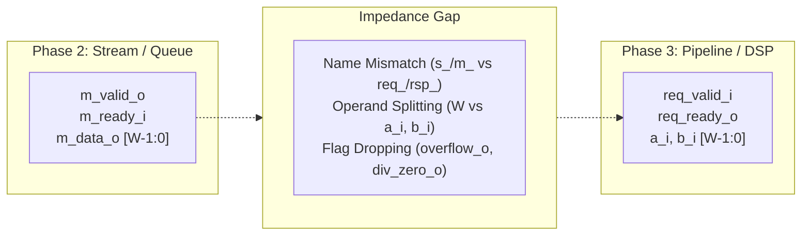

# Spec Catalog: Phase 1, 2 & 3 Design Unification Recommendations

> **Document Scope**: Cross-phase interoperability analysis and proposed architectural unifications for Spec Library components across Phase 1 (Logic & State), Phase 2 (Queues, CDC & Streams), and Phase 3 (Arithmetic & DSP).  
> **Status**: Technical Proposal & Architecture Note  
> **Target Audience**: Spec authors, RTL system architects, and tooling engineers.

---

## 1. Executive Summary

As the Spec Library expands across successive phases:
- **Phase 1** delivered 32 atomic combinational and sequential building blocks (`mux`, `register_enable`, `counter_up`, etc.).
- **Phase 2** delivered 32 queuing, stream routing, and clock-domain crossing components (`fifo_sync`, `stream_register`, `cdc_bus_handshake`, etc.).
- **Phase 3 (Part 1)** delivered 12 arithmetic, multiplier, and divider components with a 3-tier hierarchical structure (`add_sub`, `multiplier_pipeline`, `divider_pipeline`, etc.).

When these components are assembled together into complete SoC subsystems or pipelines (e.g., streaming arithmetic through queues and cross-domain handshakes), several interface and architectural discrepancies emerge. This document outlines concrete recommendations to harmonize these components for cohesive mixed usage.

---

## 2. High-Impact Interoperability Challenges & Proposed Solutions



---

### Challenge 1: Elastic Handshake and Port Naming Inconsistency

#### The Problem
* **Phase 2 Streams & Queues** (`stream_register`, `fifo_sync`, `stream_skid_buffer`):
  * Ingestion: `s_valid_i`, `s_ready_o`, `s_data_i`
  * Egress: `m_valid_o`, `m_ready_i`, `m_data_o`
* **Phase 3 Arithmetic Pipelines** (`multiplier_pipeline`, `divider_pipeline`, `mac`):
  * Ingestion: `req_valid_i`, `req_ready_o`, `a_i`, `b_i`
  * Egress: `rsp_valid_o`, `rsp_ready_i`, `product_o`, `quotient_o`, `remainder_o`

Connecting a Phase 2 FIFO directly into a Phase 3 Multiplier requires explicit adapter wrappers or manual net remapping because the port prefixes (`s_`/`m_` vs `req_`/`rsp_`) and operand groupings diverge.

#### Recommendation
1. **Bus Interface Definition in Component Metadata**:
   Define formal bus interface roles in `.spec` component definitions (e.g., `stream_sink`, `stream_source`, `pipelined_arith_sink`). This allows Circuit Designer and Spec Editor to recognize matching elastic channels and generate automatic point-to-point connections regardless of internal port names.
2. **Channel-Prefixed Port Standardization**:
   Standardize sequential arithmetic inputs to use clear channel prefixes:
   * Multi-operand input: `req_valid_i`, `req_ready_o`, `req_a_i`, `req_b_i`
   * Result output: `rsp_valid_o`, `rsp_ready_i`, `rsp_data_o` (or `rsp_quotient_o`)
3. **Stream-to-Arithmetic Adapter Primitives**:
   Add a standard `stream_splitter` / `stream_joiner` in the catalog that demultiplexes a single packed stream `{b, a}` into dual arithmetic operand channels (`a_i`, `b_i`).

---

### Challenge 2: Sideband Signal & Error Flag Propagation Across Queues

#### The Problem
* Phase 3 arithmetic blocks produce critical status and exception flags:
  * `overflow_o`, `borrow_o` (in `add_sub`, `saturating_add_sub`)
  * `div_zero_o`, `overflow_o` (in `divider_pipeline`, `divider_iterative`)
* Phase 2 queues and stream buffers (`fifo_sync`, `stream_register`, `stream_upsizer`) carry **only a single data word: `data_i [W-1:0]`**.

If an architect buffers the output of a pipelined divider using a Phase 2 FIFO, the exception flags (`div_zero_o`, `overflow_o`) are either orphaned or must be manually packed into the data word, complicating width parameterization across the design.

#### Recommendation
* **Introduce Parameterized Sideband Signals (`USER_W`)**:
  Extend Phase 2 stream and queue interfaces to support an optional parameter `USER_W = 0`:
  * `s_user_i [USER_W-1:0]`, `m_user_o [USER_W-1:0]`
  * When `USER_W == 0`, the ports are omitted or tied off.
  * When `USER_W > 0`, transaction metadata (e.g., `div_zero`, `overflow`, packet tags, error codes) propagates synchronously alongside the data payload through FIFOs, CDC boundaries, and stream arbiters.

---

### Challenge 3: Backpressure & Timing Closure (Combinational Ready Chains)

#### The Problem
* In Phase 2 `stream_register`:
  ```systemverilog
  assign s_ready_o = !m_valid_o || m_ready_i;
  ```
  There is a direct combinational path from downstream `m_ready_i` to upstream `s_ready_o`.
* In Phase 3 pipelined arithmetic:
  `req_ready_o` is similarly combinationally derived from downstream `rsp_ready_i`.
* **System Impact**: Cascading multiple Phase 2 and Phase 3 components (e.g., `FIFO -> Multiplier -> Stream Demux -> Register`) forms an unbuffered backward combinational path through the entire subsystem. This limits clock frequency and can lead to combinational feedback loops in complex topologies.

#### Recommendation
* **Promote Skid Buffers as the Standard Egress Strategy**:
  * Emphasize the use of Phase 2's `stream_skid_buffer` at module boundaries where `ready` timing is critical. A skid buffer breaks both the forward (`valid`/`data`) and backward (`ready`) combinational paths with zero throughput loss (maintaining 1 transfer/cycle).
  * In Phase 3 and Phase 4 complex pipelines, incorporate an optional output skid buffer preset to ensure clean boundary isolation.

---

### Challenge 4: Cross-Package VLNV Instantiation vs Code Duplication

#### The Problem
* `.spec` packages currently operate as hermetic containers without the ability to link to external `.spec` files in the catalog.
* In Phase 3's 3-tier hierarchy, when Level 2 subsystems needed leaf primitives from Phase 1 (`mux`, `register_enable`, `counter_up`), the SystemVerilog code and port definitions had to be **copied by value** into each candidate package.
* **Maintenance Risk**: If an optimization, lint fix, or formal property is updated in Phase 1's `register_enable`, the copied code inside Phase 3's arithmetic components will not automatically inherit the fix.

#### Recommendation
* **Catalog Component Referencing in `internal_design`**:
  Update the transaction resolver and Spec Editor schema to allow an `InternalInstanceIR` to reference an external catalog VLNV (e.g., `component_vlnv="spec2gds.local:state:register_enable:1.0.0"`).
* During code generation or synthesis packaging, the tool resolves external catalog dependencies, avoiding duplicate SystemVerilog definitions while keeping components modular and maintainable.

---

### Challenge 5: Structural Hierarchy Consistency (Flat vs Composite Drill-Down)

#### The Problem
* **Phase 1 & 2 Releases**: All 64 components are authored as flat leaf components (`implementation: "body_sv"`).
* **Phase 3 Releases**: All components are authored as 3-tier composite designs (`implementation: "composite"` with Level 1 Top $\rightarrow$ Level 2 Subsystem $\rightarrow$ Level 3 Leaf).
* **User Experience in Circuit Designer**:
  * Viewing a Phase 2 compound block like `fifo_sync` (which logically contains a dual-port RAM, read/write counters, and status comparators) shows a single monolithic black box.
  * Viewing a Phase 3 `add_sub` allows expanding into sub-blocks (`u_core_stage`, `u_flag_stage`).

#### Recommendation
* Identify complex compound components from Phase 1 and Phase 2 and provide composite reference designs:
  * `fifo_sync` $\rightarrow$ composed of `ram_1r1w` + `counter_up` (pointers) + `comparator` (flags).
  * `cdc_bus_handshake` $\rightarrow$ composed of `cdc_level_sync` + `register_enable`.
* Maintain backwards compatibility by retaining the monolithic models as optimized leaf implementations while offering the composite versions as hierarchical structural templates.

---

### Challenge 6: Parameter Typing and Condition Standards

#### The Problem
* Early Phase 1 components occasionally defined flags as `ParamDef("FLAG", "bit", ...)` with defaults like `1'b1`.
* In Verilator, assigning integer presets to 1-bit parameters triggers `%Warning-WIDTHTRUNC`, while testing `if (FLAG)` with 32-bit unsigned parameters triggers `%Warning-WIDTH`.

#### Recommendation
* Standardize all integer and boolean parameters across all phases:
  * Parameter Type: `int unsigned` (e.g., `SIGNED`, `HAS_OVERFLOW`, `WIDTH`).
  * Relational SystemVerilog syntax: Always write `if (FLAG != 0)` rather than implicit boolean casts `if (FLAG)`.

---

## 3. Summary & Prioritized Action Matrix

| Priority | Unification Proposal | Affected Components | Effort | Impact on End-to-End System Design |
| :---: | :--- | :--- | :---: | :--- |
| **P1** | **Sideband Signal (`USER_W`) in Queues & Streams** | `fifo_*`, `stream_*`, `cdc_bus_handshake` | Medium | **High**: Prevents dropped arithmetic exception flags (`overflow`, `div_zero`) when buffering DSP datapaths. |
| **P2** | **Bus Interface Abstraction in Spec Metadata** | All Phase 2 & 3 sequential components | Low | **High**: Enables 1-click automatic bus stitching in Circuit Designer regardless of port naming prefixes. |
| **P3** | **Skid Buffer Egress Option in Pipelined Blocks** | `multiplier_pipeline`, `divider_pipeline`, `mac` | Low | **High**: Eliminates long backward combinational `ready` paths across multi-block cascaded pipelines. |
| **P4** | **Catalog VLNV Cross-Referencing in Spec Formats** | Core platform (`transactions.py`, `codegen.py`) | High | **Medium**: Eliminates copy-pasted SystemVerilog leaf code across future library phases (Phase 4+). |
| **P5** | **Composite Decomposition of Phase 2 Compound Blocks** | `fifo_sync`, `fifo_async`, `cdc_bus_handshake` | Medium | **Medium**: Ensures consistent schematic drill-down and visual clarity across the entire catalog. |
