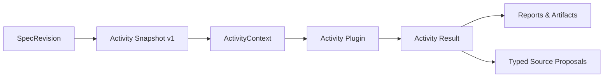

# Activity SDK

The Activity SDK provides the Python extension interface to analyze hardware specifications, generate code, and produce verification artifacts.
The SDK remains completely independent of queueing, process management, and HTTP hosting.



## 1. Core Concepts and Architecture

- **Activity**: A registered Python function or class that performs analysis or code generation.
- **Job**: An execution instance of an Activity with concrete parameters.
- **Activity Snapshot**: An immutable, portable ZIP container capturing one complete `.spec` source revision.
- **Activity Context**: The runtime execution interface providing read-only access to specification data.
- **Activity Result**: The immutable output containing markdown reports, output artifacts, and optional typed source proposals.

Activity code never receives mutable `.spec` packages or live editor sessions.
Any source changes return as typed proposals that require designer review and revision validation.

---

## 2. Activity Snapshot v1 Container Specification

An Activity Snapshot is the portable input boundary for Activities and Context Renderers.
The container media type is `application/vnd.spec2gds.activity-snapshot.v1+zip`.

The deterministic ZIP contains exactly three entries in order:
```text
mimetype
snapshot.json
source/source.spec
```

- `mimetype`: Uncompressed file containing the exact media type string.
- `source/source.spec`: Complete, valid, source-only `.spec` container without execution history.
- `snapshot.json`: Manifest adhering to `spec2gds.activity-snapshot.v1`:

```json
{
  "schema_version": "spec2gds.activity-snapshot.v1",
  "snapshot_id": "sha256:...",
  "source": {
    "document_id": "soc_top",
    "source_revision_hash": "sha256:...",
    "package_path": "source/source.spec",
    "package_sha256": "sha256:..."
  },
  "scope": {
    "kind": "entity",
    "target": {
      "document_id": "soc_top",
      "entity_kind": "design",
      "entity_id": "main_design"
    }
  },
  "dependency_closure": []
}
```

The `snapshot_id` hashes the canonical manifest fields.
Timestamps and host paths are excluded to guarantee deterministic snapshot hashes.

---

## 3. Two-Level Read API

The `ActivityContext` exposes two distinct read interfaces:

### High-Level API (`context.spec.high`)
Use `context.spec.high` for general hardware analysis and model context rendering:

```python
# Query entities by kind
components = context.spec.high.entities(kind="component")
dma = components.where(name="dma").one()

# Query graph relationships
dependencies = context.spec.high.related(dma.ref, "dependencies")
usages = context.spec.high.related(dma.ref, "usages")

# Read narrative documentation
intent = context.spec.high.text.linked_to(dma.ref).plain_text()
```

High-level queries are deterministic, iterable, and immutable.

### Low-Level API (`context.spec.low`)
Use `context.spec.low` when detailed IP-XACT hardware models or exact port layouts are required:

```python
for component in context.spec.low.components:
    for port in component.ports:
        print(component.vlnv, port.name, port.direction, port.width)

# Resolve design topology and netlist connections
design = context.spec.low.resolve(design_ref)
connections = context.spec.low.connections(design_ref)
```

The low-level API returns concrete immutable `SpecIR` objects.
It never exposes raw XML or mutable write handles.

---

## 4. Define and Register an Activity

Use the public decorator and registration hook. Activities receive one immutable
`ActivityContext`; they return a typed report and staged artifacts.

```python
from pydantic import BaseModel
from spec2gds.spec.activities import activity, ActivityScopes, ActivityResult

class CountReport(BaseModel):
    count: int

@activity(
    activity_id="example.count_components",
    version="1.0.0",
    title="Count Components",
    description="Count source Components in an immutable snapshot.",
    scopes=ActivityScopes(document=True),
    report_model=CountReport,
)
def count_components(context):
    context.cancellation.raise_if_cancelled()
    count = len(context.spec.high.entities(kind="component"))
    return ActivityResult(summary=f"Found {count} Components.", report={"count": count})

def register_extensions(registry):
    registry.register_activity(count_components)
```

## 5. Diagnostic export sample

The default `reference.spec_summary` Activity, version `2.0.0`, exports selected
Component or Design details as JSON. Its display command is **Export target
details (JSON)**.

`context.spec.low.document_projection()` returns a defensive source projection.
It includes all Section records and tables, including protocol data hidden from
Spec Editor. It does not filter for editor visibility, add Circuit topology, or
invoke RTL validation.

The sample selects the target dependency closure and preserves Section order,
nested narrative, source values, and SystemVerilog payloads. The artifact uses
role `spec.summary` and media type `application/json`. Its schema is
`spec2gds.section-diagnostics.v1`, with `snapshot_id`, `document_id`,
`source_revision_hash`, `target`, `dependency_closure`, `sections`, and
`linked_narrative`. Host paths, timestamps, and job history are excluded.

## 6. Execution rules

- Read source through `context.spec.high` and `context.spec.low`.
- Check `context.cancellation.raise_if_cancelled()` before and during work.
- Publish artifacts through `context.outputs.add_text`, `add_json`, or `add_bytes`.
- Activities that need generated project files declare `requires_workspace_output`
  and use the constrained `context.workspace` writer.
- Return typed proposals for source changes. An Activity cannot approve its own
  changes.
