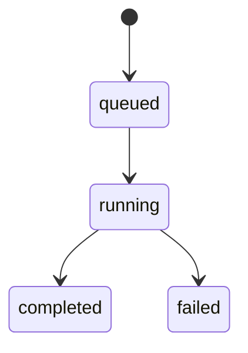

# Agent-Spec Action And Pipeline Contract

## Purpose

This document describes the action, run, snapshot, artifact, and writeback
contract implemented in `spec2gds/agent_spec/`. The current implementation is a
local in-process runner. It is designed so later worker or queue machinery can
reuse the same core data model, but those distributed pieces are not present
today.

The contract code lives in:

- `spec2gds/agent_spec/models.py`
- `spec2gds/agent_spec/actions/builtin.py`
- `spec2gds/agent_spec/runs/runner.py`
- `spec2gds/agent_spec/storage/repository.py`

## Action Definition

Actions are registered Python handlers with UI/API metadata:

```python
class ActionSpec(pydantic.BaseModel):
    action_id: str
    title: str
    summary: str
    version: str
    provider: str
    required_tags: list[str]
    context: list[str]
    parameters: list[ActionParameter]
    output_roles: list[str]
    enabled: bool
```

The current action registry supports:

- direct registration through `ActionRegistry.register()`
- registration from Python modules that expose `register_actions(registry)`
- enable/disable overrides from JSON or the repository's simple YAML parser

`ActionRegistry.actions_for_tags(tags)` returns enabled actions when the action
has no required tags or at least one required tag is present on the block.

## Built-In Actions

| Action ID | Required tags | Output |
| --- | --- | --- |
| `agent_spec.inspect` | none | Informational diagnostic that the snapshot is valid. |
| `systemc.perf.pseudo` | `systemc-perf` | Fixed pseudo SystemC performance artifact. |
| `systemc.bitaccurate.pseudo` | `systemc-bitaccurate` | Fixed pseudo SystemC bit-accurate artifact. |

The pseudo SystemC actions write a small text artifact into:

```text
<sidecar_root>/runs/<run_id>/<output_name>
```

The returned `ArtifactRef.external_uri` points at that file with a `file://`
URI.

## Action Parameters

Parameters are metadata objects, not arbitrary UI code:

```python
class ActionParameter(pydantic.BaseModel):
    name: str
    parameter_type: str
    required: bool = False
    enum_values: list[str] = []
    default: Any = None
```

The built-in pseudo actions currently use:

| Name | Type | Default |
| --- | --- | --- |
| `delay_seconds` | `number` | `0.01` |
| `output_name` | `string` | `model.txt` |

The runner passes request parameters through to the action snapshot. It does not
yet enforce a full JSON Schema-style parameter validator.

## Input Snapshot Contract

Every run captures an immutable `InputSnapshot` before executing an action:

```python
class InputSnapshot(pydantic.BaseModel):
    snapshot_id: str
    document_id: str
    source_document_hash: str
    created_at: str
    selected_versions: list[BlockVersionRecord]
    artifact_refs: list[ArtifactRef]
    parameters: dict[str, Any]
```

Current rules:

- The snapshot is created at run submission time.
- The snapshot includes the active version for the target block.
- Existing artifact attachments for the block are copied into the snapshot.
- `source_document_hash` records the `.spec` file hash at capture time.
- The snapshot is persisted under
  `spec_data/agent-spec/runs/<run_id>/input_snapshot.json`.

## Run Lifecycle

The current `AgentSpecRunner.trigger_action()` flow is synchronous:



`queued` and `running` are recorded during the same API request. If the action
handler and writeback checks complete, the run becomes `completed`. If any
exception escapes the action/writeback flow, the run becomes `failed` and the
error is stored as a diagnostic.

Persisted run files:

```text
spec_data/agent-spec/runs/<run_id>/run.json
spec_data/agent-spec/runs/<run_id>/events.ndjson
```

## Event Contract

Run events are audit records, not a live broker contract:

```python
class RunEvent(pydantic.BaseModel):
    event_id: str
    event_type: str
    document_id: str
    aggregate_id: str
    sequence: int
    created_at: str
    actor: dict[str, str]
    payload: dict[str, Any]
```

Current event types emitted by the runner:

| Event | When emitted |
| --- | --- |
| `run.created` | A run record has been created. |
| `run.started` | The action is about to execute. |
| `run.artifact.created` | An artifact passed sanity checks and was attached. |
| `run.writeback.applied` | The writeback had no diagnostics and was auto-applied. |
| `run.needs_human_feedback` | One or more diagnostics prevented clean artifact application. |
| `run.completed` | The run finished and run metadata was persisted. |
| `run.failed` | The run raised an exception. |

The in-memory `/agent-spec/events` endpoint returns events accumulated since
the current API session opened. Completed runs also persist their own
`events.ndjson`.

## Artifact Contract

Actions return artifacts through `ActionResult`:

```python
class ArtifactRef(pydantic.BaseModel):
    artifact_id: str
    artifact_kind: str
    media_type: str
    summary: str
    sha256: str
    external_uri: str
    producer: str
    source_trace: SourceTrace
    role: str
    created_at: str
```

The runner accepts an artifact only when:

- `sha256` starts with `sha256:` and has the expected length
- `external_uri` starts with `file://` or `artifact-store://`
- `source_trace.version_id` is part of the input snapshot
- `role` is allowed by `ActionSpec.output_roles`, when roles are declared
- `summary`, `media_type`, and `artifact_kind` are non-empty

Accepted artifacts are stored in the graph and persisted under:

```text
spec_data/agent-spec/artifacts/<artifact_id>.json
```

The repository appends an `AttachmentRecord` from the target block to each
accepted artifact.

## Writeback Contract

Current writebacks record artifact attachment results and diagnostics:

```python
class WritebackRecord(pydantic.BaseModel):
    writeback_id: str
    run_id: str
    document_id: str
    base_document_hash: str
    read_set: list[SourceTrace]
    artifact_ids: list[str]
    diagnostics: list[AgentSpecDiagnostic]
    status: str
    created_at: str
```

`status` is one of:

| Status | Meaning |
| --- | --- |
| `auto_applied` | Artifact metadata passed sanity checks and was attached. |
| `needs_human_feedback` | Diagnostics were produced; malformed outputs were not attached. |

Writeback records are persisted under:

```text
spec_data/agent-spec/writebacks/<writeback_id>.json
```

Action handlers should not mutate `.spec` source prose directly. Current
supported output is artifact metadata plus diagnostics.

## API Endpoints

The action API is mounted under `/agent-spec` by `document_app.py`.

| Endpoint | Purpose |
| --- | --- |
| `POST /agent-spec/documents/open` | Open one active local document session, project the graph, and save metadata. |
| `GET /agent-spec/blocks` | Re-project and return block, artifact, and attachment state. |
| `POST /agent-spec/blocks/{block_id}/tags` | Replace a block's v1 tag list. |
| `GET /agent-spec/blocks/{block_id}/actions` | Return enabled actions available for a block's tags. |
| `POST /agent-spec/blocks/{block_id}/actions/{action_id}/runs` | Trigger one synchronous action run. |
| `GET /agent-spec/events` | Return in-memory run events for the current session. |

## Deferred Extensions

These are design directions, not current behavior:

- remote workers and leases
- asynchronous queues
- WebSocket or SSE event subscriptions
- richer JSON Schema parameter validation
- action capabilities and sandbox policy
- human-reviewed source prose updates
- retry, cancellation, pause, and resume
