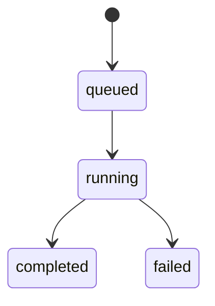

# Agent-Spec Action and Pipeline Contract

## Purpose

Actions are the bridge between the central agent-spec document and downstream
pipelines. An action definition should be enough for the server to decide where
the action is valid, for the UI to render a button or form, and for the worker
runtime to execute the action with immutable inputs.

## Action Definition

An action is Python code plus typed metadata. The metadata is the UI and API
contract; the Python handler is the execution implementation.

Conceptual Pydantic model:

```python
class ActionSpec(pydantic.BaseModel):
    action_id: str
    title: str
    summary: str
    version: str
    provider: str
    context: list[str]
    input_selector: dict[str, typing.Any]
    parameters_schema: dict[str, typing.Any]
    output_contract: list[dict[str, typing.Any]]
    writeback_policy: str
    capabilities: list[str]
    queue: str
```

Example:

```json
{
  "action_id": "systemc.generate",
  "title": "Generate SystemC",
  "summary": "Generate or refresh the SystemC simulator model for selected block versions.",
  "version": "0.1.0",
  "provider": "spec2gds.systemc",
  "context": ["document", "block"],
  "input_selector": {
    "requires_tags": ["ip", "interface", "systemc-perf"],
    "default_version": "active"
  },
  "parameters_schema": {
    "type": "object",
    "properties": {
      "output_style": {
        "type": "string",
        "enum": ["transactional", "cycle_approx"],
        "default": "transactional"
      }
    }
  },
  "output_contract": [
    {"kind": "artifact", "format": "cpp"},
    {"kind": "artifact_attachment", "target": "source_block"}
  ],
  "writeback_policy": "review_required",
  "capabilities": ["read_spec", "write_artifacts", "propose_writeback"],
  "queue": "local"
}
```

## Action Provider Protocol

Each Python action provider should expose two responsibilities:

- `describe() -> ActionSpec`: returns metadata for discovery and UI rendering.
- `run(context: ActionRunContext) -> ActionResult`: executes the action.

The registry should load providers from built-in modules first. Later it can
support Python entry points or a configured plugin directory.

## Input Snapshot Contract

Pipeline actions must receive immutable snapshots, not mutable editor state.

```json
{
  "snapshot_id": "snap_...",
  "document_id": "doc_...",
  "source_document_hash": "sha256:...",
  "created_at": "2026-07-05T00:00:00Z",
  "selected_versions": [
    {
      "block_id": "dma_controller",
      "version_id": "v2",
      "kind": "ip_block",
      "artifact_refs": [
        "spec://ipxact/dma.xml/VLNV",
        "spec_data/agent-spec/versions/dma_controller/v2.json"
      ]
    }
  ],
  "parameters": {}
}
```

Rules:

- `snapshot_id` is created at run submission time.
- `source_document_hash` records the agent-spec state used for the snapshot.
- `selected_versions` must include exact version IDs.
- Artifact references should be resolvable through the spec graph service.
- The snapshot should be persisted or reproducible from run metadata.

## Run Lifecycle



State meanings:

| State | Meaning |
| --- | --- |
| `queued` | Run exists but no worker owns it yet. |
| `running` | Pipeline implementation is executing. |
| `completed` | Run finished and all required outputs are recorded. |
| `failed` | Run ended with an error, diagnostic, or contract violation. |

`preparing`, `writeback_pending`, `cancelled`, retry, pause, and resume can be
added later if real pipeline behavior needs them.

## Event Envelope

All runtime events should share one envelope:

```json
{
  "event_id": "evt_...",
  "event_type": "run.artifact.created",
  "document_id": "doc_...",
  "aggregate_id": "run_...",
  "correlation_id": "run_...",
  "causation_id": "evt_...",
  "sequence": 17,
  "created_at": "2026-07-05T00:00:00Z",
  "actor": {"kind": "worker", "id": "local-systemc"},
  "payload": {
    "artifact_id": "artifact_...",
    "external_uri": "artifact-store://run_.../model.cpp",
    "spec_metadata_path": "spec_data/agent-spec/artifacts/artifact_....json"
  }
}
```

Event ordering is per aggregate. The UI should not assume global total ordering
across all documents or all runs.

## Writeback Record Contract

Pipelines do not directly mutate authoritative source block content. They return
artifact metadata that the server validates and applies. Generated files,
reports, and structured outputs are artifacts attached to existing blocks.
Malformed or uncertain output is recorded with `needs_human_feedback`.

```json
{
  "writeback_id": "wb_...",
  "run_id": "run_...",
  "document_id": "doc_...",
  "base_document_hash": "sha256:...",
  "read_set": [
    {"block_id": "dma_controller", "version_id": "v2"}
  ],
  "operations": [
    {
      "op": "attach_artifact",
      "artifact_id": "artifact_model_cpp",
      "target_block_id": "dma_controller",
      "role": "systemc_model"
    },
    {
      "op": "add_spec_link",
      "source_block_id": "dma_controller",
      "href": "spec://agent-spec/runs/run_.../artifacts/model.cpp"
    }
  ],
  "diagnostics": [],
  "status": "auto_applied"
}
```

Allowed operation families:

| Operation | Purpose |
| --- | --- |
| `attach_artifact` | Link a generated file/report/log to a block or run. |
| `add_spec_link` | Add or update a visible document link to a structured node or artifact. |
| `add_diagnostic` | Record warnings, errors, or review notes. |
| `append_attachment` | Add a new attachment without replacing existing attachments. |
| `request_human_feedback` | Record malformed, ambiguous, or review-required output without applying it to source content. |

## Conflict Policy

Before applying artifact metadata, the server should compare:

- The writeback `base_document_hash` with the current document hash.
- The writeback `read_set` with current active block versions.
- The writeback target blocks and attachments with any newer user edits.

Initial policy:

- If the output passes sanity checks, auto-apply the artifact reference and
  attachment.
- If an existing attachment is present, append a new attachment with metadata.
- If metadata is malformed or ambiguous, record `needs_human_feedback`.
- If a pipeline wants to update source block content, require a future reviewed
  source-update artifact flow.

## Artifact Policy

Artifacts should be addressable and hashable:

```json
{
  "artifact_id": "artifact_model_cpp",
  "run_id": "run_...",
  "kind": "source",
  "format": "cpp",
  "external_uri": "artifact-store://run_.../model.cpp",
  "spec_metadata_path": "spec_data/agent-spec/artifacts/artifact_model_cpp.json",
  "sha256": "...",
  "summary": "Generated SystemC model",
  "media_type": "text/x-c++src"
}
```

Large artifacts live externally. The agent-spec stores hashes, summaries, media types,
producer metadata, and stable retrieval metadata.

## Minimum Built-In Actions

The first useful action set should be deliberately small:

| Action | Purpose |
| --- | --- |
| `agent_spec.inspect` | Validate the graph, links, versions, tags, and artifact references. |
| `systemc.perf.pseudo` | Wait a few seconds and return fixed SystemC performance artifact metadata. |
| `systemc.bitaccurate.pseudo` | Wait a few seconds and return fixed SystemC bit-accurate artifact metadata. |

These prove action discovery, button rendering, run execution, event streaming,
artifact storage, automatic attachment, and auditability before real generators
are added.
