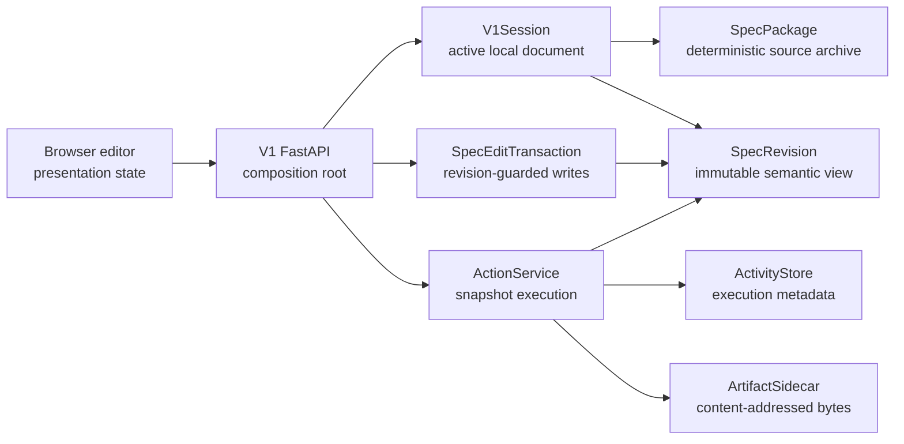

# Agent-Spec V1 Architecture

This document is the authoritative architectural description of the current
IP-XACT-centered implementation. The completed pivot plans in [`pivot/`](pivot/README.md)
explain how the project reached this architecture; they are not runtime
contracts.

## Product Boundary

V1 is a local, single-user hardware specification workbench. It provides a
deterministic `.spec` source package, immutable semantic queries, validated
source edits, entity-targeted local actions, artifact provenance, reviewed
change proposals, a FastAPI service, and a no-build browser editor.

V1 does not generate SystemC, RTL, or GDS. It does not import the retired ODT
format, run remote executors, or support concurrent users.

## System Shape

The dependency direction is deliberate: package and source models do not know
about FastAPI or the editor. Actions consume immutable revisions. The browser
receives JSON projections and never receives a mutable `SpecPackage`.

## Source and Activity Separation

Source truth consists of the manifest, narrative AST, IP-XACT documents,
assets, and accepted annotations. `SpecRevision.source_revision_hash` covers
that source set.

Action executions, reports, artifact metadata, events, and proposal review
state live under `activity/` and are excluded from the source revision hash.
Generated artifact bytes live in a content-addressed filesystem sidecar. This
lets an action record remain stable when a reviewed proposal creates a new
source revision.

## Core Boundaries

| Boundary | Current implementation | Responsibility |
| --- | --- | --- |
| Persisted contracts | `spec_format/models.py` | Strict manifest, narrative, asset, and entity-reference schemas. |
| Package I/O | `spec_format/archive.py` | Safe deterministic ZIP load/save, source hashing, structural validation. |
| Protocol validation | `spec_format/ipxact.py` | Safe XML parsing, IEEE 1685-2022 XSD validation, V1 profile checks. |
| Semantic reads | `spec_format/ir.py` | Immutable components, designs, connections, queries, dependency closure. |
| Source writes | `spec_format/transactions.py` | Atomic optimistic transactions and semantic revalidation. |
| Execution | `spec_format/actions.py` | Action contracts, snapshots, subprocess execution, artifacts, proposals. |
| HTTP/application | `spec_format/v1_api.py` | Single-user session, request translation, status mapping, editor snapshots. |
| Presentation | `spec_format/editor/` | Browser navigation and rendering from API projections. |
| Acceptance fixture | `spec_format/samples.py` | Deterministic sample covering every editor-visible relationship. |

## Read Flow

1. `SpecPackage.load()` rejects unsafe or non-V1 archives and validates package
   metadata, hashes, references, narrative shape, and IP-XACT documents.
2. `SpecRevision.from_package()` creates immutable semantic objects and runs
   cross-document validation.
3. `V1Session` holds the validated package, revision, activity store, sidecar,
   and action service for the one active local document.
4. `/documents/snapshot` returns the complete editor projection. Focused routes
   expose the same model for programmatic consumers.

## Write Flow

1. A client sends the source hash it last observed plus typed operations.
2. `SpecEditTransaction` compares the hash and applies all operations to a
   private package copy.
3. Package, protocol, and semantic validation run on the complete candidate.
4. On success, the API adopts and saves the new revision. On failure, it
   returns diagnostics and leaves the active source unchanged.

No API route directly edits ZIP members or mutable XML owned by the active
revision.

## Action and Proposal Flow

1. An action targets a stable component or design `EntityRef`.
2. `ActionService` validates inputs and captures an immutable dependency
   snapshot plus selected input artifacts.
3. A trusted local subprocess receives a language-neutral bundle in an isolated
   temporary directory.
4. The service validates `completion.json`, report shape, produced bytes,
   source-entity provenance, and parent lineage before recording success.
5. Source-changing output is stored as a pending proposal. Preview and accept
   both use the normal transaction validator; reject changes only review state.

## Architectural Invariants

- IP-XACT and the typed narrative AST are canonical source; rendered topology
  and editor cards are derived views.
- Every persisted relationship uses stable IDs or VLNVs, not display text.
- Source edits are atomic and optimistic-concurrency guarded.
- Activity never changes the source revision hash.
- Generated bytes are immutable and verified when written and read.
- Actions cannot mutate source directly.
- The active server has no dependency on ODT parsing, heading-derived blocks,
  or the removed prototype packages.

## Deployment Model

Run `uv run spec2gds-server` or `uv run spec2gds-editor`. Both start the same
local FastAPI process; the browser application is served at `/editor`. Host and
port can be set with `--host` and `--port`; `AGENT_SPEC_HOST` and
`AGENT_SPEC_PORT` provide environment defaults. Use `--reload` during Python or
editor development.

## Related Documents

- [`agent_spec_document_schema.md`](agent_spec_document_schema.md)
- [`spec_ir_v1.md`](spec_ir_v1.md)
- [`agent_spec_action_execution.md`](agent_spec_action_execution.md)
- [`spec_editor_v1.md`](spec_editor_v1.md)
- [`mvc_architecture_assessment.md`](mvc_architecture_assessment.md)
