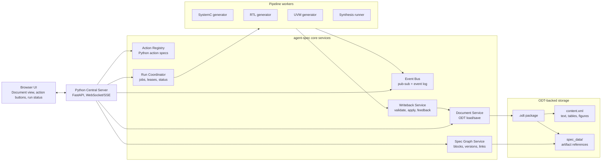
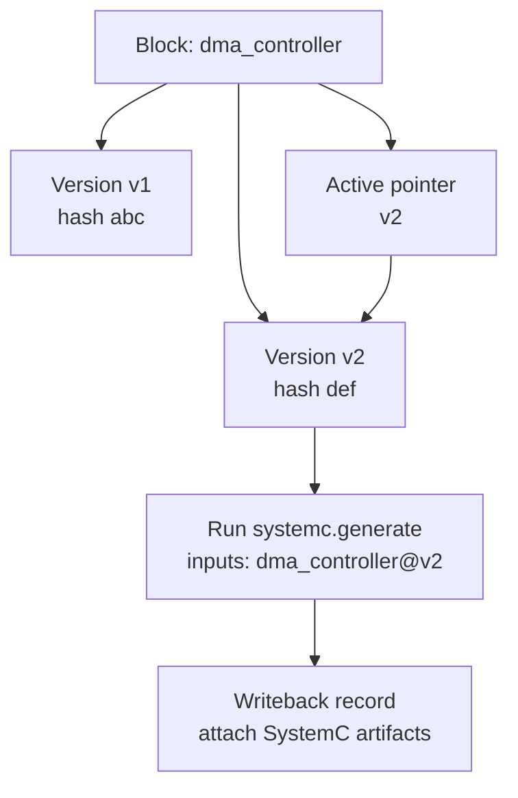
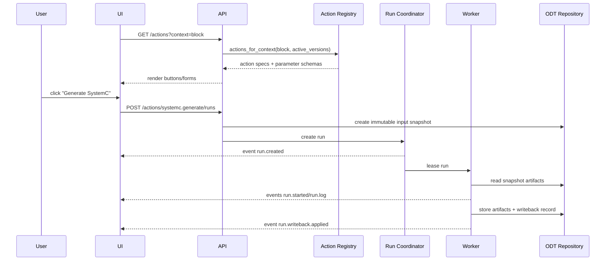
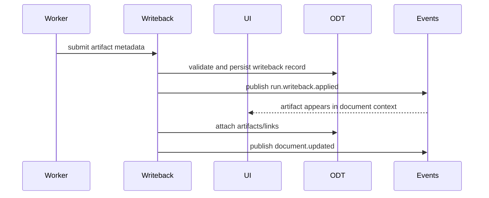

# Agent-Spec Architecture Plan

## Purpose

`agent-spec` should become the central source of truth for specification-driven
hardware work. It is not only a document viewer and not only a code generator.
It is the versioned repository of human-readable specification content,
deterministically defined artifacts, pipeline inputs, generated outputs,
provenance, and reviewable writebacks.

A normal hardware spec document may start as Word, PDF, Markdown, ODT, or
another human-written format. The architecture assumes that document can be
converted into an agent-spec document: an ODT-backed document with stable
blocks, tags, artifact references, and links for agent/pipeline use.

The existing ODT container remains the storage foundation:

- `content.xml` carries the editable human document: text, tables, figures, and
  headings.
- `spec_data/` carries artifact references and agent-spec metadata that office
  tools preserve inside the `.odt` package.
- `spec://` links connect visible prose to exact structured nodes.
- The current FastAPI plus React editor can become one client of the richer
  central server rather than the owner of pipeline logic.

## Architecture Goals

- Keep the `.odt` file as the portable project artifact and authoritative
  interchange format.
- Let downstream pipelines consume explicit versions of explicit spec blocks.
- Let each pipeline run independently and asynchronously.
- Make pipeline actions discoverable from Python configuration so adding a new
  action can update the UI without custom UI code.
- Preserve provenance: every generated result must point back to the source spec
  versions, action version, parameters, tool versions, and run status.
- Automatically attach valid artifact metadata, while routing malformed or
  ambiguous outputs to human feedback.
- Keep pipeline stages loosely coupled, matching the project constitution.

## Non-Goals For The First Architecture Slice

- Full multi-user collaborative editing.
- Distributed build farm orchestration.
- Exact LibreOffice rendering in the browser.
- Replacing ODT with a database as the primary source of truth.
- Running proprietary EDA tools directly from the browser.

## Core Vocabulary

The shared vocabulary is maintained in
[`agent_spec_vocabulary.md`](agent_spec_vocabulary.md). Current key decisions:

- Every ODT heading or subheading creates a versioned block.
- A block can also be called a document section or subsection.
- A block version includes both the human prose under that heading and linked
  artifacts.
- Pipeline outputs are artifacts attached to existing blocks. They do not create
  new headings or blocks by default.
- Actions are assigned through block tags.

## High-Level Shape



## Recommended Python Package Boundaries

The existing `spec2gds.spec.odt_container` package should remain the ODT package
engine. The new architecture should add an orchestration package above it:

```text
spec2gds/
  agent_spec/
    api/              central FastAPI app and websocket/event routes
    actions/          action registry, plugin loading, built-in actions
    events/           event envelope, in-process bus, durable event log
    graph/            block/version graph models and queries
    runs/             run coordinator, leases, worker protocol
    storage/          ODT-backed repository and artifact policies
    writeback/        validation, auto-apply, feedback, and audit logic
    workers/          local worker runtime and adapters
  spec/
    odt_container/    existing ODT container, plugins, editor core, web shell
```

The current editor API can either stay as an ODT-only development surface or be
gradually folded under `agent_spec/api` once the action/event model exists.

## ODT Storage Model

The `.odt` remains the portable artifact. The server should project it into an
in-memory spec graph while editing or running actions, then persist important
state back into `spec_data/agent-spec/`.

Recommended paths:

```text
spec_data/agent-spec/
  manifest.json
  graph.json
  versions/<block_id>/<version_id>.json
  runs/<run_id>/run.json
  runs/<run_id>/events.ndjson
  artifacts/<artifact_id>.json
  writebacks/<writeback_id>.json
```

Rules:

- `manifest.json` identifies the agent-spec schema version and document ID.
- `graph.json` stores block IDs, active versions, tags, relationships, section
  anchors, and artifact references.
- `versions/` stores immutable block snapshots. The content hash can become part
  of the version ID.
- `runs/` stores action execution records, event summaries, produced artifact
  IDs, logs, metrics, and tool metadata.
- `artifacts/` stores embedded summaries, hashes, media types, producers, and
  external locations for artifacts.
- `writebacks/` stores applied writeback records and `needs_human_feedback`
  records for malformed or ambiguous outputs.
- Large artifacts live externally. The ODT stores hashes, summaries, and stable
  artifact references; the exact external mechanism will be designed later.

## Versioning Model

Pipelines must consume immutable inputs. The UI may show an active version, but
an action run should record the exact versions it used.



Version rules:

- A block version is immutable after creation.
- Editing a block creates a new version.
- A pipeline action receives a snapshot containing exact block version IDs.
- A run records a read set: all block versions and artifacts it read.
- A writeback records a write set: artifact references, links, diagnostics, and
  metadata it wants to add or update.
- Applying a writeback attaches artifacts, diagnostics, links, and metadata to
  existing blocks rather than creating new blocks by default.

## Event-Driven Runtime

The first implementation can use an in-process event bus. The contract should be
designed so Redis Streams, NATS, or another broker can replace it later without
changing action code.

Important topics:

| Topic | Producer | Consumers |
| --- | --- | --- |
| `document.opened` | API | UI, graph service |
| `document.updated` | document/writeback service | UI, action eligibility cache |
| `action.requested` | UI/API | run coordinator |
| `run.created` | run coordinator | UI, workers |
| `run.started` | worker | UI, audit log |
| `run.log` | worker | UI, run record |
| `run.artifact.created` | worker | UI, artifact index |
| `run.writeback.applied` | writeback service | UI, audit log |
| `run.needs_human_feedback` | writeback service | UI, feedback queue |
| `run.completed` | worker | UI, downstream automation |
| `run.failed` | worker | UI, diagnostics |

Event envelope:

```json
{
  "event_id": "evt_...",
  "event_type": "run.started",
  "document_id": "doc_...",
  "aggregate_id": "run_...",
  "correlation_id": "run_...",
  "causation_id": "evt_...",
  "sequence": 42,
  "created_at": "2026-07-05T00:00:00Z",
  "actor": {"kind": "user", "id": "local"},
  "payload": {}
}
```

The UI should subscribe to server events through WebSocket or SSE and update
visible state from events plus periodic snapshot refreshes.

## Action Trigger Flow



## Writeback Flow



Default policy is auto-apply after sanity checks pass. Outputs that are
malformed, ambiguous, or attempt source-block updates are recorded as
`needs_human_feedback`.

## Service Responsibilities

| Service | Responsibility |
| --- | --- |
| Document Service | Load, save, validate, and checkpoint ODT documents using the existing container layer. |
| Spec Graph Service | Resolve block IDs, tags, active versions, `spec://` links, artifact references, and dependency relationships. |
| Action Registry | Load Python action definitions and expose UI-ready action metadata. |
| Run Coordinator | Create runs, lock input snapshots, lease work to local or remote workers, and maintain run status. |
| Event Bus | Publish runtime events, route UI subscriptions, and persist durable event summaries. |
| Worker Runtime | Execute action handlers with typed context, collect outputs, and report events. |
| Writeback Service | Validate pipeline output, detect conflicts, auto-attach accepted artifacts, and route questionable output to `needs_human_feedback`. |
| Artifact Service | Store generated files, hashes, summaries, and download metadata. |

## UI Responsibilities

The UI should remain a client of the architecture:

- Render the human document, tables, figures, block version controls, tags, and
  artifact previews.
- Ask the server for available actions for the current document/block/context.
- Render action buttons and parameter forms from server-provided schemas.
- Trigger runs and subscribe to run/document events.
- Show logs, artifacts, diagnostics, and feedback-needed items in context.
- Let the user review and apply generated updates.

The UI should not hard-code pipeline behavior such as how to generate RTL or how
to run synthesis. It should only understand action metadata and generic run
states.

## First Implementation Slice

1. Add `spec2gds/agent_spec/` with Pydantic models for documents, blocks,
   versions, actions, runs, events, artifacts, and writebacks.
2. Implement an in-process event bus with a durable event-log abstraction.
3. Implement a Python action registry from repo Python modules plus YAML config.
4. Add pseudo `systemc.perf` and `systemc.bitaccurate` actions that return fixed
   artifact metadata after a short delay.
5. Add API endpoints for action discovery, run creation, run status, events, and
  auto-apply, feedback, and audit flows.
6. Persist `spec_data/agent-spec/manifest.json`, `graph.json`, run records, and
   writeback records inside sample ODT files.
7. Update the React UI to fetch actions by context and render generic action
   buttons/forms.
8. Add tests around action discovery, snapshot immutability, event ordering,
   writeback persistence, and ODT reload.

## Design Risks

- ODT files are ZIP packages, so frequent append-only event persistence can be
  expensive. Keep live events in server memory and checkpoint durable summaries
  into the ODT at run boundaries.
- Large artifacts need a stable external storage mechanism. Keep hashes and
  summaries in ODT so the agent-spec document remains authoritative.
- Concurrency is subtle. Start with a single-writer document lock per ODT file,
  then add optimistic conflict checks based on read/write sets.
- Action plugin freedom can become unsafe. Use typed schemas, explicit
  capabilities, timeouts, and visible provenance before running external tools.
