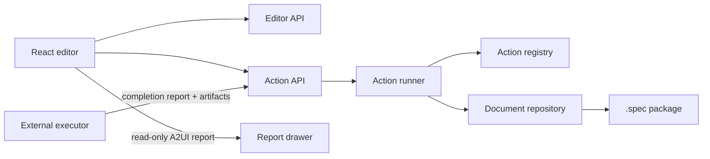

# Agent-Spec Architecture

`agent-spec` is a local, single-user `.spec` document editor with an action
execution contract. Document content stays office-compatible in `content.xml`;
project metadata, artifacts, runs, reports, and IP-XACT payloads live under
`spec_data/` in the same package.

## Components

- `api/document_app.py` serves editor snapshots, saves, file browsing, and
  IP-XACT views, and mounts the action API at `/agent-spec`.
- `api/app.py` exposes enabled actions, action context, precondition checks,
  launch, run lookup, and executor completion.
- `actions/builtin.py` registers declarative actions and their condition hooks.
- `runs/runner.py` captures immutable snapshots, records dispatch, accepts
  executor completion, validates artifacts/report data, and creates A2UI
  report streams.
- `storage/repository.py` projects heading blocks and persists graph, run,
  artifact, report, and audit data.
- `query.py` supplies read-only document/action context through the
  `agent-spec.actions.v1` envelope.
- `document/editor_web/` provides the document canvas, contextual Actions
  popover, and mutually exclusive IP-XACT/report right drawer.

## Action Lifecycle

1. The editor shows every enabled action for each heading.
2. A schema-driven form collects inputs; the server evaluates preconditions.
3. Trigger creates a running record, captures its snapshot, and records a
   dispatch event without invoking an external command.
4. An executor completes the run with structured report data and artifacts.
5. Postconditions validate the completion. Valid artifacts are attached; a
   malformed completion remains visible as a review-required report.
6. The server persists a restricted A2UI surface, rendered read-only in the
   report drawer.

External command launching, authentication, retries, cancellation, queues,
and multi-user coordination are intentionally not implemented.
