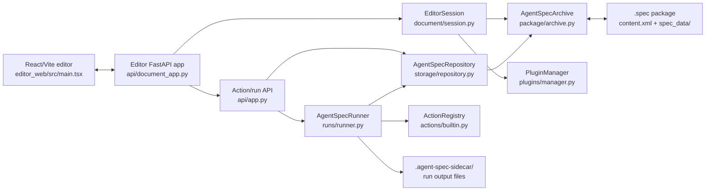
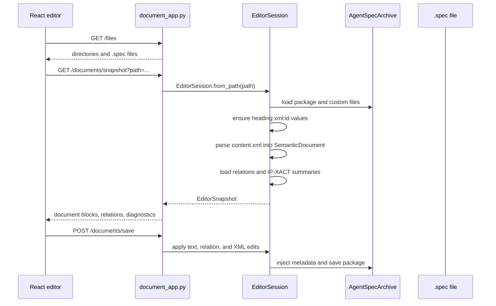
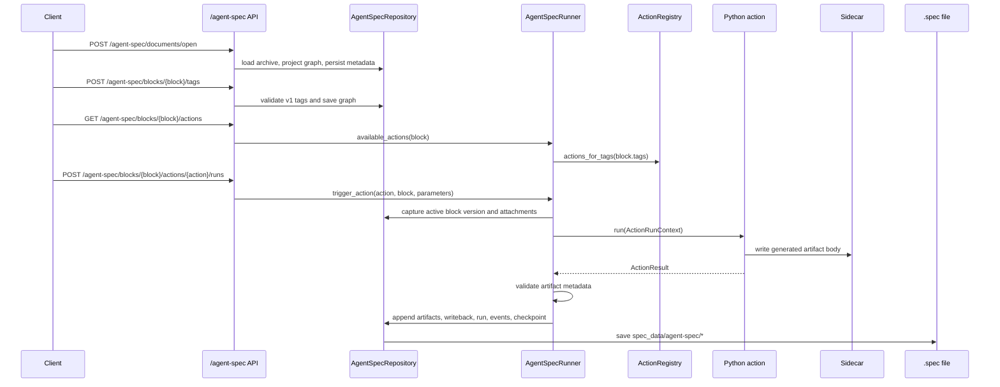

# Agent-Spec Architecture

## Purpose

This document describes the current `agent-spec` implementation in this
repository. It is the place to understand the software components, the runtime
flow, and where to read code for details.

`agent-spec` currently provides a local, single-user workflow for `.spec`
documents:

- `.spec` files keep the human-readable document body in office-compatible
  `content.xml`.
- Project metadata and structured hardware payloads live under `spec_data/`
  inside the same package.
- The local FastAPI backend projects document headings into blocks, records
  block versions, stores action/run metadata, and preserves embedded artifacts.
- The React/Vite editor consumes backend snapshots, edits supported document
  blocks, previews IP-XACT attachments, and can trigger the current action API.

The repository is still an umbrella for specification-driven hardware design
experiments. The architecture below reflects the code that exists today, not a
future multi-user orchestration system.

## Component Map

```text
spec2gds/agent_spec/
  api/
    app.py              action/run API mounted at /agent-spec
    document_app.py     editor API, file browser, IP-XACT endpoints, API mount
    __main__.py         uvicorn entry point
  document/
    semantic.py         content.xml parser and plain-text edit application
    session.py          editor facade around one AgentSpecArchive
    relations.py        section-version and IP-XACT attachment metadata
    ipxact_view.py      lightweight IP-XACT summaries for the editor
    editor_web/         React/Vite frontend and Playwright smoke test
  package/
    archive.py          .spec package load/save and spec_data preservation
    cli.py              list/inject/extract/validate CLI
    verifier.py         package/link validation
  plugins/
    base.py             modality plugin protocol
    manager.py          plugin registry and spec:// URI resolution
    json_payload.py     JSON payload plugin
    ipxact.py           IP-XACT payload plugin
  storage/
    repository.py       graph projection, metadata persistence, sidecar writes
  actions/
    builtin.py          action registry and built-in pseudo actions
  runs/
    runner.py           snapshot capture, action execution, writeback checks
  models.py            Pydantic contracts shared across the v1 action flow
  samples/             sample .spec builders and checked-in generated samples
```

Focused tests live under `tests/agent_spec/`. Benchmark fixtures live under
`benchmarks/agent_spec/`.

## Runtime Shape



There are two related API surfaces:

- `spec2gds.agent_spec.api.document_app.create_app()` is the local editor API.
  It serves document snapshots, text edits, active section choices, IP-XACT
  preview/editing, image assets, and file browsing. It mounts the action API at
  `/agent-spec`.
- `spec2gds.agent_spec.api.app.create_app()` is the action/run API. It opens one
  active document session, exposes blocks, updates block tags, lists available
  actions for a block, triggers action runs, and returns run events.

Run the combined local API with:

```bash
uv run python -m spec2gds.agent_spec.api
```

## Document Storage

A `.spec` file is an office-compatible package handled by
`package/archive.py`. The human document body is `content.xml`. Project-owned
metadata and structured hardware payloads are stored as package parts below
`spec_data/`.

Current important paths:

```text
spec_data/
  ipxact/*.xml
  agent-spec/
    manifest.json
    graph.json
    versions/<block_id>/<version_id>.json
    artifacts/<artifact_id>.json
    runs/<run_id>/input_snapshot.json
    runs/<run_id>/run.json
    runs/<run_id>/events.ndjson
    writebacks/<writeback_id>.json
    checkpoints/<checkpoint_id>.json
  agent-spec-editor/
    relations.json
    active_section_versions.json
```

`AgentSpecArchive` preserves all `spec_data/` custom files during load/save and
keeps the package mimetype compatible with office tooling. The repository layer
adds the `spec_data/agent-spec/` graph/run metadata. The editor layer adds
`spec_data/agent-spec-editor/` UI relation metadata.

Large generated files are written to the sidecar directory, which defaults to:

```text
<document>.agent-spec-sidecar/
```

The `.spec` file stores artifact metadata, hashes, summaries, and `file://`
references to those sidecar outputs.

## Editor Flow



`document/semantic.py` is intentionally a semantic projection, not a full word
processor. It supports headings, paragraphs, list items, tables, images, links,
and adjacent legacy section variants named `Title//version`. Plain-text edits
are applied only to simple editable text blocks. Blocks with inline markup,
tables, and images remain read-only in the current editor.

`document/session.py` validates links and IP-XACT summaries before save. Warnings
and errors are blocking for the current save flow.

## Action And Run Flow



The current runner executes actions synchronously in-process. It still records
the lifecycle as run events so the persisted data shape remains auditable.

Implemented built-in actions:

| Action ID | Required tag | Behavior |
| --- | --- | --- |
| `agent_spec.inspect` | none | Emits an informational diagnostic for the captured snapshot. |
| `systemc.perf.pseudo` | `systemc-perf` | Writes a fixed pseudo SystemC performance artifact to the sidecar. |
| `systemc.bitaccurate.pseudo` | `systemc-bitaccurate` | Writes a fixed pseudo bit-accurate artifact to the sidecar. |

Action enablement can be controlled by a small JSON-or-simple-YAML config passed
when opening the action API session.

## Graph And Version Model

`AgentSpecRepository.project_graph()` parses current headings from `content.xml`
and creates one block per heading. For each heading block it gathers the content
until the next heading at the same or higher level, combines that content with
attached artifact IDs, and computes a content-hash version ID.

Current rules:

- A block ID is the heading `xml:id`.
- Missing heading IDs are assigned by `document.semantic.ensure_heading_ids()`.
- New content hashes create new immutable `BlockVersionRecord` entries.
- The active version pointer moves to a new version when content changes.
- Tags are stored on `BlockRecord` and validated against `models.V1_TAGS`.
- Attachments are append-only relationships from a block to artifact metadata.

The graph is stored in `spec_data/agent-spec/graph.json`; individual version and
artifact records are also persisted under `versions/` and `artifacts/`.

## Writeback And Safety

Pipeline actions do not edit source prose directly. The current writeback path
accepts generated artifact metadata only when sanity checks pass:

- artifact hash must be a `sha256:` value
- external URI must use `file://` or `artifact-store://`
- artifact source version must be part of the input snapshot
- artifact role must match the action output contract when one is declared
- summary, media type, and artifact kind must be present

Accepted artifacts are attached to the target block and persisted in the graph.
Malformed or unsupported output produces a `WritebackRecord` with
`needs_human_feedback`.

`AgentSpecRepository.save()` also refuses to write when the `.spec` file changed
outside the loaded server session. This protects the local single-writer model
from silently overwriting external edits.

## Where To Read Next

- Vocabulary: [`agent_spec_vocabulary.md`](agent_spec_vocabulary.md)
- Action contracts: [`agent_spec_action_contract.md`](agent_spec_action_contract.md)
- Current setup and commands: [`agent_spec_v1_setup.md`](agent_spec_v1_setup.md)
- Roadmap and open questions: [`agent_spec_roadmap_questions.md`](agent_spec_roadmap_questions.md)
- Benchmarks: [`agent_spec_benchmarks.md`](agent_spec_benchmarks.md)
