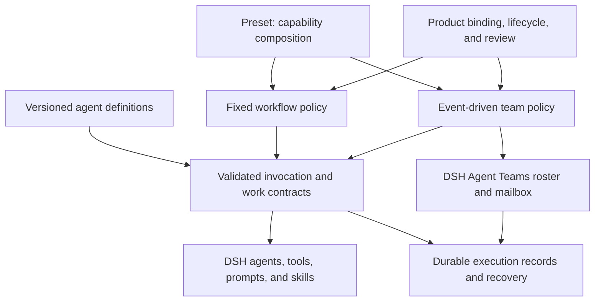
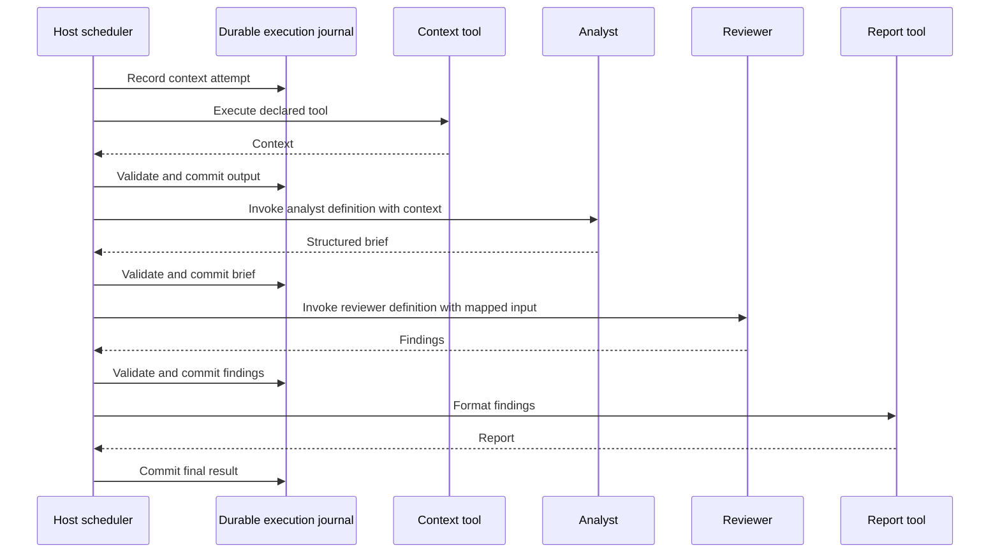

# DSH Agentic Systems: Fixed Workflows and Event-Driven Agents

Date: 2026-09-28. Status: current-code assessment and proposed architecture.
Audience: DSH and spec2gds engineers. No runtime features in this proposal have
been implemented by this documentation change.

## 1. Answer and recommendation

**The current spec2gds assistant does not fully support either requested model.**
Its workflow service provides durable lifecycle and review state, but does not
execute a prescribed sequence of individually configured stages. Its
`orchestrated` preset provides bounded, one-shot analysis children, rather than
independent peers that repeatedly accept work. The underlying pinned DSH
checkout contains substantially more functionality, including experimental
Agent Teams with durable peer messaging and a shared task board.

**Recommend a shared orchestration foundation with two execution policies:
fixed workflows and event-driven teams.** Fixed workflows are a constrained
case of orchestration. Presets remain independently selectable capability
compositions that enable a policy and its tools; a preset itself is not the
executor, queue, or recovery mechanism.

Applied to the original alternatives:

- **Option A, a separate preset orthogonal to workflows:** useful as a product
  entry point, but insufficient as the architecture. Configuration cannot supply
  the missing typed execution, scheduling, and recovery guarantees.
- **Option B, a broader system where workflows are a specific case:** the
  recommended runtime model. Implement it as reusable DSH services and policy
  plugins, then expose focused product presets. Avoid making one large preset
  responsible for every coordination behavior.

Reuse and harden existing Agent Teams for the team policy. Build the missing
fixed-stage executor using DSH tools, agents, prompts, and persistence. Share
agent definitions and execution contracts, while allowing a tool-only workflow
to run without creating a team. Keep `sWorkflow` as spec2gds lifecycle and review
governance during adoption. [Product composition][p-profile],
[workflow implementation][d-workflow], [team implementation][d-team].

## 2. Scope and evidence baseline

The user confirmed a reusable DSH architecture, spec2gds as the first
integration, durable state and queued work, one server initially, and permission
to base the recommendation on experimental Agent Teams with hardening.
Multi-server coordination and runtime implementation are outside this report.

The product was examined in the current working tree, including existing local
changes. The sibling DSH checkout was clean and its HEAD matched
[`ai-assistant/harness.lock.json`](../ai-assistant/harness.lock.json):
`c758a9c270123d1640e9f205909728f110c1eb02`. DSH source links below are pinned to
that commit. Findings concern this integration and pin, not an unspecified
latest upstream release. The [report plan](agentic-systems-report-plan.md)
records the agreed investigation.

### Terms that must remain separate

| Term | Responsibility |
| --- | --- |
| Product profile | Process-level web/headless composition. |
| Agent preset | Trusted plugins and capabilities mounted for an Agent. |
| Agent definition, proposed | Versioned role, prompt, model, context/output contracts, tools, and skills. |
| Fixed workflow definition, proposed | Declared stage graph and data bindings; the host controls progression. |
| Team definition, proposed | Named agent roles, permitted work routing, and lifecycle policy. |
| Current `sWorkflow` | Durable objective, budgets, draft, checkpoints, review, and human-controlled lifecycle. |
| Session | Durable event history; an Agent is its live execution handle. |
| Work item, proposed | One identified assignment with validated input, progress, terminal result, and retry identity. |

The current [`prepare-reviewed-change` YAML][p-workflow] and the older DSH
[`tool-workflow`][d-script-workflow] are different mechanisms. The former
declares lifecycle-stage descriptions; the latter runs model-authored JavaScript
orchestration and blocks the calling turn until completion. Neither establishes
the requested deployment-defined stage contract by merely being enabled.

## 3. Capability assessment

Here, **enabled** means available in the product; **available but not
integrated** means present in pinned DSH; **partial** means the foundation exists
but lacks a requested guarantee; **requires development** means the inspected
interfaces do not provide the contract.

| Requirement | Current product / pinned DSH assessment | Evidence |
| --- | --- | --- |
| Versioned prompts and durable lifecycle | Enabled: exact prompt/workflow references, sealed catalogs, revisioned snapshots. | [Product host][p-host], [workflow service][d-workflow] |
| Host-enforced fixed stage sequence | Requires development: stage entries contain only ID, kind, description; checkpoint accepts an identifier without advancing a validated graph. | [Workflow service][d-workflow], [strict YAML parser][d-yaml] |
| Direct tool stage with mapped input/output | Requires development in the workflow layer; the underlying typed tool executor is reusable. | [Workflow definition][p-workflow], [tools service][d-tools] |
| Separate prompt/model/tool set per LLM stage | Partial: subagent APIs support persona, model options, tool filtering, and one-shot structured output; the workflow catalog has no stage bindings for them. | [Subagent contracts][d-subagent-types], [child composition][d-child] |
| Predetermined context input schema | Requires development as an invocation boundary; typed tool arguments and domain proposals are narrower existing contracts. | [Domain tools][p-tools], [workflow service][d-workflow] |
| Validated stage result | Partial: one-shot subagents support object-rooted output schemas; continuable starts explicitly omit `outputSchema`. | [Subagent contracts][d-subagent-types] |
| Per-role skills | Partial: DSH has scoped skill discovery/loading; product disables `tool-skill` and adapters currently list no skill packages. | [Product profile][p-profile], [Spec adapter][p-adapter], [skill registry][d-skills] |
| Reusable independent agents | Available but not integrated: continuable children have durable identities and can be resumed. Product selects one-shot children. | [Orchestrated preset][p-orchestrated], [subagent contracts][d-subagent-types] |
| Peer-to-peer messaging | Available but not integrated through Agent Teams. Ordinary subagent messaging is restricted to supported direct parent/child edges. | [Team mailbox][d-mailbox], [subagent control][d-control] |
| Durable mail and duplicate receipt prevention | Available but not integrated: Team mailbox queues before dispatch and checks target receipts during recovery. | [Mailbox][d-mailbox], [persistence tests][d-team-tests] |
| Shared task dependencies and ownership | Available but not integrated: Team tasks support dependencies and compare-and-set updates. Task readiness does not start an agent. | [Team task board][d-task-board], [team tools policy][d-team-tools] |
| Typed work/results with automatic processing recovery | Requires development beyond Team free-form messages and its task board. Inbox receipt does not prove completed work. | [Team types][d-team-types], [mailbox][d-mailbox] |
| Automatic restart of all active runs at server boot | Requires a host recovery driver; Team recovery attaches to live/created agents rather than scanning and starting all dormant product runs. | [Team service][d-team], [product startup][p-host] |
| Pause/review/cancel/budget lifecycle | Enabled for current workflows; applying it across new stage attempts and team work needs integration. | [Product host][p-host], [workflow service][d-workflow] |

### Why existing workflows are not a fixed executor

`SWorkflowDefinition.steps` has no tool name, agent reference, system prompt,
context schema, result schema, dependencies, or data bindings. The strict YAML
parser rejects additional fields. `start()` writes a run snapshot;
`checkpoint()` records a step label, note, and usage delta. It neither invokes
the next stage nor verifies that checkpoint labels follow the declared stages.
A model instruction to follow a sequence cannot replace host enforcement.
[Definition and lifecycle methods][d-workflow], [parser][d-yaml].

The generic script workflow package is also not a direct solution: execution
uses a model-authored script, and its durable run records are observational.
They are not a persisted stage scheduler capable of resuming an interrupted
fixed graph. The product currently disables that tool.
[Script workflow contract][d-script-workflow], [product profile][p-profile].

### What Agent Teams already supplies, and what it does not

Agent Teams supplies a named roster, peer messages, cold activation of inactive
teammates, a task board, and change notification. Any member can send work to
another member; only the Lead creates or interrupts teammates. This fits the
requirement to generate assignments for other agents without requiring
unrestricted agent creation. Team metadata lives in the Lead Session; each
agent keeps its own conversation. [Team service][d-team], [roster][d-roster],
[team types][d-team-types].

There are important boundaries:

- `SpawnTeammateRequest.prompt` is initial user-message content, not an
  independently configured system prompt. The Team API does not expose a role
  definition, tool/skill allowlist, or per-item input/output schema. Lower-level
  continuable creation supports some of these composition inputs, so extend
  that path rather than replacing the agent loop.
- Children inherit the parent's preset composition. A persona override alone
  does not remove other inherited prompt sections or domain tools. Role
  isolation must be tested at the effective request and tool-execution boundary.
- Peer mail uses Steer: it can enter a running agent at a step boundary. This is
  not a guarantee of one independent task per turn, in FIFO processing order.
- Mail acknowledgement means the target durably holds the message in its inbox
  or history. A crash after receipt can still leave business work unfinished.
- Task records support pending, in-progress, completed, and deleted states;
  there is no complete retry/failure/result contract for typed work. Completing
  a dependency changes readiness without automatically scheduling its owner.
- Recovery runs when relevant agents are present or created. Automatic server
  boot recovery needs explicit run discovery and root activation.
- Ownership and dispatch are process-local. Existing queue deduplication does
  not establish distributed coordination or exactly-once external effects.

These are supported by the [creation contracts][d-team-types],
[child composition][d-child], [mailbox][d-mailbox],
[task board][d-task-board], and [service recovery hooks][d-team].

## 4. Architectural options

The effort estimates below are relative engineering assessments, not measured
delivery estimates. All options still need work contracts and product integration.

| Criterion | Extend current `sWorkflow` to cover everything | Independent team preset/runtime | Shared foundations, two policies — recommended |
| --- | --- | --- | --- |
| Initial effort | High: lifecycle catalog becomes an executor and peer scheduler. | Lowest for a free-form team demo; substantial for typed durable work and a separate fixed executor. | Moderate upfront: shared definitions and invocation contracts, followed by each policy. |
| Reuse | Keeps current governance but risks rebuilding Team facilities. | Reuses Teams quickly; tends to duplicate contracts across modes. | Reuses DSH services and Teams without making tool-only workflows depend on a roster. |
| Fixed-flow control | Possible after major schema and execution changes. | Requires a separate enforcing executor. | Explicit host-owned stage scheduler. |
| Durability | Existing lifecycle snapshots are insufficient for attempts and mail. | Team mail is durable; processing recovery still missing. | Shared execution records and recovery policy, plus existing mailbox mechanisms. |
| Configuration | One catalog becomes responsible for unrelated concepts. | Simple presets, but separate definitions and semantics can drift. | Agent, workflow, and team definitions have distinct responsibilities. |
| Compatibility | Largest risk to existing lifecycle and persisted runs. | Existing modes can remain unchanged. | Additive modes and versioned records; current modes retain their semantics. |
| Maintenance | Broad coupling between governance and execution. | Repeated validation, budget, and observability logic. | Common execution contracts with separate policy owners. |

Adopt the third alternative. New `workflow` and `team` presets are reasonable
proposed user entry points after their runtime support exists. Keep existing
`focused`, `goal`, and `orchestrated` behavior intact. Product preset names and
the current workflow budget enum are hard-coded in several places, so adding
directories alone is insufficient. [Product types][p-types],
[host validation][p-host], [workflow types][d-workflow-types].

## 5. Proposed reusable architecture

Everything in this section is proposed. Names describe responsibilities, not
packages or APIs that can already be imported.



### Definitions and interface responsibilities

| Proposed contract | Minimum contents and behavior |
| --- | --- |
| `AgentDefinition` | Exact version/digest; system-prompt reference; model configuration; context and result schemas; tool allowlist; skill references/loading policy; execution limits. |
| `FixedWorkflowDefinition` | Exact identity; tool or agent stage target; dependencies; explicit input mappings; result contract; bounded retry and failure policy. |
| `TeamDefinition` | Named members referring to agent definitions; allowed sender/recipient/work-type routes; concurrency and lifecycle limits. |
| `WorkItem` | Stable ID, run, sender, recipient, contract version, validated input, correlation/dependency IDs, status, attempt, and result or failure. |
| Invocation service | Resolve a definition; construct isolated context; call a registered tool or configured agent; validate the result; record execution and usage. |
| Work service | Submit, claim, complete, fail, cancel, and inspect typed assignments with revision checks. Successful submission means durable acceptance. |
| Recovery driver | Load eligible active runs; restore role configuration and owner binding; reconcile unfinished attempts; dispatch eligible pending work. |

Reuse the Team task board's ownership and dependency rules for team work state.
For the new mode, use one authoritative versioned work lifecycle and derive
the board view from those records. Keep existing Team task records
readable for existing sessions. Do not make a new work table and old Team tasks
independently authoritative for the same assignment. Mailbox delivery state is
separate because it tracks receipt rather than processing.

Implement these capabilities through Cordis services, providers, and consumers.
Reuse DSH Session persistence and existing tool execution. Avoid a second chat
loop or an unrelated message broker for the initial single-server deployment.

### Prompt, context, schema, and skill isolation

Each invocation resolves an immutable role definition before work starts.
Context is built from declared fields and artifact references, validated by the
host, and then rendered into the model request. A JSON blob inside prose is not
schema enforcement. Stage outputs and work results are validated before their
consumers can act on them.

Use fresh invocation context for fixed LLM stages. For teams, retain the agent's
own Session history by default, but validate each new work payload separately;
context schema validation does not claim that the whole conversation has that
schema. Parent transcript inheritance is opt-in and excluded from the initial
role-isolation example.

Compose role-specific system sections explicitly; restrict tool execution as
well as visibility. Skills are instructions and supporting resources, not
permission grants. Declare required skills to preload and optional skills that
the agent may load. Resolve and record their content identities for replay.
DSH's live skill registry supports scoped discovery, but immutable role skill
bundles and an enforced role allowlist need integration.
[Prompt catalog][d-prompts], [skill registry][d-skills],
[subagent restrictions][d-subagent-types].

### Fixed workflow policy

The host schedules the declared graph. Initial support should cover sequences
and static acyclic dependencies, including fixed fan-out/fan-in. Dynamic graph
rewriting and model-selected next stages are excluded. Conditional paths and
bounded loops can be specified later without weakening the fixed-flow contract.

A tool stage calls the DSH tool executor directly, with declared validated
arguments and no LLM required. An LLM stage runs its own agent definition;
allowed tool use within that stage remains bounded by its policy. If an exact
tool sequence is required, represent those calls as explicit stages.

Persist each attempt before execution and its validated result before scheduling
dependents. Declared mappings select the next stage's context. Schema failure
blocks progression. Only the host marks a stage successful. Human review is a
host-owned wait gate, never a model-asserted approval.

### Event-driven team policy

Create a declared roster through the host/Lead and retain stable member
identities across activations. An agent may submit typed work to a permitted
peer without asking the Lead LLM to relay it. The host validates and persists
the work, dispatches it, and records a correlated terminal result. Only the
host/Lead manages roster membership in the initial design.

Default to one active work item per agent. Buffer new assignments until the
agent is ready; do not expose unrestricted raw Steer messaging as the work
submission path. Reuse the Team mailbox when dispatch is eligible, and retain
control messages as a separate channel. This requires a typed admission and
dispatch layer around current Team messaging.

An agent that needs a peer result records a dependency and yields its turn.
The dispatcher resumes the waiting item when the dependency completes. Avoid
holding a live LLM turn while waiting or polling. Once an agent finishes and has
no eligible work, it can unload; its durable identity and queue remain. A Team
change notification is useful for observation, but does not itself assign work
or prove that an assignment completed.

### Durability, failures, and limits

- Discover and activate unfinished runs at server startup. Resume active work;
  keep paused runs, human-review waits, and terminal runs in their recorded state.
- Persist accepted work and terminal results. Reconcile any interrupted attempt
  before retrying; retain the same work ID and a distinct attempt identity.
- Apply bounded retries to eligible read-only operations. Invalid output gets
  only its declared repair budget. Uncertain external effects require owner
  reconciliation before any repeat action.
- Reuse receipt deduplication, and add idempotent result acceptance and durable
  result notification. A crash between work completion and notification must
  allow notification to be reconstructed without redoing completed work.
- Record failed/cancelled outcomes visibly. A claimed item cannot disappear
  because its agent becomes idle. Reject dependency cycles; report stalled
  runs with no runnable work instead of repeatedly waking agents.
- Apply run-wide and per-agent request, token, elapsed-time, work-count, and
  concurrency limits at the host. Count an identity once at creation and count
  active execution separately; reactivation is not another newly created agent.
- Pause stops new admissions/dispatch and drains or interrupts active work under
  a declared policy. Cancel closes new work and propagates to owned attempts;
  already executed external effects are reconciled, not assumed rolled back.

The target is durable acceptance, duplicate-resistant delivery, and explicit
processing recovery. It is not exactly-once LLM execution or external mutation.

## 6. Worked examples

The YAML below is illustrative proposed syntax. Current catalog loaders will
reject it. Referenced prompts, schemas, and skills are example identities, not
shipped assets. `inputBindings` selects named fields without evaluating code.

### Example A: fixed design-analysis workflow

The host reads context, asks a requirements agent for a structured brief, asks a
reviewer for findings, and invokes a deterministic report formatter. Neither
agent can skip review or introduce another stage.

```yaml
kind: AgentDefinition
id: requirements-analyst
version: 1.0.0
systemPrompt: requirements-analysis@1.0.0
modelProfile: design-analysis
contextSchema: requirements-analysis-input@1.0.0
outputSchema: requirements-brief@1.0.0
tools: []
skills:
  preload: [hardware-requirements@1.0.0]
  available: []
```

```yaml
kind: FixedWorkflowDefinition
id: review-design
version: 1.0.0
stages:
  - id: context
    kind: tool
    tool: get_bound_context
    inputBindings: {binding: run.binding}
    outputSchema: bound-design-context@1.0.0
  - id: analyze
    kind: agent
    agent: requirements-analyst@1.0.0
    after: [context]
    inputBindings: {context: stages.context.output}
  - id: review
    kind: agent
    agent: design-reviewer@1.0.0
    after: [analyze]
    inputBindings:
      context: stages.context.output
      brief: stages.analyze.output
  - id: format
    kind: tool
    tool: format_design_report
    after: [review]
    inputBindings: {findings: stages.review.output}
    outputSchema: design-report@1.0.0
```

Here `requirements-analysis-input` describes an object with a required `context`
field whose value satisfies `bound-design-context`. The reviewer definition has
its own prompt, skill list, and schema for `context` plus `brief`. The formatter
is a proposed tool. Product-bound context can be injected by a host adapter so
this example need not change the current model-facing `get_bound_context`
arguments.



### Example B: independent design and verification agents

The host registers a designer and a verification analyst. The designer receives
work, creates a verification assignment, and yields while waiting. Verification
completes independently; its result resumes the designer. Both remain available
for later assignments. The sequence emerges from accepted work and result
events, rather than a predefined stage graph.

```yaml
kind: TeamDefinition
id: design-team
version: 1.0.0
members:
  designer: design-author@1.0.0
  verifier: verification-analyst@1.0.0
routes:
  - {from: designer, to: verifier, workType: check-design@1.0.0}
  - {from: verifier, to: designer, workType: clarify-design@1.0.0}
execution:
  maxActiveWorkPerAgent: 1
  recoverActiveRunsOnStartup: true
```

Each referenced agent definition supplies its own system prompt, context/output
contracts, tools, and skills. Replies use the original correlation identity;
they do not become unrelated new assignments. Permitted reverse routing does
not allow circular waits: dependency-cycle validation still applies.

```mermaid
sequenceDiagram
    participant H as Host dispatcher
    participant J as Durable work and mailbox records
    participant D as Designer
    participant V as Verifier
    H->>J: Persist initial design work
    H->>D: Dispatch when ready
    D->>H: Submit check-design work to verifier
    H->>J: Validate and persist assignment
    H-->>D: Accepted work ID
    D->>H: Wait for dependency and yield
    H->>V: Activate and dispatch verification work
    V->>H: Complete with structured findings
    H->>J: Commit result and notification obligation
    H->>D: Resume waiting design work with correlated result
    D->>H: Complete design work
    H->>J: Commit terminal result
    Note over D,V: Idle or unloaded; durable identities accept later work
```

## 7. Integration, compatibility, and delivery phases

### DSH responsibilities

Implement reusable definition resolution, validated invocation, work lifecycle,
fixed scheduling, and recovery plugins in DSH. Extend Team creation to carry a
trusted agent-definition reference and restore that composition on cold resume.
Keep team membership and mailbox mechanics behind the existing Team service.
Add schema-validated work submission/completion tools whose authority is checked
by the host.

Introduce versioned execution/work events and projection support. Existing
`s-workflow/change`, Team records, and Session histories must remain readable;
do not reinterpret old checkpoints as completed executable stages. New event
types must follow DSH's persistence compatibility rules. Keep the experimental
dependency explicitly pinned and test its integration before changing the pin.

### Spec2gds responsibilities

Add new modes explicitly through preset validation, launch/binding types,
browser choices, catalog registration, budget policy, and review controls.
The current child admission hook requires an active `orchestrated` workflow,
a live bound parent, and an available child/concurrency budget. It attaches the
parent's binding and counts creation on `agent/created`. These assumptions need
a separate path for durable role agents and reactivation; simply enabling Team
plugins would not satisfy them. [Product host][p-host].

Retain immutable owner/document bindings, allowlist checks, and human-reviewed
apply/send. Initial team agents perform analysis and prepare typed findings;
the product root remains responsible for preparing an owner-backed proposal
and presenting review. Team completion is distinct from owner approval.
The existing focused headless command remains unchanged until a durable
noninteractive submission/resumption interface is explicitly added.

### Phased roadmap

| Phase | Work | Exit evidence |
| --- | --- | --- |
| 1. Shared definitions and invocation | Resolve role prompts, schemas, tools and skills; persist resolved identities; reuse tool/agent execution. | Two role definitions produce isolated requests and reject invalid inputs/results. |
| 2. Fixed workflow executor | Execute declared tool/LLM stages, mappings, dependencies, attempts, gates, and recovery. | Example A runs with enforced order and resumes without rerunning committed stages. |
| 3. Typed durable teams | Adapt Agent Teams, add typed work/result contracts, eligible dispatch, idle wake-up, and processing recovery. | Example B works across interruption/restart; mailbox receipt and completed work are independently observable. |
| 4. Product adoption | Add explicit presets, binding recovery, aggregate budgets, run/stage/work projections, and review integration. | New modes pass owner-bound integration cases while existing modes preserve behavior. |

Expose run, stage/work, agent, attempt, message, and correlation IDs in traces.
Monitor pending work age, recovery failures, retries, schema failures, active
agents, and budget exhaustion. A rollout should enable new modes only after
their exit scenarios pass; users of existing sessions retain existing behavior.

## 8. Validation and acceptance scenarios

### Evidence inspected

- [Workflow projection tests][d-workflow-tests] exercise snapshot folding,
  invalid envelopes/revisions, and changed catalog digests. They do not
  demonstrate fixed-stage execution.
- [Team persistence tests][d-team-tests] cover provisioning recovery, queued mail
  after restart, and acknowledgement of already recorded or pending target
  messages without duplicate delivery.
- [Team behavior tests][d-team-behavior-tests] cover peer messaging, cold sibling
  activation, task revisions/dependencies, limits, interruption, and disposal.
- [Product Harness integration test][p-integration] covers the existing focused
  proposal and keyless replay path. It does not establish either proposed mode.

These tests were inspected, not executed for this documentation-only change.
The report is a source-based assessment, not a production reliability
certification. Documentation validation checks relative link targets, pinned
DSH source targets, example YAML syntax, and whitespace. New runtime behavior
will require the following tests during implementation.

| Scenario | Required outcome |
| --- | --- |
| Tool → LLM → LLM → tool | Exact stage dependencies enforced; direct tool stages make no model request. |
| Attempt to skip a stage | No dependent stage starts without the required committed successful output. |
| Invalid input or output | Reject before invocation or downstream scheduling; bounded repair policy is visible. |
| Role isolation | Effective prompts, history selection, tools, and skill access match the role after creation and cold resume. |
| Peer assignment and result | Peer work is durable and correlated; only the intended waiting item resumes. |
| Busy recipient | New work waits without changing the active assignment's context unexpectedly. |
| Idle recipient and repeated work | Agent wakes, completes, returns idle, and accepts a later assignment under the same identity. |
| Crash before or after inbox receipt | Accepted mail survives; already recorded mail is not admitted twice. |
| Crash after receipt but before completion | The work remains unfinished and receives an explicit reconcile/retry decision. |
| Crash after completion before notification | Reconstruct result notification without re-executing completed work. |
| Startup with dormant active runs | Host activates eligible roots and dispatches ready work without requiring a browser to reopen them. |
| Dependency cycle or no runnable work | Reject the cycle or expose a blocked run; no polling or idle wake loop. |
| Competing claims or duplicate completion | Revision/idempotency checks prevent double ownership and repeated terminal effects. |
| Pause, cancel, and budget exhaustion | Stop further dispatch consistently and retain visible partial outcomes. |
| Owner mutation uncertainty | Reconcile persisted proposal/review state before retry; no agent can self-approve. |
| Compatibility | Current focused, goal, orchestrated, review, archive/resume, and headless paths keep their semantics. |

## 9. Decisions and remaining product choices

No additional answer is needed to use this report. Confirmed requirements are
single-server durability, reusable DSH capabilities, spec2gds integration, and
reuse of experimental Teams with hardening.

Recommended initial defaults are a host-declared roster, one active assignment
per agent, static acyclic workflows, fresh fixed-stage context, retained
per-agent team history, host-enforced schemas, and the current human review
boundary. These are recommendations rather than additional user-confirmed
requirements.

Before a runtime implementation, revisit only if the intended product needs
model-created agents, cross-team or external event routing, per-item fresh team
memory, conditional workflow branches/loops, or multiple servers. Each expands
the execution contract. None is necessary for the two requested initial models.

## Source references

Product links refer to this checkout. DSH links refer to the verified pin; they
were checked against the local source tree, not fetched from GitHub.

[p-profile]: ../ai-assistant/profile/cordis.patch.yml
[p-host]: ../ai-assistant/src/index.ts
[p-types]: ../ai-assistant/src/types.ts
[p-tools]: ../ai-assistant/src/tools.ts
[p-workflow]: ../ai-assistant/profile/catalog/workflows/prepare-reviewed-change.yaml
[p-adapter]: ../ai-assistant/profile/catalog/adapters/spec.yaml
[p-orchestrated]: ../ai-assistant/profile/presets/orchestrated/agent.cordis.yml
[p-integration]: ../ai-assistant/tests/harness.integration.test.mjs
[d-workflow]: https://github.com/ankdesh/deepseek-harness/blob/c758a9c270123d1640e9f205909728f110c1eb02/packages/workflow/s-workflow/src/index.ts
[d-workflow-types]: https://github.com/ankdesh/deepseek-harness/blob/c758a9c270123d1640e9f205909728f110c1eb02/packages/workflow/s-workflow/src/types.ts
[d-yaml]: https://github.com/ankdesh/deepseek-harness/blob/c758a9c270123d1640e9f205909728f110c1eb02/packages/workflow/s-workflow-yaml/src/index.ts
[d-script-workflow]: https://github.com/ankdesh/deepseek-harness/blob/c758a9c270123d1640e9f205909728f110c1eb02/packages/workflow/tool-workflow/README.md
[d-team]: https://github.com/ankdesh/deepseek-harness/blob/c758a9c270123d1640e9f205909728f110c1eb02/packages/experimental/agent-team/src/index.ts
[d-team-types]: https://github.com/ankdesh/deepseek-harness/blob/c758a9c270123d1640e9f205909728f110c1eb02/packages/experimental/agent-team/src/types.ts
[d-roster]: https://github.com/ankdesh/deepseek-harness/blob/c758a9c270123d1640e9f205909728f110c1eb02/packages/experimental/agent-team/src/roster.ts
[d-mailbox]: https://github.com/ankdesh/deepseek-harness/blob/c758a9c270123d1640e9f205909728f110c1eb02/packages/experimental/agent-team/src/mailbox.ts
[d-task-board]: https://github.com/ankdesh/deepseek-harness/blob/c758a9c270123d1640e9f205909728f110c1eb02/packages/experimental/agent-team/src/task-board.ts
[d-team-tools]: https://github.com/ankdesh/deepseek-harness/blob/c758a9c270123d1640e9f205909728f110c1eb02/packages/experimental/tool-agent-team/src/index.ts
[d-subagent-types]: https://github.com/ankdesh/deepseek-harness/blob/c758a9c270123d1640e9f205909728f110c1eb02/packages/subagent/subagent/src/types.ts
[d-child]: https://github.com/ankdesh/deepseek-harness/blob/c758a9c270123d1640e9f205909728f110c1eb02/packages/subagent/subagent/src/child-agent.ts
[d-control]: https://github.com/ankdesh/deepseek-harness/blob/c758a9c270123d1640e9f205909728f110c1eb02/packages/subagent/tool-subagent-control/README.md
[d-tools]: https://github.com/ankdesh/deepseek-harness/blob/c758a9c270123d1640e9f205909728f110c1eb02/packages/core/tools/src/index.ts
[d-prompts]: https://github.com/ankdesh/deepseek-harness/blob/c758a9c270123d1640e9f205909728f110c1eb02/packages/core/prompt-catalog/src/index.ts
[d-skills]: https://github.com/ankdesh/deepseek-harness/blob/c758a9c270123d1640e9f205909728f110c1eb02/packages/skill/skill/README.md
[d-workflow-tests]: https://github.com/ankdesh/deepseek-harness/blob/c758a9c270123d1640e9f205909728f110c1eb02/packages/workflow/s-workflow/tests/projection.spec.ts
[d-team-tests]: https://github.com/ankdesh/deepseek-harness/blob/c758a9c270123d1640e9f205909728f110c1eb02/packages/experimental/agent-team/tests/persistence.spec.ts
[d-team-behavior-tests]: https://github.com/ankdesh/deepseek-harness/blob/c758a9c270123d1640e9f205909728f110c1eb02/packages/experimental/agent-team/tests/team.spec.ts
