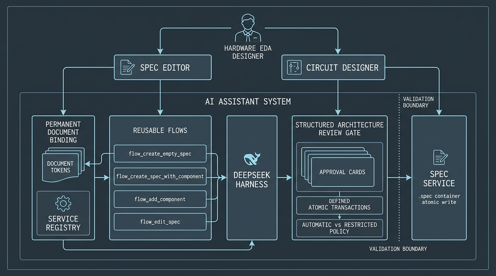

# AI Assistant System Contract

Status: required system behavior.

Use [canonical terminology](TERMINOLOGY.md) throughout this contract.

This document defines how the Assistant operates with Spec Editor and Circuit Designer.
It is the authority for product behavior.
Proposals must cross service validation and designer review gates before committing to disk.



Use the [operations and test guide](ai-assistant-operations.md) to run, inspect, and verify the system.
See [reusable flows](ai-assistant-flows.md) for flow definitions.

## 1. Terms and Authority

<a id="as-01"></a>

**AS-01 — One behavior contract.** Change this contract when the designer accepts a behavior change.
Update the affected test cases at the same time.
Do not create another behavior guide.
Keep requirement IDs stable.
Do not reuse a removed ID for another rule.

| Term | Meaning |
| --- | --- |
| Spec | The logical design document shown in Spec Editor. |
| `.spec` file | The physical archive that stores IP-XACT, narrative, and assets. |
| Component | An interface and its implementation. A leaf has SystemVerilog section; a composite contains an internal design. |
| Design | Structured composition: component instances and connections. |
| Service | The service that validates and saves its document. |
| Binding | The permanent service, document identity, and writable scope of one conversation. |
| Architecture review | A human decision about proposed structure, behavior, interfaces, and assumptions. It does not save content. |
| Content proposal | An immutable operation batch that the service can preview and save. |
| Receipt | A service record that proves a particular request outcome. |
| Validation failure | Arguments or content were rejected. It is not a request for missing user input. |
| Uncertain write | A write started, but its result is not known. It is not proof of failure or success. |

<a id="as-02"></a>

**AS-02 — Responsibilities and capabilities.** Each layer must keep its own
responsibility. The model authors proposals; it must not approve them.

| Layer | Responsibility |
| --- | --- |
| DeepSeek Harness | conversation shell, conversations, transcript, streaming, model loop, cancellation, native goals, event delivery, and resource accounting. |
| Assistant host | Bindings, prompt/tool composition, architecture reviews, creation progress, proposal identity, service adapters, and status reconciliation. |
| Assistant UI | Architecture decisions, questions, progress, proposal/error details, execution controls, and links to the service editor. |
| Spec service | Semantic context, operation schema, preview, revision checks, durable submissions, atomic save, and saved receipts. |
| Spec Editor UI | Review and approve restricted content saves; show saved content, drafts, and history. |
| Circuit service and UI | Circuit validation, proposal decisions, private drafts, and explicit source saves. |
| CLI | Explicit human architecture/content decisions with the same identity, revision, and service checks. |

The model has no shell, filesystem, browser, arbitrary skill, `.spec` file-delete,
or direct approval tool. Standing event agents are read-only. They are distinct
from generic coding subagents. Only the primary can prepare service proposals.
Product-specific behavior belongs in this repository. Generic runtime extension
contracts belong in Harness. The former Python/A2A assistant and custom conversation
REST/SSE protocol are not supported interfaces.

## 2. Binding, intent, and context

<a id="as-03"></a>

**AS-03 — Permanent exact target.** A Spec target is the tuple
`(owner URL, owner_document_key, document_id, scope, entity kind/id)`.
`owner_document_key` distinguishes `.spec` files with equal internal document IDs.
A document title, active editor tab, or Workspace is not sufficient identity.
Circuit binding uses its exact service URL and document ID.

Keep editor selection, conversation binding, and request progress separate. Opening B
in the editor does not retarget an A conversation. A display rename does not change the
binding, hardware identifier, or saved path. A `.spec` file owns one Harness
Workspace. Source-derived Circuits share that Workspace; an independent Circuit
has its own. The private workspace path is a grouping identity, not a file tool.

| Entry point | Target and behavior |
| --- | --- |
| `/launch` or editor launch without attachment | New unbound conversation. Do not infer the editor's active document. |
| `/launch/spec-document` | New conversation bound to the exact Spec document. |
| `/launch/spec` | New conversation bound to the exact Spec target and its writable boundary. |
| `/launch/circuit` | New conversation bound to the exact Circuit document. |
| Assistant home | Current shell selection or the new-conversation chooser. Opening the home page alone does not select a service. |
| Reopen a saved conversation | Restore its permanent binding. Read fresh context before design claims. |
| New document created from conversation A | Create a separate document conversation. Keep A's binding and pending work. |
| Headless request | Exact configured target; no browser creation or question cards. |

Launch reserves a new conversation, validates the binding and Workspace, then activates
it. It must not report readiness before these steps finish. An interrupted
reservation must be reconciled with native conversation history.

<a id="as-04"></a>

**AS-04 — Interpret the request within its binding.** Use this decision table
before authoring tool arguments. Do not turn discussion into an edit.

| Request | Required response |
| --- | --- |
| General hardware discussion | Answer without document claims. No service read is needed unless the answer concerns stored content. |
| “This document” or an unqualified document edit | Use the conversation's document, even if the editor displays another document. |
| “Create a counter” in a document conversation | Add a counter to that document after architecture approval. Do not create another document. |
| The same request in an unbound browser conversation | Prepare architecture for a new Spec. |
| Add a component to a bound design | Use an existing component definition as an instance when that is the clear intent. Ask if creation versus reuse is unclear. |
| Explicit request for new document B | Use the separate creation flow. Preserve A. |
| Explicit request to edit document B from conversation A | Explain the target mismatch and stop. Tell the user to open a B conversation manually. Do not read or edit B through A's tools. |
| “Edit the document open in the editor” | Verify that it is the bound target. If this cannot be established, explain the ambiguity and stop. |
| Compare stored A and B | Explain the single-binding limit. Do not invent B's context. |
| Target or requested scope is unclear | Ask a focused question. Do not choose another `.spec` file by title alone. |

<a id="as-05"></a>

**AS-05 — Writable scope is a service boundary.** Document scope can use the
supported operation vocabulary across its document. Component or Design scope can edit only
its published writable targets and narrative. Surrounding references remain
read-only. Creating a top-level target requires document scope. Do not widen a
conversation's scope. If the exact service, `.spec` file, or target is unavailable, stop that
work. Do not substitute another service, visible document, or copied `.spec` file.

<a id="as-06"></a>

**AS-06 — Read fresh, complete context.** Call `get_bound_context` before facts
about stored designs and before each edit. Use its revision to author the
proposal. A previous turn's read is not sufficient. A service read failure must
produce a service/context error, not a request to restate the design.

Spec context is one semantic representation. A page has
`schema_version=spec2gds.assistant-context-page.v1`, document identity, revision,
scope, target, `records`, `incomplete`, and `next_cursor`. Each record has a JSON
path; string fragments also have `offset` and total `length`. Reconstruct exact
values. Follow `next_cursor` with the same `entity_ids` selection before replacing
an incomplete field. Do not truncate values or use a hidden spill file.

Every model-facing Spec reply must be below 40 KiB. Cursors are bound to revision
and selection. Invalid/stale cursors and missing targets fail explicitly.
Selection filters reads; it never widens writes. Circuit semantic context is
authoritative; SVG is a visual aid. A failed optional SVG fetch must not be
reported as lost semantic context.

## 3. Architecture and approval

<a id="as-07"></a>

**AS-07 — Use the live service schema.** Read the binding-specific operation
contract from the service at attachment and before proposal preview. A missing or
unsupported contract disables proposals. It must not activate a bundled fallback.
Context reads can remain available.

Spec publishes `GET /assistant/operation-schema` with `document_id`,
`owner_document_key`, and `scope`. Component or Design scope also supplies `entity_kind` and
`entity_id`. Circuit publishes the same relative endpoint under its configured
`/api/circuit-designer/v1` base and supports document scope.

The response contains `schema_version=1`, `digest`, and `operation_schema`.
The schema describes one operation. The digest is `sha256:` plus the SHA-256 of
canonical schema JSON: sorted keys, no added whitespace. A supported proposal
has a nonempty operation array with unique `operation_id` values. The service
still validates scope, references, and semantics.

The converter supports local `$defs`/`$ref`, `oneOf`, object `allOf`, properties,
required fields, additional properties, arrays/items, primitive types, const,
enum, string length/pattern, numeric bounds, `minItems`, and `uniqueItems`.
Arbitrary maps use general JSON admission, then strict service validation.
Unsupported constructs must reject the contract. A changed Spec digest needs a
fresh context read and tool refresh. Ordinary source edits do not change the
schema digest.

<a id="as-08"></a>

**AS-08 — Defaults and questions.** For a new design, use a reasonable concrete
default when the request and domain context support it. Show each material
default as an assumption in the architecture review. There is no universal
width, reset, overflow, or protocol default. Do not silently change an existing
design's behavior, endpoint identity, clock domain, width adaptation, or protocol.
Ask when such a choice is unresolved.

A required-input question is not a validation error. Browser roots can use
`ask_user_question`; goal/orchestrated primaries can use a correlated durable
human wait. Specialists cannot question the user. Headless requests report the
missing input and exit. Do not add a details confirmation for values already
approved in architecture. User answers must reach the same request as structured
state, not as an untracked replacement proposal.

<a id="as-09"></a>

**AS-09 — Architecture approval for Spec content.** Require human architecture
approval before new hardware content is added, structural changes are made, or
SystemVerilog section is changed. This includes target creation/deletion, ports, parameters that affect
interfaces or behavior, bus interfaces, channels, internal designs, instances,
and connections. It also includes initial RTL and RTL-only refinement.

Treat a SystemVerilog section change as an RTL edit. Do not assume semantic equivalence
to bypass approval. Removing presentation fences before storage is formatting
admission, not another RTL edit. A proposal that changes only narrative,
description, or display metadata needs no architecture approval. Text edits must
not include an unsolicited RTL rewrite. Mixed proposals require architecture
approval for the structure/RTL portion.

Architecture approval is required under both Spec save policies. It is separate
from content-save approval. Circuit retains the flow in AS-26.

<a id="as-10"></a>

**AS-10 — Review contents and validity.** The review must identify the intended
document action, destination name/service for new documents, affected targets,
interfaces, clocks/reset, intended behavior, hierarchy, concrete configuration,
assumptions, and essential unresolved questions. For an existing document, capture
the exact service key, scope, source revision, and requested change. For a new
independent document, do not depend on an unrelated bound document. A derived
request must identify the source it actually depends on.

The architecture subflow stores a durable review; it does not approve it.
The Assistant card permits **Approve**, **Revise**, or **Cancel**. Essential open
questions prevent approval. Revision creates a new review and retains the original
request. Cancellation stops that request without creating content. Approval covers
the exact stored plan; the model cannot edit the approved record.

After approval, read the relevant current context again. A changed dependent
source revision invalidates approval. Obtain a new review; do not relabel old
operations. Reuse requires the exact service/document/scope, or the recorded
creation destination. A plan must match all affected structure and declared
behavior, not only the names of newly created components. Automatic checking
must cover typed structure; behavioral correspondence is also a model/reviewer
obligation. Do not claim that schema or lint proves RTL/prose equivalence.

Architecture phase results use named `components` and `designs`, grouped
`interfaces`, `clocks_resets`, `decomposition_rationale`, `assumptions`,
`open_questions`, and a nonempty `concrete_configuration`. Use `designs=[]` for
a leaf. Give each component one interface group; portless components use
`ports=[]`. Port directions are `in`, `out`, or `inout`; widths are positive
integers. Each interface is grouped by its Component.

Example A is a schema-valid architecture phase result. The requested behavior is a
concrete unsigned counter. The name/service/action must also be visible in the
review context; do not invent new tool fields that are absent from its schema.

```json
{
  "title": "16-bit up/down counter",
  "components": [{"name": "counter_core", "purpose": "Store and update the count"}],
  "designs": [],
  "interfaces": [{"component": "counter_core", "ports": [
    {"name": "clk", "direction": "in", "width": 1},
    {"name": "reset", "direction": "in", "width": 1},
    {"name": "up_down", "direction": "in", "width": 1},
    {"name": "count", "direction": "out", "width": 16}
  ]}],
  "clocks_resets": ["Rising-edge clock", "Synchronous active-high reset"],
  "decomposition_rationale": "One component owns the counter state and update logic.",
  "assumptions": ["Reset sets count to zero", "Count wraps modulo 65536", "No enable input"],
  "open_questions": [],
  "concrete_configuration": {"width": 16, "reset": "synchronous active-high", "overflow": "wrap", "up_down": "1 increments; 0 decrements"}
}
```

## 4. Document creation and content saving

<a id="as-11"></a>

**AS-11 — Create through a flow after required approval.** Focused and Goal
conversations select `flow_create_empty_spec` or `flow_create_spec_with_component`.
The content flow prepares architecture, waits for approval, creates the document,
and binds a separate conversation without another creation confirmation. It then
authors and submits one complete Component. The empty flow skips hardware review
and content authoring. Orchestrated Spec conversations support reads and analysis;
they have no Spec write capability.

Use the readable title and selected service. Derive the filename under
`SPEC_DOCUMENT_ROOT`; the service reserves the identity and destination. Collision
suffixes are allowed. Never overwrite an existing `.spec` file. An explicitly
selected offline service must not be replaced with another service.

Examples of inputs for the two published tools:

```json
{"title": "Counter specification", "request": "Create a new Spec with a complete 16-bit up/down counter Component."}
```

```json
{"title": "Empty specification", "request": "Create a new empty Spec."}
```

The new-conversation chooser starts the empty-Spec flow through the generic host
start API. It does not create a Spec directly or send a continuation message.

<a id="as-12"></a>

**AS-12 — Creation has separate outcomes.** Persist the flow execution, original
request, service, destination, operation identity, creation receipt, and destination
conversation identity. Preserve the execution preset and resource allowance.
File creation, confirmed binding, model result, and content save are separate
outcomes. The internal creation status `bound` confirms the destination binding.
Only the exact applied service receipt completes a content request.

If the file exists but content fails, show **Document created; content not saved**
and the failed operation. An explicit architecture revision starts a linked
replacement flow and reuses the confirmed file and conversation. Cancel stops
further operations and preserves confirmed saves. It does not delete the file.

The legacy Spec mutation tools and browser continuation routes are removed. Old
pending Spec requests have no compatibility execution path. Start a new flow.
For current Spec edits, use `flow_edit_spec`; structural edits require approval of
the exact operation batch. Selected Component and Design bindings remain narrow.
Spec Editor controls the content decision under restricted policy.

<a id="as-13"></a>

**AS-13 — Content-save policy and UI.** Discover the service's approval policy;
do not infer it from prompts or browser controls. Spec defaults to `automatic`.
`--require-human-approval` selects `review`. Never default to automatic when policy
retrieval fails.

| Change | Automatic service | Restricted service |
| --- | --- | --- |
| New content, structure, or RTL | Approve architecture in Assistant; valid content saves automatically. | Approve architecture in Assistant; valid content remains pending until approved in Spec Editor. |
| Text-only change | Valid content saves automatically. | Valid content remains pending until approved in Spec Editor. |
| Explicit empty document | Create and report empty-ready. | Create and report empty-ready; later content follows the restricted policy. |
| Invalid or stale proposal | Stop, show diagnostics; no content save. | Stop, show diagnostics; no content save. |

The Assistant must not offer **Approve and apply** for Spec content. It shows
the exact pending proposal and an **Open Spec Editor** link. The Editor approves
the stored proposal ID after revalidation. Both UIs must then show the same service
outcome. Architecture decisions require a correlated flow wait. Direct Assistant Spec
approval controls are rejected. Circuit send and accept controls are unchanged.

<a id="as-14"></a>

**AS-14 — Immutable atomic proposal.** The model supplies title, summary,
rationale, assumptions, authored revision, and typed operations. The host creates
an immutable artifact/digest. The service compiles creations before dependent
edits into a private candidate, previews it, and saves the complete valid batch
atomically. A rejected batch leaves saved content unchanged.

Existing references use authoritative IDs from context. New Spec `entity_id`
values are proposal-local aliases. If omitted, the creation `operation_id` is the
alias. The Assistant host allocates persistent target IDs from proposal identity
and operation position, then remaps matching typed references together. The service
derives hardware names once. Later display renames do not change those identities.
Duplicate aliases or an alias with the wrong target kind must fail.

A typed reference contains `document_id`, `entity_kind`, and `entity_id`.
Formatting admission may fill an omitted document ID from the binding when kind
and ID are present. Preserve an explicit foreign document ID; it cannot satisfy a
new component's description requirement. Every new component, including a child,
needs nonempty `set_entity_metadata.description` in the same proposal, with its
correct typed reference. Do not use a separate description store.

| Formatting admission | Boundary |
| --- | --- |
| Missing operation ID | Supply a deterministic ID. Rebuilding the same proposal must preserve its digest. |
| Missing creation alias or `instances` | Use the operation alias and an empty instance list. |
| Unambiguous physical wire family | Supply `family=wire`; do not reinterpret transactional/structured ports. |
| Wire range `[15:0]` | Store `15:0`; scalar ports can omit range. |
| Outer RTL code fence | Remove only the fence. Preserve the body. |
| Component `entry_design=false` | Omit this ineffective field. Entry flags belong to designs. |
| Metadata/bus `clear_fields` | Convert requested clears into the service's null representation. Null unchanged fields must not erase data. |
| Narrative options and Circuit map entries | Convert admitted key/value lists; reject duplicate keys. |

Formatting admission runs before strict service-schema validation. It is distinct
from repairing a failed call. Never strip `module`/`endmodule`, external `include`,
or user `line` directives from invalid RTL. Reject them. Nonempty component
`instances` are invalid; create a component-owned design instead. Complete
replacement operations must preserve all unchanged fields.

Example B is a Spec proposal argument for Example A. Replace `doc_example`, the
revision, and review ID with the exact context and approved record. The displayed
all-zero hash is shape-valid sample data, not a usable current revision. The
example uses explicit aliases and full references, so it does not rely on optional
formatting admission.

```json
{
  "supported": true,
  "base_source_revision_hash": "sha256:0000000000000000000000000000000000000000000000000000000000000000",
  "unsupported_reason": null,
  "title": "Implement the approved counter",
  "summary": "Add counter_core with its interface, RTL, and explanation.",
  "rationale": "Implement the approved concrete architecture.",
  "assumptions": ["Reset sets count to zero", "Count wraps modulo 65536", "No enable input"],
  "architecture_review_id": "approved-review-id",
  "operations": [
    {
      "operation_id": "create_counter",
      "type": "create_entity",
      "kind": "component",
      "entity_id": "counter_local",
      "name": "counter_core",
      "instances": [],
      "ports": [
        {"name": "clk", "direction": "in", "family": "wire"},
        {"name": "reset", "direction": "in", "family": "wire"},
        {"name": "up_down", "direction": "in", "family": "wire"},
        {"name": "count", "direction": "out", "family": "wire", "range": "15:0"}
      ],
      "systemverilog": "always_ff @(posedge clk) begin\n  if (reset) count <= 16'h0000;\n  else if (up_down) count <= count + 16'd1;\n  else count <= count - 16'd1;\nend"
    },
    {
      "operation_id": "describe_counter",
      "type": "set_entity_metadata",
      "entity": {"document_id": "doc_example", "entity_kind": "component", "entity_id": "counter_local"},
      "description": "Unsigned 16-bit count. On each rising clock edge, synchronous active-high reset sets count to zero. Otherwise up_down=1 increments and up_down=0 decrements. Arithmetic wraps modulo 65536. There is no enable input."
    }
  ]
}
```

<a id="as-15"></a>

**AS-15 — Revision and receipt checks.** Use the model-read
`base_source_revision_hash`. Check identity, scope, schema, and revision at preview
and again at save. If source changes, stop with `STALE_REVISION`. A user retry must
reread and regenerate; it must not restamp old operations.

A repeated identical request returns its stored receipt without another save.
Changed content under the same ID fails. An uncertain write enters reconciliation.
Read the exact receipt and compare artifact identity. An explicit recovery retry
may use only the same ID and saved inputs where the service supports durable
receipts. Without that support, inspect the destination and keep the outcome
uncertain. Do not issue a fresh write as recovery.

```mermaid
stateDiagram-v2
    [*] --> FreshContext
    FreshContext --> ArchitecturePending: New content, structure, or RTL
    ArchitecturePending --> FreshContext: Approved plan; reread
    FreshContext --> Previewing: Text-only or approved edit
    Previewing --> Ready: Valid restricted proposal
    Previewing --> Applying: Valid automatic proposal
    Ready --> Applying: Approve in Spec Editor or explicit CLI
    Ready --> Discarded: Reject stored proposal
    Applying --> Applied: Owner saved receipt
    Applying --> Reconcile: Outcome unknown
    Reconcile --> Applied: Exact receipt proves save
    Reconcile --> Discarded: Owner proves rejection/discard
    Previewing --> Stopped: Validation or stale failure
    Applying --> Stopped: Owner proves failure
    Stopped --> FreshContext: Explicit user retry
```



## 5. Hierarchy and implementation authority

<a id="as-16"></a>

**AS-16 — Preserve intent and implementation authority.** Follow the user's
explicit hierarchy request. Otherwise choose decomposition that has useful
responsibilities and interfaces. A general preference for cohesive counters must
not override an explicit request for a control/register hierarchy. Present that
choice for architecture approval.

SV section defines implemented behavior. Structured ports/designs define interface
and wiring. Description and requirements define intent and guide implementation.
Read SV section/wiring before describing existing behavior. Report disagreements
between implementation and text; preserve both until the user requests a change.
Explain purpose, interface behavior, timing, reset, state, corner cases, and
assumptions. Composite descriptions explain child responsibilities. Link authored
requirements, behavior, architecture, assumptions, and verification criteria to
the relevant targets. Preserve unrelated authored text and paragraph breaks.

Generation must not interpret prose or silently synchronize RTL. Text-only edits
leave generated SV bytes unchanged, although provenance can change. No functional
SystemVerilog section means unimplemented. A compile-safe scaffold is not a functional
implementation. Validation must follow stable target identity even if metadata
changes the display name in the same batch.

<a id="as-17"></a>

**AS-17 — Supported hierarchy and RTL boundaries.** Use typed designs, instances,
and connections for composition. Do not hide hierarchy only in SV. Internal
designs use `entry_design=false`; ordinary design creation defaults to an entry
design. One composite component owns its internal design. Composite ports remain
subject to the service's read-only restrictions; architecture approval does not
remove them.

The RTL generation Activity accepts component/design targets, emits only reachable hierarchy,
and emits one module per reused definition. Numeric endpoint slices use
`{lsb,width}`; unsliced boundary strings remain compatible. Validate bounds,
effective widths, overlap, and drivers. Preserve unconnected-port warnings.
Symbolic/ascending slices, sliced bidirectional ports, and bus or transactional
port generation remain unsupported. Parameterized RTL generation is not supported;
store configurable intent but generate approved concrete widths/depths.

CLI generation targets use exact target IDs or full VLNVs. Unknown/ambiguous targets
fail. An omitted target requires one entry design. Reports retain target,
implementation status, consumed-section/target provenance, and source revision.
V3 reports/manifests and saved V2 records remain distinct. Use the
[RTL generation reference](rtl-generation.md) for the Activity API.

## 6. Prompts, failures, and visible state

<a id="as-18"></a>

**AS-18 — Prompt/tool agreement.** Trusted, exact-version prompt bundles supply
product identity, domain persona, immutable binding/context rules, service operation
constraints, architecture rules, and output rules. Prompts must agree with tool
schemas and host guards. An unbound complete prompt must include the architecture
and creation guidance it needs; suppressed sections must not be assumed active.
A model cannot grant capabilities through a prompt or service content. Runtime
rules must not rely only on model obedience where a host/service check is possible.

<a id="as-19"></a>

**AS-19 — Stop on first validation failure.** Stop the affected request after
native tool-argument rejection, formatting rejection, architecture rejection,
service-schema rejection, or service-preview validation failure. Do not call the
failed tool again with corrected arguments in the same request. Do not start a
goal continuation or event activation to repair it. Report failure even when no
proposal record was created. An explicit new user retry can start new authoring.

Read-only transport delivery retries and unchanged polling are separate from
model validation repair. They can keep their bounded replay-safe transport policy.
They must not retry a request that was stopped for validation. An uncertain service
write requires receipt inspection, not model repair or a new write identity.

<a id="as-20"></a>

**AS-20 — Diagnostic contract.** Lead with a readable error, failure stage, named
target, and next action. Preserve technical details for investigation. Do not
label a suspected root cause as proven.

| Stage | Details needed |
| --- | --- |
| Target/binding | Expected service/document/scope and observed mismatch. |
| Context | Service response status, identity/revision, selection, and cursor failure. |
| Native tool arguments | Tool name, rejected field path, expected shape, and native diagnostic. |
| Formatting/service schema | Operation ID/type, field path, formatting applied before rejection, and schema digest. |
| Architecture | Review ID/status, dependent revision, and plan mismatch or missing approval. |
| Service preview/save | Service status, diagnostics, base revision, proposal ID/digest, and whether a write began. |
| Creation/conversation continuation | Creation request ID, saved destination if known, and last confirmed phase. |
| Model/execution limit | Provider stop reason, effective token/step limit, and last confirmed tool outcome. |

Use one error envelope across proposal, architecture, creation, and native schema
failures. Retain existing error codes, issue details, service diagnostics, correlation
ID, and suggested actions. Add the stage and mutation outcome when missing. Link
technical details to conversation/turn/call identity, prompt bundle/version, operation
schema digest, and relevant receipt. `retryable` describes a later manual recovery
option; it never authorizes automatic validation repair. Remove credentials and
secrets from exported diagnostics.

<a id="as-29"></a>

**AS-29 — Visible UI state.** Show the bound source name and document/Component or Design scope.
Do not call a writable document conversation read-only. Keep architecture decisions,
proposal state, and errors visible after tool traces collapse and after reload.
A later error must not hide a pending architecture card. Use service-derived change
summaries and exact stored service previews for diffs. Keep Before and After side
by side, including on narrow screens. Show all changed fields, narrative text,
and SystemVerilog without requiring expansion. Large comparisons scroll without
removing content. Show readable architecture cards and interface tables.

Keep internal IDs, hashes, fixed prompts, context payloads, and complete diagnostics
in persistent records and developer logs. The Assistant has no technical inspection
panels. Progress uses recorded phases and domain actions. Mark content as Saved
only after a matching service receipt; a model's success sentence is not evidence
of a save. Spec content decisions remain in Spec Editor.

## 7. Execution, persistence, and Circuit serviceship

<a id="as-21"></a>

**AS-21 — Presets and bounds.** A conversation pins `focused`, `goal`, or
`orchestrated`; there is no silent complexity router. Focused performs a bounded
single turn. Published flows add a bounded deterministic executor that triggers
declared model phases and stops at decisions. Goal uses native single-agent continuation. Orchestrated keeps
read-only analyst/reviewer conversations and a proposal-owning primary. Only the primary
can create questions/proposals; specialists cannot approve changes or edit execution
configuration. The [operations guide](ai-assistant-operations.md#configuration-and-limits)
records defaults once. Token limits, model steps, and aggregate requests/rounds are
different limits. Exhaustion stops work visibly; it does not prove completion.

<a id="as-22"></a>

**AS-22 — Causal review and waits.** In orchestrated execution,
`user.requested` or an authorized `source.changed` observation goes to the analyst;
`analysis.ready` goes to the reviewer; `review.ready` returns to the primary.
A proposal needs reviewed ancestry from the latest request/observation. An older
review cannot authorize a newer input. Event delivery acceptance is not successful
activation completion. Agent review is not human architecture approval.

Goal continuation uses its native driver, not the analyst/reviewer chain. A required
architecture or service decision blocks continuation using a correlated wait. Match
the exact review/wait identity and execution revision. Applying, sending, or
discarding a proposal can resolve that wait, but cannot complete the goal by itself.
The primary must check the requested outcome. A validation stop must remain stopped
until a user requests another attempt.

The event contracts below preserve the supported producer and correlation
boundaries. A `review.applied` event can record a Circuit send. Its name does not
prove that specification content was saved.

| Event | Producer | Payload and meaning |
| --- | --- | --- |
| `user.requested` | Host observing native human input | `text`; starts the orchestrated analysis chain. Native goal input stays direct. |
| `source.changed` | Approved HTTP source adapter | `trigger_id`, `url`, `value_json`, `previous_digest`, `current_digest`; wakes the permitted chain or goal primary. |
| `analysis.ready` | Approved analyst | `findings`; reviewer input for its causally identified request. |
| `review.ready` | Approved reviewer | `result`; primary may prepare a proposal for that latest reviewed input. |
| `review.prepared` | Product host after preview | `proposal_id`; audit record and correlated goal review wait. |
| `review.applied` | Product host after service applied/sent receipt | `proposal_id`; resolves that proposal's wait, subject to remaining allowance. |
| `review.discarded` | Product host after discard | `proposal_id`; resolves that proposal's wait without completing its requested result. |
| `system.wait.answered` | Human answer API | `wait_id`, `answer`; resolves the exact current human wait. |
| `system.activation.completed` | Native event service | `agent`, `activation_id`; successful activation outcome. |
| `system.activation.failed` | Native event service | `agent`, `activation_id`; failed activation outcome. Validation stops cannot become repair retries. |
| `system.activation.interrupted` | Native event service | `agent`, `activation_id`; interrupted outcome that needs uncertainty acknowledgement. |

Waits match future events; an event already in history cannot resolve a newly
created wait. Models can publish only their pinned event allowlist. Read-only
observers cannot publish the trusted analyst/reviewer results. System events are
host-owned.

<a id="as-23"></a>

**AS-23 — Human configuration and monitoring.** Event templates define allowed
agents, prompts, model routes, event schemas, subscriptions, and resource bounds.
Validate and review exact content before saving. A conversation pins the resolved
revision; later template edits affect new conversations only. Editing a built-in creates
a named template. Models cannot change rosters, permissions, or allowances.

Events have unique IDs, validated payloads, producer-scoped dedupe keys, causation,
root correlation, and depth. Subscriptions match exact types. Payload filters,
arbitrary flow joins, and stage mappings are unsupported. Durable waits
correlate exact string fields independently. System events are host-owned.

HTTP monitoring reads only allowlisted paths for the bound service. Endpoint content
is untrusted data. Reject credentials in URLs, redirects, invalid JSON/pointers,
oversized bodies, and incompatible event schemas. Unchanged polling makes no model
requests. Changed observations use the remaining execution budget and never approve
content. Sources persist when disabled. Pause suspends checks/admissions; Stop ends
execution. Webhooks and file watchers are future work. Developer-authored
[reusable flows](ai-assistant-flows.md) use a separate pinned execution record.

<a id="as-24"></a>

**AS-24 — State and recovery.** Native JSONL is the transcript authority. Product
SQLite owns bindings, architecture decisions, creation progress, proposals, and
configuration revisions/pins. Native storage domains own event deliveries, waits,
sources, cursors, and spending. Service persistence owns saved documents and receipts.
Back up the complete state root; no single store proves an external save.

Run one Assistant process per state root. Restart retains budgets and records.
Persistent execution needs human Resume before new model work. Unknown/interrupted
transport work needs explicit acknowledgement before retry. Old unsupported execution
records remain readable but cannot silently adopt new capabilities. Spec bindings
survive service restart and visible-document changes. Circuit document/proposal state
is process-local; reopen it before reconciling after a Circuit restart.

<a id="as-25"></a>

**AS-25 — Close, cancel, stop, and reject are different.** Closing a browser tab or
archiving a conversation preserves binding, receipts, and pending decisions. It must not
approve, discard, or delete content. It must not be treated as execution Stop.
Cancel an architecture request without creating content. Cancel `.spec` file creation
only before its write starts. Reject a pending proposal without changing saved
content. Pause/Stop prevent future execution; an in-flight write still requires
outcome reconciliation. Saved changes need a new explicit edit to undo them.
No model tool deletes a Spec.

<a id="as-26"></a>

**AS-26 — Circuit handoff and save.** Circuit proposal preview checks logical
Circuit rules. The Assistant's explicit **Send to Circuit Designer** action records
`sent` only after service receipt. Independent Circuit acceptance keeps its service
behavior. For a source-bound Circuit, **Accept** takes an edit lease and stages a
private draft; it does not save the specification.

**Save to Spec** performs Circuit preview, Spec preview, Spec commit, and
Circuit re-projection. Carry the staged `proposal_id`; resolve it only after successful
save. A failed save retains the draft/proposal. Cancel discards the draft. A reload
with unchanged source revision/projection preserves the proposal for staging again.
Direct source-bound accept and ordinary Circuit write routes reject source writes.
Initial Circuit-valid preview can still fail Spec validation at save. Show that
validation scope honestly. Never claim a saved specification from `sent` or draft
acceptance. Additional source preflight is a future proposal, not a requirement.

<a id="as-27"></a>

**AS-27 — Completion means the requested result.** Use confirmed outcomes:

| User requested | Evidence needed before claiming completion |
| --- | --- |
| Empty Spec | Creation receipt and correct destination conversation; explicitly report empty content. |
| Specification content saved | Applied service receipt for the exact artifact and saved revision. |
| Proposal for review | Valid stored preview; clearly say content is pending. |
| Circuit proposal handoff | Circuit receipt; report sent, not accepted or saved. |
| Source-bound Circuit saved | Successful Spec save receipt/revision from the Circuit service flow. |
| RTL functionality | Relevant executed functional tests, in addition to source/generation/lint results. |

## 8. Verification and maintenance

<a id="as-28"></a>

**AS-28 — Reproducible composition.** Use the source setup and supported runtimes.
Verify the installed Harness release against `harness.lock.json` before supported integration
or packaging. Package releases only from a clean matching Harness checkout. Rebuild product/editor
assets from source. Copied bundles and stale builds are not evidence of source changes.

<a id="as-30"></a>

**AS-30 — Requirement evidence.** Map every requirement to checks in the
[acceptance matrix](ai-assistant-operations.md#acceptance-matrix). A partial fixture
proves only the boundary it exercises. Keyless deterministic tests establish
contracts. Repeated live-model runs measure inference quality. Catalogue validation,
replay, lint, simulation, and manual document review are separate outcomes. Missing
credentials/tools mean unverified, not passed. Numeric quality thresholds remain
proposals until approved. Remove a TEMP gap only after its required tests and this
contract agree with the implementation.

## 11. Native tool contracts and instruction releases

<a id="as-31"></a>

**AS-31 — One static instruction source.** The Assistant loads its five native
JSON tool contracts and static instructions from one versioned catalogue. Each
contract names its handler, availability rule, schemas, and instruction reference.
Generate argument types from these contracts. Reject unsupported native schema
keywords, missing references, or unknown handlers before model execution.
Service operation schemas remain live and authoritative. Keep their strict
validation after formatting admission and before semantic preview.

<a id="as-32"></a>

**AS-32 — Independent service metadata.** Each service exports
`GET <service-base>/assistant/integration-metadata`, even with no document open.
Circuit service bases include `/api/circuit-designer/v1`. Metadata declares the
format version, service kind, interface version, digest, and named API actions.
Actions declare methods, relative paths, parameter names, and response kinds.
The Assistant uses separate service adapters. They accept known actions only.
Missing or incompatible metadata stops the service call. Metadata cannot grant
permissions or change a conversation target. No other service is selected silently.
The services do not import Assistant handlers or each other's implementation.
Save to Spec retains its explicit Spec service dependency.

<a id="as-33"></a>

**AS-33 — Immutable conversation snapshots.** Pin a release before the first model
execution, including in an unbound conversation. Store the static contracts,
instruction templates, release version, content hash, and handler compatibility
version. Persist the resolved event configuration separately. Members and a new
Spec continuation inherit the source release. Reload must retain those pins.
Context, revisions, permissions, service schemas, and service metadata remain fresh.
Reject changed content under an existing release version. Incompatible pinned
handlers stop execution; they do not trigger instruction replacement.
For the TD-05 rollout, conversations without snapshots remain readable history.
Require a fresh conversation for model execution. Preserve Specs, receipts,
proposals, approvals, and uncertain-write records. Receipt inspection and explicit
approval commands remain available.

<a id="as-34"></a>

**AS-34 — Extension and evidence.** Add native tools through a JSON contract,
catalogue instructions, a registered handler, capability checks, and deterministic
checks. Add services through independent metadata and adapter declarations.
Keep single-user operation for this change. Do not add MCP or change UI-02.
Validate schema, instruction, state, and flow regressions with fixed responses.
These results establish deterministic boundaries. They do not establish model
accuracy. Live-model comparison remains deferred.
