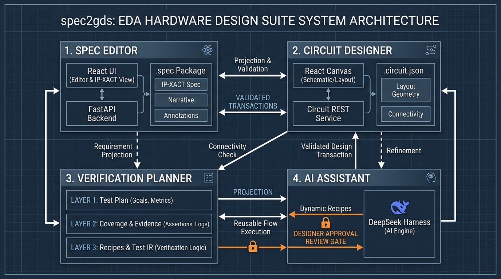
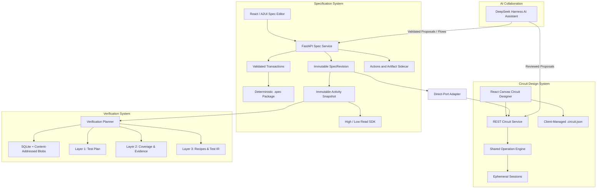
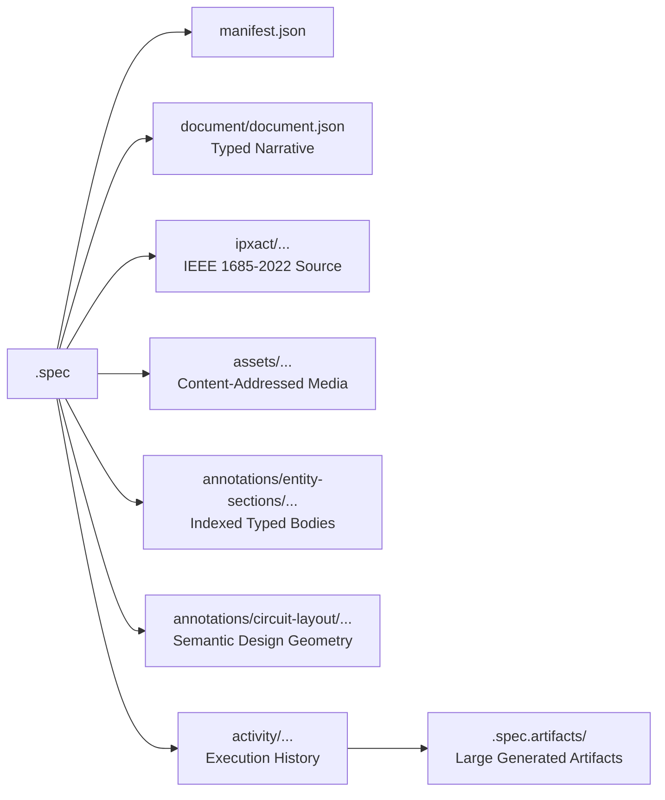
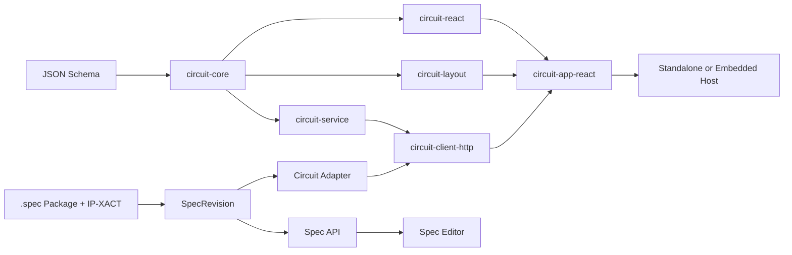

# Architecture

## Product Objective

The `spec2gds` platform converts structured hardware specifications into validated hardware design state.
Each layer has a strict service boundary.
Every mutation must cross a validated boundary.

## Source Authority and State Boundaries

| State Category | Authoritative Service | Durable Storage | Mutation Rule |
| --- | --- | --- | --- |
| Hardware Specification | Spec service | Deterministic `.spec` ZIP | Revision-guarded transaction |
| Narrative and Assets | Spec service | Inside `.spec` container | Same transaction boundary |
| Activity History | Spec service | Package history + artifact sidecar | Append and review operations |
| Independent Circuit | Circuit client | `.circuit.json` | Private draft, then Save |
| Circuit Session | Circuit service | Memory only | Lease and revision validation |
| Spec-Derived Circuit | Spec service | `.spec` topology + layout annotation | Edit private projection, then Save to Spec |
| AI Assistant Suggestion | Document approval policy | Proposal and review record | Automatic save or restricted review gate |
| Verification Plan & Evidence | Verification Planner | SQLite + content-addressed blobs | Revision-checked commands and immutable checkpoints |

The combined development processes bind to all interfaces (`0.0.0.0`) by default.
This configuration allows intranet access across multiple workstations.
The service directory advertises one detected or configured LAN host.
The independent Verification Planner binds to loopback (`127.0.0.1`) by default.

## Activity Extension Boundary

The public Activity SDK remains decoupled from the execution host.
An Activity snapshot embeds a complete source-only `.spec` revision.
Activities and Context Renderers read data through high-level and low-level read APIs.
Activity definitions contain no queue, process, HTTP, database, or monitoring settings.
This separation allows the execution runner to change without modifying Activity plugins.

Activities return reports and staged artifacts immediately.
Any hardware modifications remain typed proposals.
Proposals must cross the normal revision-checked review boundary.
Extension code never receives a mutable package or live editor session.

## Specification Package Container

A `.spec` file is a deterministic ZIP container with standard structure:

- `SpecPackage`: Validates and writes the physical ZIP container.
- `SpecRevision`: Supplies an immutable semantic view of the specification.
- `SpecEditTransaction`: Enforces atomic write validation.
- Revision hash checks prevent stale clients from overwriting newer edits.

The Spec service projects Component and Design content through a typed section registry.
Narrative text and ports use IP-XACT adapters.
Optional SystemVerilog module bodies use digest-indexed annotation files.

## Circuit Document Model

Circuit Designer validates documents with JSON Schema (`circuit-designer.v1.schema.json`).
A circuit document contains:
- Reusable component definitions and boundary terminals.
- Exactly one design containing component instances, boundary terminals, and nets.
- Layout geometry separated from electrical connectivity.

The Circuit service manages live revisions, edit leases, idempotency tokens, proposals, and events.
The Circuit service does not maintain a persistent database.
Independent circuits download canonical JSON documents directly.
Source-bound circuits commit changes through the Spec API before their session updates.

## Dependency Direction

Circuit packages do not import Python or SpecIR.
The Spec service owns translation because it parses IP-XACT.
The reusable React application shell consumes host adapters for files, preferences, source synchronization, events, and tools.
UI packages consume public projections and clients.
UI packages never mutate model objects directly.

## Deliberate Design Limits

- **Document Focus**: The Spec Editor displays one `.spec` document at a time. Document tokens ensure Assistant conversations keep their correct target.
- **Session Durability**: Circuit service sessions live in memory and terminate on server restart.
- **Bus Interface Modeling**: The Spec Editor preserves bus interfaces in the `.spec` source, but hides them from direct UI edits.
- **Port Projection**: The circuit adapter projects physical wire ports and ad-hoc connections. Bus interfaces stay in the specification source.
- **Document Import**: Imported PDF, Word, and ODT documents become narrative text. Model-based extraction requires explicit API key configuration.
- **AI Assistant Writes**: The AI Assistant cannot write directly to disk. Writes must follow the document approval policy and pass service validation.
- **Verification Execution**: Verification Planner generates reference artifacts and synthetic templates. External simulators run executable tests outside the service.
