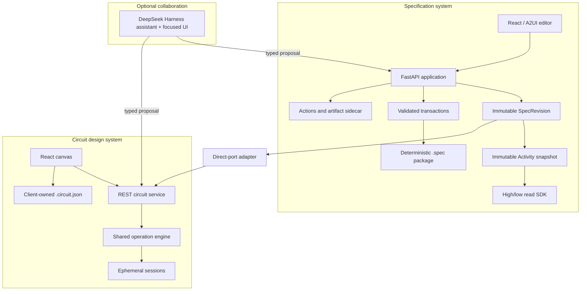
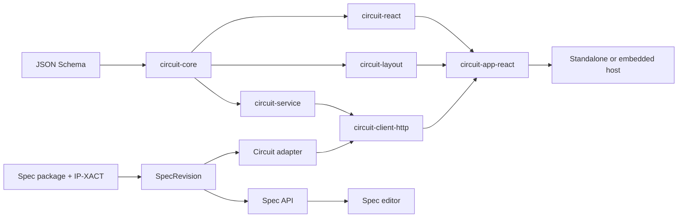

# Architecture

## Product objective

The system turns structured hardware intent into reviewable design state. Each
layer has one owner and every mutation crosses a validated boundary.

## Source ownership

| State | Authority | Durable form | Mutation rule |
| --- | --- | --- | --- |
| Hardware specification | Spec API | deterministic `.spec` ZIP | revision-guarded transaction |
| Narrative and source assets | Spec API | inside `.spec` | same transaction boundary |
| Action history | Spec API | package activity plus artifact sidecar | append/review operations |
| Independent circuit | client | `.circuit.json` | private draft, then Save |
| Circuit session | Circuit service | memory only | lease and revision checks |
| Spec-derived circuit | specification source | `.spec` topology plus circuit-layout annotation | edit a private projection, then revision-checked Save to Specification |
| AI Assistant suggestion | user review | proposal record | explicit accept or reject |

The service processes bind to all interfaces by default so the editors can be
used by multiple systems on the same intranet. Their service directory
advertises one detected or configured LAN host.

## Activity extension boundary

The public Activity SDK is separate from the current execution host. A
deterministic Activity snapshot embeds a complete source-only `.spec` revision;
Activities and Context Renderers select data through explicit high- and
low-level read APIs. Activity definitions and results contain no queue,
process, HTTP, database, workspace, or monitoring settings. This permits the
launch mechanism to change without changing team plugins or snapshot/result
formats.

Activities return reports and staged artifacts immediately. Any source edits
are typed proposals and still cross the ordinary revision-checked review
boundary. Extension code never receives a mutable package or live editor
session.

## Specification package

A `.spec` file is a deterministic ZIP container.

`SpecPackage` validates and writes the container. `SpecRevision` is the
immutable semantic view. `SpecEditTransaction` is the write boundary. A source
revision hash prevents a stale client from overwriting newer work.

Component/design content is projected through the typed section registry.
Existing text and ports are IP-XACT adapters; optional SystemVerilog bodies are
digest-indexed annotation files. See [Entity sections](entity-sections.md).

## Circuit document

Circuit Designer uses the JSON Schema in
`circuit-designer/schema/circuit-designer.v1.schema.json`. A document contains:

- reusable component definitions and terminals;
- one design with instances, boundary terminals, and nets;
- layout geometry kept separate from electrical connectivity.

The service owns live revisions, edit leases, idempotency results, proposals,
events, and ephemeral source bindings. It intentionally owns no durable
database. Independent circuits download the accepted canonical document;
source-bound circuits commit through the Spec API before their session changes.

## Dependency direction

Circuit packages do not import Python or SpecIR. The specification side owns
translation because it understands IP-XACT. The reusable React application
shell consumes host adapters for files, preferences, source synchronization,
events, telemetry, and tools; the standalone application supplies the current
browser and Spec integrations. UI packages consume public projections and
clients; they do not mutate model objects directly.

## Deliberate limits

- One active `.spec` document per Spec API process.
- Circuit service sessions disappear on restart.
- The specification editor omits bus interfaces, interface connections, and
  bus/abstraction definitions while retaining them in the `.spec` source.
- The initial adapter projects direct physical ports and ad-hoc connections;
  bus interfaces remain in the specification source.
- Imported PDF, Word, and ODT files become narrative source; optional model
  extraction requires explicit OpenAI configuration.
- The AI Assistant is optional and all writes remain review-gated.
