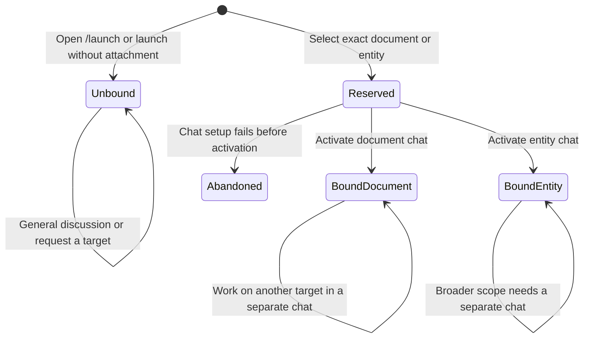
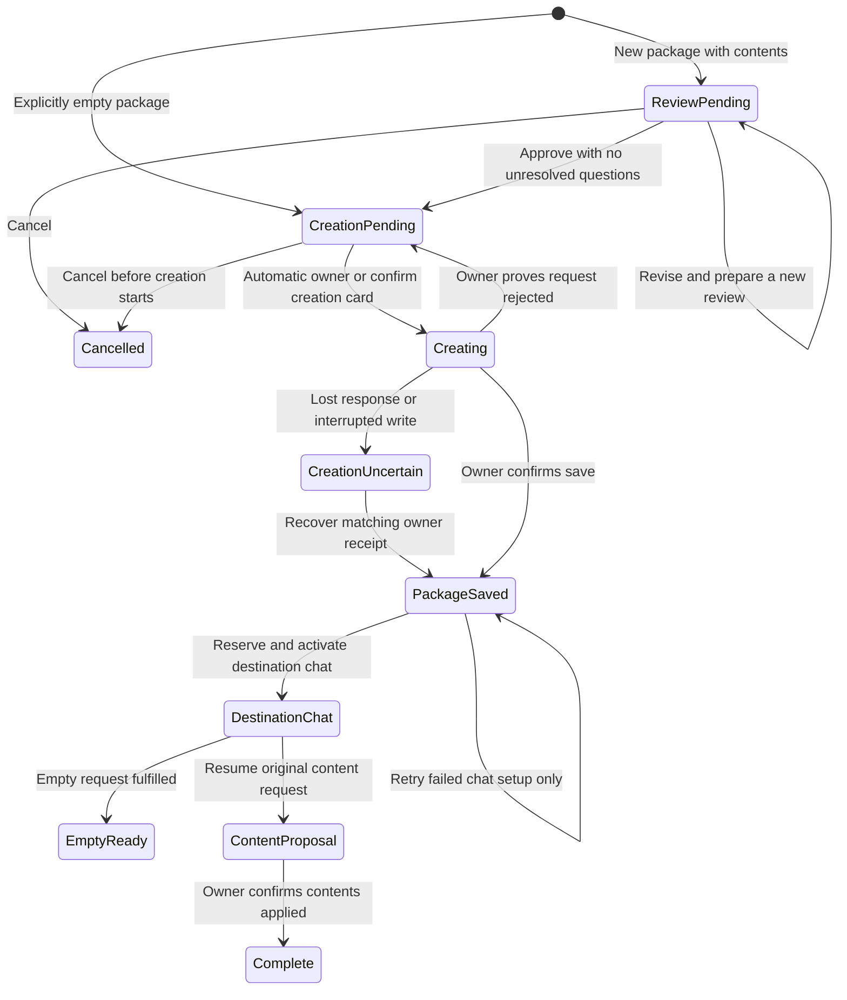
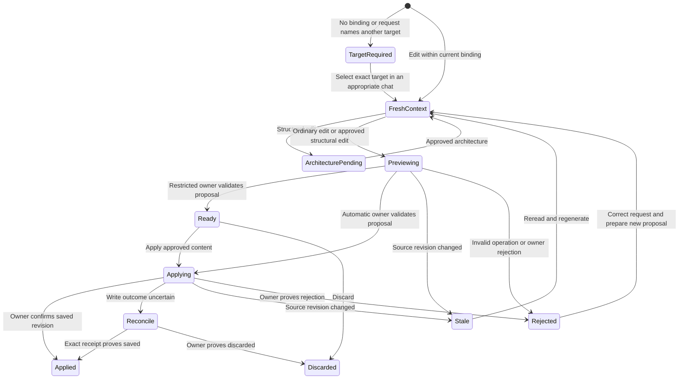

# Assistant document lifecycle: rules and state machines

This is the reference for requests to create, inspect, edit, switch, or close
specifications. It combines rules already enforced by the code with explicitly
marked requirements for missing behavior. It does not introduce new APIs.

The central rule is **one chat, one permanent target**. A chat bound to package A
continues to target A when the editor displays B. Work on B belongs in a chat
bound to B. Creating B creates a separate chat; it does not retarget A's chat.

Status labels used below:

- **Enforced**: implemented by an owner/host/tool guard.
- **Prompt**: stated to the model; not a deterministic request-routing guard.
- **Required**: the intended rule; supporting behavior is still missing.

## 1. Keep three kinds of state separate

| State | Meaning | Does changing it change the others? |
| --- | --- | --- |
| Editor selection | The package displayed by a particular editor client | Opening another package does not retarget existing chats. |
| Chat binding | Exact owner, package identity, document/entity scope | Permanent for this chat; another target requires another chat. |
| Request progress | Review, creation, proposal, save, or recovery | Pending work belongs to its original chat, target, and request identity. |

Do not store these as one `current_document` variable. The Spec service also has
an active package used as a default for unkeyed UI requests; that default is not
an existing chat's authority. Editor clients pin their own package keys, so two
editor tabs need not display the same package.

An exact target consists of `(owner service, owner_document_key, document_id,
scope, entity kind/id where applicable)`. The owner key includes canonical
package path and document ID. Two copies with equal document IDs remain different
packages. A title, visible tab, or workspace grouping is insufficient identity.

## 2. Entry points

| How the Assistant opens | Initial target | Available behavior |
| --- | --- | --- |
| Spec Editor toolbar, package A displayed | Document A | Read A and propose supported edits across A. |
| Spec Editor entity action on component/design X | Entity X in A | Read owner context and edit only the published writable boundary. Surrounding context is read-only. |
| Spec Editor toolbar, no package attached | Unbound | General discussion and browser creation of a new Spec package. |
| Editor explicitly requests no attachment | Unbound, even if a package is active | Same as the previous row. |
| Direct `/launch` | New unbound chat | No implicit attachment to the editor's open package. |
| Direct Assistant home `/` | Existing shell selection or new-chat chooser | Opening the application alone does not identify a target. Check the selected chat's binding; use the chooser for a new bound chat. |
| New-chat chooser selects package/entity A | New chat bound to that selected target | Validate exact identity and scope before activating the chat. |
| Reopen an existing chat | Its persisted binding | Fresh context from that binding, regardless of the current editor selection. |
| Headless or specialist agent | Its configured/inherited target | Browser package-creation cards are unavailable; specialists have the read-only capability boundary. |

Editor launch routes currently reserve a **new** chat. They do not automatically
reuse a chat for the same package. Chat reservation and activation are distinct
stages; startup reconciles an interrupted reservation with stored chat history.



The self-loops describe the original chat. A separate new chat has its own
reservation/activation path. Closing a UI tab is not a binding transition.

## 3. Request-routing rules

| Rule | Required decision before a tool call | Current status |
| --- | --- | --- |
| R01: identify intent | Distinguish discussion, read, edit, create package, add entity, switch target, cancel, stop, and close. “Create a comparator” alone does not decide between a new package and an entity in A. Clarify only when context does not settle that distinction. | Prompt; a central deterministic router is required. |
| R02: resolve target | Unqualified “this document” means this chat's bound document. “This component” means its bound entity where applicable. An unbound chat cannot infer the editor selection. | Prompt plus binding guards. |
| R03: handle explicit conflict | If chat A receives “edit B,” first resolve B and use a separate B chat. Never translate it into an edit of A. “The document currently open in the editor” requires checking/choosing that target if it differs from the binding. | Required routing/selection flow; immutable binding is enforced. |
| R04: enforce scope | Changes outside an entity's writable boundary require a document chat or another entity chat. Do not widen a chat's scope. Adding an instance of an existing component to a bound design differs from creating a top-level component. | Enforced by binding-specific owner schemas and semantic validation. |
| R05: read before claims/edits | Read fresh bound context for concrete design facts and every edit. Use the authored revision in the proposal. A stale proposal must be regenerated; never replace its revision label and reuse old operations. | Prompt for reads; revision/identity checks enforced. |
| R06: distinguish two approvals | New entities and structured architecture changes require an approved architecture review. Text/RTL refinement without structural changes follows the ordinary owner policy. Automatic content save does not approve architecture. | Enforced for structural operations; see section 4. |
| R07: create separately | New contentful package: approved architecture, package creation, destination chat, initial content submission. Explicitly empty package may bypass architecture. Preserve the original chat and request. | Enforced through the browser creation workflow. |
| R08: resume exact work | Retry the original request/proposal identity after uncertain writes. A saved package receipt means populate/recover its chat, not create another package. Never overwrite an existing destination. | Enforced; receipt support determines recovery capability. |
| R09: do not conflate close actions | Closing an editor/chat tab, cancelling a request, stopping execution, archiving a chat, and deleting a package are different actions. Resolve ambiguous “close it” before acting. | Required unified intent rule; existing controls cover only some actions. |
| R10: preserve authority on failure | Offline owner, missing/moved package, ambiguous IDs, or removed entity blocks that target's work. Never substitute the visible package or a different copy. | Exact identity checks enforced; routing and presentation need improvement. |

When the target is already clear, proceed without asking the user to select it
again. General hardware discussion needs no document read unless it claims facts
about a stored design. A request to compare A and B needs fresh authorized
context for both; the current single-binding tools cannot provide B's context
through A's chat. Offer the appropriate separate target workflow.

## 4. Creation and editing

Creation uses four separate records: architecture decision, package creation
receipt, destination chat binding, and content proposal receipt. Completion of
one does not imply completion of the next.



`CreationUncertain` cannot start a different creation attempt as recovery.
Receipt-capable owners can recover using the same request ID and exact saved
details. Without receipts, inspect the destination; do not repeat the write.
The creation record's `continued` means the original request was admitted into
the destination chat. It does **not** mean the contents were saved.

For an edit, classify architecture-changing operations before submitting:

- Architecture review: new/deleted entities, ports, bus interfaces, channels,
  internal designs, instances, connections, and structured sections for those
  interfaces/compositions.
- Ordinary owner proposal: narrative, descriptions, or stored RTL refinements
  that do not change that structured architecture.
- Mixed request: obtain architecture approval for the structural portion, then
  submit the supported changes with that approved review and current revision.

Approval covers the exact stored plan and applicable source revision. Revisions
to an architecture plan require a new review. New component creation includes a
description in the same proposal. Text edits do not authorize an RTL rewrite;
stored RTL behavior and explanatory text can disagree and must be reported.



`TargetRequired` is the proposed routing state, not a current stored enum.
After architecture approval, context is read again; if the approved source
revision changed, return to a new architecture review. Cancellation/revision
must leave saved content unchanged. The diagram omits the UI details card,
which is an input wait before a proposal rather than a package save.

## 5. What “close” means

| User action | Rule | Current support |
| --- | --- | --- |
| Close editor/browser tab | Preserve saved package and chat binding. Pending decisions remain pending. | Browser action; no Spec `/documents/close` endpoint or assistant close tool. |
| Open B instead of A | Update editor selection; A's chat remains bound to A. | Supported with per-client owner keys. |
| Close/hide Assistant tab | Preserve history, binding, and receipts. Do not interpret as cancellation or stopping background execution. | No product close-to-stop hook. |
| Cancel architecture | Mark that review cancelled; stop that creation/structural request. | Supported architecture card action. |
| Cancel package creation | Allowed only while `pending`; once a write starts, inspect/recover its result. | Enforced; a saved package is not rolled back by Cancel. |
| Discard content proposal | Discard the pending proposal; keep existing saved contents. | Supported review action. |
| Pause execution | Prevent new checks/admissions until resumed. An already-started owner write still needs outcome reconciliation. | Goal/orchestrated execution control. |
| Stop execution | Stop continuation and cancel execution waits; preserve saved package and receipts. Explicitly resolve remaining review cards. | Goal/orchestrated control; stopping is not discarding a proposal. |
| Archive chat | Hide/organize history; keep package and target identity. Do not assume it stops work. | Native Harness UI; a product lifecycle contract linking archive to execution is not established. |
| Delete package/chat | A separate destructive operation, never implied by “close.” | No model package-delete tool. Entity deletion is a different, reviewed operation. |

Closing a pending card's containing tab must not silently approve, reject, or
forget it. Reopening recovers durable status. For background presets, the UI
should make running/pending work visible when a user closes or archives a chat;
that close/stop interaction is a requirement, not implemented behavior.

## 6. Scenario checklist

Use these stable case IDs in bug reports and future acceptance tests. “Covered”
names the closest existing check; it does not claim that a natural-language
model request was exercised end to end.

| Case | Situation | Expected outcome | Evidence / remaining test |
| --- | --- | --- | --- |
| S01 | Editor launches with no attached spec | Unbound chat; no implicit design context | `test_v1_api.py`: editor launch test. |
| S02 | Editor launches document A | New document chat for exact A | Same launch test; host binding tests. |
| S03 | Entity action launches X in A | Entity chat; boundary enforced | Launch test and cross-boundary owner tests. |
| S04 | Direct `/launch` while A is open | Unbound chat | Launch handler; unbound host creation tests. |
| S05 | Direct home reopens an A chat | Still A; fresh context | Stored binding code; needs explicit browser scenario. |
| S06 | Chat A; editor switches to B; request “edit this document” | A is the target | Keyed owner requests covered; needs language-routing scenario. |
| S07 | Chat A; request explicitly names B, already open | Separate B chat; A unchanged | Required target router/selection test. |
| S08 | Chat A; “edit the document currently open” and UI is B | Resolve visible target; no silent A edit | Required explicit UI-target conflict test. |
| S09 | Unbound chat; “edit A” | Select exact A; enter a bound chat | Chooser supported; text-to-chooser handoff missing. |
| S10 | Two packages share title/document ID | Choose exact owner key; never pick by ID alone | Owner rejects absent/ambiguous unkeyed IDs; needs duplicate-copy browser test. |
| S11 | Entity chat requests sibling/top-level creation | Appropriate document/entity chat | Cross-boundary tests; routing UI still required. |
| S12 | Add existing component instance to bound design | Edit within allowed design boundary; architecture review | Owner operation schema tests. |
| S13 | New contentful package from unbound chat | Review, create once, destination chat, initial content | Creation host/unit/client tests. |
| S14 | Create B from A chat | Preserve A binding/execution; continue in B chat | Bound creation host test. |
| S15 | Explicit empty package | Create package without architecture; report empty-ready | Empty creation tool tests. |
| S16 | “Create comparator” in A, package/entity intent unclear | Clarify only that distinction | Required intent-classification test. |
| S17 | Creation attempted before architecture approval | Reject; approval card remains usable | Architecture tests and retained-card client regression. |
| S18 | Revise/cancel review or unresolved questions | No creation; revision needs new review | Architecture tests. |
| S19 | Source changes after review/proposal | Refresh and regenerate; renewed review where needed | Architecture freshness, stale creation, and owner edit tests. |
| S20 | Owner saved package; destination chat setup fails | Retry chat setup, same saved package | Creation reservation failure test. |
| S21 | Write response lost or process restarts | Recover exact receipt; no duplicate write | Creation uncertainty/restart tests; state recovery code. |
| S22 | Double-click or repeat a call for same creation | One package and destination chat | Concurrent creation and shared-architecture receipt tests. |
| S23 | Close tab while review pending/background work active | Retain decisions; use explicit Stop for execution | Required browser close/reopen and execution scenarios. |
| S24 | Owner offline, package moved/deleted, entity removed | Block exact target; never fall back to another package | Owner lookup guards; needs combined recovery scenario. |
| S25 | New B requested from unavailable A chat | Independent creation should not require A unless it derives from A | Current architecture capture reads A; source-dependency modeling required. |
| S26 | Destination exists or save succeeded earlier | Reject overwrite or resume exact receipt | Owner rejection and receipt recovery tests. |
| S27 | Creation continues but content proposal fails | Package exists; resume population and report incomplete contents | Separate receipts implemented; needs full content-failure browser scenario. |
| S28 | Multiple Spec services; intended owner offline | Preserve an explicitly chosen owner; clarify before switching | Current preferred-owner fallback can choose another available owner; explicit selection policy required. |

## 7. Implementation gaps and next fixes

1. **Central request router**: classify intent and resolve target before model
   proposal authoring. Return a distinct target-selection outcome on conflicts.
   Existing guards stop retargeting, but cannot tell that operations on A were
   mistakenly authored in response to a request for B.
2. **Binding presentation**: show package identity/scope and pending/running work
   consistently. The editor currently says a document Assistant chat is
   “read-only,” although document proposal tools support owner-authorized edits.
3. **Other-target handoff**: resolve/select an existing package and open its chat
   while keeping A's binding and pending work. The chooser currently lists the
   connected Spec service's active snapshot, not every registered package.
   Arbitrary package search/switching by name is not a supported model tool.
4. **Review purpose/source dependency**: distinguish new independent package,
   package derived from A, and structural edit of A. Current review capture in a
   bound chat always reads A and pins A's revision, even for an independent B.
5. **Close/cancel/stop policy**: define host events and UI decisions explicitly;
   add reopen tests. A tab close, archive, execution stop, and proposal discard
   must not be treated as interchangeable.
6. **Owner selection and population completion**: pin an explicit destination
   service, and surface “package created; contents pending/failed” separately
   from “contents saved.” `continued` cannot serve as the completion signal.

This guide establishes the rules and acceptance cases. The items marked
Required above have not been implemented by writing this document.

## 8. Code and verification map

| Responsibility | Source / tests |
| --- | --- |
| Editor launch and exact package reopening | `spec2gds/agent_spec/spec_format/v1_api.py`: `bound_session`, `launch_assistant`, `launch_document_assistant`; `tests/agent_spec/spec_format/test_v1_api.py` |
| Per-editor package pinning and launch notices | `circuit-designer/packages/document-core/src/index.ts`; `circuit-designer/apps/editor/src/App.tsx` |
| Binding reservation, activation, routes, execution controls | `ai-assistant/src/index.ts`; `ai-assistant/src/state.ts`; host/state tests |
| Bound context and target/operation contracts | `ai-assistant/src/owner-clients.ts`, `domain-context.ts`, `tools.ts`; owner/domain contract tests |
| Architecture approval and initial interface checks | `ai-assistant/src/architecture-review.ts`; `state.ts`; `architecture-review.test.ts` |
| Package creation and retry receipts | `ai-assistant/src/source-creation.ts`; `source-creation.test.ts`, `source-creation-host.test.ts` |
| Cards and destination continuation | `ai-assistant/client/index.js`; `source-creation-client.test.ts` |

For future fixes: identify the scenario ID, capture binding/editor/request states
and the exact receipt/revision, locate the responsible guard, and add a regression
at that layer. Add a browser scenario when the failure concerns visible cards,
target selection, or closing/reopening. Preserve user content and pending
receipts while reproducing.

Run Assistant checks with a supported Node runtime from `ai-assistant/`:

```bash
npm test
npm run typecheck
npm run build
```

Run the owner launch/boundary checks from the repository root using the existing
uv environment:

```bash
uv run --no-sync pytest tests/agent_spec/spec_format/test_v1_api.py -k 'launches_ai_assistant or stale_and_cross_boundary'
```

Related references: [package creation and recovery](assistant-spec-creation.md),
[owner operation contracts](assistant-owner-operation-contract.md),
[execution waiting and stopping](event-driven-assistant-operations.md).
