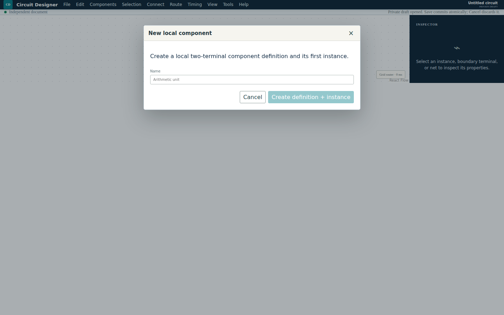

# Circuit Designer visual profile

Circuit Designer uses **Blueprint Slate**, a restrained engineering-workstation
profile intended to be recognizable without looking like a generic dark IDE.
Dark navy chrome and inspector surfaces frame a light drawing canvas; teal is
reserved for primary actions, cobalt for connectivity, and amber for timing or
constraint warnings.



## Semantic palette

| Role | Value | Usage |
| --- | --- | --- |
| Chrome | `#081f33` | menubar and inspector |
| Canvas | `#f7f9fc` | topology workspace |
| Surface | `#ffffff` | dialogs, menus, cards |
| Primary | `#007c89` | commits and active controls |
| Net | `#1d64c8` | connections and routed signals |
| Warning | `#9a5d00` | timing, CDC, and constraint attention |
| Text | `#102a43` | primary light-surface copy |
| Focus | `#3aaed8` | keyboard focus indication |

The canonical values are exported as `blueprintSlateTheme` from
`@spec2gds/circuit-core`. `circuitThemeCssProperties()` converts any
`CircuitThemeDefinition` into the `--cd-*` properties consumed by the React
shell and canvas. SVG/PNG export uses the same semantic theme, so exported
artifacts match the working view.

## UI rules

- Application CSS is contained by `.cd-app`; standalone page sizing stays in
  the standalone application.
- Supporting text is at least 11–12 px, with higher contrast than the earlier
  warm-gray profile.
- Keyboard focus uses a visible cyan outline rather than relying on color fill.
- The shell sizes from its host container, not `100vh`.
- Below 960 px the inspector becomes an overlay; 720 px is the supported
  minimum standalone width.
- Functional states use semantic tokens and are not encoded by color alone.

## Custom themes

Hosts may pass another theme without rewriting CSS:

```ts
const laboratoryTheme: CircuitThemeDefinition = {
  ...blueprintSlateTheme,
  id: "laboratory",
  colors: {
    ...blueprintSlateTheme.colors,
    primary: "#5b4cc4",
    net: "#087f8c",
  },
};
```

Keep the semantic roles stable and verify text, focus, warning, and disabled
contrast before adopting a custom profile.
