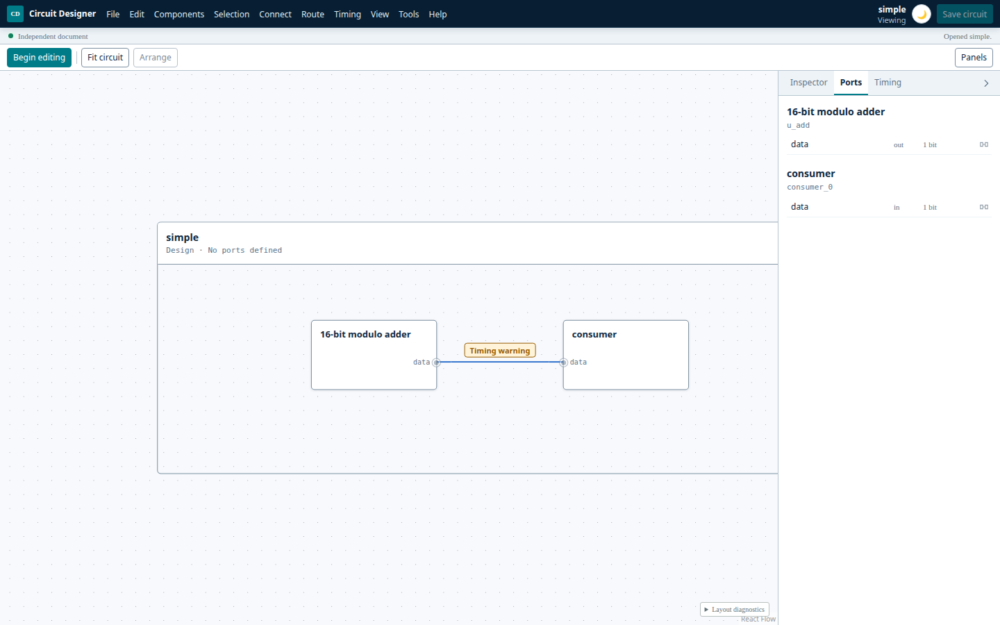
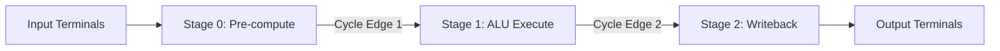

# Circuit Designer

Circuit Designer provides a direct-manipulation schematic and circuit layout editor.
It operates as a standalone application or as an embedded component within host platforms.



## 1. Visual Profile and Theme

Circuit Designer uses the **Blueprint Slate** visual profile.

### Design Principles
- High-contrast slate and dark navy surfaces prevent visual fatigue.
- Signal routes and boundary terminals use crisp cyan and amber accents.
- Monospace labels display hardware identifiers and timing stage numbers.
- Canvas layouts, SVG vector exports, and PNG raster exports share identical coordinate models and styling.

---

## 2. Canvas Interactions and Gestures

Circuit Designer uses one unified direct-manipulation canvas.
The designer does not need to switch between Select, Connect, Route, or Pan modes.

### Direct Gestures

| User Action | Interaction Result |
| --- | --- |
| Click instance, terminal, or net | Select the target item |
| `Shift` + Click or `Ctrl/Cmd` + Click | Toggle item in multi-selection |
| Drag empty canvas area | Pan canvas viewport smoothly |
| `Shift` + Drag empty canvas area | Marquee selection box for multiple items |
| Drag selected instance | Move instance snapped to circuit grid |
| Arrow keys / `Shift` + Arrow keys | Move selected instances 1 or 10 grid increments |
| Drag free terminal to another terminal | Create a connected net between terminals |
| Drag route segment or junction | Adjust orthogonal wire routing |
| Double-click wire segment | Insert or remove route bend point |

---

## 3. Application Menubar

A traditional compact menubar provides all operations:

- **File**: Document creation, opening, draft save/cancel, and JSON/SVG/PNG exports.
- **Edit**: Edit lease acquisition, undo, redo, object deletion, and preferences.
- **Components**: Component catalog, local definitions, and hierarchical child design drill-down.
- **Selection**: Select all, invert selection, and clear selection.
- **Connect & Route**: Manual wire routing, orthogonal clean-up, and segment locking.
- **Timing**: Cycle edge markers, clock domains, and path latency analysis.
- **View**: Canvas zoom controls, grid snapping toggles, and property Inspector panel.
- **Tools**: Host-contributed tools, including the AI Assistant.

---

## 4. Pipeline Stages and Timing Analysis

Circuit Designer divides designs into left-to-right pipeline stages using vertical **cycle edges**.



### Timing Stage Behavior
- **Cycle Calculation**: A path in the same clock domain gains one clock cycle for each cycle edge crossed between source and destination.
- **Default Clock Domain**: Designs begin with one implicit domain named `clk`.
- **Multiple Clock Domains**: Use **Timing → Clock settings** to configure additional clock domains. Paths crossing distinct clock domains report clock domain crossing (CDC) warnings.
- **Placement Constraints**: Every component instance must sit fully within one pipeline stage. Placing a component across a cycle edge marker triggers a placement error.
- **Automatic Layout**: The layout engine preserves stage containment and expands unlocked cycle markers rightward as needed.
- **Timing Analysis**: **Timing → Timing analysis** lists paths, cycle counts, CDC boundaries, and backward feedback loops.

---

## 5. User Preferences and Shortcuts

Open **Edit → Preferences → Actions and shortcuts** to adjust keybindings:
- Every action supports customizable keyboard and mouse bindings.
- The editor automatically detects and clears shortcut conflicts.
- Preferences save through the Circuit service and persist across sessions.
- **Reset defaults** restores standard factory shortcuts.

---

## 6. Embedding Circuit Designer

The host-neutral React component package `@spec2gds/circuit-app-react` enables embedding in custom host tools.

### Build the Package
```bash
cd circuit-designer
npm run build --workspace @spec2gds/circuit-app-react
```

### Embed in React Applications
```tsx
import { CircuitDesignerApp } from "@spec2gds/circuit-app-react";
import "@xyflow/react/dist/style.css";
import "@spec2gds/circuit-react/styles.css";
import "@spec2gds/circuit-app-react/styles.css";

export function EmbeddedCircuitView({ backend, files, preferences }) {
  return (
    <div style={{ height: "100vh", width: "100%" }}>
      <CircuitDesignerApp
        backend={backend}
        files={files}
        preferences={preferences}
        launch={{ kind: "document", documentId: "soc_top" }}
      />
    </div>
  );
}
```

### Host Adapter Responsibilities
- `backend`: Manages document revisions, leases, operations, and hierarchy.
- `files`: Handles document loading and export of JSON, SVG, and PNG files.
- `preferences`: Persists and caches shortcut mappings and visual settings.
- `source`: Synchronizes source-bound projections with external specification authorities.
- `tools`: Injects external tools, such as the AI Assistant.
