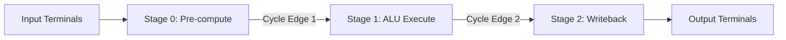

# Circuit Designer

Circuit Designer provides a direct-manipulation schematic and circuit layout editor.
It operates as a standalone application or as an embedded component within host platforms.


## 1. Visual Profile and Theme

Circuit Designer uses the **Blueprint Slate** visual profile.

### Design Principles
- High-contrast slate and dark navy surfaces prevent visual fatigue.
- Signal routes and boundary terminals use crisp cyan and amber accents.
- Monospace labels display hardware identifiers and timing stage numbers.
- Canvas layouts, SVG vector exports, and PNG raster exports share identical coordinate models and styling.
- A quick theme toggle allows the designer to switch between dark and light themes. Theme preferences persist in local storage.

---

## 2. Canvas Interactions and Gestures

Circuit Designer uses one unified direct-manipulation canvas.
The designer does not need to switch between Select, Connect, Route, or Pan modes.

Each open Design has an automatic frame. Internal Designs show their Component
name. Instances and routes stay inside the frame. Boundary ports sit on its
edges, with labels inside. Inputs default to the left, outputs to the right, and
bidirectional ports to the bottom. Saved side and order choices are preserved.
Component interface previews remain a single block.

Select the visible **Begin editing** button, then **Add port** in the toolbar, frame header, or context menu.
Enter the name, direction, and wire width or range. **Port list** provides a readable alternative to small canvas terminals. Select a port to inspect it or start a connection from it. This also works for
independent circuit files. Port creation is one undoable change; Cancel does not
create a port. The frame adjusts to the content without moving instances or
changing the current viewport.

### Direct Gestures

| User Action | Interaction Result |
| --- | --- |
| Click instance, terminal, or net | Select the target item |
| `Shift` + Click or `Ctrl/Cmd` + Click | Toggle item in multi-selection |
| Drag empty canvas area | Pan canvas viewport smoothly |
| `Shift` + Drag empty canvas area | Marquee selection box for multiple items |
| Drag selected instance | Move instance snapped to circuit grid |
| Arrow keys / `Shift` + Arrow keys | Move selected instances 1 or 10 grid increments |
| Drag free terminal to another terminal | Create a connected net between terminals |
| Drag route segment or junction | Adjust orthogonal wire routing |
| Double-click wire segment | Insert or remove route bend point |

### Net Connections and Scalar Handling
- Net connections enforce strict port width matching.
- Scalar 1-bit wire ports connect directly to matching 1-bit scalar ports or terminals.
- Vector buses require explicit bit-width declarations (such as `[7:0]`).
- **Connect ports** uses **From port** and **To port**. Whole ports connect without slice fields. **Advanced: connect selected bits** exposes offsets and width. Invalid mappings disable submission and explain the constraint. Compatible target choices appear first; no width conversion is implicit.
- Circuit preview layouts preserve port order and wire routes across saves.

---

## 3. Application Menubar

The toolbar shows common actions: **Begin editing**, **Add component**, **Add port**, **Connect ports**, and **Cancel changes**. The header keeps the document name, save state, and save destination visible. Independent circuits use **Save circuit**, which commits and downloads the file. Linked circuits use **Save to Spec**.

**Add component** opens the existing Component catalog and an explicit **Create local Component** action. Review the port summary before placing an instance. A new local Component has input and output ports with an explicit width or range; the default is 1 bit.

The menubar retains all operations. At smaller widths, open **Commands** to access it:

- **File**: Document creation, opening, draft save/cancel, and JSON/SVG/PNG exports.
- **Edit**: **Begin editing**, **Create internal Design**, undo, redo, object deletion, and preferences.
- **Components**: Component catalog, local definitions, and hierarchical child design drill-down.
- **Selection**: Select all, invert selection, and clear selection.
- **Connect & Route**: Manual wire routing, orthogonal clean-up, and segment locking.
- **Timing**: Cycle edge markers, clock domains, and path latency analysis.
- **View**: Canvas zoom controls, grid snapping toggles, and property Inspector panel.
- **Tools**: Host-contributed tools, including the AI Assistant.

For a Component opened from Spec Editor without an internal Design, select
the visible **Create internal Design** button. It acquires editing permission and prepares a private Design. The menu path **Edit → Begin editing → Edit → Create internal Design** remains available. The interface preview stays read-only
until creation succeeds. The new Design remains private until **Save to Spec**.
An empty first save is allowed. **Cancel changes** restores the interface preview.
If implementation SV exists, choose **Retain SV**, **Remove SV**, or **Cancel saving**.
Retained SV becomes reference text and is excluded from hardware generation and lint.
See the [Spec Editor guide](spec-editor.md#create-an-internal-design-for-a-blank-component).

---

## 4. Pipeline Stages and Timing Analysis

Circuit Designer divides designs into left-to-right pipeline stages using vertical **cycle edges**.



### Timing Stage Behavior
- **Cycle Calculation**: A path in the same clock domain gains one clock cycle for each cycle edge crossed between source and destination.
- **Default Clock Domain**: Designs begin with one implicit domain named `clk`.
- **Multiple Clock Domains**: Use **Timing → Clock settings** to configure additional clock domains. Paths crossing distinct clock domains report clock domain crossing (CDC) warnings.
- **Placement Constraints**: Every component instance must sit fully within one pipeline stage. Placing a component across a cycle edge marker triggers a placement error.
- **Automatic Layout**: The layout engine preserves stage containment and expands unlocked cycle markers rightward as needed.
- **Timing Analysis**: **Timing → Timing analysis** opens a side panel with port names, clock domains, cycle counts, CDC boundaries, and backward feedback loops. Select a row to highlight its net in the circuit.

---

## 5. User Preferences, Recovery, and Shortcuts

Open **Edit → Preferences → Actions and shortcuts** to adjust keybindings:
- Every action supports customizable keyboard and mouse bindings.
- The editor automatically detects and clears shortcut conflicts.
- Preferences save in browser-local storage. The Circuit service preference file supplies initial defaults. Changes in one browser do not change another browser’s settings.
- **Reset defaults** restores standard factory shortcuts.

### Save conflicts and narrow screens

A stale Spec save preserves the draft and shows one recovery panel. **Keep editing draft** collapses the panel. **Download draft** preserves a local copy. **Open latest Spec** asks before discarding unsaved changes. A failed reload keeps the draft available for download or discard. Transport retries keep the existing request identity.

Primary toolbar controls remain outside the zoomed canvas. **Port list** supports terminal selection and connections without precision taps. The Inspector has a close action and opens below the toolbar as a drawer on narrow screens. Save state remains visible at all widths.

### Error Handling and Session Recovery
The application shell catches rendering errors and projection faults.
If an unexpected runtime error occurs, the UI presents a recovery panel.
The designer can reload the active circuit or restore the last valid snapshot without data loss.

---

## 6. Embedding Circuit Designer

The host-neutral React component package `@spec2gds/circuit-app-react` enables embedding in custom host tools.

### Build the Package
```bash
cd circuit-designer
npm run build --workspace @spec2gds/circuit-app-react
```

### Embed in React Applications
```tsx
import { CircuitDesignerApp } from "@spec2gds/circuit-app-react";
import "@xyflow/react/dist/style.css";
import "@spec2gds/circuit-react/styles.css";
import "@spec2gds/circuit-app-react/styles.css";

export function EmbeddedCircuitView({ backend, files, preferences, source, tools }) {
  return (
    <div style={{ height: "100vh", width: "100%" }}>
      <CircuitDesignerApp
        backend={backend}
        files={files}
        preferences={preferences}
        source={source}
        tools={tools}
        launch={{ kind: "document", documentId: "soc_top" }}
      />
    </div>
  );
}
```

### Host Adapter Responsibilities
- `backend`: Manages document revisions, leases, operations, and hierarchy.
- `files`: Handles document loading and export of JSON, SVG, and PNG files.
- `preferences`: Persists and caches shortcut mappings and visual settings.
- `source`: Synchronizes source-bound projections with external specification authorities.
- `tools`: Injects external tools, such as the AI Assistant.

### Shared hosted Specs

Source-bound Circuit identity includes the exact Spec file binding and its edit
context. Copied files with matching internal IDs do not share a Circuit. A
read-only Spec opens a read-only projection. Save to Spec requires both a valid
Circuit edit lease and valid Spec edit access. A linked open view renews Spec
participation after Spec Editor closes. Independent `.circuit.json` files keep
their existing save and shared-record behavior.

## Spec interfaces and access

Spec Editor can create an empty internal Design directly from a Component.
Open it here and select **Begin editing** before changing the circuit.
Top-level Designs have their own ports and parameters; internal Designs use their
Component’s interface. Boundary changes save to the appropriate source through
**Save to Spec**. Circuit saves preserve declared ranges and explicit instance
parameter mappings, including different effective widths on reused Components.

**Close Spec** in Spec Editor ends linked editing access. The circuit draft stays
available, while saving is disabled. Request new access from Spec Editor before
starting a new source-bound edit. Retained Component SV is reference text whenever
an internal Design supplies the implementation.
