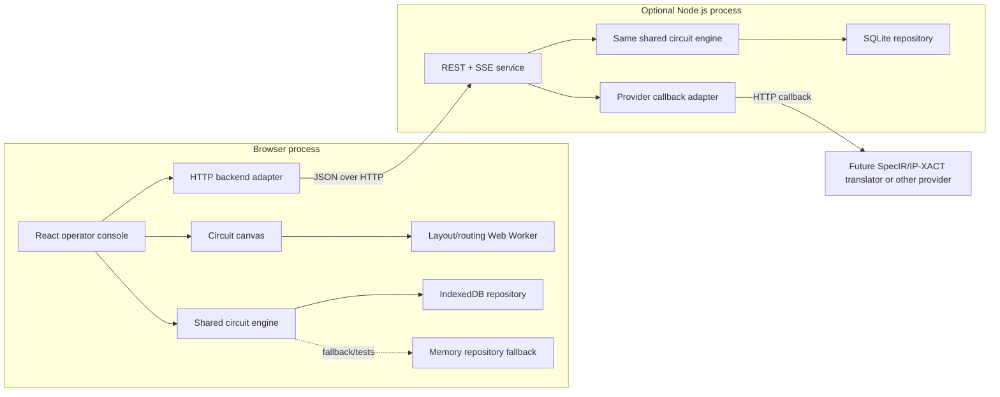
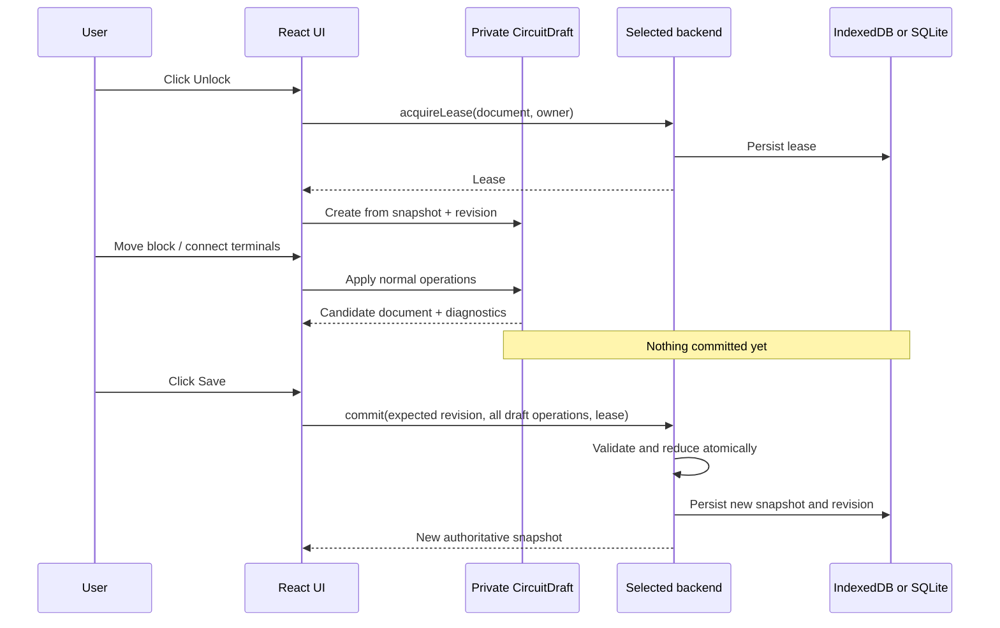

# Temporary Orientation Report: How Circuit Designer Runs

This report explains the Circuit Designer from a system-engineering perspective.
It is intentionally introductory and is not the protocol specification.

## Short answer: are we using Node.js?

Yes, in two distinct roles:

1. **Development toolchain:** Node.js runs `npm`, TypeScript, Vite, schema
   generation, builds, and tests. This role is needed even when the finished
   application runs entirely in a browser.
2. **Optional application server:** Node.js can run the reference HTTP service,
   persist documents in SQLite, publish server-sent events, and call component
   design providers.

The browser does **not** run Node.js. Vite converts the TypeScript/React source
into ordinary browser JavaScript, CSS, and worker files. Chrome, Edge, or
another browser executes those generated files.

Think of Node.js as both the build workstation and, optionally, the deployed
control computer. The browser is the operator console.

## Main architectural separation

There are two supported deployment shapes:

- **Browser-only:** React + shared engine + IndexedDB all run locally in the
  browser. No application server is required after the static files are served.
- **Client/server:** React runs in the browser, while the HTTP adapter sends
  requests to the Node service. The Node service runs the same engine and saves
  state in SQLite.

The current standalone app selects the browser-only shape. It opens IndexedDB
and falls back to memory if IndexedDB is unavailable.

## What runs in the browser?

### React application

React builds the visible controls: catalog, inspector, Unlock/Save/Cancel,
proposal decisions, export buttons, and canvas modes. React is primarily the
human-machine interface; it is not the canonical circuit model.

### Canvas renderer

The canvas receives a flattened view derived from the canonical document:
component definitions plus instances become visible nodes and terminal handles.
This projection allows reuse of the existing React canvas without making its
rendering objects the storage format.

### Shared circuit engine

The browser executes the TypeScript engine for:

- schema and semantic validation;
- construction compilation;
- atomic operation reduction;
- diagnostics and normalized diffs;
- private draft undo/redo and operation coalescing;
- hierarchy compatibility checks;
- deterministic SVG and JSON export.

This engine has no React, SpecIR, IP-XACT, Python, or database dependency.

### Web Worker

Automatic placement and routing run in a Web Worker. A worker is another
browser execution context, comparable to a background task. It prevents a large
layout operation from blocking button clicks, canvas feedback, and repainting.
The UI receives progress and can request cancellation.

### IndexedDB

IndexedDB is a database built into the browser. It persists data under the
website's origin, for example `http://127.0.0.1:4180`.

It stores:

- the current `CircuitSnapshot`;
- the opaque revision counter;
- active edit lease;
- pending proposals;
- idempotency results for committed request IDs.

It is appropriate for a single-browser/local application. It is not a shared
multi-machine database and is not normally inspected as a file by the user.
Clearing site data can remove it, so portable JSON export remains important.

## What runs on the optional Node.js server?

### REST service

The Node service exposes `/api/circuit-designer/v1`. It accepts the same
documents, constructions, and operation batches used by the browser backend.
It maps domain outcomes to HTTP status codes such as:

- `400`: validation failure;
- `404`: missing document or component;
- `409`: revision or stale-proposal conflict;
- `423`: manual edit lock conflict;
- `502`: provider failure.

### SSE notifications

Server-Sent Events notify clients that a document, lock, proposal, or provider
state changed. An event is only an invalidation notice. The client refetches the
authoritative snapshot rather than attempting to reconstruct state from events.

### SQLite

SQLite is an embedded relational database used by the Node service. It is a
file on the server's filesystem. It stores the same logical repository state as
IndexedDB but is owned by the server process and can serve multiple browser
clients.

SQLite is appropriate when:

- several clients must see one authoritative circuit;
- browser storage should not be authoritative;
- the circuit must survive browser cache/site-data removal;
- a future translator or provider communicates through the service;
- server-side operational control and backup are needed.

### Provider callbacks

The Node service can call a provider to resolve a component's internal design
or save a writable child design. A future SpecIR/IP-XACT translator can occupy
this boundary without adding IP-XACT concepts to `CircuitDocument`.

## What do the four repository names mean?

All four present the same `CircuitDesignerBackend` interface to callers. This is
similar to interchangeable equipment implementing the same interface control
document.

| Implementation | Runs where | Durable? | Shared? | Primary purpose |
|---|---|---:|---:|---|
| Memory | Browser or Node process | No | No | Tests, examples, and fallback |
| IndexedDB | Browser | Yes, in browser site data | Normally one browser profile | Default standalone persistence |
| HTTP adapter | Browser or another JS client | Depends on server | Yes | Remote proxy to the Node service |
| SQLite | Node server | Yes, as a server file | Yes, through the service | Authoritative service persistence |

An important nuance: the **HTTP adapter does not itself store data**. It
implements the repository interface by forwarding calls to a remote service.
The service's SQLite repository performs the actual persistence.

### Memory repository

This is an in-process map. It has full behavior—validation, revisions, leases,
proposals, and idempotency—but everything disappears when the page or process
ends. It is fast and deterministic, which makes it valuable for unit tests.

### IndexedDB repository

This combines the same in-memory behavior with browser persistence. It hydrates
repository state when opened and writes complete state after accepted changes.

### HTTP-backed repository

This serializes backend calls as REST requests. React can therefore use nearly
the same code whether the authority is local IndexedDB or remote SQLite.

### SQLite-backed repository

This combines the shared behavior with transactional server-file persistence.
The Node service surrounds it with REST, SSE, provider callbacks, and HTTP error
mapping.

## Example: manual canvas edit

If validation produces a blocking error, the final persistence step does not
occur and the draft remains open. Cancel simply discards the draft and releases
the lease.

## Example: client/server request

1. React calls `HttpCircuitDesignerBackend.commit(...)`.
2. The HTTP adapter sends JSON to the Node REST endpoint.
3. The service passes the batch to the shared TypeScript engine.
4. The engine checks the expected revision, lease, references, slices, and
   layout.
5. On success, SQLite receives the complete new repository state.
6. The service returns the new snapshot and publishes an SSE invalidation.
7. Other browser clients refetch the authoritative snapshot.

## Where Node.js is and is not required

| Activity | Node.js required? |
|---|---:|
| Install dependencies and build TypeScript/React | Yes |
| Run Vite development server | Yes |
| Execute the built browser application | No |
| Use browser IndexedDB | No |
| Run automatic layout in the browser worker | No |
| Run the REST/SSE reference service | Yes |
| Use server SQLite persistence | Yes |
| Run schema generation and automated tests | Yes |

In production, some ordinary static web server must still deliver the built
HTML/JavaScript/CSS files. That static server does not need to be Node.js.

## Suggested mental model

Use this mapping to familiar system-engineering concepts:

- `CircuitDocument` = controlled design data package;
- JSON Schema = interface/data specification;
- shared engine = rules and state-transition logic;
- operation batch = revision-controlled change request;
- draft = uncommitted engineering change workspace;
- revision = configuration baseline identifier;
- lease = exclusive maintenance lock;
- backend interface = standardized equipment/service interface;
- IndexedDB or SQLite = configuration-state repository;
- React canvas = operator console;
- Web Worker = background compute unit;
- HTTP/SSE = command/response plus state-change notification transport;
- provider callback = external subsystem interface.

The central invariant is: **the canonical circuit document and operation engine
do not care which repository or user interface is connected to them.**

## Current source map

- Protocol schema: `circuit-designer/schema/circuit-designer.v1.schema.json`
- Shared engine: `circuit-designer/packages/core/src/`
- Memory and IndexedDB: `circuit-designer/packages/client-local/src/index.ts`
- HTTP adapter: `circuit-designer/packages/client-http/src/index.ts`
- Node/SQLite service: `circuit-designer/packages/service/src/`
- Layout worker: `circuit-designer/packages/layout/src/worker.ts`
- React canvas: `circuit-designer/packages/react/src/index.tsx`
- Standalone application: `circuit-designer/apps/standalone/src/App.tsx`

This report is temporary orientation material. The authoritative specifications
remain `circuit_designer_protocol_v1.md`,
`circuit_designer_provider_v1.md`, and
`circuit_designer_tools_v1.md`.
