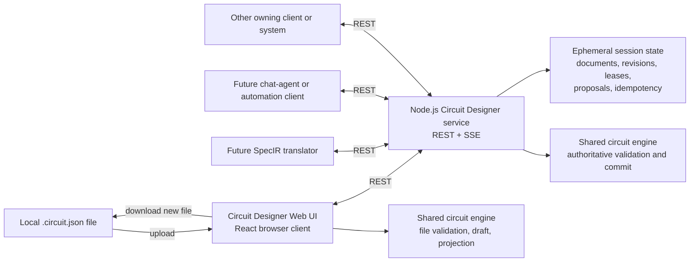
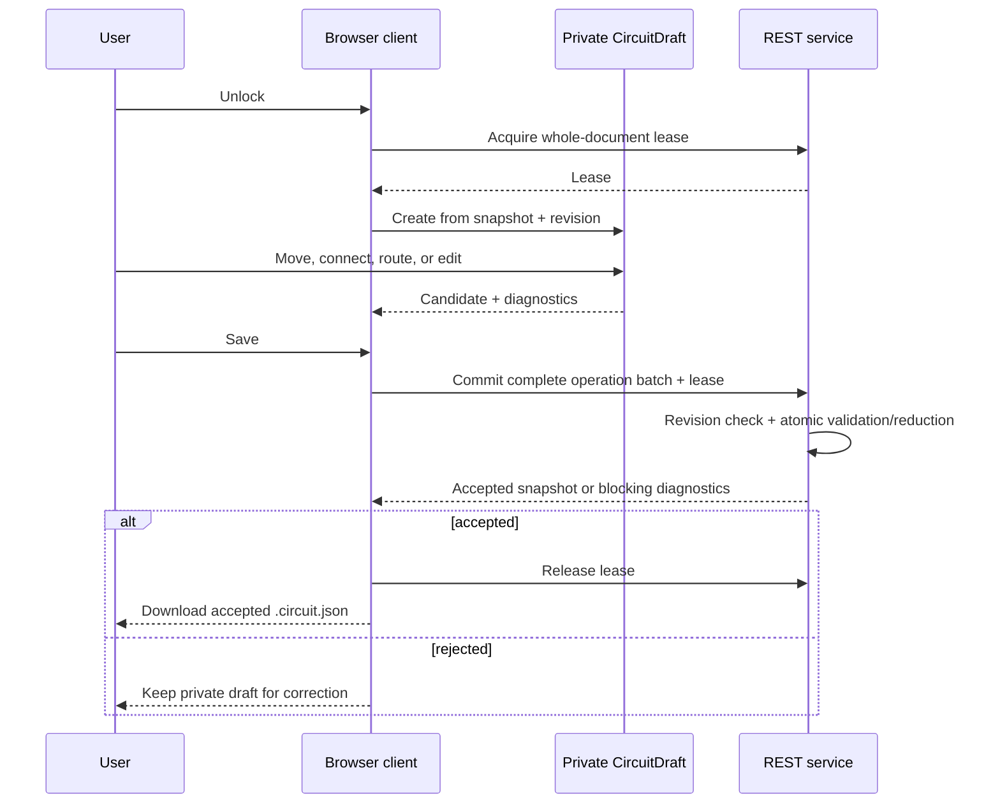

# Circuit Designer v1 Design and Architecture

This is the authoritative design document for Independent Circuit Designer v1.
The protocol details are in
[Circuit Designer v1 Protocol](circuit_designer_protocol_v1.md), and operational
commands are in [Running Circuit Designer v1](circuit_designer_run_v1.md).

## Locked decisions

- Circuit Designer is independent of SpecIR and IP-XACT.
- Every external client communicates through versioned REST endpoints.
- The Node service coordinates active work in process memory only.
- The client that supplied a circuit owns its durable representation.
- The browser opens files with a standard upload control and saves by
  downloading a new `.circuit.json` file.
- The browser does not overwrite local files and does not use IndexedDB.
- The service does not use SQLite or another persistent database.
- The existing React canvas is retained and adapted incrementally.
- A future SpecIR translator and a future chat-agent host are ordinary REST
  clients; neither is implemented in v1.

The service is therefore stateful during an active editing session but is not a
system of record. Restarting it discards all active circuits, revisions, leases,
proposals, provider registrations, and idempotency records.

## System context



“Owning client” means the system responsible for durable data:

- for file-based use, the downloaded `.circuit.json` file is durable;
- for future SpecIR use, SpecIR remains durable and the translator maps the
  accepted circuit back into SpecIR;
- for another application, that application persists its own representation.

The service never persists an owning client’s data on its behalf.

## Authority and state

| State | Authority | Lifetime |
| --- | --- | --- |
| Durable circuit source | File, future SpecIR translator, or another client | Chosen by the owning client |
| Active `CircuitSnapshot` | Node REST service | Until service restart |
| Revision, lease, proposal, idempotency result | Node REST service | Until service restart |
| Private `CircuitDraft` and undo/redo | Controlling browser tab | Until Save, Cancel, navigation, or tab close |
| Viewport, selection, mode, panels, theme | Browser tab | Browser-local only |
| Component-provider sidecars and entity mappings | Provider | Provider-defined |

The canonical portable value is `CircuitDocument`. A service
`CircuitSnapshot` adds only an opaque session revision. Leases, proposals,
request IDs, provider mappings, and browser view state are not written into a
circuit file.

## Why the engine is shared

`@spec2gds/circuit-core` is environment-neutral TypeScript used on both sides of
the REST boundary.

The browser uses it to:

- validate an uploaded circuit before starting a session;
- build and manipulate a private operation-based draft;
- derive flattened render nodes and terminal handles;
- generate deterministic circuit JSON.

The service uses it to:

- validate every authoritative create, replace, preview, and commit;
- apply operation batches atomically;
- generate diagnostics, normalized diffs, and alias maps;
- enforce revisions, references, slices, hierarchy, and explicit cascades.

Using one engine prevents the UI preview and service commit from developing
different circuit rules. The service result remains authoritative: browser
draft evaluation is immediate feedback, not a committed state.

## Runtime components

| Path | Responsibility |
| --- | --- |
| `schema/circuit-designer.v1.schema.json` | JSON Schema authority |
| `packages/core/` | Generated contracts, validation, reducer, drafts, hierarchy, queries, and deterministic exports |
| `packages/client-http/` | REST client implementing `CircuitDesignerBackend` and validating responses |
| `packages/service/` | REST/SSE server, ephemeral session backend, PNG export, and provider callbacks |
| `packages/layout/` | Cancellable placement and orthogonal routing worker |
| `packages/react/` | Canvas projection rendering and gestures |
| `apps/standalone/` | Human React client and file upload/download composition |

There is intentionally no local repository package. The browser client cannot
switch to an IndexedDB or in-process authority.

## Core flows

### Open a file

```mermaid
sequenceDiagram
  participant U as User
  participant B as Browser client
  participant S as REST service

  U->>B: Select .circuit.json
  B->>B: Parse + schema/semantic validation
  alt invalid
    B-->>U: Diagnostics; current circuit is unchanged
  else valid
    B->>S: POST /documents
    S->>S: Validate and create revision 1
    S-->>B: CircuitChangeResult + snapshot
    B-->>U: Render active circuit
  end
```

If the document ID already identifies an identical active session, the browser
joins it. If the ID identifies different content, the upload is rejected
instead of replacing another client’s active work.

### Manual edit and Save



Cancel releases the lease and discards the draft. File opening and authoritative
exports are disabled while a draft is active.

### Another client changes the circuit

An agent, translator, or other trusted client previews and commits through the
same REST protocol. The service emits an SSE invalidation. When the browser has
no private draft, it refetches the authoritative snapshot. While a manual lease
exists, other direct commits receive HTTP 423.

### Proposal review

An external agent host may submit a structured immutable proposal. The service
stores it only for the active session. Accept applies the proposal atomically;
Reject deletes it. Any intervening revision makes it stale. Acceptance updates
the service session but does not durably save the owning client’s source.

## REST surface

The base path is `/api/circuit-designer/v1`.

| Method and path | Purpose |
| --- | --- |
| `POST /documents` | Create an active circuit session explicitly |
| `GET /documents/{document_id}` | Read the authoritative snapshot |
| `PUT /documents/{document_id}` | Explicit revision-guarded replacement |
| `POST /constructions/validate` | Compile and validate compact construction JSON |
| `POST /documents/{id}/operations/preview` | Preview an atomic operation batch |
| `POST /documents/{id}/operations/commit` | Commit an atomic operation batch |
| `GET, POST /documents/{id}/lock` | Read or acquire the manual-edit lease |
| `PUT, DELETE /documents/{id}/lock/{lease_id}` | Renew or release the lease |
| `GET /documents/{id}/summary` | Return design counts and warning count |
| `GET /documents/{id}/components` | Search the working component catalog |
| `POST /documents/{id}/queries/subgraph` | Return a focused circuit neighborhood |
| `POST /documents/{id}/exports` | Export JSON, SVG, or PNG |
| `GET, POST /documents/{id}/proposals` | List or submit proposals |
| `POST /documents/{id}/proposals/{proposal_id}/decision` | Accept or reject |
| `POST /documents/{id}/components/{component_id}/resolve` | Resolve a child design |
| `POST /documents/{id}/components/{component_id}/commit` | Commit a writable child design through its provider |
| `PUT /documents/{id}/provider` | Register an ephemeral HTTP provider callback |
| `GET /documents/{id}/events` | Subscribe to SSE invalidations |

There is no filesystem path API and no database-management API.

## Session consistency

- Revisions are opaque to clients.
- Every mutating batch carries the revision the client observed.
- Request IDs make accepted creates and commits idempotent within the current
  service process.
- A manual lease is exclusive, renewable, and covers the whole document.
- Direct trusted commits are allowed only when no manual lease exists.
- SSE is invalidation-only; clients refetch instead of reconstructing state
  from events.
- Restart recovery is client-driven: reload the durable source and create a new
  session.

## Hierarchy and providers

Circuit Designer models reusable component definitions, not IP-XACT wrappers or
provider entity identities. A provider can resolve one shared child
`CircuitDocument` for a component. Child boundary terminals must match the
component definition, and hierarchy cycles are rejected.

Provider callback registration is part of the ephemeral parent session. A
writable provider owns durable child persistence and returns its accepted
provider revision and normalized document. See
[Circuit Designer v1 Provider Boundary](circuit_designer_provider_v1.md).

## Deployment and security

During development, `npm run dev` starts the service first, waits for it, and
then starts the Vite browser client. Vite proxies `/api` to loopback.

In production, serve the built browser assets and route
`/api/circuit-designer/v1` to the Node service. The v1 reference service is
unauthenticated and binds to loopback by default. Provider callback URLs are
also loopback-only unless explicitly permitted.

Authentication, authorization, durable service storage, and multi-tenant
isolation are outside v1.

## Explicit v1 boundaries

- no SpecIR/IP-XACT translator implementation;
- no A2UI circuit protocol;
- no model SDK, chat panel, or natural-language execution;
- no desktop shell or browser filesystem-handle API;
- no overwrite-in-place file saving;
- no SQLite, IndexedDB, or user-visible revision history;
- no authentication or hosted multi-tenant deployment;
- no multiple canonical layouts or designs in one document;
- no whole-hierarchy image expansion.
