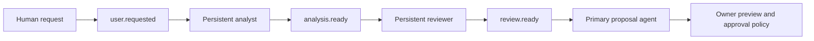

# DSH configurable Assistant tutorial

This walkthrough follows startup, a bound request, event collaboration, native goals, and owner review. The [architecture reference](configurable-assistant-architecture.md) owns responsibilities; the [Phase 1 guide](event-driven-assistant-phase1.md) owns operational limits and recovery.

## 1. Start the native product

Run `scripts/setup-all.sh`, then `bash scripts/serve-all.sh start`. The Assistant's `harness.product.json` selects the web or headless DSH profile. The shared product patch mounts the trusted catalogs, event service, native goals, and product adapter. Browser composition mounts the preset selector and execution dock; headless requests retain focused execution.

Loader injection makes native agent/session, persistence, tools, token metering, and storage available before execution. Catalog providers resolve text and validate references; the product checks exact Spec/Circuit definitions and seals registrations before becoming ready.

## 2. Create an immutable bound conversation

In the Assistant, choose the Spec or Circuit target and one preset. The owner validates the target, the product stores its permanent binding, and the selected native composition supplies scoped tools. Unbound chats can discuss general questions or initiate a new Spec package, but cannot read a design or create a design goal without binding.

The product reads the owner's operation schema and approval policy. It contributes ordered domain prompt sections and semantic tools. Model capabilities are checked by the native tool executor as well as described by prompts.

## 3. Follow event-driven analysis and review

For `orchestrated`, attaching the primary pins its trusted roster, prompts, subscriptions, selected model routes, and resource allocation. A direct human request becomes a committed `user.requested` event before delivery.

The dispatcher persists a delivery identity before placing a logged plugin message in the member's native inbox. Its exact user-message receipt records acceptance. That member's corresponding turn-end records the activation outcome. The analyst/reviewer can read bound context and publish approved result types; only the primary receives proposal tools. A causal review of the latest user request must precede proposal preparation. Later requests reuse those native sessions.

## 4. Follow a native goal

For `goal`, one primary uses the existing goal tools and same-session round driver. It shares the event service's host-owned accounting and lifecycle controls without sending every continuation through subscriptions. A proposal requiring human review pauses the goal and new admissions. Resolve the review card and explicitly Resume to continue; an owner receipt does not automatically complete the goal.

## 5. Inspect and control execution

The dock reads committed state through the product API. Pause/stop cancels owned active work; Resume retains spending. Every initiator-owned model request, including native retry/compaction, is charged before provider access. The storage-domain ledger owns configuration, deliveries, attempts, and accounting; native JSONL owns model-visible history; product SQLite owns binding and review metadata.

A restart restores state without running models. Formerly active execution requires human Resume. An uncertain interrupted attempt needs a separate acknowledged retry, which preserves its prior identity and results. Legacy chats remain readable and use new bound conversations for updated execution. Workflows, external triggers, automatic retry, and general durable waiting remain deferred.

## 6. Verify the native composition

From `ai-assistant`, run `npm test`, `npm run build`, and `npm run test:harness`. The latter runs the focused profile's owner integration/keyless replay and native Loader/owner tests for both updated presets. In the sibling Harness checkout, run the event-service/provider tests listed in the Phase 1 guide. Provider responses are scripted; execution, tools, native goals, persistence, and owner requests remain real.
