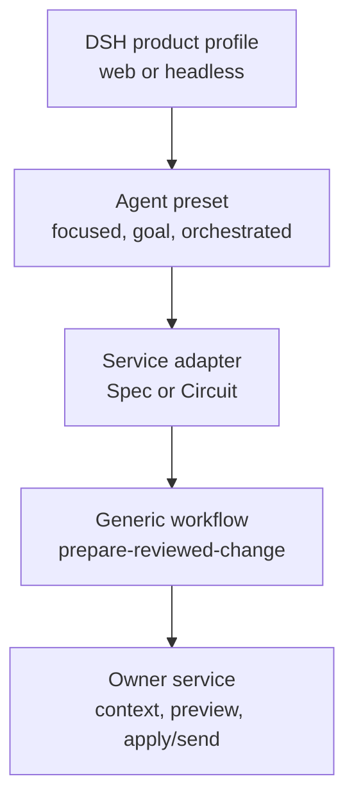

# DSH Configurable Assistant Tutorial

This tutorial explains the configurable spec2gds assistant from the DeepSeek Harness perspective. It assumes familiarity with Cordis services, plugin loading, dependency injection, effects, and scoped contexts. It introduces the DSH concepts needed to follow a focused question, a durable goal, or delegated analysis from startup through review and persistence.

## 1. Start with the five composition layers

The implementation separates application hosting, per-session execution, service knowledge, durable work state, and owner mutation.



| Layer | Question | Current values |
| --- | --- | --- |
| Product profile | Which application and host surface run? | `spec2gds-web`, `spec2gds-headless` |
| Agent preset | How may this session execute? | `focused`, `goal`, `orchestrated` |
| Service adapter | Which domain capabilities and review type apply? | `spec-editor@1.0.0`, `circuit-editor@1.0.0` |
| Workflow | Which reusable work lifecycle applies? | `prepare-reviewed-change@1.0.0` |
| Owner binding | Which document may be read and changed? | Immutable owner URL, document, scope, and optional entity |

The service adapter never selects the execution preset. A Circuit session can be focused, goal-oriented, or orchestrated in exactly the same way as a Spec session. This independence is why a new service does not require a new agent runtime.

## 2. Learn the DSH terms used here

### Product profile and bundle

A DSH product profile is a process-level application composition. The product recipe in `ai-assistant/harness.product.json` defines two profiles:

- `spec2gds-web` composes `dsh-base`, `dsh-web-app`, the assistant bundle, and the spec2gds browser bundle.
- `spec2gds-headless` composes `dsh-base`, `dsh-headless`, and the assistant bundle for one request without a browser.

A bundle is a package that contributes an ordered Cordis patch. Bundles package a known set of plugin rows and defaults. Later layers can replace a row by its `id`; a replacement supplies the complete row configuration rather than merging individual fields.

### Agent preset

An agent preset is a trusted Cordis composition created inside one Agent's scope. `@deepseek-ai/dsh-agent-presets` loads the preset catalog, and `@deepseek-ai/dsh-client-ui-agent-preset` carries the browser selection into the new Session header.

The assistant stores the same choice in its immutable binding. The DSH Session header determines which scoped plugin tree is mounted, while the product binding determines which workflow policy is valid for the permanently selected owner document.

Do not confuse an agent preset with a product profile. A profile chooses the application once at process startup. A preset chooses capabilities for each new Session.

### Session, Agent, turn, and step

A DSH Session is the append-only durable event log. An Agent is the live handle that drives one Session and owns a scoped Cordis context.

A turn begins with admitted input and can contain multiple steps. One step is one model request followed by its tool calls and results. The assistant uses `agent/pre-step` to reject excessive steps and `agent/request` to cap model output. Focused turns allow three model steps; goal and orchestrated turns allow eight.

### Goal and workflow

DSH goals and the spec2gds workflow solve different problems:

| Concept | Owner | Purpose |
| --- | --- | --- |
| DSH goal | `ctx.goals` plus the goal round driver | Continue autonomous work across multiple rounds in the same Session |
| `sWorkflow` run | Deployment/product host | Record the exact definition, budgets, draft, review state, and human decisions |

The goal system supplies continuation mechanics and its existing UI. The workflow supplies product governance. The model can report workflow progress, but it cannot start, pause, resume, cancel, raise budgets, approve completion, apply an artifact, or send it to another service.

The older generic `tool-workflow` and `tool-ralph` packages are deliberately disabled. They execute model-authored or fixed child loops; they do not provide the deployment-owned review lifecycle required here.

### Session projection

`@deepseek-ai/dsh-session-projection` folds committed Session events into typed current state. A projection is derived state, not a second database.

The workflow service registers an `sWorkflow` projection. Every `s-workflow/change` event contains the complete post-change snapshot. Replay checks the event envelope, revision continuity, nonterminal-run replacement, and exact definition and adapter digests before the state is used.

### Scoped registration

The product registers domain prompt sections and tools on `agent.ctx`, not on the process-wide root. Tools therefore belong only to the bound Agent and are disposed with it. An orchestrated child receives a separately filtered scope containing only `get_bound_context`.

## 3. Follow process startup

Startup proceeds in this order:

1. The product runtime reads `ai-assistant/harness.product.json` and chooses `spec2gds-web` or `spec2gds-headless`.
2. `@deepseek-ai/dsh-base` installs the standard agent, model, tool, Session, persistence, permission, and safety services.
3. The web or headless bundle supplies its host surface.
4. `ai-assistant/profile/cordis.patch.yml` replaces model and safety settings, disables general-purpose tools, and inserts the prompt catalog, workflow service, YAML providers, and product plugin.
5. In the browser profile, `ai-assistant/bundles/web/cordis.patch.yml` installs the product client, enables the preset selector and goal UI, and removes unrelated coding UI.
6. The YAML providers load every configured file synchronously during service construction. Their Cordis service keys act as startup readiness barriers.
7. The product verifies every exact prompt, workflow, and adapter reference, then seals both catalogs. Registration or hot reload after sealing fails.

The strict providers reject executable or ambiguous YAML features: directives, custom tags, aliases, anchors, merge keys, duplicate or non-string keys, unknown fields, and oversized files.

## 4. Plugin and package inventory

The base and web bundles contain more infrastructure, but the following packages are the components a maintainer needs to understand this implementation.

### Application and core agent runtime

| DSH package or plugin | DSH concept | Use in spec2gds |
| --- | --- | --- |
| `@deepseek-ai/dsh-base` | Shared bundle | Supplies the model, agent, Session, tools, permissions, and persistence stack |
| `@deepseek-ai/dsh-web-app` | Browser application bundle | Supplies the Web host, connection, Session UI, workspaces, client loader, and browser transport |
| `@deepseek-ai/dsh-headless` | One-shot application bundle | Runs the command-line request path without browser UI |
| `@deepseek-ai/dsh-agent` | Live Agent registry | Provides `ctx.agents`, Agent lifecycle lookup, parent relationships, and scoped identity |
| `@deepseek-ai/dsh-agent-loop` | Turn and step driver | Assembles requests, runs the model, dispatches tools, logs results, and emits `agent/*` hooks |
| `@deepseek-ai/dsh-agent-default-model` | Route selection | Selects the configured provider and model |
| `@deepseek-ai/dsh-llm-pi-ai` | LLM adapter provider | Connects DSH to the configured OpenAI-compatible endpoint and exposes the configured default plus `gpt-5.6-luna` to model selectors |
| `@deepseek-ai/dsh-system-prompt` | Ordered prompt registry | Composes persona, domain sections, workflow policy, and visible tool schemas |
| `@deepseek-ai/dsh-tools` | Scoped tool registry and executor | Runs typed tools through validation, logging, cancellation, and result handling |

### Durable state and safety

| DSH package or plugin | DSH concept | Use in spec2gds |
| --- | --- | --- |
| `@deepseek-ai/dsh-session` | Append-only event log | Stores messages, tool calls/results, workflow snapshots, and request history |
| `@deepseek-ai/dsh-session-persistence-jsonl` | Persistence provider | Writes Session generations; production uses zstd compression |
| `@deepseek-ai/dsh-session-projection` | Typed event fold | Projects the latest workflow snapshot for host and browser consumers |
| `@deepseek-ai/dsh-sandbox-policy` | Workspace safety policy | Keeps the general execution environment read-only even though coding tools are disabled |
| `@deepseek-ai/dsh-user-approval` | Approval policy | Retains DSH's `ask` policy; artifact mutation still uses the product review card |
| `@deepseek-ai/dsh-user-questions` | Human-question service seam | Suspends a root Agent tool call until a scoped answerer accepts a response |
| `@deepseek-ai/dsh-tool-ask-user` | Structured model-facing question tool | Lets every browser root preset request missing information or a choice during the current turn |

The DSH Session log is the conversation source of truth. Product SQLite stores only immutable editor bindings and proposal-review state. Backups must keep both stores together.

### New catalog and workflow packages

| DSH package | Cordis service or contribution | Responsibility |
| --- | --- | --- |
| `@deepseek-ai/dsh-prompt-catalog` | `ctx.promptCatalog` | Validates, hashes, binds, lists, and seals versioned prompt bundles |
| `@deepseek-ai/dsh-prompt-catalog-yaml` | `ctx.promptCatalogYaml` | Loads trusted prompt YAML once and acts as a startup barrier |
| `@deepseek-ai/dsh-s-workflow` | `ctx.sWorkflow` | Owns workflow/adapter catalogs, budgets, lifecycle methods, snapshots, and replay checks |
| `@deepseek-ai/dsh-s-workflow-yaml` | `ctx.sWorkflowYaml` | Loads strict workflow and service-adapter YAML once |
| `@deepseek-ai/dsh-tool-s-workflow` | Five tools on `ctx.tools` | Lets the model read state, replace a draft, checkpoint, and request input or completion review |

The YAML packages are providers for their corresponding catalog services. The tool package is a consumer of `ctx.sWorkflow`. This follows the DSH capability pattern: a service owns the API, providers supply configuration or execution, and consumers expose selected operations to a model or host.

### Preset, goal, and delegation packages

| DSH package or plugin | Presets using it | Responsibility |
| --- | --- | --- |
| `@deepseek-ai/dsh-agent-presets` | All browser Sessions | Loads trusted per-Agent Cordis trees from `profile/presets` |
| `@deepseek-ai/dsh-client-ui-agent-preset` | Browser | Adds the preset choice to new Session creation |
| `@deepseek-ai/dsh-client-ui-user-questions` | Browser | Replaces the composer with the structured question surface while `ask_user_question` waits |
| `@deepseek-ai/dsh-persona` | All three | Adds the preset-specific identity before domain prompt sections |
| `@deepseek-ai/dsh-goal` | Goal and orchestrated infrastructure | Persists same-Session objective state |
| `@deepseek-ai/dsh-goal-round-driver` | Goal and orchestrated infrastructure | Continues an unfinished goal in bounded rounds |
| `@deepseek-ai/dsh-command-goal` | Goal and orchestrated | Provides human command handling for goal state |
| `@deepseek-ai/dsh-tool-goal` | Goal and orchestrated | Lets the root Agent inspect and update its DSH goal |
| `@deepseek-ai/dsh-client-ui-goal` | Browser goal/orchestrated Sessions | Renders current DSH goal state |
| `@deepseek-ai/dsh-tool-subagent` | Orchestrated only | Registers `delegate_workflow_step` using the subagent service |
| `@deepseek-ai/dsh-subagent-spawn-in-process` | Orchestrated provider path | Creates a fresh one-shot child Agent and Session inside the process |

The orchestrated preset configures `tool-subagent` rather than creating a new delegation runtime. Its configuration fixes the provider, tool name, one-shot mode, depth limit, child persona, and tool allowlist.

### Product Web integration

The browser bundle uses DSH's client plugin system rather than owning a separate application shell.

| DSH component | How the product uses it |
| --- | --- |
| Web server and authenticated connection | Serves the application and same-origin `/spec2gds-api` routes |
| Session controller/client Session service | Reserves, creates, opens, and follows the exact bound Session ID |
| Workspace service | Maps a Spec source and related Circuits into one DSH Workspace |
| Client slot registry | Inserts branding, proposal tool views, and the workflow dock |
| Tool renderer | Renders persisted Spec or Circuit proposal results as review cards |
| Session projection transport | Supplies the live `sWorkflow` value to the workflow dock |
| User-question answerer | Takes over the composer, collects structured answers, and resumes the waiting tool call |

## 5. Follow prompt construction

Prompt construction has three independent inputs:

1. The preset persona identifies focused, goal-oriented, or orchestrating behavior.
2. The exact service prompt bundle contributes `domain-persona`, `binding-context`, `operation-constraints`, and `output-contract`.
3. Preset-scoped DSH packages contribute stable policies such as the workflow-tool policy.
4. When a browser root preset exposes `ask_user_question`, the product contributes `spec2gds:interactive-clarification` at order 250. Every interactive top-level component creation is returned once as a request-derived product form before owner preview; other immediate questions use `ask_user_question`. The section is omitted in headless mode.

The prompt catalog replaces `{{binding.*}}` variables from the immutable binding and returns detached text plus the bundle digest. The product checks expected section IDs and order before registering them on `agent.ctx.systemPrompt`.

An unbound Session receives one `complete: true` guard. In DSH, that flag makes the section the entire effective prompt and suppresses other prompt text. The guard therefore fails closed without exposing a partially configured design assistant.

### Choose the right input mechanism

Proposal details, `ask_user_question`, and an `sWorkflow` input request all involve a human, but they have different lifetimes. For an interactive top-level component creation, `prepare_spec_proposal` returns `required_input` once before it performs owner preview; the turn footer renders every field as a text box with defaults derived from the user's request. **Continue proposal** sends the confirmed values into the same Session as a new message. The proposal tool can then produce the separate owner-preview card whose **Approve and apply** action is the mutation boundary. Requests that are genuinely outside the writable vocabulary remain error cards.

Use `ask_user_question` for non-proposal information needed immediately in the current turn, such as choosing between compatible endpoints before a proposal attempt. The Web answerer replaces the composer and returns compact structured answers to the waiting tool.

Use the workflow input request only when goal or orchestrated work must durably stop at a consequential decision. It changes the persisted workflow state to `awaiting-user-input`; a later direct user answer returns the workflow to `active`. Focused mode has no workflow state. Headless mode has no interactive answerer. Delegated children cannot use either mechanism and return unresolved questions to the root Agent.

## 6. Follow the three execution paths

### Focused question or proposal

```text
human message
  -> Agent turn
  -> get_bound_context
  -> optional defaulted proposal-details card or ask_user_question
  -> optional prepare_spec_proposal / prepare_circuit_proposal
  -> owner preview only
  -> persisted review card
  -> human Apply/Send or Discard
```

Focused mode mounts the structured question tool but no goal, workflow, or delegation tools. The product still enforces the immutable binding, fresh context read, normal three-step limit, and 1,200-token response cap. One visible `ask_user_question` call earns one additional step in that same turn; ordinary repeated-tool trajectories still stop at three. A proposal-details card starts a normal follow-up turn after submission. Missing fields can therefore be collected interactively without converting absent data into an unsupported-request error; edits produce a previewed proposal but never mutate through a model tool.

### Goal-oriented work

```text
first human message
  -> host starts prepare-reviewed-change
  -> DSH goal tools/driver may continue bounded rounds
  -> model reads or checkpoints sWorkflow
  -> proposal preview becomes the complete workflow draft
  -> model may request missing input or completion review
  -> human review action applies/sends and approves completion
```

The product starts the workflow; the model does not. A fresh user answer moves `awaiting-user-input` back to `active`. Browser/API controls pause, resume, cancel, answer, approve, or raise budgets with the exact run ID and revision.

### Orchestrated work

Orchestrated mode adds `delegate_workflow_step`. Before a child starts, the host requires an active orchestrated parent workflow, delegation depth one, available child and concurrency budgets, and the exact inherited binding.

The child sees only `get_bound_context` plus a read-only persona. It cannot prepare a proposal, update workflow state, ask the user, or delegate again. It returns analysis to the parent, which alone owns review drafts and proposal tools.

## 7. Understand the authority model

Tool visibility controls composition, while validation in the owning host or service enforces authority.

| Action | Model | Product host/browser | Owner service |
| --- | --- | --- | --- |
| Read bound context | Through `get_bound_context` | Validates binding and allowlist | Returns authoritative revision and data |
| Prepare proposal | Root Agent tool | Persists exact artifact and digest | Performs non-mutating preview |
| Update workflow draft/checkpoint | Restricted workflow tools | Observes exact revision | Not involved |
| Start/pause/resume/cancel | No | Yes | Not involved |
| Raise budgets/approve completion | No | Yes, within hard caps | Not involved |
| Apply Spec/send Circuit proposal | No | Only explicit review action | Performs mutation and returns result |
| Delegate analysis | Orchestrated root only | Enforces binding and budgets | Read-only context calls |

Owner mutation is rejected while a workflow is paused, blocked, or awaiting input. A successful owner preview is copied into the workflow draft. Apply or send then records completion through the same human action, so workflow and review state cannot silently diverge.

## 8. Understand persistence and replay

Three identities connect the durable state:

- the Session ID connects DSH history, the product binding, and the browser;
- the workflow run ID plus revision protects every transition from stale writes;
- catalog `id@version` plus SHA-256 digest identifies exact prompt, workflow, and adapter content.

Every workflow mutation appends one complete `s-workflow/change` snapshot. Complete snapshots make each event independently inspectable and avoid replay depending on an expanding set of patch-operation semantics. The workflow state remains small and bounded.

On restart, DSH reconstructs the Session and projection. The product validates that stored digests still match the loaded catalog. A changed file under the same version fails closed, so changing catalog content requires a new version.

## 9. Read the configuration in the right order

Use this order for a code-reading session:

1. `ai-assistant/harness.product.json` — process profiles and bundle order.
2. `ai-assistant/profile/cordis.patch.yml` — shared host services, disabled general tools, catalog services, and product plugin.
3. `ai-assistant/bundles/web/cordis.patch.yml` — browser-only plugins and UI reductions.
4. `ai-assistant/profile/presets/*/agent.cordis.yml` — per-Agent capabilities.
5. `ai-assistant/profile/catalog/prompts` — exact domain prompt bundles.
6. `ai-assistant/profile/catalog/workflows` and `adapters` — generic lifecycle plus Spec/Circuit contributions.
7. `ai-assistant/src/index.ts` — startup verification, binding attachment, workflow authority, delegation, and HTTP actions.
8. `ai-assistant/src/tools.ts` — domain tool schemas, owner reads, previews, and review persistence.
9. In the Harness checkout, read the READMEs under `packages/core/prompt-catalog*` and `packages/workflow/s-workflow*` for the reusable package contracts.

## 10. Extend the architecture safely

### Add another design service

1. Implement an owner client with context, preview, and explicit mutation.
2. Add a versioned four-section prompt bundle.
3. Add an exact `ServiceAdapter` naming prompts, tools, optional skills, and review kind.
4. Add typed proposal normalization and a review renderer.
5. Bind the service to the generic workflow and applicable presets.
6. Test exact startup references, focused behavior, owner failures, and one real Harness trajectory.

### Add another execution preset

Add a preset when execution behavior changes independently of the design service. Create a trusted preset directory, select existing DSH capabilities, set explicit limits, and decide what the browser may choose. Do not copy Spec or Circuit instructions into the preset.

### Add another workflow

Add a workflow when the lifecycle or review sequence differs. Give it a versioned definition, reuse service adapters where their tool and review declarations still apply, and keep lifecycle methods host-owned.

### Add a DSH plugin

Build a new DSH plugin only when the capability does not exist. Define the Cordis service and ownership first, then add providers and consumers separately when they can evolve independently. Persist model-visible or restart-relevant facts as Session events, supply a projection when hosts need current state, and expose only model operations that are safe without human authority.

## 11. Verification and troubleshooting

Run the product checks under Node.js 22.19+ or 24+:

```bash
cd ai-assistant
npm run setup:harness
npm run typecheck
npm test
npm run build
npm run test:harness
```

The setup command prepares and builds the exact DSH commit recorded in
`harness.lock.json`. It uses the sibling `../deepseek-harness` checkout by
default; set `HARNESS_SOURCE` for a different path. An existing clean checkout
at another commit is left unchanged unless setup is rerun with `--update`.

When behavior is surprising, inspect these layers in order:

1. Confirm the product profile and selected agent preset.
2. Check the binding's owner, document, and scope.
3. Check the preset file for visible tools and persona.
4. Check the prompt bundle version and bound variables.
5. Read the latest `s-workflow/change` event and compare its revision, status, budget, usage, definition digest, and adapter digest.
6. Check product SQLite for the persisted artifact and review state.
7. Check the owner response before interpreting model text.

Use [Configurable Assistant Architecture](configurable-assistant-architecture.md) as the compact reference after this tutorial. Use [AI Assistant](ai-assistant.md) for setup and operational behavior, and the [improvement plan](ai-assistant-improvement-plan.md) for deferred decisions.
