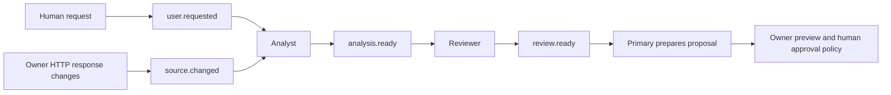

# Event driven Assistant: presets, events, and plugins

The Assistant supports two persistent execution presets: `orchestrated` coordinates standing agents through typed events, and `goal` runs one bounded native goal agent. Both remain bound to one Spec or Circuit owner. `focused` retains one-shot behavior. Event subscriptions describe reactions; they do not implement workflow dependencies, joins, or a graph scheduler.

## Presets and reactions

| Preset | Members | Request and source behavior | Completion |
| --- | --- | --- | --- |
| `orchestrated` | A proposal-owning primary, read-only analyst and reviewer, plus optional approved read-only observers within deployment bounds | A human request or `source.changed` wakes the analyst; `analysis.ready` wakes the reviewer; `review.ready` wakes the primary. The primary may prepare a proposal only after causal review of the latest input. | Deliveries and activation outcomes are inspected separately. Owner approval remains a separate decision. |
| `goal` | One primary with native goal tools | Native user input starts work; goal continuation follows the native driver. `source.changed` can wake that primary. Correlated waiting blocks model rounds until its matching response arrives. | The model must complete its native goal; a proposal review decision alone does not complete it. |

The diagram describes `orchestrated`. In `goal`, the primary receives native human input directly and subscribes to `source.changed`; it does not run the analyst/reviewer chain. Read-only observers can receive declared events and publish custom observations. They cannot publish the trusted analyst/reviewer results or prepare owner proposals.

## Event reference

Every ledger event has a unique ID, type, producer, payload, producer-scoped dedupe key, causation event, root correlation ID, chain depth, and creation time. The host validates declared payload schemas before atomically recording events and their matching deliveries. Each delivery records its subscription, target, message, activation, attempt, retry parent, state, and error. Receipt admission does not establish successful completion.

| Event | Producer | Payload | Consumer and meaning |
| --- | --- | --- | --- |
| `user.requested` | Host observing native human input | `text` | `orchestrated` analyst; starts the causal review chain. Native goal input remains direct. |
| `source.changed` | Approved HTTP source adapter | `trigger_id`, `url`, `value_json`, `previous_digest`, `current_digest` | Analyst in `orchestrated`, primary in `goal`; observations remain untrusted. |
| `analysis.ready` | Approved analyst | `findings` | Reviewer; causation identifies the input being analyzed. |
| `review.ready` | Approved reviewer | `result` | Primary; permits proposal preparation only for the causally reviewed latest input. |
| `review.prepared` | Product host after owner preview | `proposal_id` | Audit/inspection; in `goal`, the host also records a correlated native review wait. |
| `review.applied` | Product host after the owner's applied or sent receipt | `proposal_id` | Resolves a wait for this proposal and resumes eligible native goal continuation. It never grants approval to another proposal. |
| `review.discarded` | Product host after discard | `proposal_id` | Resolves the same proposal's review wait without claiming the requested goal is complete. |
| `system.wait.answered` | Human answer API | `wait_id`, `answer` | Exact pending human wait; stale execution revisions or identities are rejected. |
| `system.activation.completed` | Native event service | `agent`, `activation_id` | Durable successful activation outcome; available for exact subscriptions. |
| `system.activation.failed` | Native event service | `agent`, `activation_id` | Failure outcome; replay-safe subscriptions may schedule bounded retries. |
| `system.activation.interrupted` | Native event service | `agent`, `activation_id` | Interrupted outcome; uncertain work needs human acknowledgement before retry. |

The `system.*` namespace is host-owned. Models can publish only events in their pinned allowlist. A human can add custom payload contracts and reactions in the editor; native schema validation and deployment capability restrictions still apply. Subscriptions match exact types; payload filters are not supported in this version. Durable waits provide exact string-field correlation independently of subscriptions.

## Plugin responsibilities and interaction

| Plugin/service | Responsibility | Interaction |
| --- | --- | --- |
| `dsh-event-system` | Durable ledger, roster, subscriptions, waits, deliveries, retries, aggregate budgets | Uses native agents/sessions, observes model work, and enforces per-member tool/publication allowlists. |
| `dsh-event-system-yaml` | Trusted startup templates and contained Markdown prompts | Resolves and validates definitions before the native catalog is sealed. |
| `dsh-event-system-http` | Bounded owner HTTP polling, debounce, equality/change conditions, durable cursors and publication outbox | Commits a typed event into the same ledger; unchanged checks never call models. |
| `dsh-agent`, `dsh-agent-loop`, sessions, persistence and system prompt | Native execution, inbox admission, cancellation, logs, and member context | Specialists retain their native sessions; the primary remains a normal native agent. |
| `dsh-goal`, `dsh-goal-round-driver`, `dsh-tool-goal` | Native continuation, goal state and scoped model tools | Used by `goal`; waiting blocks continuation, matching decisions resume eligible saved goal revisions. |
| `dsh-storage-domain`, `dsh-storage-sqlite`, token meter | Typed ledger/source storage and observed resource measurement | Conversations retain spent budget after pause, retry, and restart. |
| Product Assistant adapter | Immutable owner binding, templates, review tools, owner API, UI | Guards proposal causation and permissions; stores human template revisions and exact configuration pins in product SQLite. |
| Product browser plugin and native web host | Template editor, review cards, execution controls and inspection | Browser requests use the same host validation as text/API clients; native session-history buttons use the Harness session service. |

The shared profile registers the reusable services and runtime invariants. Preset compositions provide their native tools. Product prompts add owner context and approval policy. UI template edits cannot grant shell access, add arbitrary skills/MCP servers, replace the primary composition, or increase deployment allowances. New read-only observers use the existing read-only event composition. HTTP source URLs must match both deployment approval and the conversation's bound owner.

## Visual configuration and inspection

Open **Configure event template** while starting a conversation, or **Configure event templates** inside its execution inspector. Visual fields edit the same JSON document displayed in the text panel; JSON is a YAML subset. Startup YAML/Markdown templates are imported as resolved prompt text, so saved definitions have no filesystem references. The host canonicalizes object keys, validates native event references and schemas, checks role permissions and limits, and reports unused events and reaction cycles. Cycles are allowed only within the existing enforced resource bounds.

**Validate and preview** displays validation warnings and removed/added text lines. **Save reviewed template** requires that exact reviewed content and template revision. Editing a built-in creates a separate named template; editing a saved template advances its revision using compare-and-swap. A new conversation pins its selected revision before agent creation. Saving later edits does not rewrite that conversation's prompts, permissions, routing, or budget. Templates and pins persist in `assistant.sqlite3`.

The execution inspector shows the pinned definition/digest and limits, native goal state and continuation rounds, the selected event payload and causal ancestry, matching subscriptions, each delivery attempt and activation ID, retries, errors, emitted events, and native session-history buttons. The request-charge table lists conservative outstanding reservations and settled token/time charges. It reports the aggregate allowance honestly; historic records do not contain per-request agent attribution. Sources show their condition, cursor sequence and failure state. Existing controls handle pause, restart Resume, stop, human answers, and uncertainty acknowledgement.

## Operating constraints

Run one process per state root. Restart restores durable state with human Resume required before model work. Disabled HTTP sources are retained; source editing/deletion is not supported. Existing pre-template conversations use their already pinned native definition. Current source setup remains required until the new Harness packages are published. No workflow authoring or execution is added.

Use [the hands-on tutorial](event-driven-assistant-tutorial.md) to try both presets. [Execution operations](event-driven-assistant-operations.md) explains monitoring, waiting and recovery bounds.

## Shipped execution allocations

`ai-assistant/profile/cordis.patch.yml` supplies these defaults; trusted deployment
configuration can change them only within `src/execution-policy.ts` ceilings.
A saved human template can lower its selected allocation, never exceed deployment.

| Limit | goal | orchestrated |
| --- | --- | --- |
| Rounds / model requests | 8 / 32 | 8 / 48 |
| Tokens / active time | 300,000 / 30 minutes | 500,000 / 45 minutes |
| Members / concurrency | 1 / 1 | 7 / 3 |
| Pending deliveries / ledger events | 100 / 256 | 1,000 / 1,000 |
| Payload bytes / causal depth | 131,072 / 16 | 131,072 / 16 |

Each model response is capped at the deployment output token limit (1,200 by
default). Native request accounting includes continuation/retry/compaction work.
Human waits and unchanged polling do not replenish or consume new model rounds.

## State, cutover and verification

The native `event_systems` domain stores roster, resolved definition, deliveries,
waits, attempts and spending; native HTTP storage retains sources/cursors/outbox.
Native JSONL retains model-visible messages. Product SQLite retains bindings,
review/creation progress and event template revisions/pins. Back up the entire
state root. No store by itself proves an exactly-once external mutation.

Older goal/orchestrated chats without a native event record remain readable but
refuse new model work; start a new bound chat. Existing pre-template event chats
continue with their pinned native definition. Focused chats retain their existing
behavior. Historical workflow decoding is available only for old transcripts.

Run `npm run typecheck`, `npm test`, `npm run build` and `npm run test:harness`
from `ai-assistant/`; use the tutorial's isolated setup for `npm run test:ui`.
For native-package validation, use the sibling Harness checkout at the commit in
`harness.lock.json`. Publication and regeneration of the npm registry lockfile
remain separate release tasks; the delivered source setup links local packages.
