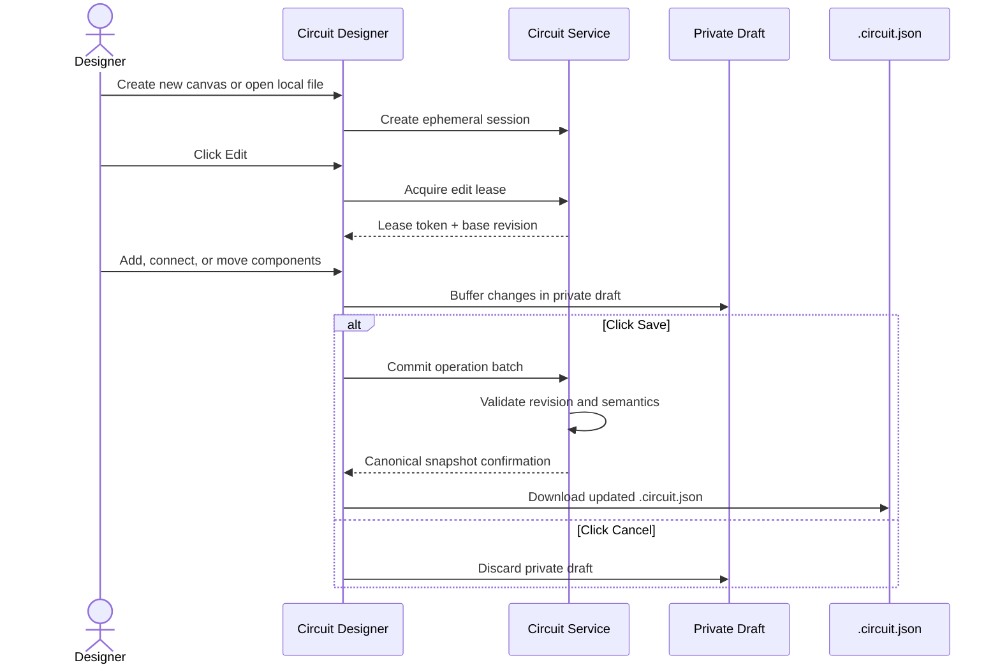
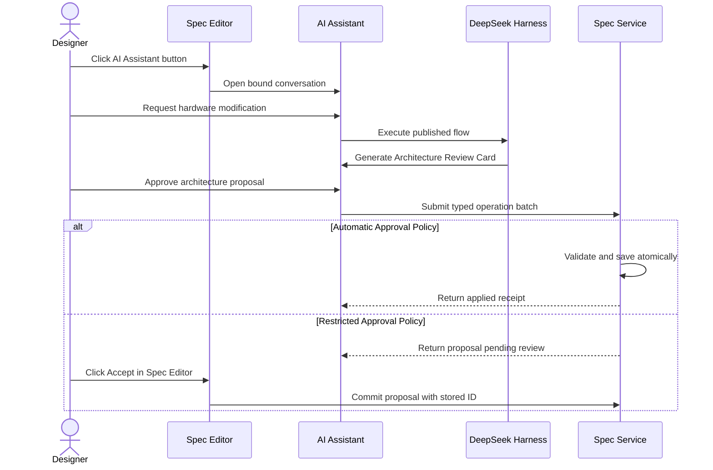
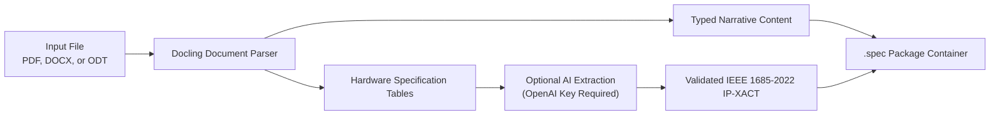

# End-to-End System Flows

This document specifies the primary operational flows across `spec2gds`.

## 1. Create and Edit a Specification

```mermaid
sequenceDiagram
    actor Designer
    participant UI as Spec Editor
    participant API as Spec API
    participant Package as .spec Package

    Designer->>UI: Select File → New Spec; enter name and path
    UI->>API: POST /documents/create with title and path
    API->>Package: Create and validate empty package
    Package-->>API: Source revision hash
    API-->>UI: Immutable snapshot + projection
    Designer->>UI: Edit structured content
    UI->>API: POST /transactions with base hash
    API->>API: Apply operations and validate candidate
    alt Candidate is valid and current
        API->>Package: Atomic save to archive
        API-->>UI: New snapshot and revision hash
    else Candidate is invalid or stale
        API-->>UI: Diagnostics; source file remains unchanged
    end
```

### Operational Steps

1. The designer selects **File → New Spec**.
2. The designer enters the visible name and server-local path.
3. The Spec API creates and validates an empty `.spec` package.
4. The designer adds Components, Designs, and Ports through group menus.
5. The Spec Editor displays ports as rows in a unified definition table.
6. The designer adds component instances to entry designs.
7. Each edit submits a typed transaction with the base revision hash.
8. The Spec API validates the candidate server-side.
9. Valid transactions commit atomically to disk.
10. Stale or invalid transactions reject safely and leave the source file unchanged.

The Spec Editor auto-saves accepted transactions.
**File → Refresh From Disk** reloads the active package from disk.

---

## 2. Open a Specification in Circuit Designer

```mermaid
sequenceDiagram
    actor Designer
    participant SE as Spec Editor
    participant SA as Spec API
    participant CA as Circuit Adapter
    participant CS as Circuit Service
    participant CD as Circuit Designer

    Designer->>SE: Select Component or Design
    SE->>SA: POST /circuit-designer/launch
    SA->>CA: Project active SpecRevision
    CA-->>SA: CircuitDocument + source mapping
    SA->>CS: Create session and register source binding
    CS-->>SA: Session ID, revision, and capabilities
    SA-->>SE: Editor URL and binding tokens
    SE->>CD: Open new browser window
    CD->>CS: Read active session
    CS-->>CD: Projected circuit and source binding
    Designer->>CD: Modify topology or layout
    CD->>CS: Save to Spec (candidate, base revision)
    CS->>SA: Authenticated commit request
    SA->>SA: Validate and atomically save .spec
    SA-->>CS: Updated revision confirmation
    CS-->>CD: Refresh session and release lease
    SA-->>SE: Emit source.changed; refresh Spec Editor
```

### Operational Steps

1. The designer selects a Component or Design in Spec Editor.
2. The designer selects **Options → Open in Circuit Designer**.
3. The Spec API projects the active `SpecRevision` through the circuit adapter.
4. The adapter converts direct ports and nets into schematic items.
5. The Spec API creates a session in the Circuit service.
6. Circuit Designer opens in a new browser tab.
7. The designer adjusts component placement and signal routing.
8. The designer clicks **Save to Spec**.
9. The Circuit service forwards validated geometry and topology to the Spec API.
10. The Spec API commits changes to the `.spec` container and emits `source.changed`.

Leaf components open as read-only preview instances.
Designs with instances open as editable source-bound sessions.

---

## 3. Edit an Independent Circuit



### Operational Steps

1. The designer opens Circuit Designer standalone.
2. The designer loads a local `.circuit.json` file or starts from a blank canvas.
3. The designer clicks **Edit** to acquire an exclusive edit lease.
4. The designer places components, routes wires, and adjusts layout.
5. Edits accumulate safely inside the client-side private draft.
6. The designer clicks **Save** to commit the operation batch.
7. The Circuit service validates the revision and updates the canonical session.
8. The browser downloads the updated `.circuit.json` file.

The Circuit service never modifies local disk files directly.

---

## 4. AI Assistant Flows and Proposals



### Supported Published Flows

The AI Assistant uses deterministic flows for hardware generation:

| Flow tool | Flow sequence | Completion evidence |
| --- | --- | --- |
| `flow_create_empty_spec` | Resolve path, create package, bind conversation | Creation receipt and confirmed binding |
| `flow_create_spec_with_component` | Prepare architecture, obtain approval, create package, author Component, submit batch | Exact applied receipt and saved revision |
| `flow_add_component` | Read context, prepare architecture, obtain approval, author Component, submit batch | Exact applied receipt and saved revision |
| `flow_edit_spec` | Read context, author operation batch, obtain approval for structure, submit batch | Exact applied receipt and saved revision |

### Operational Rules

- Conversation alone never modifies hardware state.
- Structural edits always require an approved architecture review card.
- Automatic mode saves immediately when service validation passes.
- Restricted mode requires explicit review and confirmation in Spec Editor.
- The AI Assistant stops execution immediately upon any validation error.

---

## 5. Import an Existing Document



### Operational Steps

1. Install document import dependencies:
   ```bash
   uv sync --extra document-import
   ```
2. Run the import command:
   ```bash
   uv run spec2gds-import-document path/to/spec.pdf -o output.spec
   ```
3. Add the `--openai` flag only when table-to-IP-XACT extraction is configured:
   ```bash
   export OPENAI_API_KEY="sk-..."
   uv run spec2gds-import-document path/to/spec.pdf -o output.spec --openai
   ```
4. The tool writes the complete `.spec` package with narrative text and extracted ports.
