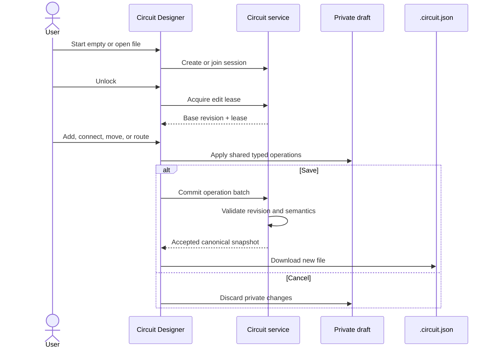
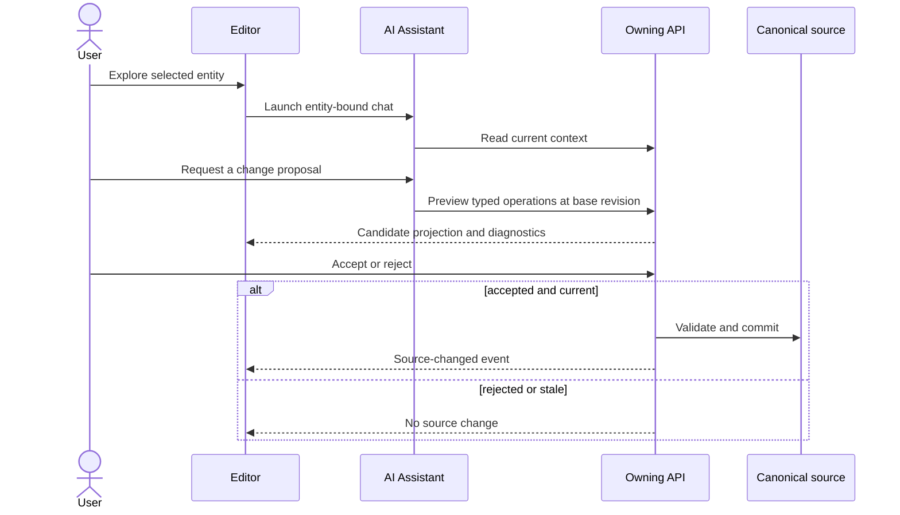
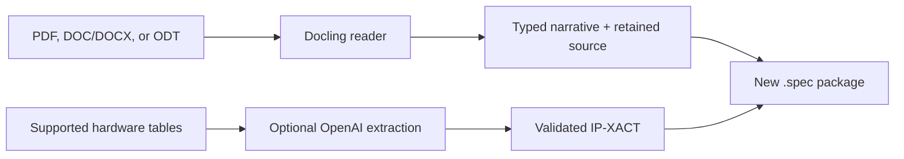

# End-to-end flows

## Create and edit a specification

```mermaid
sequenceDiagram
    actor User
    participant UI as Spec editor
    participant API as Spec API
    participant Package as .spec package

    User->>UI: File → New Specification; enter name and server-local path
    UI->>API: POST /documents/create with title and path
    API->>Package: Create and validate empty package
    Package-->>API: Source revision hash
    API-->>UI: Immutable snapshot + A2UI projection
    User->>UI: Edit structured content
    UI->>API: POST /transactions with expected hash
    API->>API: Apply operations and validate candidate
    alt candidate is valid and current
        API->>Package: Deterministic atomic save
        API-->>UI: New snapshot and hash
    else invalid or stale
        API-->>UI: Diagnostics; source is unchanged
    end
```

Scenario: a designer creates `timer.spec` with the visible name “Timer
Platform,” adds a component and entry design from their group menus, edits the
introductory paragraph, and adds wire, transactional, and packed structured
ports. Ports appear as rows in one definition table. The designer can then add
top-level component instances to the entry design by choosing from the
specification’s component list.
Each Save submits one typed transaction. The API compares the submitted
revision hash with the active revision, constructs IP-XACT XML server-side, and
atomically saves a valid candidate. A stale or invalid candidate leaves the
file untouched and the inline draft available for correction. Creating a
package also fails closed when the requested path already exists.

The editor keeps package operations in the **File** menu. Accepted transactions
save automatically, so Save is informational rather than a second persistence
step. **File → Refresh From Disk** reopens the active server-local path.

Direct editor operations are intentionally narrower than the source format.
The editor creates components and entry designs with the fixed internal
`spec2gds.local:work:<name>:1.0` identity convention, edits paragraph text, and
adds or edits all three leaf-component port families. The visible specification
title is stored separately so renaming it does not migrate IDs or references.
Bus interfaces, detailed TLM protocol modeling, structured subports, identity
migration, port deletion, and composite boundaries remain separate workflows.
Existing bus interfaces, port maps, channels, interface connections, and
bus/abstraction definitions are preserved in the package but hidden from the
editor document until those workflows are ready.

## Open a specification in Circuit Designer

```mermaid
sequenceDiagram
    actor User
    participant SE as Spec editor
    participant SA as Spec API
    participant CA as Circuit adapter
    participant CS as Circuit service
    participant CD as Circuit Designer

    User->>SE: Choose a component or design
    SE->>SA: POST /circuit-designer/launch
    SA->>CA: Project current SpecRevision
    CA-->>SA: CircuitDocument + source map + omission notes
    SA->>CS: Create/refresh session and register source binding
    CS-->>SA: document_id, revision, and writable capability
    SA-->>SE: Editor URL, binding metadata, and projection notes
    SE->>CD: Open new browser tab
    CD->>CS: Read session
    CS-->>CD: Projected circuit and source binding
    User->>CD: Begin editing and change topology/layout
    CD->>CS: Save to Specification(candidate, base source revision)
    CS->>SA: Authenticated preview, then idempotent commit
    SA->>SA: Validate and atomically save .spec
    SA-->>CS: Authoritative re-projection and new source revision
    CS-->>CD: Replace session, release lease, exit edit mode
    SA-->>SE: source.changed; refresh tables and SVG
```

Scenario: a specification design contains direct port wiring and bus
interfaces. Direct ports appear in the circuit view. Unsupported bus items are
reported, not silently converted. Unused transactional and structured ports
are also reported as omitted. A connected non-wire port rejects the launch
because dropping a real design connection would be unsafe. Eligible design
sessions are editable, but the `.spec` package remains authoritative because
the source transaction must succeed before the ephemeral Circuit session is
updated. Leaf-component previews remain read-only.

Users can launch from the grouped **Circuit** menu or from **Options → Open
circuit** on a design or component section. Non-circuit sections omit that
command. Entity-backed sections retain **Options → More actions**. See
[Circuit Designer specification synchronization](circuit-designer-spec-sync.md)
for conflicts, recovery, and the semantic layout annotation.

## Edit an independent circuit



Scenario: a designer starts from the blank canvas, unlocks it, creates two
component definitions and connects their instances. Save validates the batch,
updates the ephemeral session, and downloads a new file. The service never
overwrites a local file in place.

## Review an AI Assistant proposal



Scenario: the AI Assistant proposes a description or circuit change. Discussion
alone changes nothing. The user reviews the typed candidate. Acceptance still
runs normal validation and revision checks; a stale proposal must be rebuilt.

## Import an existing document



Run `uv sync --extra document-import`, then
`uv run spec2gds-import-document path/to/input -o output.spec`. Add `--openai`
only when table-to-IP-XACT extraction is wanted and configured.
