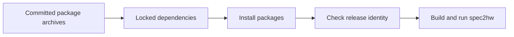

# Harness package releases

spec2hw keeps the published `@ankdesh` package archives in `ai-assistant/vendor/harness/`. Setup, builds,
checks, and application startup do not require a DeepSeek Harness checkout.

## Current release



The application uses `0.1.6-ankdesh.2`. Its pinned inventory contains 175
packages. Harness packages use that version. Supporting packages, such as
`@ankdesh/cordis`, keep their own base version and the `ankdesh.2` suffix.

The 12 custom packages use `@ankdesh/ankdesh-*` names. For example,
`@ankdesh/ankdesh-flow-runtime` replaces `@ankdesh/dsh-flow-runtime`, and
`@ankdesh/ankdesh-product-tools` replaces `@ankdesh/dsh-product-tools`.
Do not mix the old names or `.1` versions into the installation.

`ai-assistant/releases/harness-release-manifest.json` records the promoted package
names, versions, archive integrity checksums, and production profile metadata. `harness.lock.json` pins the inventory checksum. The npm lock pins the
selected application dependencies. Package checks reject source links, changed
archive checksums, and installed versions that differ from the published release.

## Install and run

Use Node.js 24.2+ for the complete environment. Assistant alone also supports
Node.js 22.19+ in the 22.x line. No `NODE_AUTH_TOKEN` is required.
The installer checks all archive SHA-256 and SHA-512 values before npm extracts
and installs them. Public npm dependencies still require network access.

```sh
npm --prefix ai-assistant run install:packages
npm --prefix ai-assistant run check:harness
npm --prefix ai-assistant run build
npm --prefix ai-assistant run dev -- --no-open
```

The promoted package release is `0.1.6-ankdesh.2`.
This release adopts custom agentic packages with the `@ankdesh/ankdesh-*` naming pattern (such as `@ankdesh/ankdesh-flow` and `@ankdesh/ankdesh-event-system`).
The Harness lock records status `promoted`. Application and production lockfiles
are tracked and point to the committed archives. Package names, versions, integrity
values, and the original release manifest remain unchanged.

The archives total 6.36 MB compressed (22.41 MB of package contents). The original
licence files and third-party notices remain inside each archive. Do not commit
`node_modules` or repack installed packages.
The remaining public dependencies use the public npm registry. The source-link
commands and `HARNESS_SOURCE` setting are no longer used. A local Harness checkout
can be deleted after these checks pass.

## Update a release

Obtain the promoted release, its original `.tgz` files, and the verified consumer
locks. Put each archive beside `release-manifest.json` in the promoted release
directory. The adoption command checks every archive against the release inventory
before copying it to `vendor/harness/`. GitHub credentials are needed only if the
release maintainer downloads a new private release from GitHub Packages.
Update the inventory, its pinned checksum, the application and bundle dependencies,
and the npm locks together.
Custom package names must match the published release. Regenerate the lock from a
clean dependency graph when package names change. Do not force incompatible peers.

Run `npm run install:packages`, the package check, builds, and the required application profiles.
The package check also runs before the Assistant build, typecheck, tests, and
normal startup. A published registry archive establishes package provenance;
application tests establish whether spec2hw works with that release.

## Production profiles

The current lock records `promoted` for `0.1.6-ankdesh.2`. Preserve its complete
release manifest and pinned checksum. The adopted web and headless production
locks remain under `ai-assistant/production/`. Package checks accept this promoted
manifest and require the matching local archives. Production
installation still requires matching adopted profile metadata and production locks.

When a release supplies complete promotion evidence, adopt it from `ai-assistant`:

```sh
node scripts/adopt-harness-release.mjs PROMOTED_RELEASE_DIRECTORY VERIFIED_CONSUMER_DIRECTORY
npm run install:packages
npm run build
```

The adoption command checks the release manifest, promotion receipt, application
acceptance records, and exact development and production locks before changing
application files. It preserves the promoted manifest bytes and converts only
Harness archive locations in the locks to local paths. It does not require a source checkout.

With a promoted release, install and assemble one production profile:

```sh
npm --prefix ai-assistant run install:profile -- spec2gds-headless temp/TEMP_headless_install
ASSISTANT_INSTALL_ROOT="$PWD/temp/TEMP_headless_install" \
  npm --prefix ai-assistant run package -- "$PWD/temp/TEMP_headless_release" spec2gds-headless
```

Use a new output directory each time. Production installation copies the archives
into that directory and installs them without a GitHub token. Release assembly checks the inventory
checksum, follows installed package metadata, and keeps dependency links inside
the output. Native files target Linux x86-64 with glibc.

The assembled release includes the service resolver and default configuration.
Launch it with an explicit file when addresses differ from the defaults:

```sh
node temp/TEMP_web_release/deployment/launch.mjs --service-config config/services.json --port 6423 --public-host design-host.example --no-open
node temp/TEMP_headless_release/deployment/request.mjs --service-config config/services.json --domain spec --service-url http://127.0.0.1:6010 --document-id example -- "Explain this Spec."
```

Addresses use command line → file → defaults. Network environment settings have
no effect. Copy the shipped `config/services.json` to the service manager's
configured path before enabling the example systemd unit. Credential, storage,
and logging environment settings keep their existing rules.
