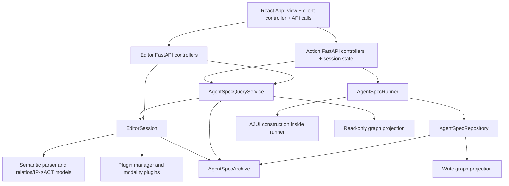
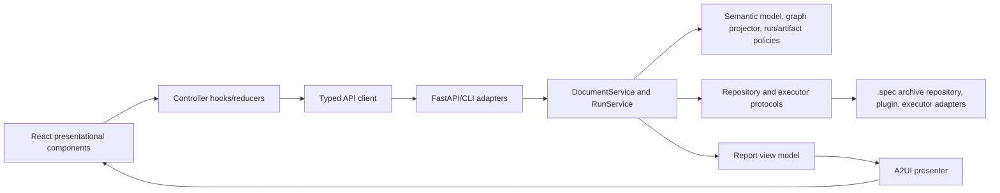

# MVC Architecture Assessment

Assessment date: 2026-07-16

## Executive Result

The active `agent-spec` implementation is **MVC-compatible but not a strict,
clean MVC implementation**.

- The Python backend has a sound layered core: typed models, semantic parsing,
  query services, an action runner, repositories, archive adapters, and plugin
  protocols are separated into recognizable responsibilities.
- The FastAPI routes act mostly as controllers and usually delegate meaningful
  work to services.
- The React application is physically separated as the view, but its main
  component also owns API access, client-side controller logic, state,
  transformations, polling, and almost all rendering.
- A few backend classes cross layer boundaries. In particular, graph projection
  is duplicated, the action runner creates view-specific A2UI messages, and the
  API controller owns process-wide session state and reads archive internals.

The best description of the current design is **layered MVC with service,
repository, strategy, and read-model patterns, plus several growing
"smart controller/view" classes**. It is appropriate for the documented local,
single-user application today, but the highlighted seams should be improved
before significant UI, executor, or multi-document growth.

| MVC concern | Current implementation | Assessment |
| --- | --- | --- |
| Model | Pydantic contracts, semantic document model, relations, action/run rules, query service, repository, archive | Strong foundation; some domain, persistence, and presentation responsibilities are mixed |
| View | React editor and restricted A2UI report renderer | Clearly separate deployment surface, but `App` is also a client controller and API gateway |
| Controller | FastAPI route functions and the CLI command dispatcher | Mostly delegates well; process state, file browsing, archive traversal, and object construction still live in controllers |
| Supporting layers | Runner/application service, query/read service, repository, plugins | Good pragmatic additions to MVC and worth preserving |

## Scope and Criteria

This assessment covers the active code under `spec2gds/agent_spec/`, its React
editor, CLI, and architecture-relevant tests. It treats service and repository
layers as valid refinements of MVC rather than requiring folders literally named
`models`, `views`, and `controllers`. Archived OpenSpec proposals, benchmark
data, and generated sample documents were not treated as runtime application
architecture.

The assessment uses the repository's documented constraint that the current
server is local and single-user. Process-local state is therefore a design debt
rather than an immediate production defect. It becomes a high-risk issue if the
server is expected to support multiple users, workers, or concurrent writers.

## Current Responsibility Flow



The intended dependency direction is visible, but the diagram also shows the
main architectural pressure points: two graph projectors, three document/archive
access paths, presentation construction in the runner, and a React root that
contains both view and controller behavior.

## What Follows Good Architecture Patterns

### 1. Typed model and contract layer

`models.py` defines explicit Pydantic contracts for graphs, versions, runs,
events, artifacts, snapshots, conditions, and reports. Persisted state validation
is colocated with the relevant records, including run and writeback state checks
([`models.py`](../spec2gds/agent_spec/models.py#L14)). The semantic document,
relations, and IP-XACT summaries are also represented as typed data rather than
unstructured XML or dictionaries throughout the application.

This is a strong Model foundation because controllers and views exchange stable
data shapes, while parsing and persistence details remain outside the UI.

### 2. Controllers are usually thin

Most editor routes create an editor/query service, invoke one use case, and
serialize the result ([`document_app.py`](../spec2gds/agent_spec/api/document_app.py#L118)).
Action routes similarly delegate precondition checks, launch, and completion to
`AgentSpecRunner` ([`app.py`](../spec2gds/agent_spec/api/app.py#L129)). HTTP error
translation is kept at the API boundary.

This is the correct controller role: translate transport input, invoke an
application operation, and translate the outcome.

### 3. Explicit application and read services

`AgentSpecRunner` coordinates the action lifecycle without putting that workflow
directly in FastAPI routes ([`runner.py`](../spec2gds/agent_spec/runs/runner.py#L27)).
`AgentSpecQueryService` builds read-only, consumer-specific projections for the
editor and executors ([`query.py`](../spec2gds/agent_spec/query.py#L36)).
`EditorSession` provides a cohesive editing use-case facade over a document
([`session.py`](../spec2gds/agent_spec/document/session.py#L44)).

These layers are useful additions to MVC. The query service is especially close
to a CQRS-style read model: it creates response shapes without saving or
sanitizing the source document.

### 4. Repository and infrastructure boundaries

`AgentSpecRepository` centralizes graph, run, report, checkpoint, and artifact
persistence and performs optimistic file-hash conflict detection
([`repository.py`](../spec2gds/agent_spec/storage/repository.py#L63)).
`AgentSpecArchive` isolates `odfdo`, ZIP, manifest, byte-copy, and package
integrity behavior ([`archive.py`](../spec2gds/agent_spec/package/archive.py#L20)).

Keeping archive mechanics out of the React and semantic parsing layers is a good
Repository/Adapter design choice. Defensive copies at archive and plugin
boundaries also reduce accidental shared-state mutation.

### 5. Strategy/registry pattern for modalities and actions

`ModalityPlugin` is a structural protocol and `PluginManager` routes operations
through registered strategies ([`base.py`](../spec2gds/agent_spec/plugins/base.py#L21),
[`manager.py`](../spec2gds/agent_spec/plugins/manager.py#L10)). Action definitions
are likewise registered independently from the runner.

This supports the project's loose-coupling goal: JSON, IP-XACT, and future
modalities can change without adding modality conditionals to the archive core.

### 6. Validation and traceability are first-class concerns

The design captures immutable input snapshots, source traces, event streams,
artifact metadata, preconditions, and postconditions. The runner validates JSON
schemas and artifact provenance before writeback
([`runner.py`](../spec2gds/agent_spec/runs/runner.py#L47),
[`runner.py`](../spec2gds/agent_spec/runs/runner.py#L289)). `EditorSession` blocks
saves when semantic or IP-XACT diagnostics are unsafe
([`session.py`](../spec2gds/agent_spec/document/session.py#L398)).

These are strong domain safeguards and are more important than mechanically
following MVC folder names.

### 7. Core workflows have useful tests

The tests cover parsing, document editing, plugin behavior, repository-backed
action execution, invalid reports, and document switching. The action tests
exercise launch through completion and persisted report retrieval
([`test_action_api.py`](../tests/agent_spec/test_action_api.py#L40)). A Playwright
smoke test also verifies the editor shell and document-load flow.

## What Should Be Improved

### P1. Create one pure graph projection policy

Graph projection is implemented independently in
`AgentSpecRepository.project_graph()`
([`repository.py`](../spec2gds/agent_spec/storage/repository.py#L139)) and
`AgentSpecQueryService._project_graph_readonly()`
([`query.py`](../spec2gds/agent_spec/query.py#L223)). The implementations already
have a behavioral difference: the repository activates a newly derived version,
while the query projector only supplies an active version when none exists.

Consequences:

- Read and write endpoints can disagree about the active version after content
  changes.
- Hashing, section-boundary, and version rules must be updated twice.
- The query layer imports repository constants while reimplementing repository
  behavior, which blurs ownership.

Recommendation: extract a pure `project_graph(semantic_document,
existing_graph, now, activation_policy)` domain function or `BlockGraphProjector`.
Both the read service and repository should use it; only persistence and the
activation policy should differ. Add parity tests that run the same document and
existing graph through read and write paths.

### P1. Split the React root into view, controller hooks, and an API client

`main.tsx` is 879 lines. `App` starts at line 210, owns 28 state hooks, performs
all nine `fetch` calls, polls runs, applies draft transformations, coordinates
panels, and renders nearly the entire application
([`main.tsx`](../spec2gds/agent_spec/document/editor_web/src/main.tsx#L210)).

This is the clearest MVC separation issue: the view also acts as transport
adapter, controller, state store, and mapper. Changes to API behavior, editor
state, or a drawer all collide in one file.

Recommendation:

- Move transport code to `src/api/client.ts` with typed success/error handling.
- Move shared API shapes to `src/api/contracts.ts`, preferably generated from
  the FastAPI OpenAPI schema.
- Extract `useDocumentEditor`, `useActionRuns`, and `useFileBrowser` controller
  hooks.
- Extract presentational components such as `CommandBar`, `FileBrowser`,
  `DocumentCanvas`, `HeadingActions`, `ActionMenu`, `RunsDrawer`, and
  `IpxactDrawer`.
- Keep `App` responsible for composition and top-level layout only.

No Redux-style state library is required yet; reducer-backed hooks and a typed
API client are sufficient for the current size.

### P1. Give document/session lifecycle a single application owner

The editor API opens a new `EditorSession` for each mutation, the query service
opens a fresh archive and editor session, and the action API caches long-lived
`AgentSpecRepository` instances. Opening a document through the action API also
projects and saves it before returning
([`app.py`](../spec2gds/agent_spec/api/app.py#L85)).

Consequences:

- A cached action session can become stale after the editor saves through its
  separate API path.
- "Open" has a surprising persistence side effect.
- Conflict handling differs between `EditorSession` and
  `AgentSpecRepository`.
- It is hard to define one transaction or unit of work for a combined edit and
  action operation.

Recommendation: introduce a `DocumentService`/`DocumentContext` application
boundary that owns opening, refreshing, editing, querying, projecting, and
saving a document. Make both mounted API surfaces resolve document contexts
through the same lifecycle service. Separate an explicit `initialize_document`
command from read-only open/query behavior.

### P1 if deployment grows; otherwise P2. Move process state out of route closure

The action API stores active document, sessions, and run-to-session mappings in
an untyped dictionary captured by `create_app()`
([`app.py`](../spec2gds/agent_spec/api/app.py#L46)). The `/runs` controller then
walks every cached repository's archive bytes and decodes records itself
([`app.py`](../spec2gds/agent_spec/api/app.py#L149)).

For the current local, single-process product this works, but it is difficult to
test in isolation and cannot support multiple workers or robust concurrent
callbacks. The delayed executor thread can also use the same mutable repository
without an explicit lock.

Recommendation: create a typed `SessionRegistry`/`RunRegistry` service and
inject it through FastAPI dependencies or `app.state`. Put run aggregation in a
query/repository method. If multi-user or multi-worker service is planned,
replace process memory with a durable registry and define document-level
locking before adding features.

### P2. Split action orchestration from UI report construction

`AgentSpecRunner` currently:

- enforces the input capabilities of the React generic form;
- coordinates run state and executor dispatch;
- launches a demonstration thread;
- validates completion and artifacts;
- constructs and validates A2UI component messages; and
- reads persisted run data through repository internals.

The input-form support check at
[`runner.py`](../spec2gds/agent_spec/runs/runner.py#L75) and A2UI construction at
[`runner.py`](../spec2gds/agent_spec/runs/runner.py#L267) make the application
service depend on view capabilities.

Recommendation: keep `AgentSpecRunner` (or rename it `RunService`) as the use-case
coordinator. Extract a domain `CompletionPolicy`/`ArtifactPolicy`, an executor
adapter, and an `A2UIReportPresenter` that maps an `ActionReport` view model to
messages. A future non-A2UI view could then reuse the same run lifecycle.

### P2. Stop bypassing repository boundaries

The action API reads `repository.container.custom_files` directly for global run
listing, while the runner loads run, snapshot, and event files through the
repository's container attribute. The query service also knows the complete
embedded storage path layout.

This weakens the otherwise good repository abstraction and spreads archive path
knowledge across controller, service, query, and persistence modules.

Recommendation: add typed repository/query operations such as `list_runs()`,
`load_run_bundle()`, `load_snapshot()`, and `load_events()`. Define small
`Protocol` ports for the operations consumed by the runner and query service so
unit tests can supply in-memory implementations without constructing ODT files.

### P2. Make API contracts executable rather than duplicated

The backend often returns `dict[str, Any]` without FastAPI response models, while
the frontend manually repeats the Pydantic shapes at the top of `main.tsx`.
Compile-time TypeScript assertions do not validate server responses at runtime,
and contract changes must be synchronized by hand.

Recommendation: define response models for public routes, expose them through
OpenAPI, and generate or validate frontend types from that schema. Keep transport
request/response DTOs in the API layer and map them to domain/application models
where their concerns differ.

### P2. Test the seams, not only route functions

The Python API tests retrieve `route.endpoint` and call it directly
([`test_action_api.py`](../tests/agent_spec/test_action_api.py#L40),
[`test_document_session.py`](../tests/agent_spec/package/test_document_session.py#L493)).
That validates use cases but bypasses FastAPI request parsing, response
serialization, mounted paths, middleware, and exception behavior. The Playwright
test covers document loading but not save, validation failure, action launch,
polling, or report display.

Recommendation:

- Use FastAPI `TestClient`/HTTPX for controller contract tests.
- Unit-test graph projection, run policies, and report presentation separately.
- Add frontend tests for extracted hooks/reducers and a small number of critical
  Playwright flows.
- Add an import/dependency rule test so API modules may depend on application
  services, but domain modules may not depend on API or React presentation
  details.
- Mirror new test locations to the source layout; document-session tests
  currently live under `tests/agent_spec/package/` even though their primary
  source is under `document/`.

### P3. Inject plugin composition and split the CLI if they grow

`EditorSession` constructs and registers concrete JSON and IP-XACT plugins in
its constructor. This is acceptable for built-ins, but it makes alternative
plugin sets and focused tests harder. Accept an optional `PluginManager` or
factory and keep the current built-in factory as the default composition root.

The CLI's `main()` contains parsing, file I/O, application logic, formatting,
and exit handling in one function. A CLI is a second controller/view adapter,
not necessarily part of the web MVC flow, so this is low priority today. If more
commands are added, move each command to a typed handler that reuses the same
application services as FastAPI and keep `main()` limited to argument parsing
and exit-code mapping.

## Recommended Target Direction

Do not reorganize solely to create literal `model/`, `view/`, and `controller/`
folders. Improve dependency direction with a small number of explicit seams:



An evolutionary file layout could be:

```text
spec2gds/agent_spec/
  api/
    schemas.py
    editor_routes.py
    action_routes.py
  services/
    documents.py
    runs.py
    sessions.py
  document/
    semantic.py
    graph_projector.py
  reports/
    a2ui.py
  storage/
    ports.py
    repository.py

spec2gds/agent_spec/document/editor_web/src/
  api/client.ts
  api/contracts.ts
  controllers/useDocumentEditor.ts
  controllers/useActionRuns.ts
  components/...
  App.tsx
  main.tsx
```

This keeps the current domain concepts and avoids a large rewrite.

## Refactoring Order and Completion Criteria

1. **Unify projection behavior.** Add projector parity tests, extract the pure
   projector, and make read/write paths use it. Completion means the same source
   document produces the same block/version identities in both paths.
2. **Modularize the React application.** Introduce the typed client and controller
   hooks, then extract components one feature at a time. Completion means `App`
   composes features without raw `fetch` calls or feature-specific mutation
   logic.
3. **Centralize document lifecycle and session state.** Add typed services and
   inject them into both API surfaces. Completion means opening can be read-only,
   editor saves invalidate/refresh action state, and controllers do not inspect
   archive bytes.
4. **Separate run policy and presentation.** Extract completion/artifact rules
   and A2UI presentation. Completion means the run service can be tested without
   A2UI and the presenter can render a stored `ActionReport` independently.
5. **Harden contracts and boundaries.** Add API response models, generated or
   runtime-validated TypeScript contracts, HTTP-level tests, and dependency
   checks.

## Validation Performed

The following architecture-relevant test set passed:

```text
18 passed in 2.82s
```

Command:

```bash
env UV_CACHE_DIR=.uv-cache UV_PYTHON_INSTALL_DIR=.uv-python \
  uv run python -m pytest -q \
  tests/agent_spec/test_v1_setup.py \
  tests/agent_spec/test_action_api.py \
  tests/agent_spec/package/test_document_session.py
```

The full suite was not run because three checked-in generated binary sample
documents were already modified before this assessment; the targeted selection
avoided intentionally rebuilding those fixtures.

## Decision Questions for Future Planning

No answer was required to make the current judgement because the repository
explicitly documents a local, single-user application. Before implementing the
refactor, two product decisions should calibrate the design:

1. Will the API remain a local single-user process, or should it become a
   multi-user/multi-worker service? The latter promotes session durability,
   locking, authorization, and path isolation to P1 work.
2. Is strict textbook MVC a required organizational standard, or is the goal
   maintainable separation of concerns? The current service/repository design
   should be retained for the latter; renaming folders to MVC terms alone would
   not improve the dependency structure.
