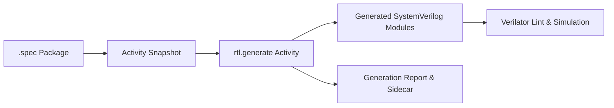

# Deterministic RTL Generation

The `rtl.generate` Activity (version `1.2.0`) generates a standard SystemVerilog 2017 project from a selected Component or Design.
The generator preserves reachable component hierarchy, emits reusable hardware modules, and translates direct wire connections.
It does not invoke an LLM, inspect narrative text, or infer missing clock or reset signals.



## 1. Supported Source Profile

### Hardware Ports
- Ports must be physical wires with scalar or explicit decimal ranges (such as `[7:0]`).
- Symbolic ranges (for example, `DATA_WIDTH-1:0`) and ascending ranges are rejected before generation.
- Transactional and packed structured ports are rejected; direct wire connections only are supported.

### Connections and Wiring
- Only IP-XACT ad-hoc wire connections are supported.
- Each signal bit supports exactly one driver.
- Multiple drivers on the same wire bit cause a generation error.
- Bus interfaces and interface connections must be resolved into direct wire ports before generation.

---

## 2. Body-Only SystemVerilog Contract

Components and Designs store behavioral code in the inline **SystemVerilog** section.

### Section Rules
- The stored code block contains only declarations and sequential logic (such as `logic`, `always_ff`, and `assign`).
- Do **not** include `module`, `endmodule`, or port list headers in the section.
- The `rtl.generate` tool reads ports from IP-XACT and automatically constructs the ANSI port list.
- If a component has no SystemVerilog section, the generator emits tie-offs (`'0` for outputs) so the module compiles cleanly.

### Example: Single-Cycle Registered Pipeline
```systemverilog
// Placed inside the Component SystemVerilog section:
always_ff @(posedge clk or negedge rst_n) begin
    if (!rst_n) begin
        data_out <= '0;
    end else if (valid_in) begin
        data_out <= data_in;
    end
end
```

### Example: Two-Cycle Registered Pipeline
```systemverilog
// Placed inside the Component SystemVerilog section:
logic [31:0] stage1_data;
logic        stage1_valid;

always_ff @(posedge clk or negedge rst_n) begin
    if (!rst_n) begin
        stage1_data  <= '0;
        stage1_valid <= 1'b0;
        data_out     <= '0;
    end else begin
        stage1_data  <= data_in;
        stage1_valid <= valid_in;
        if (stage1_valid) begin
            data_out <= stage1_data;
        end
    end
end
```

---

## 3. Generate and Verify RTL Projects

### Run RTL Generation via Script
To update or check the generated RTL samples from the repository root:

```bash
# Check existing generated examples
uv run python scripts/generate_rtl_examples.py --check

# Regenerate examples into the configured workspace (generated/)
uv run python scripts/generate_rtl_examples.py --update
```

### Run RTL Generation in Spec Editor
1. Open a specification in Spec Editor.
2. Select the top-level Design or Component.
3. Click **Options → Generate RTL**.
4. The Activity executes and publishes output files into the generated project directory.

### Compile and Verify with Verilator
In each generated project directory, run Verilator lint:

```bash
cd generated/rtl/<project-name>/
make lint
```
