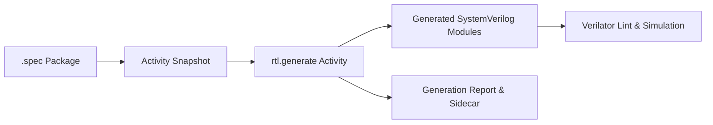

# Deterministic RTL Generation

The `rtl.generate` Activity (version `1.2.0`) generates a standard SystemVerilog 2017 project from a selected Component or Design.
The generator preserves reachable component hierarchy, emits reusable hardware modules, and translates direct wire connections.
It does not invoke an LLM, inspect narrative text, or infer missing clock or reset signals.



## 1. Supported Source Profile

### Hardware Ports
- Ports must be physical wires with scalar or one packed range. Preserve the declared bounds, including `4:1`, `0:3`, negative bounds, and indexed one-bit ranges.
- Symbolic ranges such as `DATA_WIDTH-1:0` use stored Component parameters and the local constants and constant functions in the SystemVerilog Section. Verilator elaboration resolves the bounds for validation. Generated RTL retains the source expressions. Missing values or dependencies stop generation with a diagnostic.
- Literal bounds need no compiler elaboration. Calculate width as the absolute difference between evaluated bounds plus one; a scalar has width one.
- Transactional and packed structured ports are rejected; direct wire connections only are supported.

### Interface elaboration

The Spec service provides the read-only `POST /assistant/resolve-interface` operation.
Send `ports` with their IDs, directions, and source ranges, `parameters` with their
stored declaration types and default expressions, and `systemverilog` with the
required local constants and constant functions. The optional `overrides` object
maps declared parameter IDs to explicit values.

The result reports the parameter values used, evaluated bounds, calculated
widths, and compiler diagnostics. It retains each source range. Literal ranges
and scalars need no compiler elaboration. Symbolic bounds require Verilator;
a missing value, dependency, or compiler stops approval with a clear diagnostic.
Elaboration does not save a Spec or run simulation.

Assistant creation checks this interface before approval. Spec preview checks it
again when ports, parameters, or the SystemVerilog Section change. RTL creation
uses the same declarations and source ranges. Existing nonblocking compiler
warnings remain warnings.

### Connections and Wiring
- Only IP-XACT ad-hoc wire connections are supported.
- Each signal bit supports exactly one driver.
- Multiple drivers on the same wire bit cause a generation error.
- Bus interfaces and interface connections must be resolved into direct wire ports before generation.

---

## 2. Body-Only SystemVerilog Contract

Components and Designs store behavioral code in the inline **SystemVerilog** section.

### Section Rules
- The stored code block contains only declarations and sequential logic (such as `logic`, `always_ff`, and `assign`).
- Do **not** include `module`, `endmodule`, or port list headers in the section.
- The `rtl.generate` Activity reads ports and Component parameters from IP-XACT and constructs the module parameter declarations and ANSI port list. Parameter types, signedness, and default expressions are retained. Local constants and constant functions remain in the SystemVerilog Section.
- If a component has no SystemVerilog section, the generator emits tie-offs (`'0` for outputs) so the module compiles cleanly.

### Example: Single-Cycle Registered Pipeline
```systemverilog
// Placed inside the Component SystemVerilog section:
always_ff @(posedge clk or negedge rst_n) begin
    if (!rst_n) begin
        data_out <= '0;
    end else if (valid_in) begin
        data_out <= data_in;
    end
end
```

### Example: Two-Cycle Registered Pipeline
```systemverilog
// Placed inside the Component SystemVerilog section:
logic [31:0] stage1_data;
logic        stage1_valid;

always_ff @(posedge clk or negedge rst_n) begin
    if (!rst_n) begin
        stage1_data  <= '0;
        stage1_valid <= 1'b0;
        data_out     <= '0;
    end else begin
        stage1_data  <= data_in;
        stage1_valid <= valid_in;
        if (stage1_valid) begin
            data_out <= stage1_data;
        end
    end
end
```

---

## 3. Generate and Verify RTL Projects

### Run RTL Generation via Script
To update or check the generated RTL samples from the repository root:

```bash
# Check existing generated examples
uv run python scripts/generate_rtl_examples.py --check

# Regenerate examples into the configured workspace (generated/)
uv run python scripts/generate_rtl_examples.py --update
```

### Run RTL Generation in Spec Editor
1. Open a specification in Spec Editor.
2. Select the top-level Design or Component.
3. Click **Options → Generate RTL**.
4. The Activity executes and publishes output files into the generated project directory.

### Compile and Verify with Verilator
In each generated project directory, run Verilator lint:

```bash
cd generated/rtl/<project-name>/
make lint
```
