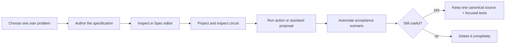

# Sample application method

## Objective

Build one small, representative hardware application at a time through the
whole system. A sample is a maintained product scenario, not a pile of static
generated files.

There is currently no maintained full editor/Circuit/Assistant user-journey
sample. Small RTL semantics examples are available under `samples/rtl/` and
in [the RTL generation guide](rtl-generation.md). Choose any broader
application deliberately and add its reproducible vertical slice.



## Selection checklist

A proposed sample should have:

- one clear user and design question;
- enough structure to cross Spec, Circuit, and review boundaries;
- a small source that a new contributor can understand quickly;
- observable acceptance outcomes;
- no need for a private or redistributable corpus.

Avoid selecting a sample only to exercise every field. Unit fixtures already
cover contract breadth. The sample exists to prove a coherent user journey.

## Build sequence

1. Write a one-page scenario in `docs/` with the goal, inputs, expected output,
   and explicit exclusions.
2. Create the `.spec` through the public CLI, API, importer, or editor. Do not
   hand-assemble internal archive entries.
3. Open the specification in the editor and record the human review steps.
4. Project a component or design through the real Circuit service. Document any
   intentionally omitted semantics.
5. Exercise one reviewed action or assistant proposal when it is relevant to
   the scenario.
6. Add focused tests at the owning boundaries plus one end-to-end acceptance
   test. Keep synthetic fixtures inside test code.
7. Add the sample's run command to the root README only after the complete path
   works from a clean checkout.

## Text scenario template

Use this short structure in the sample document:

```text
Actor: who is using the system
Goal: the hardware question they need to answer
Given: the smallest required input
When: the actions taken through public interfaces
Then: the saved source, projection, artifact, or decision they can verify
Not covered: deliberate limits of this sample
```

Example shape (not a committed sample): a designer creates a small peripheral
specification, inspects its ports and narrative, opens its direct-port topology
in Circuit Designer, reviews a proposed description change, and reopens the
saved `.spec` to prove persistence.

## Storage policy

- Keep one canonical human-readable input when the sample needs source data.
- Generate derived packages and exports during tests or documented commands.
- Do not commit artifact sidecars, browser downloads, build output, or copied
  third-party corpora.
- Do not create a benchmark suite until a stable performance or quality metric
  and its maintenance owner are defined.
- Remove superseded samples and their documentation in the same change.

## Definition of done

The sample is done when a new contributor can run it from the root README, the
full sequence uses public system boundaries, automated checks cover the stated
outcome, and no checked-in generated output is needed to understand or verify
the flow.
