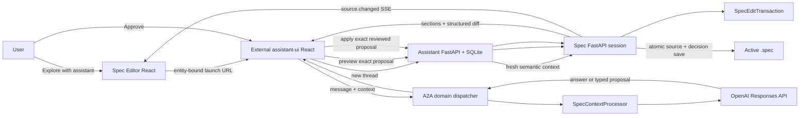

# Spec Editor Assistant Integration

The Spec assistant is an optional domain in the sibling
`external-assistant` application. The Spec Editor remains the source authority:
the assistant owns chat and review history, while the Spec API owns context,
validation, source mutation, and the accepted decision stored in `.spec`.

## Runtime architecture



The dependency remains one-way. The external UI imports the reusable
`DocumentSection` renderer from the Circuit/Spec frontend workspace; the Spec
Editor does not import or require the external assistant.

## Launch and permanent binding

The editor exposes **Explore with assistant** for components, designs,
bus-definitions, abstraction-definitions, and narrative blocks. It calls:

```text
POST /assistant/launch
```

The response points at `/launch/spec` on the external application. That launch
route always creates a fresh thread and permanently binds it to:

- `domain=spec`
- the normalized Spec service origin
- the active document ID
- the target entity kind and canonical ID

Existing chats remain in SQLite and appear in the assistant sidebar. The Spec
client permits only configured origins and rejects non-loopback origins by
default. If the external service is absent, only the new browser tab reports an
error; normal editor and API operations are unchanged.

## Context contract

The external backend refreshes this endpoint before every assistant turn:

```text
GET /assistant/context?document_id=...&entity_kind=...&entity_id=...
```

It contains the source revision hash, target semantic IR, rendered sections,
exclusively writable narrative, owned internal design, diagnostics, legal
references, and explicitly labeled read-only dependencies and usages.
`SpecContextProcessor` serializes that payload deterministically and preserves
the writable/read-only labels for the model.

The assistant sends the latest eight messages verbatim. Once history exceeds
twelve messages or about 12,000 characters, SQLite stores a running summary of
the older portion. A source revision change leaves the discussion intact but
marks any unapplied review stale.

## Ownership boundary

The model suggests operations, but the Spec API enforces ownership:

| Chat target | Writable | Read-only context |
| --- | --- | --- |
| Component | Selected component, exclusively linked narrative, embedded/owned internal design | Dependencies, usages, shared narrative, separate/shared designs |
| Design | Selected design and exclusively linked narrative | Referenced definitions, usages, shared narrative |
| Bus or abstraction definition | Selected definition and exclusively linked narrative | Referenced/using entities and shared narrative |
| Narrative block | Selected narrative subtree and links to existing entities | Other narrative and referenced entities |

Top-level source creation/deletion, VLNV or identity changes, assets, raw XML,
and writes to surrounding/shared entities are rejected. References in typed
operations must resolve to existing component, design, bus, or abstraction
definitions.

## Proposal contract and lifecycle

Exploration produces ordinary assistant text. A proposal is requested with the
**Prepare proposal** control or explicit proposal language and uses this
envelope:

```json
{
  "schema_version": "1.0",
  "kind": "spec_change_proposal",
  "proposal_id": "proposal_...",
  "document_id": "...",
  "target": {
    "document_id": "...",
    "entity_kind": "component",
    "entity_id": "..."
  },
  "base_source_revision_hash": "sha256:...",
  "title": "...",
  "summary": "...",
  "rationale": "...",
  "assumptions": [],
  "operations": []
}
```

Operations cover metadata, parameters, component ports/bus interfaces/channels,
design instances and connectivity, component-owned internal design, bus and
abstraction properties, and typed narrative edits. The operation compiler turns
them into the existing transaction vocabulary; it does not accept model-authored
XML.

Assistant SQLite review states are:

```text
draft -> invalid | ready | stale
ready -> discarded | stale | applied
```

A newer proposal discards the older active review without deleting its history.
Only `ready` can be approved.

## Preview, apply, and provenance

`POST /assistant/proposals/preview` is stateless and non-mutating. It validates
the exact proposal and runs `SpecEditTransaction` without committing. The
response status is `valid`, `invalid`, or `stale`, with diagnostics, current and
candidate revision hashes, current/proposed rendered sections, and a structured
JSON field/text diff.

`POST /assistant/proposals/apply` repeats all checks. A stale base hash returns
HTTP 409. A valid operation set and its accepted-decision record are saved in a
single deterministic `.spec` rewrite. `proposal_id` plus the operations digest
is idempotent: an exact replay returns the original result, while reusing the ID
with different operations conflicts.

Only this accepted record enters `.spec` activity data:

```text
proposal ID, target, base/result source hashes, operations digest,
exact operations, decision=accepted, applied timestamp
```

Chat messages, prompts, model details, rationale, assumptions, previews, and
rejected proposals stay in external SQLite.

## Refresh notification

`GET /events` is a server-sent event stream. A successful source commit emits
`source.changed` with document ID, source hash, origin, and affected entities.
The editor compares hashes and shows **Document changed by assistant** when its
snapshot is older. It never reloads automatically; **Refresh** explicitly loads
the latest snapshot, A2UI projection, diagnostics, and activity.

## Configuration and extension points

The OpenAI key is read from `OPENAI_API_KEY`; `OPENAI_MODEL` defaults to
`gpt-4o-mini`, and requests use the Responses API with `store=False`.
`SPEC_SERVICE_ALLOWLIST` configures comma-separated origins accepted by the
external service. `EXTERNAL_ASSISTANT_URL` and `SPEC_EDITOR_SERVICE_URL`
configure launch URLs returned by the Spec service.

New domains can derive another `ContextProcessor`, add a domain executor behind
the existing A2A dispatcher, and add a renderer/review branch without coupling
the source editor to the assistant.

## Verification

```bash
uv run python -m pytest tests/agent_spec/spec_format -q

cd external-assistant
uv sync --dev
uv run pytest -q

cd ../circuit-designer
npm run build:editor
npm run test --workspace @spec2gds/document-core -- --run
```

