# Spec Editor and Circuit Designer integration architecture

## The short version

Keep this mental model in mind:

> **Spec Editor owns the saved design. Circuit Designer edits a temporary
> projection of that design.**

The `.spec` package is the durable source of truth. The Circuit service keeps a
temporary circuit session in memory. A Circuit save is complete only after the
Spec API accepts and saves the change.

The two browser tabs do not save directly to each other. Their backend services
coordinate the work.

## Main structure

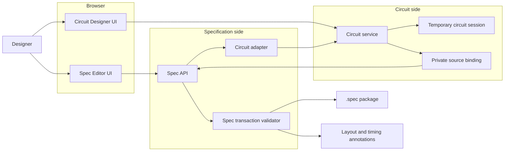

There are three important boundaries:

1. **Browser boundary** — each UI talks to its own service.
2. **Projection boundary** — the Spec adapter converts Spec data into a Circuit
   document and converts accepted Circuit changes back into Spec operations.
3. **Save boundary** — only the Spec API can commit the `.spec` package.

## Who owns each piece of data?

| Data | Owner | Durable? | Notes |
| --- | --- | --- | --- |
| IP-XACT components, designs, ports, and connections | Spec API | yes | Stored in the `.spec` package |
| Circuit layout and timing annotations | Spec API | yes | Stored beside the source data in the `.spec` package |
| Projected `CircuitDocument` | Circuit service | no | Rebuilt from the current Spec revision |
| Circuit service revision | Circuit service | no | Tracks the temporary session, not the `.spec` revision |
| Private edit draft | Circuit Designer browser | no | Exists until Save or Cancel |
| Edit lease | Circuit service | no | Prevents two active Circuit drafts from committing together |
| Source revision hash | Spec API | yes | Stops an old Circuit draft from overwriting newer Spec changes |
| Source-binding token | Spec API and Circuit service | no | Never sent to either browser UI |

Two revision values are therefore visible during editing:

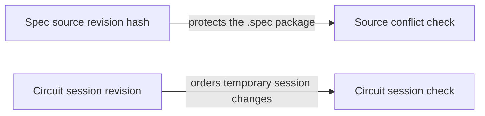

They solve different problems. They should not be treated as one revision.

## API handoff map

The endpoint names make more sense when grouped by caller.

| Caller | Receiver | Endpoint | Purpose |
| --- | --- | --- | --- |
| Spec Editor UI | Spec API | `POST /circuit-designer/launch` | Project a selected entity and prepare a Circuit session |
| Spec API | Circuit service | `POST /documents` | Publish the projected Circuit document |
| Spec API | Circuit service | `PUT /documents/{id}/source-binding` | Register the private save-back callback |
| Circuit Designer UI | Circuit service | `GET /documents/{id}` | Load the current Circuit snapshot |
| Circuit Designer UI | Circuit service | `GET /documents/{id}/source-binding` | Load public source ownership and capabilities |
| Circuit Designer UI | Circuit service | `POST /documents/{id}/lock` | Begin a private edit draft |
| Circuit Designer UI | Circuit service | `POST /documents/{id}/source/commit` | Submit a source-bound draft |
| Circuit service | Spec API | `POST /circuit-designer/source/preview` | Validate the candidate without saving |
| Circuit service | Spec API | `POST /circuit-designer/source/commit` | Atomically save and re-project the source |
| Circuit Designer UI | Circuit service | `POST /documents/{id}/source/reload` | Discard a stale view and request current source |
| Circuit service | Spec API | `POST /circuit-designer/source/resolve` | Return the current authoritative projection |
| Spec Editor UI | Spec API | event stream, `source.changed` | Learn that Circuit Designer saved a new revision |

## Package and process view

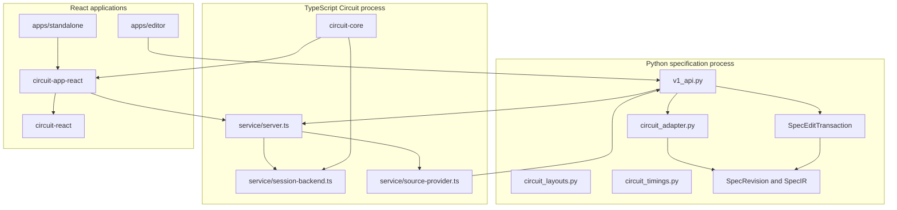

The reusable `circuit-app-react` shell does not know about `.spec` files. The
standalone application supplies the current HTTP source adapter and the
Spec-specific labels. This keeps the shell usable in another host application.

## Opening a Spec design in Circuit Designer

Opening is a server-led operation. The Spec API prepares the circuit before the
new Circuit Designer tab loads.

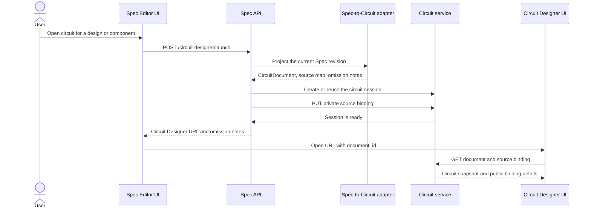

The launch creates four related objects:

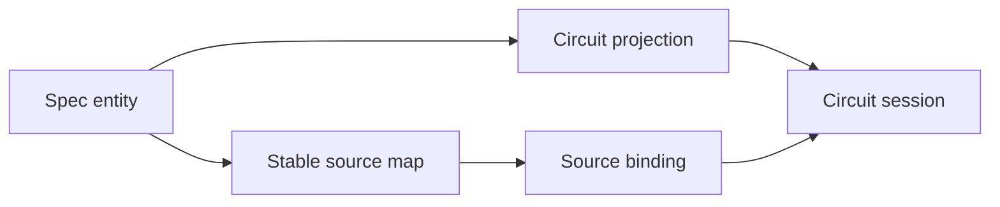

- **Projection** is the visible Circuit document.
- **Source map** connects generated Circuit IDs to stable Spec names and IDs.
- **Session** is the temporary document stored by the Circuit service.
- **Binding** tells the Circuit service how to validate and save back to the
  source.

## What the projection includes

The adapter intentionally shows only topology it can safely round-trip.

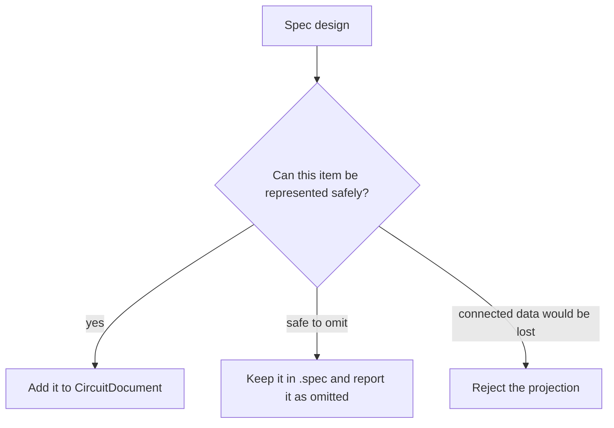

The current projection supports direct wire ports, instances, ad-hoc
connections, numeric slices, layout, timing, and supported internal-design
boundaries. Bus interfaces, transactional ports, structured ports, and
symbolic slices are preserved on the Spec side. If hiding one of them would
lose real connectivity, launch or save is rejected.

## Read-only versus writable launches

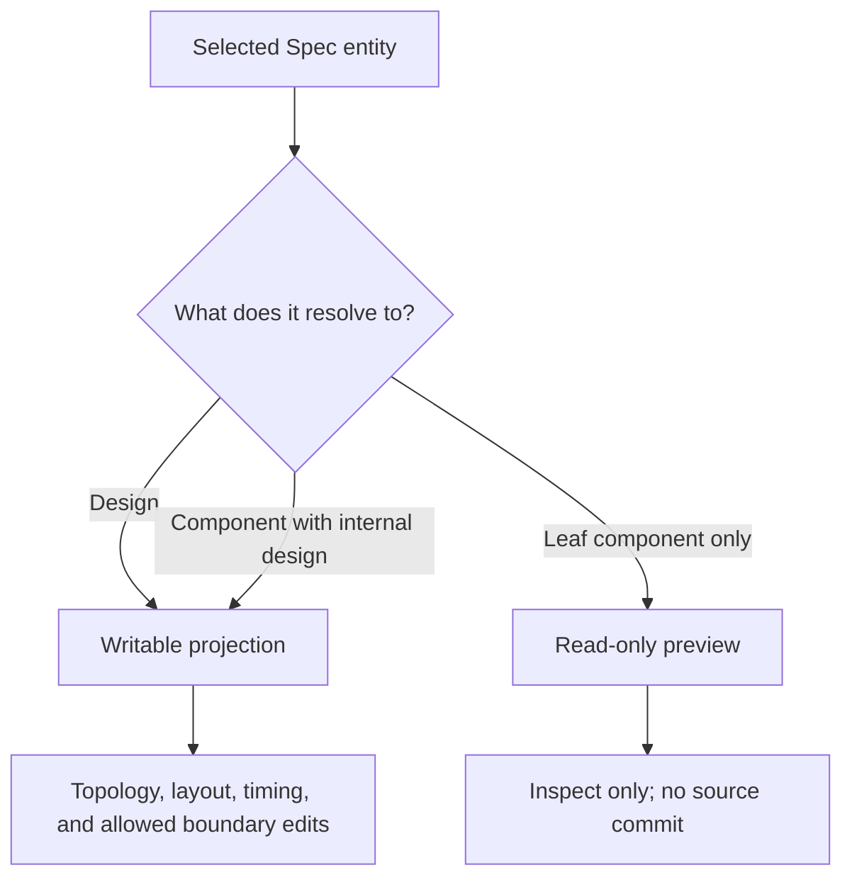

A component with an internal design edits that internal design. A leaf
component has no internal topology to edit, so Circuit Designer shows a
read-only preview of the component and its physical ports.

## Editing model

Circuit Designer uses a private draft instead of changing the session after
every gesture.

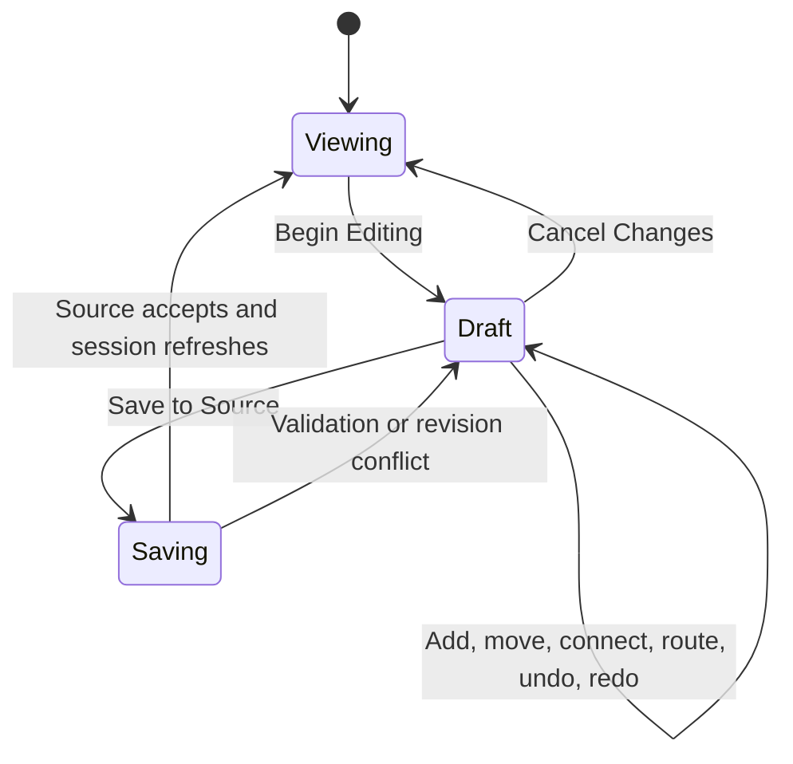

When editing begins:

1. Circuit Designer asks the Circuit service for an edit lease.
2. The browser creates a `CircuitDraft` from the current session snapshot.
3. Gestures apply typed Circuit operations to that private draft.
4. The `.spec` package and the shared Circuit session remain unchanged.

Cancel releases the lease and discards the browser draft.

## Saving a Circuit draft to the Spec package

Saving crosses the integration boundary twice: first for validation, then for
the durable commit.

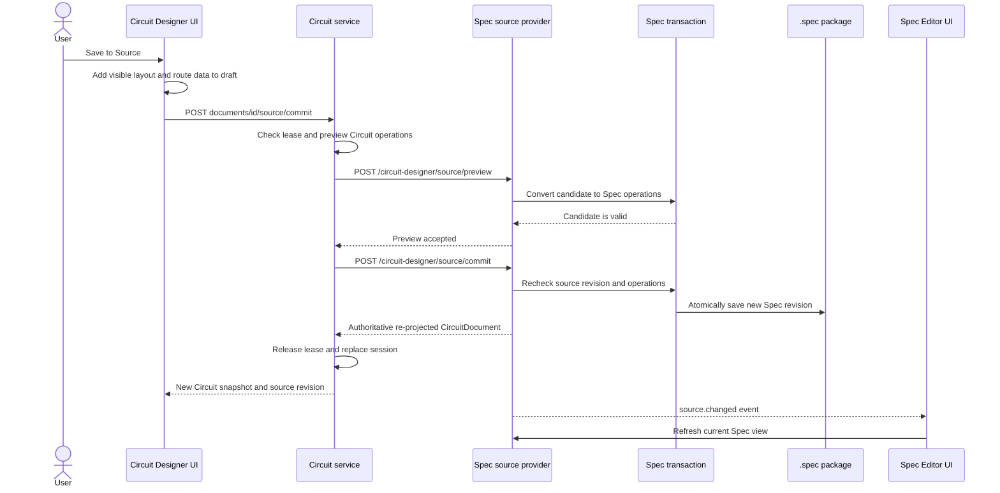

The detailed save order is:

1. The browser materializes the visible geometry, terminal placement, and
   routes into the draft.
2. The Circuit service checks the lease.
3. The Circuit service previews the Circuit operation batch against its current
   session.
4. The Circuit service sends the full candidate document to the Spec API.
5. The Spec adapter compares the original projection with the candidate.
6. It creates minimal typed Spec operations.
7. A Spec transaction validates the complete result without saving it.
8. The Circuit service asks for the commit.
9. The Spec API checks the source revision again and saves atomically.
10. The Spec API re-projects the saved source into a fresh Circuit document.
11. The Circuit service replaces its temporary session and releases the lease.
12. Both browser tabs receive refreshed authoritative data.

The re-projection in step 10 is important. Circuit Designer does not assume
that its candidate is the final canonical result. It displays what the Spec API
actually saved.

## Forward and reverse conversion

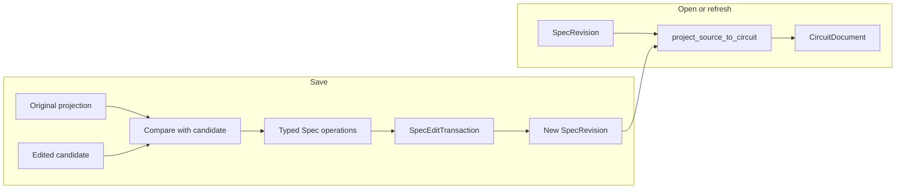

The reverse adapter does not replace the whole design. It updates only the
supported source objects. Hidden or unsupported Spec data stays in place.

## Layout and timing storage

Topology and visual data have different homes inside the `.spec` package.

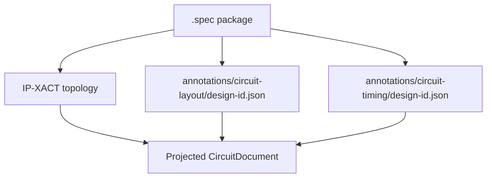

Layout and timing annotations use source names, not generated Circuit IDs.
This lets a new projection reconnect saved geometry to the same source
instances, ports, and connections.

## How Spec Editor learns about a Circuit save

The Circuit browser does not message the Spec Editor browser. The Spec API
publishes an event after the package commit.

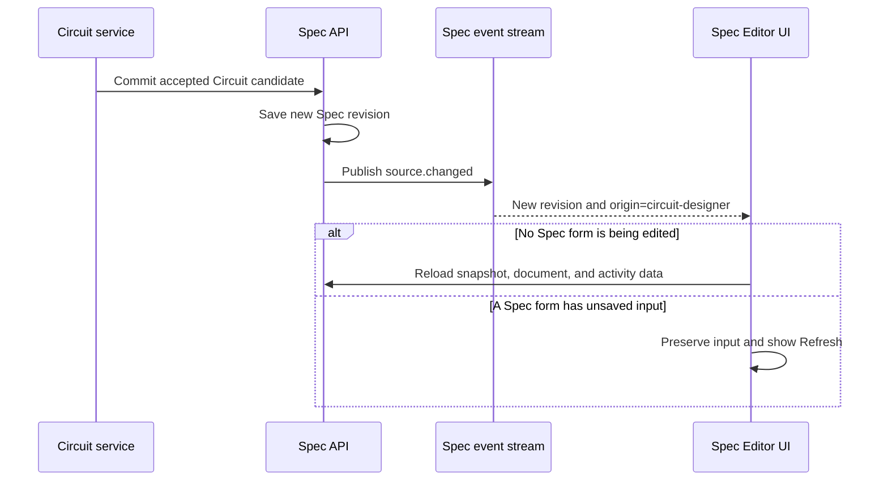

This protects an unfinished Spec Editor form from being silently replaced.

## Conflicts

A source binding records the Spec revision from which the Circuit draft began.

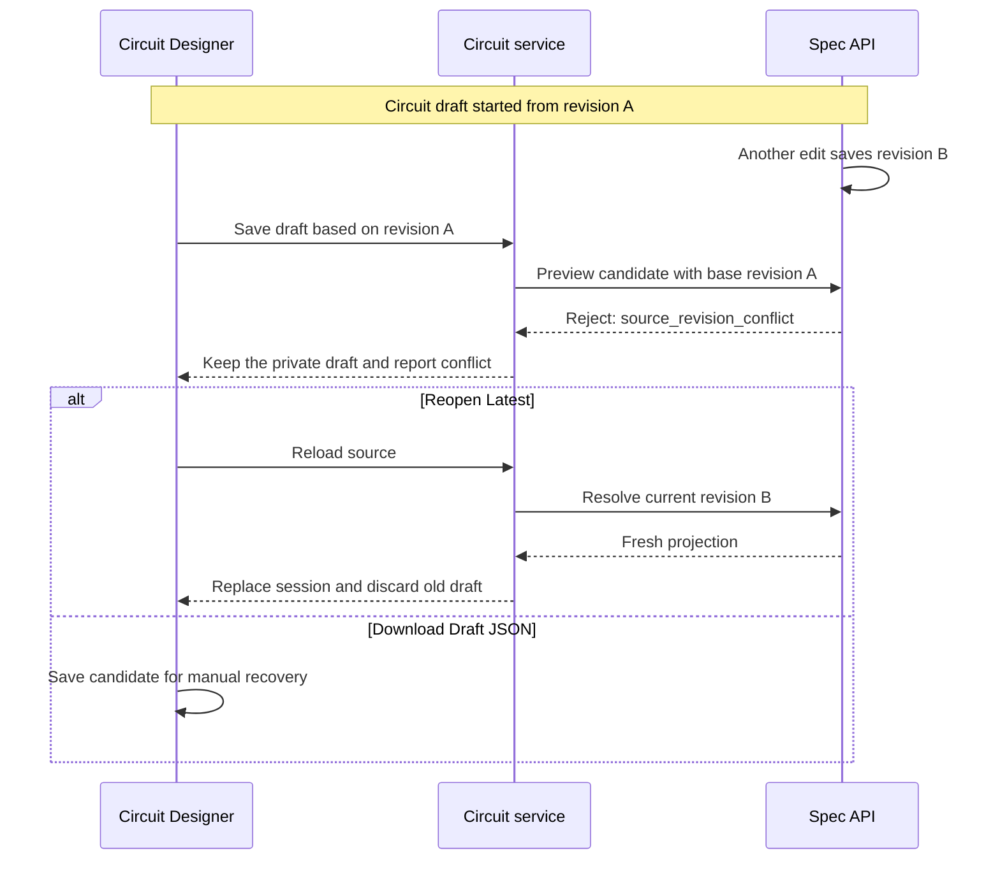

There is no automatic merge and no force save. The first successful source
commit wins.

## Security boundary

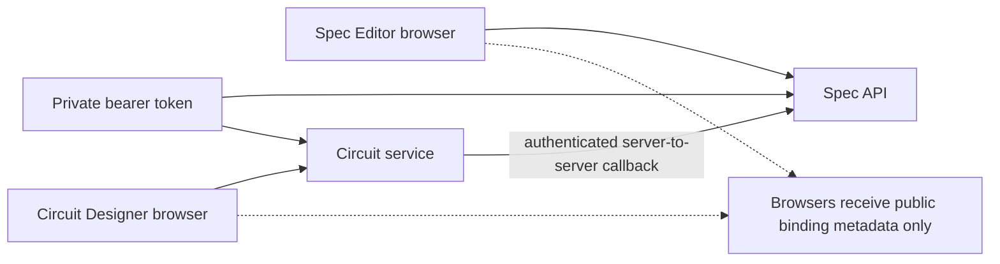

The source-binding token is stored only in backend memory. The browser receives
public binding metadata such as writable capabilities, source revision, and
omission notes. Callback URLs are limited to loopback or explicitly trusted
hosts.

## Failure behavior

| Failure | What remains safe | User action |
| --- | --- | --- |
| Circuit service is unavailable during launch | `.spec` package is unchanged | Start the Circuit service and retry |
| Projection cannot safely represent source data | `.spec` package is unchanged | Use Spec Editor or simplify the unsupported topology |
| Circuit validation fails | Browser draft is kept | Fix the reported circuit error |
| Spec validation fails | Browser draft and `.spec` package are kept unchanged | Fix the reported source error |
| Source revision changed | Browser draft is kept; newer `.spec` revision wins | Reopen Latest or download the draft |
| A server-to-server commit is repeated with the same request ID | The saved result is replayed instead of applied twice | Continue with the returned result |
| Browser loses a save response | The source may already contain the change | Reload the latest source before repeating manual work |
| Spec saves but Circuit session refresh fails | New `.spec` revision is durable | Reload the latest source projection |
| Spec Editor has an unfinished form when Circuit saves | Form input is preserved | Review it, then choose Refresh |

## Independent circuits use a shorter path

An independent `.circuit.json` document does not involve Spec Editor.

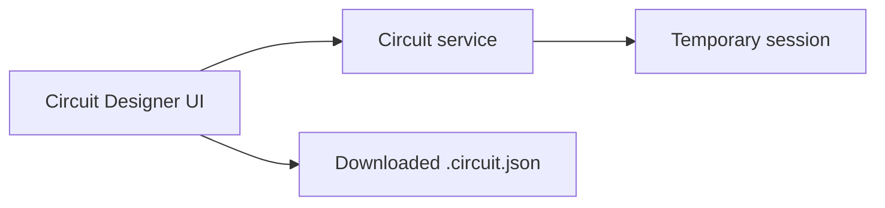

For an independent circuit, Save commits to the temporary Circuit session and
downloads a canonical file. For a source-bound circuit, Save goes through the
Spec source provider and updates the `.spec` package.

## Code map

| Responsibility | Main location |
| --- | --- |
| Spec launch and source callback endpoints | `spec2gds/agent_spec/spec_format/v1_api.py` |
| Forward projection and reverse operation compiler | `spec2gds/agent_spec/spec_format/circuit_adapter.py` |
| Durable layout annotation model | `spec2gds/agent_spec/spec_format/circuit_layouts.py` |
| Durable timing annotation model | `spec2gds/agent_spec/spec_format/circuit_timings.py` |
| Circuit source-binding routes and save orchestration | `circuit-designer/packages/service/src/server.ts` |
| Authenticated callback client | `circuit-designer/packages/service/src/source-provider.ts` |
| Temporary Circuit session and leases | `circuit-designer/packages/service/src/session-backend.ts` |
| Reusable Circuit application and private draft | `circuit-designer/packages/app-react/src/App.tsx` |
| Spec-specific browser adapters | `circuit-designer/apps/standalone/src/browser-adapters.ts` |
| Spec Editor launch and refresh behavior | `circuit-designer/apps/editor/src/App.tsx` |

## Fast reading checklist

- The `.spec` package is always the durable source of truth.
- The Circuit service stores only a temporary projection and revision.
- Circuit gestures change a private browser draft first.
- Save uses a server-to-server source binding; browsers never receive its
  token.
- The Spec adapter converts the candidate into small typed Spec operations.
- The Spec API validates, saves, and returns a fresh authoritative projection.
- The Spec Editor refreshes from a `source.changed` event.
- Stale Circuit drafts are rejected and never force-overwrite newer Spec data.
