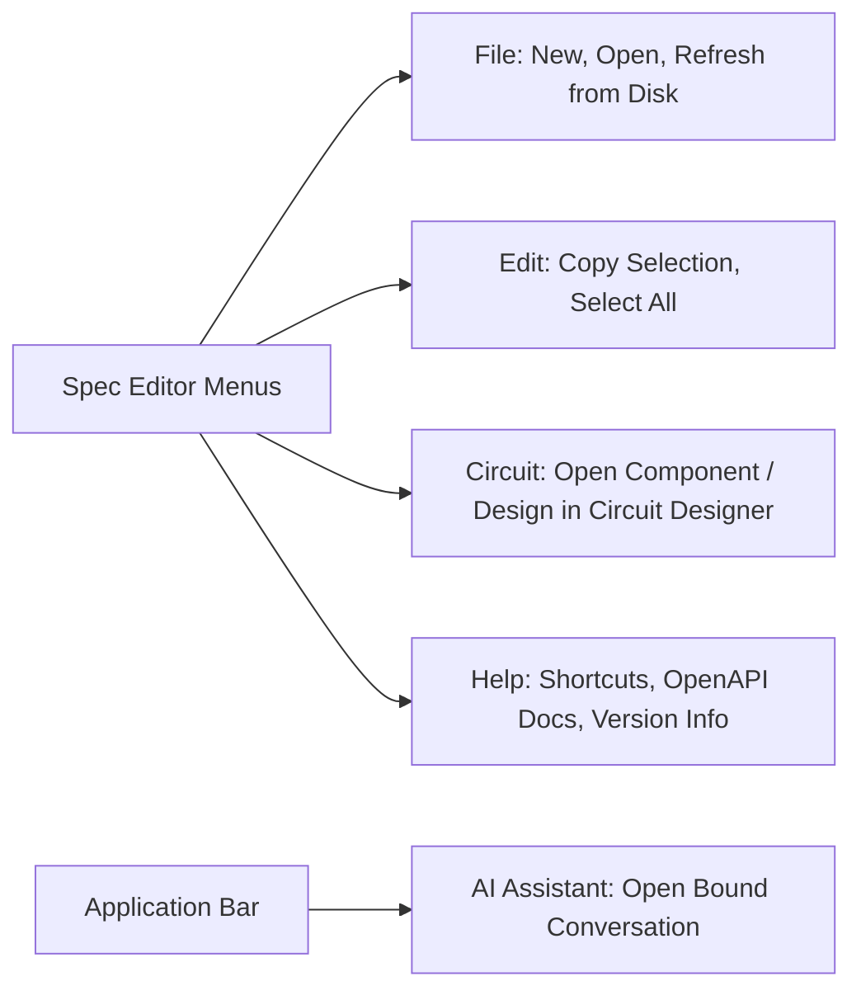
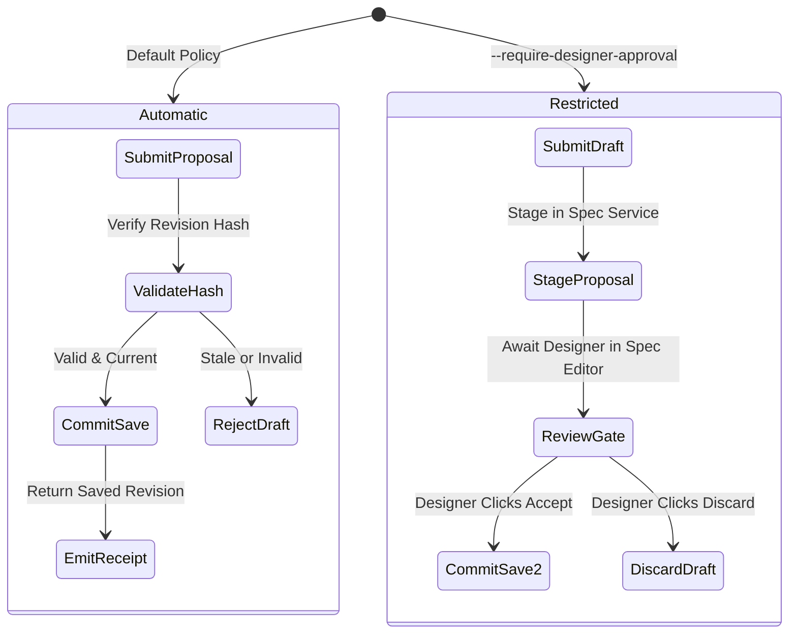

# Spec Editor and Specification Service

This document defines the user interface, section storage, and transaction model for Spec Editor and the Spec service.

## 1. User Interface and Navigation

Spec Editor provides a structured engineering interface for hardware specifications.

### Visual Layout
- The UI uses a light surface, a green accent tone, and a system sans-serif font.
- Hardware IDs and SystemVerilog code blocks use monospace text.
- Hardware IDs strictly preserve their exact letter casing.

### Navigation and Contents
- The sticky application bar keeps document actions visible during page scroll.
- The **Contents** panel tracks the visible Section as the designer scrolls.
- Below 800 pixels width, the **Contents** button opens the section list in an overlay.
- Selecting a Section closes the list and moves focus to the selected heading.
- Pressing `Escape` closes the list and returns focus to the Contents button.
- Below 620 pixels width, the **Menu** button provides access to the application menus.

### Tables and In-Place Drafts
- Hardware port tables display all ports for a component in one unified view.
- Tables support horizontal scrolling on narrow screens without hiding action buttons.
- Editing a port opens an inline draft directly inside the table row.
- Click **Save to Spec** to commit a draft, or click **Cancel** to discard edits.
- Technical details and Section identifiers remain available in collapsible panels.

---

## 2. Application Menus and Controls



### Application Bar Actions
- **Active Document**: Displays the current package name. Hover to inspect the server-local filesystem path.
- **AI Assistant Button**:
  - When a specification is open: Opens an Assistant conversation permanently bound to the active document.
  - When no specification is open: Opens an unbound conversation without attaching source context.
- **Component / Design Menus**: Use **More actions → Explore with AI Assistant** to open a conversation focused on a single entity.

### Menu Operations
- **File Menu**:
  - **New Spec (`Ctrl+N` / `Cmd+N`)**: Prompts for a human-readable title and server path, then initializes an empty `.spec` file.
  - **Open Spec (`Ctrl+O` / `Cmd+O`)**: Opens an existing `.spec` package from the host filesystem.
  - **Refresh From Disk**: Reloads the active package from disk, discarding unsaved UI state.
  - Valid transactions save automatically; persistent **Save** is therefore disabled during normal operation.
- **Edit Menu**:
  - Supports standard clipboard copy for text and tables.
  - Field inputs support native Cut, Copy, and Paste shortcuts.
- **Circuit Menu**:
  - Lists launchable entry designs, sub-designs, and leaf components.
  - Selecting an item opens the projected topology in Circuit Designer.
  - Leaf components open as read-only instance previews.
  - Composite designs open as editable, source-bound circuits.

---

## 3. Component and Design Sections

Components and Designs organize structured hardware content through a central section registry.

### Section Types

| Section Type | Allowed Parents | Cardinality | Underlying Storage | Editable |
| --- | --- | --- | --- | --- |
| `text` | Component, Design | Singleton | IP-XACT `description` adapter | Yes |
| `ports` | Component | Singleton | IP-XACT port definitions | Yes |
| `sv` | Component, Design | Optional singleton | Digest-indexed `.sv` annotation | Yes; Deletable |

### Storage Format Inside `.spec`
Persisted sections use the standard annotation structure within the `.spec` archive:

```text
annotations/entity-sections/index.json
annotations/entity-sections/sv/<section-id>.sv
```

- `index.json`: Records section ID, type, version, parent reference, media type, relative file path, and SHA-256 digest.
- Deleting a parent Component or Design automatically removes all attached section files.
- SystemVerilog text is normalized to UTF-8 with LF line endings.
- Files larger than 256 KiB are rejected; empty module bodies are valid.

### Section Mutation Operations
Mutations execute through revision-checked transaction commands:
- `upsert_entity_section`: Creates or updates a section.
- `delete_entity_section`: Removes an optional section (such as `sv`).

Example `upsert_entity_section` payload:
```json
{
  "type": "upsert_entity_section",
  "owner": {
    "document_id": "alu_core",
    "entity_kind": "component",
    "entity_id": "alu"
  },
  "section_type": "sv",
  "type_version": 1,
  "payload": {
    "content": "assign result = a + b;\n"
  }
}
```

---

## 4. Spec Service Revisions and Approval Modes

The Spec service enforces strict transactional safety for all modifications.

### Document Key Tokens
- Opening or creating a package generates a unique `owner_document_key`.
- The token securely binds client sessions and AI Assistant threads to one exact document path.
- Opening a different document in Spec Editor never changes the target of an existing bound conversation.

### Approval Policies



The Spec service supports two execution policies:
1. **Automatic Policy (Default)**:
   - Valid proposals apply and save immediately to the `.spec` package.
   - The Spec service checks schema, scope, references, and the base revision hash.
   - The client receives an atomic write receipt with the new revision hash.
2. **Restricted Policy (`--require-designer-approval`)**:
   - The Spec service stages the proposal and returns `approval_required`.
   - The proposal appears as a pending review card in Spec Editor.
   - The designer clicks **Accept** to commit the change or **Discard** to reject it.

### Launching with Approval Modes
To run the Spec service with designer approval required:

```bash
uv run spec2gds-spec-service --require-designer-approval
# Or with the combined launcher:
bash scripts/serve-all.sh start --require-designer-approval
```

### Stale Revision Protection
- Every transaction includes `base_source_revision_hash`.
- If another client or tool modifies the file first, the hashes do not match.
- The service rejects the stale transaction with HTTP 409 Conflict.
- The client must read the fresh context before submitting a new candidate.
