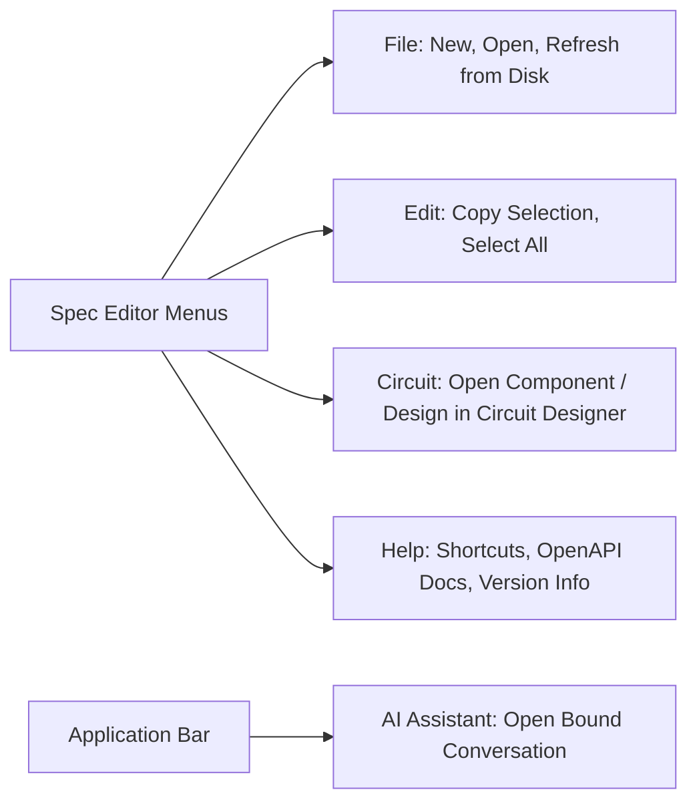
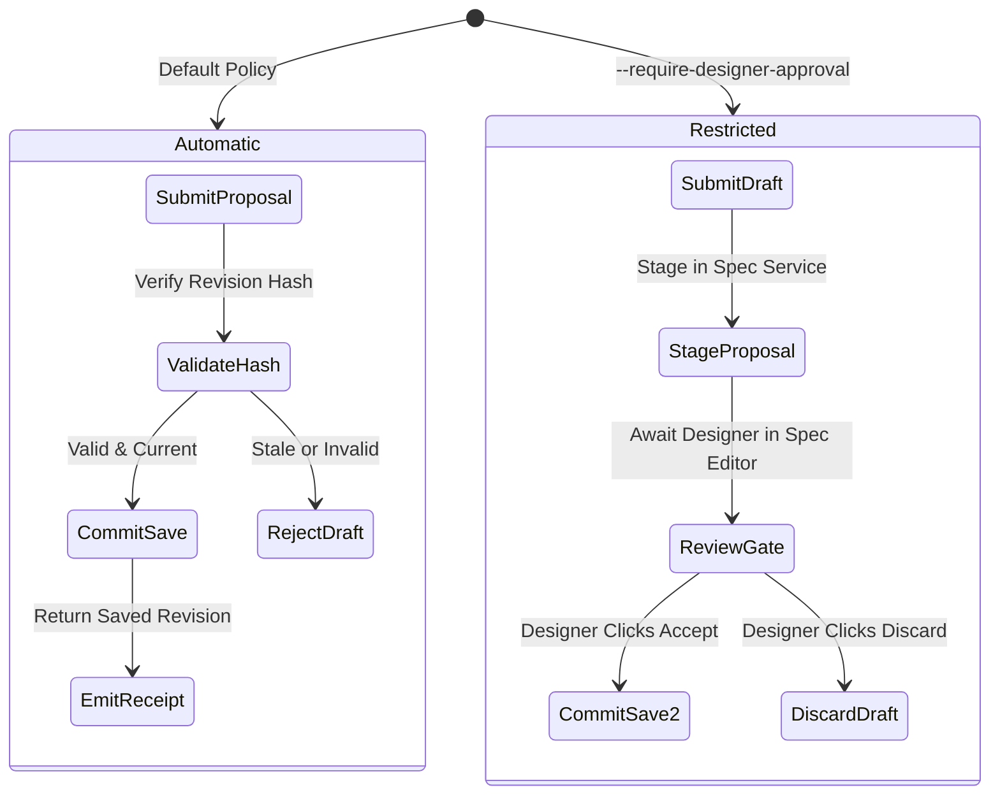

# Spec Editor and Specification Service

This document defines the user interface, section storage, and transaction model for Spec Editor and the Spec service.

## 1. User Interface and Navigation

Spec Editor provides a structured engineering interface for hardware specifications.

### Visual Layout
- The UI uses a light surface, a green accent tone, and a system sans-serif font.
- Hardware IDs and SystemVerilog code blocks use monospace text.
- Hardware IDs strictly preserve their exact letter casing.

### Navigation and Contents
- The sticky application bar keeps document actions visible during page scroll.
- The **Contents** panel tracks the visible Section as the designer scrolls.
- Below 800 pixels width, the **Contents** button opens the section list in an overlay.
- Selecting a Section closes the list and moves focus to the selected heading.
- Pressing `Escape` closes the list and returns focus to the Contents button.
- Below 620 pixels width, the **Menu** button provides access to the application menus.

### Tables and In-Place Drafts
- Hardware port tables display all ports for a component in one unified view.
- Tables support horizontal scrolling on narrow screens without hiding action buttons.
- Editing a port opens an inline draft directly inside the table row.
- Click **Save to Spec** to commit a draft, or click **Cancel** to discard edits.
- The document view does not show Technical details panels. Job history, artifact records, and reviews retain their diagnostic details.
- Existing transaction and structured ports are read-only in Spec Editor. Create and edit wire ports from the Component Options menu.

---

## 2. Application Menus and Controls



### Application Bar Actions
- **Active Document**: Displays the current package name. Hover to inspect the server-local filesystem path.
- **AI Assistant Button**:
  - When a specification is open: Opens an Assistant conversation permanently bound to the active document.
  - When no specification is open: Opens an unbound conversation without attaching source context.
- **Component / Design Menus**: Use **Options → Explore with AI Assistant** to open a conversation focused on a single entity.

### Menu Operations
- **File Menu**:
  - **New Spec (`Ctrl+N` / `Cmd+N`)**: Prompts for a human-readable title and server path, then initializes an empty `.spec` file.
  - **Open Spec (`Ctrl+O` / `Cmd+O`)**: Opens an existing `.spec` package from the host filesystem.
  - **Refresh From Disk**: Reloads the active package from disk, discarding unsaved UI state.
  - Use **Save to Spec** in each draft to validate and save the change. File has no separate Save command.
- **Edit Menu**:
  - Supports standard clipboard copy for text and tables.
  - Cut and Paste work in editable text fields and the SystemVerilog editor. Menu actions retain the field selection; native keyboard shortcuts remain available.
- **Circuit Menu**:
  - Lists launchable entry designs, sub-designs, and leaf components.
  - Selecting an item opens the projected topology in Circuit Designer.
  - Leaf components open as read-only instance previews.
  - Composite designs open as editable, source-bound circuits.

### Circuit Previews and Preservation
- Every design section displays an SVG circuit preview generated from IP-XACT topology.
- Previews display component instances, connections, and pipeline cycle markers.
- Spec Editor preserves circuit layout annotations across saves so manual positions and routing stay stable.
- Leaf components display a read-only instance preview with attached wire ports.

---

## 3. Component and Design Sections

Components and Designs organize structured hardware content through a central section registry.

### Section Types

| Section Type | Allowed Parents | Cardinality | Underlying Storage | Editable |
| --- | --- | --- | --- | --- |
| `text` | Component, Design | Singleton | IP-XACT `description` adapter | Yes |
| `ports` | Component | Singleton | IP-XACT port definitions | Yes |
| `sv` | Component, Design | Optional singleton | Digest-indexed `.sv` annotation | Yes; Deletable |

### Storage Format Inside `.spec`
Persisted sections use the standard annotation structure within the `.spec` archive:

```text
annotations/entity-sections/index.json
annotations/entity-sections/sv/<section-id>.sv
```

- `index.json`: Records section ID, type, version, parent reference, media type, relative file path, and SHA-256 digest.
- Deleting a parent Component or Design automatically removes all attached section files.
- SystemVerilog text is normalized to UTF-8 with LF line endings.
- Files larger than 256 KiB are rejected; empty module bodies are valid.

### Section Mutation Operations
Mutations execute through revision-checked transaction commands:
- `upsert_entity_section`: Creates or updates a section.
- `delete_entity_section`: Removes an optional section (such as `sv`).

Example `upsert_entity_section` payload:
```json
{
  "type": "upsert_entity_section",
  "owner": {
    "document_id": "alu_core",
    "entity_kind": "component",
    "entity_id": "alu"
  },
  "section_type": "sv",
  "type_version": 1,
  "payload": {
    "content": "assign result = a + b;\n"
  }
}
```

---

## 4. Spec Service Revisions and Approval Modes

The Spec service enforces strict transactional safety for all modifications.

### Document Key Tokens
- Opening or creating a package returns its stable `owner_document_key`.
- The key binds browser views and AI Assistant conversations to one exact file path. It identifies the file; it is not a designer identity.
- Opening a different document in Spec Editor never changes the target of an existing bound conversation.

### Shared hosting and edit access

Set `spec_editor.spec_root` in the shared service configuration, or pass
`--spec-root PATH` to the launcher or standalone Spec service. A flag has higher
priority than configuration. Configuration paths are relative to the configuration
file; flag paths are relative to the launch directory. The repository default is
`../specs` relative to `config/services.json`.

The root is the picker boundary. **Up** stops there, and **Spec root** returns
there. Typed paths and direct API requests have the same boundary. Symbolic links
below the root are rejected. Stored bindings outside a newly selected root are
unavailable. The service never moves files when the root changes.

Each Spec Editor tab selects its own file. Refresh restores that selection. A
duplicated tab receives a separate edit context. If the file is already in use,
the duplicate opens read-only. Read-only opening does not change the saved file.
Opening a writable legacy package can normalize missing or duplicate names within
its directory, while preserving hardware IDs.

**Create Copy** copies the saved source, embedded assets, annotations, Circuit
layout, and timing. It preserves internal IDs and creates a different file
binding. It does not copy Activity history, pending proposals, external artifacts,
or Assistant history. Existing destinations are never replaced. If an inline
draft is open, the copy opens separately and the original draft remains in its tab.

Edit participants renew every 30 seconds. Access expires five minutes after the
last renewal. Spec Editor, linked Circuit Designer views, open Assistant views,
and queued or running jobs can retain participation. Closing Spec Editor releases
its participant. Other disconnected participants expire. Old tokens cannot save after expiry. **Resume editing** acquires
access only if another context does not hold it.

Document HTTP requests must select `service_document_key`; the legacy
`owner_document_key` alias remains accepted. There is no shared active-file
fallback. A document ID alone is accepted only when one in-root file matches.
Writes also send `X-Spec-Edit-Context` and `X-Spec-Participant`. Event stream URLs
can carry `edit_context_id` and `edit_participant_id` query parameters.

| Endpoint | Behavior |
| --- | --- |
| `POST /documents/open` | Returns the snapshot and `edit_access`; accepts context and participant IDs to resume the same work. |
| `POST /documents/create` | Creates a new file and returns edit access. Stable request IDs recover creation receipts. |
| `POST /documents/copy` | Takes a source key, expected saved revision, destination, title, and request ID. Retries return the original copy. |
| `GET /documents/copy-suggestion` | Suggests an available filename and Spec name in the source directory. |
| `POST /documents/edit-access/acquire` | Returns edit access, or read-only when another context holds the file. |
| `POST /documents/edit-access/renew` | Renews a valid participant; expired access returns HTTP 423. |
| `POST /documents/edit-access/release` | Releases only the specified participant. |

Spec names are unique per directory. Shared lists show root-relative paths to
distinguish matching names. Artifacts and generated output use the file-specific
`<file>.spec.artifacts/` directory. The configured Activity scratch root retains
the service job database and immutable input snapshots.

### Approval Policies



The Spec service supports two execution policies:
1. **Automatic Policy (Default)**:
   - Valid proposals apply and save immediately to the `.spec` package.
   - The Spec service checks schema, scope, references, and the base revision hash.
   - The client receives an atomic write receipt with the new revision hash.
2. **Restricted Policy (`--require-designer-approval`)**:
   - The Spec service stages the proposal and returns `approval_required`.
   - The proposal appears as a pending review card in Spec Editor.
   - The designer clicks **Accept** to commit the change or **Discard** to reject it.

### Launching with Approval Modes
To run the Spec service with designer approval required:

```bash
uv run spec2gds-spec-service --require-designer-approval
# Or with the combined launcher:
bash scripts/serve-all.sh start --require-designer-approval
```

### Stale Revision Protection
- Every transaction includes `base_source_revision_hash`.
- If another client or tool modifies the file first, the hashes do not match.
- The service rejects the stale transaction with HTTP 409 Conflict.
- The client must read the fresh context before submitting a new candidate.

## Diagnostic sample Activity

Use **Options → Export target details (JSON)** on a Component or Design. This runs
the sample `reference.spec_summary` Activity, version `2.0.0`, against the saved
Spec. Unsaved drafts are excluded.

The JSON file contains all source Sections for the selected target and its
dependencies. This includes metadata, nested narrative, tables, protocol data,
and SystemVerilog content. The export does not run RTL validation or change source.

Open the Activity view and use **Download JSON** on **Target Section details**.
The artifact role is `spec.summary` and remains visible in Technical details.
The export records the snapshot and source revision. Downloads remain bound to
the same Spec.

Options lists each compatible Activity directly. It keeps availability warnings
and disabled reasons. An empty menu shows **No options available**.

### Release validation note

The release checks require fast, scoped integration, and regression profiles.
Follow [the testing strategy](testing-strategy.md) for profile selection,
prerequisites, and evidence. Keep test output under an ignored repository
`TEMP_` directory. Missing required tools or credentials make a profile
incomplete.

## Content actions and catalog import

Use the right-side **Options** menu for saved-content actions. The Overview section provides **Edit overview text…** to author and update specification architecture and overview notes. Collection menus add Components and Designs. Component and Design menus provide Verify, Activities, and Delete. Parameter, port, and instance rows use the same menu pattern. Save, Cancel, input fields, and top toolbar shortcuts remain visible.

Select **Components → Options → Import from catalog…** to browse published Component releases. Search or filter the catalog, select a version, and review its interface, defaults, usage, and evidence. Select **Review import**, resolve conflicts with **Import as a renamed copy**, then select **Import into Spec**. Import adds an editable local definition. Add instances through a Design's Options menu. Catalog origin records remain separate from verification of the current Spec.

**Options → Generate RTL** checks the saved revision and runs Verilator verification before starting the Activity. A separate Verify action is available. Source changes and unsaved draft text do not start lint. Generation uses saved source and preserves private drafts. Failed checks show target diagnostics and do not start a job.

The [Spec Catalog service guide](../spec_catalog_service/README.md) lists startup commands and configuration. Store temporary output under the repository's ignored `temp/TEMP_*` directories.
