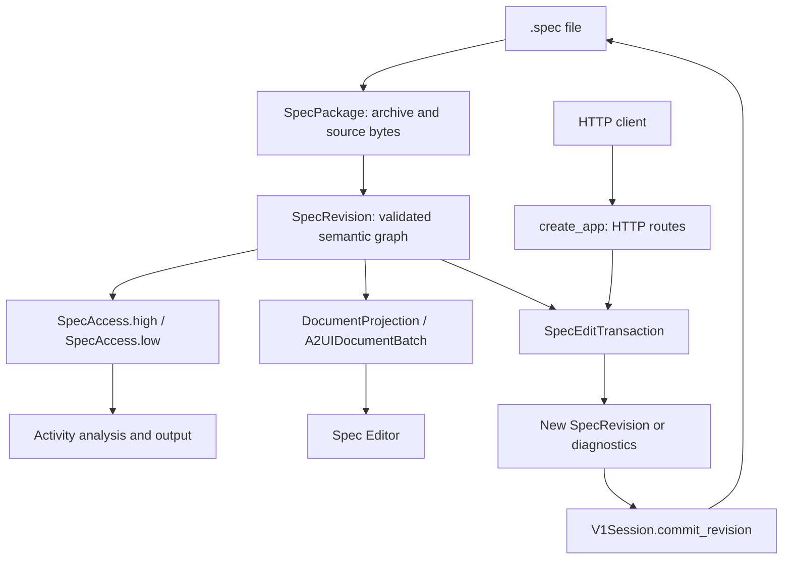
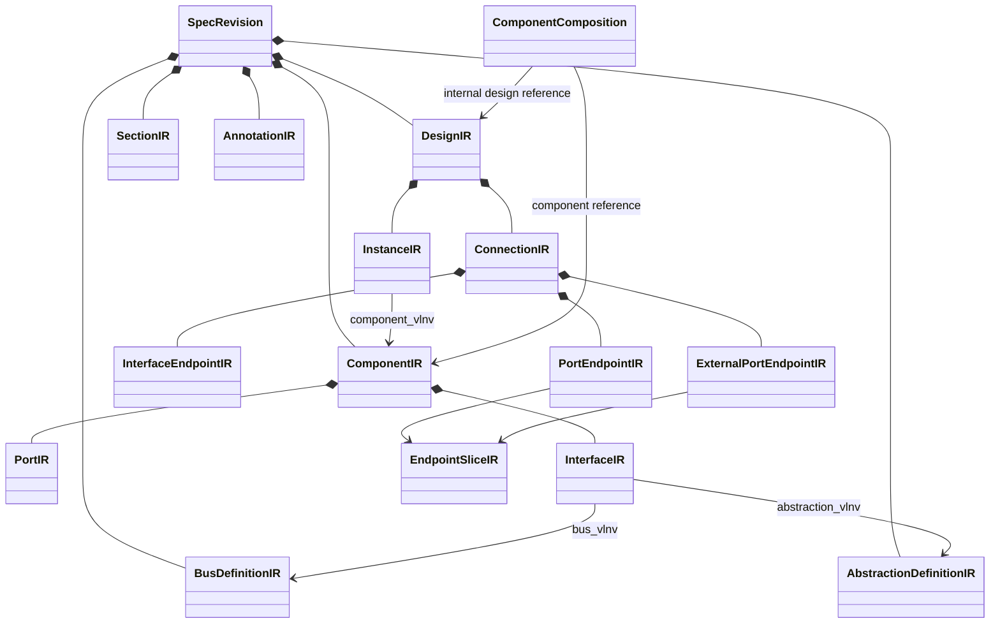
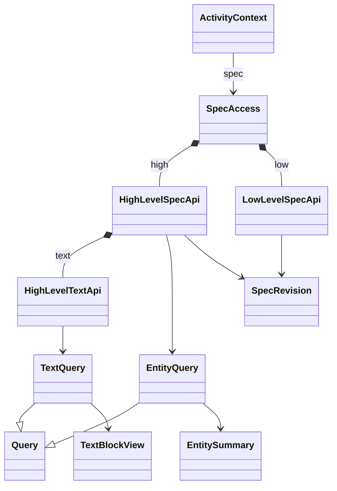
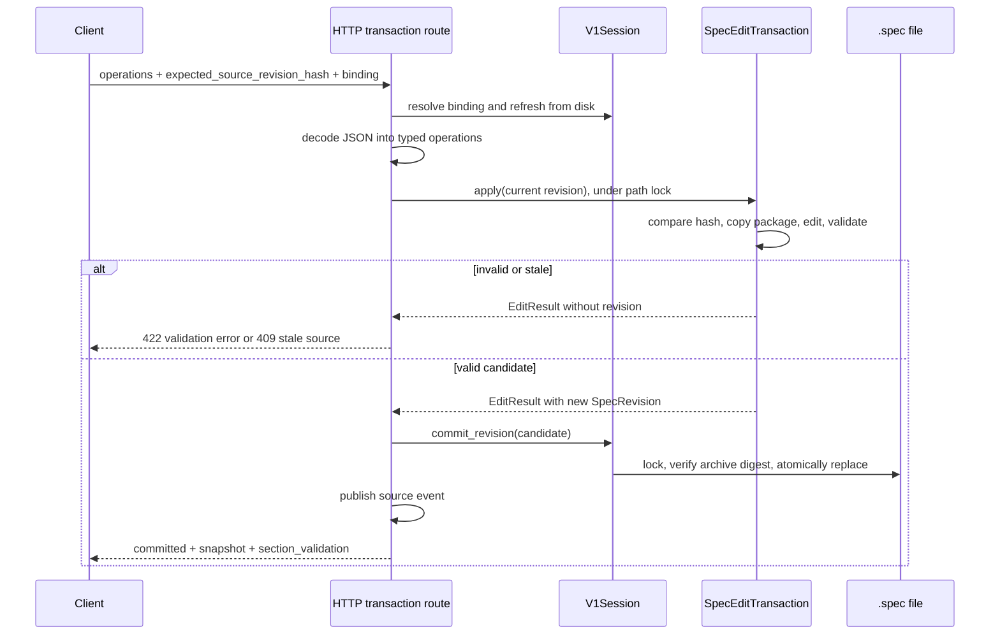

# Spec IR and Spec API: design and class guide

This guide describes the implementation on branch `base`, commit `be99fad`.
It covers the source model, the Python read API used by Activities, and the
HTTP API used by Spec Editor and other services. Source links are relative to
this file. The examples use the interfaces implemented on this branch.

Start with [the main design](#1-the-main-design), then read
[the IR classes](#4-the-spec-ir-class-model) and
[the Python API](#6-the-python-spec-api-specaccess). For service integration,
continue with [editing](#7-editing-operations-transaction-result),
[the HTTP API](#8-http-api-architecture-and-classes), and
[the request-to-disk flow](#9-a-source-edit-from-request-to-disk).

## 1. The main design

A Spec contains hardware definitions, logical connectivity, narrative, and
explicit implementation content. Its `.spec` file is a deterministic ZIP archive
centred on IP-XACT 1685-2022 XML.

The system separates three responsibilities:

| Layer | Main class | Responsibility |
| --- | --- | --- |
| Storage and construction | `SpecPackage` | Read, validate, construct, and write archive contents. |
| Semantic reads | `SpecRevision` | Represent one validated revision as an immutable graph of Python values. |
| Source edits | `SpecEditTransaction` | Apply typed operations to a detached copy and return a validated candidate revision. |

The HTTP service connects these layers through `V1Session`, which tracks a
loaded document, its current revision, disk identity, and Activity records.
Activities use `SpecAccess` to read a captured revision.



This separation gives readers a stable input while edits are prepared. A failed
edit does not partially update the original revision. Saving is a separate
service operation after candidate validation.

## 2. Where the code lives

| File | Read it to understand |
| --- | --- |
| [models.py](../spec2gds/spec/spec_format/models.py) | Persisted JSON contracts, references, manifest, and narrative. |
| [archive.py](../spec2gds/spec/spec_format/archive.py) | `SpecPackage`, archive validation, hashing, and atomic writes. |
| [ipxact.py](../spec2gds/spec/spec_format/ipxact.py) | XML parsing, schema validation, and supported IP-XACT profile. |
| [ir.py](../spec2gds/spec/spec_format/ir.py) | `SpecRevision`, hardware IR classes, graph queries, and semantic validation. |
| [sections.py](../spec2gds/spec/spec_format/sections.py) | Section registry, persisted SystemVerilog content, and `SectionIR`. |
| [transactions.py](../spec2gds/spec/spec_format/transactions.py) | Typed edit operations and all-or-nothing candidate construction. |
| [activities/view.py](../spec2gds/spec/activities/view.py) | `SpecAccess`, high and low APIs, and query classes. |
| [activities/snapshot.py](../spec2gds/spec/activities/snapshot.py) | Portable, immutable Activity inputs. |
| [v1_api.py](../spec2gds/spec/spec_format/v1_api.py) | Request models, document state, HTTP routes, commits, and events. |
| [document.py](../spec2gds/spec/spec_format/document.py) | Renderer-neutral document model and A2UI messages. |
| [spec_service_store.py](../spec2gds/spec/spec_format/spec_service_store.py) | Persistent document bindings, proposal receipts, and source events. |
| [api/__main__.py](../spec2gds/spec/api/__main__.py) | Command-line startup and Uvicorn application factory. |

The `spec2gds/spec/api/` package is a small entry point. Most HTTP implementation
is in `spec2gds/spec/spec_format/v1_api.py`.

## 3. Persisted source and identity

### Archive contents

```text
example.spec                         # ZIP archive
  mimetype
  manifest.json
  document/document.json            # NarrativeDocument
  ipxact/components/*.xml
  ipxact/designs/*.xml
  ipxact/bus-definitions/*.xml
  ipxact/abstraction-definitions/*.xml
  assets/...                         # source assets
  annotations/...                    # registered source extensions
  activity/v1/actions.json            # optional execution/proposal records
```

`SpecPackage` holds `manifest`, `narrative`, a `files: dict[str, bytes]`, and an
optional filesystem path. Manifest and narrative are separate typed attributes;
the archive writer serializes them alongside `files`.

`source_hash()` hashes the sorted source paths and contents, including the
manifest, narrative, assets, and annotations. It excludes `activity/` entries.
Consequently, recording a job result can change archive bytes without changing
`source_revision_hash`. This hash identifies source content; it is not an
elaborated or behaviourally equivalent hardware hash.

`to_bytes()` fixes ZIP timestamps and permissions, writes `mimetype` first and
uncompressed, and sorts the remaining entries. `save()` writes a temporary file
beside the destination and uses `os.replace()` to publish it atomically.

### Source contract classes

These classes are defined in `models.py`.

| Class | Main fields | Meaning |
| --- | --- | --- |
| `StrictModel` | Pydantic configuration | Rejects extra fields and freezes attribute assignment. |
| `EntityRef` | `document_id`, `entity_id`, `entity_kind` | Stable reference to an addressable source item. |
| `DocumentEntry` | `kind`, `vlnv`, `entity_id`, `path`, `sha256` | Manifest index entry for one IP-XACT XML document. |
| `SpecManifest` | `documents`, `entry_designs`, `component_compositions`, `assets`, `annotation_schemas` | Root source index and explicit hierarchy relationships. |
| `ComponentComposition` | `component`, `internal_design` | Links a Component to its internal Design. |
| `NarrativeDocument` | `document_id`, `title`, `blocks` | Human-authored document content. |
| `NarrativeBlock` | `block_id`, `type`, `text`, `children`, `entity_refs` | A section, paragraph, list, table, image, link, or live view. |
| `InlineNode` | `type`, `text`, `href`, `entity_ref` | Formatted inline text or a link inside narrative. |
| `AssetEntry` | `asset_id`, `path`, `sha256`, `media_type` | Source asset identity and integrity metadata. |
| `AnnotationSchemaEntry` | `namespace`, `version`, `path_prefix` | Registration for an annotation subtree. |

In these identifiers, “document” has two scales: `document_id` identifies the
whole Spec, while a `DocumentEntry` indexes one XML document inside it.

### References, hardware IDs, and display names

Keep these values distinct:

| Value | Example | Use |
| --- | --- | --- |
| `document_id` | `spec_demo` | Identity embedded in the whole Spec. |
| `entity_id` | `component_alu` | Stable internal reference, also associated with XML `xml:id`. |
| VLNV | `example:logic:alu_top:1.0` | IP-XACT identity: vendor, library, hardware ID, version. |
| Hardware ID | `alu_top` | Code-facing identity; the third part of the VLNV. |
| `display_name` | `Main ALU` | Human-readable name. |
| `service_document_key` | `spec_...` | Exact service binding derived from canonical file path and `document_id`. |
| `source_revision_hash` | `sha256:...` | Version of the source contents. |

`EntityRef` is the actual class name; in hardware prose, its target is a Component
or Design. Ports, interfaces, instances, and connections have local names rather
than their own `EntityRef` values. For these hardware objects, fields named `name`
usually carry a hardware ID. Their spelling is part of the code/API contract.

The service binding includes the path because two copied `.spec` files can have
the same embedded `document_id`. Changing the active document in Spec Editor
must not redirect an already bound AI Assistant conversation to another file.

## 4. The Spec IR class model

IR means **intermediate representation**. Here it is a semantic read model of
the supported source profile. The root class is `SpecRevision`; there is no
single class named `SpecIR` in `ir.py`.



### Hardware classes

| Class | What it represents | Fields to know |
| --- | --- | --- |
| `ComponentIR` | Reusable hardware definition and external contract | `ref`, `vlnv`, `ports`, `interfaces`, `display_name` |
| `PortIR` | Physical port, classified by port family | `name`, `direction`, `style`, `width`, `range`; transactional and structured details |
| `InterfaceIR` | Bus interface on a Component | `name`, `bus_vlnv`, `abstraction_vlnv`, `role`, `port_maps` |
| `DesignIR` | Assembly of Component instances and logical connections | `ref`, `vlnv`, `instances`, `connections`, `display_name` |
| `InstanceIR` | Named use of a Component in a Design | `name`, `component_vlnv` |
| `ConnectionIR` | Interface connection or ad-hoc port connection | `name`, `kind`, endpoint tuples, `hierarchy_interfaces` |
| `InterfaceEndpointIR` | Interface on an instance | `instance_name`, `interface_name` |
| `PortEndpointIR` | Port on an instance | `instance_name`, `port_name`, `slice`, `symbolic_slice` |
| `ExternalPortEndpointIR` | Port at a Component boundary | `port_name`, `slice`, `symbolic_slice` |
| `EndpointSliceIR` | Numeric part-select | `lsb`, `width` |
| `BusDefinitionIR` | Protocol identity | `ref`, `vlnv`, `display_name` |
| `AbstractionDefinitionIR` | Bus abstraction and logical port names | `ref`, `vlnv`, `bus_vlnv`, `logical_ports` |
| `AnnotationIR` | Raw accepted annotation content | `path`, immutable `data` bytes |

`InterfaceIR.port_maps` contains `(logical_port_name, physical_port_name)` pairs.
`ConnectionIR.kind` is either `interface` or `ad_hoc`; the corresponding endpoint
collections describe the connection. Logical connections remain part of Spec
source even when Circuit Designer provides their visual editing interface.

`PortIR.style` is `wire`, `transactional`, or `structured`. Do not assume that
`width` is always a number. A scalar wire has width `1`; a single vector can
retain a range string such as `[7:0]`; unsupported or non-wire shapes can have
`None`. Consumers perform their own supported-profile checks and normalization.

### Hierarchy: Component versus Design

A Component defines ports and interfaces. A Design instantiates Components and
connects them. A composite Component links to an internal Design through
`SpecManifest.component_compositions`.

```text
Entry Design: system_top
  Instance: compute0 -> Component: compute_subsystem
    ComponentComposition -> internal Design: compute_internal
      Instance: alu0 -> Component: alu
      Instance: register0 -> Component: register_bank
      Connections between these instances
```

The composition is a reference relationship, not a nested mutable object inside
`ComponentIR`. One Component can have at most one internal Design, and one
internal Design can have at most one parent Component. Recursive composition
cycles are rejected. Top-level entry Designs are explicitly listed in the
manifest; queries do not infer them from unused Designs.

### `SpecRevision` lifecycle and queries

`SpecRevision.from_package(package)` validates the archive/profile, copies the
manifest and narrative, parses the XML into typed values, checks semantic
relationships, decodes persisted Sections, and computes source identity.
Invalid source raises `SpecValidationError` or a validation error rather than
returning a partially valid graph.

| Method/property | Result |
| --- | --- |
| `load(path)` | Validated revision loaded from a `.spec` file. |
| `resolve(ref)` | Concrete value addressed by a local stable reference. |
| `by_vlnv(kind, vlnv)` | Component, Design, bus, or abstraction lookup. |
| `document_by_vlnv(...)` | Alias for `by_vlnv(...)`. |
| `instances(design)` / `connections(design)` | Immutable tuples of a Design's contents. |
| `interfaces(component)` | Immutable tuple of a Component's interfaces. |
| `entry_designs()` | Entry Designs in manifest order. |
| `internal_design(component)` | Its internal Design, or `None`. |
| `dependency_closure(target)` | Target plus reachable Component, Design, bus, and abstraction references. |
| `narrative_blocks_for(ref)` | Narrative blocks directly linked to the reference. |
| `entity_sections_for(ref, section_type)` | Persisted Sections attached to the reference. |
| `manifest` / `narrative` | Fresh typed copies suitable for inspection. |
| `to_package()` | Detached mutable package for construction or serialization. |

Dependency closure includes its starting target, removes duplicate references,
and sorts the result by kind and internal ID. It follows composition and instance
references; it is not an ordering for simulation or a flattened netlist.

The hardware classes use frozen dataclasses and tuples. Source bytes are held
behind `MappingProxyType`. Pydantic's frozen models can still contain mutable
lists, so the defensive copies returned by `manifest` and `narrative` matter:
clearing a returned list does not change the revision.

The IR contains selected semantic fields, not every possible IP-XACT field.
Original source bytes remain available through the detached package. Document
projection code reparses XML for detailed tables that exceed the compact IR.

## 5. Sections and explicit behaviour

`SectionTypeDefinition` registers a Section's valid parent kinds, version,
maximum count, storage codec, renderer, and edit permissions.

| Section type | Source representation | Returned by `entity_sections_for()`? |
| --- | --- | --- |
| `text` | IP-XACT description | No; projected from XML. |
| `ports` | IP-XACT port declarations | No; projected from XML/IR. |
| `sv` | Indexed annotation plus UTF-8 `.sv` content | Yes, as `SectionIR`. |

`SectionIndex` contains `SectionIndexEntry` records under
`annotations/entity-sections/index.json`. Each record identifies its parent,
payload path, media type, version, and digest. `SectionIR` is the decoded read
value, including `content`, `source_path`, and `source_sha256`.

SystemVerilog content is stored as an explicit body. Section validation checks
the body contract, and [sv_validation.py](../spec2gds/spec/spec_format/sv_validation.py)
derives lint diagnostics using the declared ports and available Verilator tool.
Validation availability and successful validation are different states.

Narrative text provides explanation and context. Activities must use declared
structure and explicit implementation content for deterministic output; they
must not infer hardware behaviour from narrative. A structurally valid Spec
does not by itself establish that an RTL Activity can produce complete hardware.

## 6. The Python Spec API: `SpecAccess`

`SpecAccess` exposes two views of the **same revision**. An Activity receives it
as `ActivityContext.spec`.



### High-level API

Use `spec.high` when selecting items, following relationships, or collecting text
without inspecting concrete hardware fields.

| Member | Purpose |
| --- | --- |
| `document` | Copy of document ID, title, and source revision hash. |
| `target` | Selected reference, or `None` for document scope. |
| `entities(kind=None)` | `EntityQuery` of `EntitySummary` values. |
| `entity(ref)` | One generic summary. |
| `related(ref, "dependencies")` | Dependency closure, including the target. |
| `related(ref, "usages")` | Direct usages and narrative references. |
| `text.all()` | Narrative blocks in depth-first document order. |
| `text.linked_to(ref)` | Narrative linked directly to a reference. |
| `project_path(ref, family)` | Readable relative output path derived from source identity and names. |

`Query` is an eager in-memory sequence backed by a tuple. It supports iteration,
indexing, `filter()`, `all()`, `first()`, and `one()`. `one()` raises if the result
count is not exactly one. `EntityQuery.where()` adds identity filters;
`TextQuery.plain_text()` joins non-empty block text.

For hardware summaries, `EntitySummary.name` is the VLNV hardware ID and
`display_name` is the human-readable name. Thus `.where(name="alu_top")` matches
the hardware ID, not the text `Main ALU`.

### Low-level API

Use `spec.low` for typed hardware details. Properties include `components`,
`designs`, `bus_definitions`, `abstraction_definitions`, `manifest`, `narrative`,
and `entity_sections`. Methods include `resolve()`, `entry_designs()`,
`internal_design()`, `connections()`, `dependencies()`,
`narrative_blocks_for()`, and `entity_sections_for()`.

Both APIs provide read access. They have no public source-edit methods. The
selected target is context, not a filter restricting access to the rest of the
captured Spec.

### Example: query both levels

Run from the repository root against an existing `.spec` file:

```python
from spec2gds.spec.activities.view import SpecAccess
from spec2gds.spec.spec_format.ir import ComponentIR, SpecRevision

revision = SpecRevision.load("samples/minimal/single_component.spec")
spec = SpecAccess(revision)

for summary in spec.high.entities(kind="component"):
    component = spec.low.resolve(summary.ref)
    assert isinstance(component, ComponentIR)
    print(summary.display_name, summary.vlnv)
    for port in component.ports:
        print(port.name, port.style, port.direction, port.width)
    print(spec.high.text.linked_to(summary.ref).plain_text())

for design in spec.low.entry_designs():
    for instance in design.instances:
        definition = revision.by_vlnv("component", instance.component_vlnv)
        print(design.vlnv, instance.name, definition.ref.entity_id)
```

## 7. Editing: operations, transaction, result

`SpecEditTransaction` is a frozen dataclass with two inputs:

```python
SpecEditTransaction(
    base_source_revision_hash=revision.source_revision_hash,
    operations=(...),
)
```

`apply(revision)` checks that hash, materializes a detached `SpecPackage`, applies
the operations in order, validates names and the resulting graph, and evaluates
Section diagnostics. It returns `EditResult` with:

- `revision`: the new candidate, or `None` on failure.
- `diagnostics`: transaction failure messages.
- `section_validation`: derived SystemVerilog validation results.
- `succeeded`: whether a candidate revision exists.

This call does not save a file. The HTTP service saves a successful candidate
through `V1Session.commit_revision()`.

### Operation families

| Purpose | Representative Python classes |
| --- | --- |
| Definitions and metadata | `CreateHardware`, `UpsertDocumentXml`, `DeleteDocument`, `SetDocumentTitle`, `SetHardwareMetadata` |
| Component ports | `AddComponentPort`, `UpdateComponentPort`, `RenameComponentPort`, `DeleteComponentPort` |
| Port inputs | `WirePortInput`, `TransactionalPortInput`, `StructuredPortInput`, `InitialComponentPort` |
| Instances | `UpsertInstance`, `DeleteInstance`, `RenameInstance`, `ReorderInstances` |
| Connections | `UpsertConnection`, `DeleteConnection`, `ReorderConnections` |
| Hierarchy | `SetInternalDesign`, `ClearInternalDesign`, `AddEntryDesign`, `RemoveEntryDesign` |
| Narrative | `UpsertNarrativeBlock`, `DeleteNarrativeBlock`, `ReorderNarrativeBlocks`, `SetNarrativeLinks` |
| Content | `AddAsset`, `RemoveAsset`, `UpsertSection`, `DeleteSection` |
| Circuit annotations | `UpsertCircuitLayout`, `UpsertCircuitTiming` |

The union `EditOperation` defines the Python vocabulary. The HTTP decoder exposes
a subset and translates JSON names into these classes. For example,
`create_entity` maps to `CreateHardware`, and `upsert_entity_section` maps to
`UpsertSection`. Do not assume every Python operation is available by converting
its class name to a JSON string.

Atomicity means that the batch either yields a candidate or leaves the original
revision unchanged. It does not make operation order irrelevant. Some helpers,
including hardware creation, validate intermediate package contents. Create
referenced definitions before adding dependent structures.

### Example: construct and save a new revision

This example uses a temporary directory and requires no HTTP service or RTL tool.
The Component has declared ports but no implementation body.

```python
from pathlib import Path
from tempfile import TemporaryDirectory

from spec2gds.spec.spec_format.archive import SpecPackage
from spec2gds.spec.spec_format.ir import SpecRevision
from spec2gds.spec.spec_format.transactions import (
    CreateHardware,
    InitialComponentPort,
    SpecEditTransaction,
    WirePortInput,
)

original = SpecRevision.from_package(
    SpecPackage.create(document_id="spec_demo", title="Demo")
)
result = SpecEditTransaction(
    base_source_revision_hash=original.source_revision_hash,
    operations=(
        CreateHardware(
            kind="component",
            name="Pass Through",
            entity_id="component_passthrough",
            ports=(
                InitialComponentPort("data_in", WirePortInput("in", "7:0")),
                InitialComponentPort("data_out", WirePortInput("out", "7:0")),
            ),
        ),
    ),
).apply(original)

assert result.succeeded, result.diagnostics
updated = result.revision
assert updated is not None
assert original.components == ()
assert len(updated.components) == 1

with TemporaryDirectory() as directory:
    path = Path(directory) / "demo.spec"
    updated.save(str(path))
    reopened = SpecRevision.load(str(path))
    assert reopened.source_revision_hash == updated.source_revision_hash
```

Direct `SpecRevision.save()` is useful for a new output such as this temporary
file. It does not provide the service's optimistic disk guard for concurrent
edits to an already open document.

## 8. HTTP API architecture and classes

`create_app()` builds the FastAPI application, loads service configuration,
registers Activities, initializes document bindings and the job host, and mounts
the bundled Spec Editor. Routes are declared directly on this application.
Despite the module name `v1_api.py`, these routes have no `/v1` URL prefix.

Start the service with:

```bash
uv run spec2gds-spec-service --host 127.0.0.1 --port 6010
```

The service exposes `/editor`, `/docs`, and `/openapi.json`. OpenAPI describes
request envelopes, but transaction operations are dictionaries decoded in
Python; their full vocabulary is not a discriminated union in OpenAPI.

### Document state and supporting classes

| Class | Responsibility |
| --- | --- |
| `V1Session` | Current package, revision, path lock, disk digest, Activity store, sidecar, service binding, and journal. This is a document-state object despite its historical name. |
| `SpecDiskConflict` | Indicates that archive bytes changed since the service read them. |
| `SpecServiceBindings` | SQLite catalogue of exact file bindings and reserved display names; supports reopening after restart. |
| `SpecServiceJournal` | SQLite proposal receipts and source event cursors. The `.spec` file remains authoritative source. |
| `ActivityStore` | Persisted execution metadata, artifact references, proposals, and accepted Assistant decisions. |
| `ArtifactSidecar` | Content-addressed artifact bytes, normally beside the file under `<path>.artifacts`. |
| `ActivityJobManager` | Persistent queue, one worker, recovery, cancellation, and job events. |
| `JobEnvelope` | Execution record and paths to the package, artifact sidecar, captured snapshot, and output location. |

`V1Session.refresh_from_disk()` compares archive bytes and reloads changes. It
rejects a file replaced by a different embedded document identity.
`commit_revision()` preserves current Activity metadata when adopting new source.
`commit_assistant_revision()` also stores an accepted Assistant decision in the
same archive write; the journal can later reconcile from that durable decision.

### HTTP request classes

All are in `v1_api.py`.

| Class | Main input |
| --- | --- |
| `CreateDocumentRequest` | Destination `path`, optional title/ID/sidecar, creation request ID, and named-path option. |
| `OpenDocumentRequest` | Existing server-local `path` and optional sidecar root. |
| `TransactionRequest` | `expected_source_revision_hash` and JSON `operations`. |
| `AssetRequest` | Revision hash, asset ID, base64 contents, media type, and extension. |
| `ActivityExecutionRequest` | `expected_source_revision_hash`. This branch has no configuration field in this request. |
| `ActionInputRequest` | Inputs and input artifact IDs for the older action interface. |
| `ProposalRequest` | Expected source hash when previewing or accepting an Activity proposal. |
| `CircuitLaunchRequest` | Component/Design kind and internal ID. |
| `CircuitSourceSyncRequest` | Request ID, base hash, and candidate Circuit document. |
| `AssistantLaunchRequest` | Kind and internal ID for a focused Assistant conversation. |
| `AssistantDocumentLaunchRequest` | Whether to attach the active document. |
| `CreateDirectoryRequest` | Parent path and child directory name. |

These request models derive from `pydantic.BaseModel`, while persisted source
contracts derive from `StrictModel`. Do not assume identical unknown-field
rejection across every request and source model.

### Route map

The following routes cover the main responsibilities; component/design-specific
action aliases and utility routes also exist.

| HTTP route | Purpose |
| --- | --- |
| `GET /health`, `GET /services` | Service availability and configured application URLs. |
| `POST /documents/create`, `POST /documents/open` | Create or open a `.spec` file and return a snapshot. |
| `GET /documents`, `GET /documents/resolve` | Discover and select registered document bindings. |
| `GET /documents/snapshot` | Source JSON projection with derived diagnostics. |
| `GET /documents/view` | Coordinated snapshot, A2UI, Activity records, approval policy, and event cursor. |
| `GET /documents/a2ui` | A2UI document message batch. |
| `GET /components`, `GET /components/{entity_id}` | Component reads. |
| `GET /designs`, `GET /designs/{entity_id}` | Design reads, including topology on the individual Design response. |
| `GET /entry-designs`, `GET /component-compositions` | Explicit hierarchy relationships. |
| `GET /narrative`, `GET /assets`, `GET /diagnostics` | Content and diagnostics. |
| `POST /transactions`, `POST /assets` | Revision-guarded source edits. |
| `GET /events`, `GET /events/history` | Source event stream and replay. |
| `GET /activities` | Registered Activity catalogue. |
| `GET /entities/{kind}/{entity_id}/activities` | Activity availability for a selected Component or Design. |
| `POST /entities/{kind}/{entity_id}/activities/{activity_id}/executions` | Capture source and enqueue a job; returns HTTP 202. |
| `GET /executions`, `GET /executions/{execution_id}` | Current and persisted execution records. |
| `POST /executions/{execution_id}/cancel` | Request job cancellation. |
| `GET /activity-events` | Activity event stream. |
| `GET /artifacts`, `GET /artifacts/{artifact_id}/content` | Artifact metadata and content. |
| `GET /artifacts/{artifact_id}/lineage` | Artifact provenance. |
| `GET /proposals`, `POST /proposals/{proposal_id}/preview`, `/accept`, `/reject` | Activity proposal review. The final three suffixes share the proposal path. |
| `GET /assistant/context`, `GET /assistant/context/document` | Bound Assistant context. |
| `GET /assistant/operation-schema` | Scoped Assistant operation contract. |
| `POST /assistant/proposals/preview`, `/stage`, `/submit` | Preview, record, and submit an Assistant proposal under the configured policy. The suffixes share `/assistant/proposals`. |
| `POST /circuit-designer/launch` | Project a Component or Design into Circuit Designer. |
| `POST /circuit-designer/source/resolve`, `/preview`, `/commit` | Resolve a binding and validate/save Circuit changes back to Spec. The suffixes share `/circuit-designer/source`. |

Binding-aware routes such as `/documents/snapshot`, `/documents/view`, and
`/transactions` accept `?service_document_key=...`. Middleware translates that
canonical query name to the historical `owner_document_key` parameter and gives
the canonical value precedence if both are supplied. Snapshot responses expose
both names for compatibility.

Some routes, including Component/Design list reads and Activity launch, still
use the active document directly. A binding query parameter is not a universal
document selector for every route. Consult the handler when adding a client.

## 9. A source edit from request to disk



There are two distinct guards:

1. **Source revision guard:** the request hash must match the current
   `SpecRevision.source_revision_hash`. This rejects a stale designer draft.
2. **Disk guard:** `_guarded_save()` uses a per-path `RLock`, an advisory
   `fcntl.flock()` lock file, and a digest of the entire archive. This detects
   changes after loading, including Activity-only archive changes.

The transaction route maps stale-source diagnostics to HTTP 409 and other edit
validation failures to HTTP 422. A global `SpecDiskConflict` handler returns
409, but `result_or_error()` catches `ValueError` around `commit_revision()`;
because `SpecDiskConflict` subclasses it, that path can return 422 for a disk
conflict. This is a current implementation detail, not a guarantee that every
conflict has the same status code.

### Example: create a Component through HTTP

With the service running, this Python example creates a fresh server-local
`.spec` file, then creates a Component and a port in one transaction. The path
must be writable on the service machine. The client environment needs `httpx`.

```python
from uuid import uuid4

import httpx

with httpx.Client(base_url="http://127.0.0.1:6010", timeout=30) as client:
    response = client.post("/documents/create", json={
        "path": f"/tmp/spec-api-demo-{uuid4().hex}.spec",
        "title": "API Demo",
    })
    response.raise_for_status()
    snapshot = response.json()
    binding = {"service_document_key": snapshot["service_document_key"]}

    response = client.post("/transactions", params=binding, json={
        "expected_source_revision_hash": snapshot["source_revision_hash"],
        "operations": [
            {
                "type": "create_entity",
                "kind": "component",
                "name": "Counter",
                "entity_id": "component_counter",
            },
            {
                "type": "add_component_port",
                "component": "component:component_counter",
                "port": {
                    "name": "count",
                    "family": "wire",
                    "direction": "out",
                    "range": "7:0",
                },
            },
        ],
    })
    response.raise_for_status()
    result = response.json()
    assert result["committed"]
    snapshot = result["snapshot"]  # Use this new hash for the next edit.
```

Compact references such as `component:component_counter` are expanded using the
selected Spec's `document_id`. A full `EntityRef` JSON object is also accepted.
The HTTP decoder on this branch does not expose the Python `CreateHardware`
initial-port and SystemVerilog fields; use separate operations in the same
transaction when authoring those through `/transactions`.

## 10. Three different meanings of snapshot and projection

| Representation | Class/schema | Consumer and purpose |
| --- | --- | --- |
| Semantic revision | `SpecRevision` | Internal typed graph and revision identity. |
| HTTP snapshot | `spec2gds.snapshot.v2` | JSON source projection for clients, including Sections and derived diagnostics. |
| Activity Snapshot | `ActivitySnapshot`, `spec2gds.activity-snapshot.v1` | Portable deterministic ZIP capturing full source, selected scope, and dependency closure. |

An Activity Snapshot contains `mimetype`, `snapshot.json`, and
`source/source.spec`. It strips Activity history from the embedded source. Even
when a target is selected, it captures the full source package; the closure
records relevant references instead of truncating the source. Later source
edits do not alter a queued job's captured input.

Presentation has its own classes in `document.py`:

- `DocumentProjection` holds the title, revision, table of contents, and Sections.
- `DocumentSection` combines identity, facts, tables, linked narrative, and
  editable content Sections.
- `DocumentTable`, `DocumentColumn`, `DocumentRow`, and `DocumentCell` describe
  structured tables.
- `EntityContentSection` describes content such as Text, Ports, and SystemVerilog.
- `TocEntry` provides navigation; `A2UIDocumentBatch` wraps A2UI v0.9 messages.

`build_document_projection(revision)` constructs the presentation model, and
`build_a2ui_batch(projection)` turns it into UI messages. These are derived
representations. A client saves changes through transactions rather than by
posting an edited projection back as authoritative source.

## 11. Activities, Assistant proposals, and Circuit boundaries

An Activity uses `ActivityDefinition` for its catalogue contract,
`ActivityContext` for immutable reads and constrained output capabilities, and
`ActivityResult` for reports, artifacts, and optional proposed edits.
`SpecExtensionRegistry` registers and validates extensions. The job host supplies
queueing and persistence separately from these portable contracts.

`ActivityExecutionRecord` records source hash, snapshot ID, target, Activity
identity, and status (`queued`, `running`, `succeeded`, `failed`, or `cancelled`).
`ArtifactRef` associates stored bytes with provenance. Activity records are
metadata, so persisting them does not change source identity.

There is also an older action path using `ActionDefinition`, `ActionRegistry`,
`ActionService`, `ActionSnapshot`, and `SnapshotSdk`. Its routes remain, but a new
`V1Session` constructs an empty `ActionRegistry`. Built-in Activities are
registered through `SpecExtensionRegistry`; these two interfaces should not be
treated as interchangeable.

Assistant changes use `SpecChangeProposal` and the proposal service. Preview
builds a candidate; submission follows the configured automatic or designer
review policy. Accepted changes still pass through source validation and a
guarded commit. An Activity's `ChangeProposal` and an Assistant's
`SpecChangeProposal` are separate contracts.

Circuit Designer maintains its visual document and private draft. The Spec
service maintains logical source. `project_source_to_circuit()` derives a
Circuit representation, while `compile_circuit_sync_operations()` translates a
candidate into typed Spec edits for preview and Save to Spec. Approved layout
and timing annotations can be persisted alongside logical source; visual state
does not turn `ComponentIR` or `DesignIR` into mutable canvas models.

See [Activity SDK](activity-sdk.md), [AI Assistant](ai-assistant.md), and
[Spec-Circuit integration](spec-circuit-integration-architecture.md) for the full
cross-service contracts.

## 12. Validation boundaries and reading order

Validation is layered:

| Boundary | Examples of checks |
| --- | --- |
| Persisted models | IDs, safe paths, VLNV structure, field vocabulary, manifest relationships. |
| `SpecPackage` / IP-XACT | Archive layout, hashes, XML schema/profile, embedded references, annotation integrity. |
| `SpecRevision` | Duplicate names, missing Component definitions, interface compatibility, connection endpoints, hierarchy boundaries and cycles. |
| `SpecEditTransaction` | Expected hash, operation rules, names, candidate source, blocking Section diagnostics. |
| Activity availability/analysis | Whether that Activity supports the actual ports, connectivity, implementation content, and available tools. |

Passing an earlier boundary does not imply passing every later one. For example,
a Component can be valid source while lacking the explicit implementation
required by a selected Activity.

For a first code read, follow `models.py` → `archive.py` → `ir.py` →
`activities/view.py` → `transactions.py` → `v1_api.py`. Then read `document.py`
for presentation and `activities/snapshot.py` for reproducible Activity inputs.

The following tests provide concrete examples of the design:

- [test_spec_ir.py](../tests/spec/spec_format/test_spec_ir.py): identity,
  hierarchy, dependency queries, defensive copies, atomic edits, and stale hashes.
- [test_http_contracts.py](../tests/spec/spec_format/test_http_contracts.py):
  serialized HTTP validation, binding selection, rollback, restart, and snapshots.
- [test_activity_sdk.py](../tests/spec/activities/test_activity_sdk.py):
  immutable Activity Snapshot handoff and high/low API agreement.
- [test_component_sections.py](../tests/spec/spec_format/test_component_sections.py):
  Section persistence and validation.
- [test_document_projection.py](../tests/spec/spec_format/test_document_projection.py):
  renderer-neutral projection and A2UI output.
