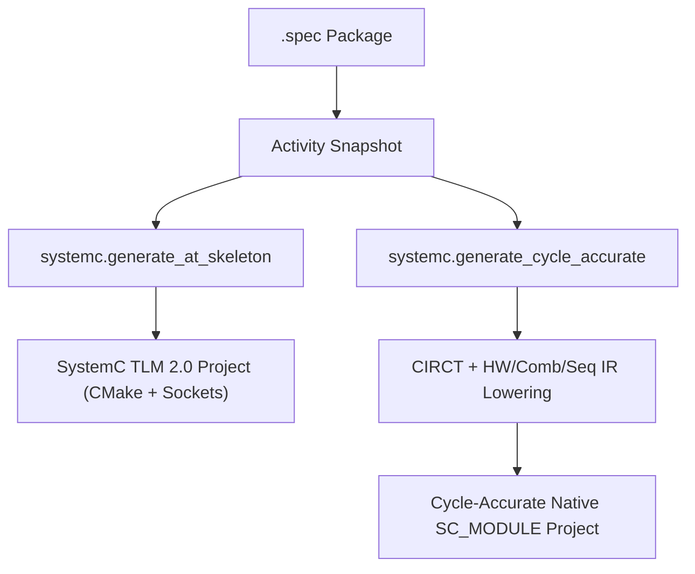

# SystemC Activities

The spec2hw platform provides two deterministic SystemC generation Activities:
1. `systemc.generate_at_skeleton`: SystemC TLM 2.0 Approximately-Timed (AT) skeleton generator.
2. `systemc.generate_cycle_accurate`: Native cycle-accurate SystemC simulation model generator using CIRCT.



Neither Activity calls an LLM or infers hardware behavior from narrative text.
Both Activities operate deterministically from snapshot data.

---

## 1. SystemC TLM 2.0 Approximately-Timed Activity

`systemc.generate_at_skeleton` generates the structural scaffold for a TLM 2.0 Approximately-Timed performance model.

### Supported Topology
- Invoked on one selected Design.
- Supports 1:1 initiator-to-target TLM interface connections.
- Supports hierarchical socket exports for composite design boundaries.
- Rejects ad-hoc wire connections, bus fan-in, and bus fan-out during preflight validation.

### Generated Project Layout
The generator writes the project to the configured Activity output directory:

```text
systemc-at/<document-id>/<design-id>/
├── CMakeLists.txt
├── README.md
├── generation-manifest.json
├── include/
│   ├── components/      # Specialized leaf modules
│   └── designs/         # Composite design top modules
└── src/main.cpp         # sc_main simulation harness
```

Each target socket returns `END_REQ` one 10 ns cycle after `BEGIN_REQ`.
The top module instantiates all components and runs an initial 100 ns simulation.

---

## 2. Cycle-Accurate SystemC Activity

`systemc.generate_cycle_accurate` compiles a design's physical wire hierarchy and SystemVerilog sections into native SystemC `SC_MODULE` classes.
The generated model executes without Verilator.

### Supported Source Profile
- **Signals**: Unsigned, two-state physical wires from 1 to 64 bits.
- **Connections**: Full-width direct wire connections with exactly one driver.
- **Components**: Every leaf component must contain a non-empty SystemVerilog section.
- **Supported SV Subset**: Bitwise logic, addition, subtraction, multiplication, muxes, relational comparisons, shifts, bit slicing, and concatenation.
- **Clock & Reset**: Rising-edge registers with synchronous or asynchronous resets.

### Compilation Pipeline
1. Assembles temporary SystemVerilog modules from IP-XACT ports and SV sections.
2. Lowers SystemVerilog to MLIR HW, Comb, and Seq dialects via `circt-verilog`.
3. Emits native C++ `SC_MODULE` implementations via `spec2gds-systemc-emit`.

### Required Toolchain
Building the cycle-accurate SystemC emitter requires:
- CIRCT (`firtool-1.160.0` or newer) with CMake headers and shared libraries.
- SystemC 2.3.3 or newer.

```bash
# Build the native emitter
cmake -S tools/systemc-rtl -B build/systemc-rtl-emitter \
  -DCMAKE_PREFIX_PATH=$CIRCT_PREFIX \
  -DCMAKE_INSTALL_PREFIX=$CIRCT_PREFIX
cmake --build build/systemc-rtl-emitter
cmake --install build/systemc-rtl-emitter
```
