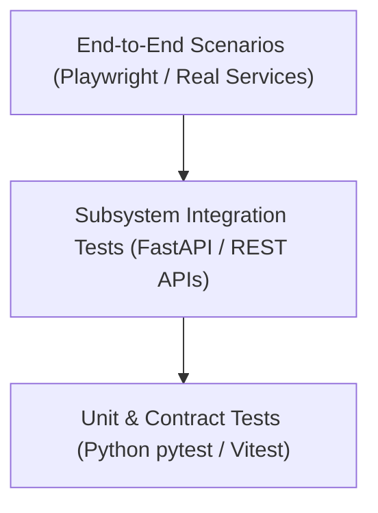

# Software Testing and Verification Strategy

This document defines the software test pyramid, local execution profiles, and coverage matrix across spec2hw.

## 1. Test Organization and Pyramid

Software tests validate platform reliability, revision safety, and cross-application boundaries.
Software tests are separate from the hardware **Test Plan** artifact produced by **Verification Planner**.

Use layered, risk-based testing. Put a check at the lowest layer that can detect
the fault reliably. Use integration and browser checks when the fault depends
on communication, persistence, or designer interaction. Do not set fixed test
counts or code-coverage percentages for each layer.

Keep tests near their subsystem. Keep flows that span applications in
`tests/ui-scenarios`. Do not copy tests into a second regression collection.
Regression profiles select the maintained suites. The suite catalogue in
`scripts/test_profiles.py` records the subsystem, layer, evidence type,
dependencies, prerequisites, risk areas, and execution limit beside each command.

| Layer | Method | Main purpose |
| --- | --- | --- |
| Unit and component | Isolated logic and state checks | Fast feedback on local faults |
| Contract and service API | Public interface and validation checks | Compatibility and enforced boundaries |
| Integration | Real services, storage, adapters, and extension execution | Correct interaction between subsystems |
| Browser | Rendered state, controls, keyboard access, and responsive layout | Correct designer interaction |
| End-to-end | Real applications and services, with saved-state assertions | Complete flows and durable results |
| Quality evaluation | Live inference, hardware execution, and measured quality | Evidence beyond fixtures |

Prioritise source integrity, atomic changes, revision control, approval rules,
and separation between Spec and Circuit domains. During detailed test design,
use state-transition, boundary-value, negative-input, and property-based methods
where they fit the risk. Use exploratory review for usability and unexpected
behaviour. The capability mapping defined in `scripts/test_capabilities.py` and
reported by `scripts/test_report.py` serves as the authoritative source for executed
coverage across implemented flows, local rules, conditional checks, and known failures.

---

## 2. Test Execution Profiles

Before finalizing a plan, get the developer's selection of test groups.
Recommend Fast for routine changes. Offer focused checks for local changes or
no automated tests for suitable documentation changes. Run the selected groups
after implementation and ask before expanding the selection.

| Command | Select for |
| --- | --- |
| `scripts/test-all.sh fast` | Routine deterministic checks. Runs selected Python tests, Circuit Designer and AI Assistant unit tests, scenario fixture tests, and the schema check. Target less than five minutes after setup. |
| `scripts/test-all.sh browser-smoke` | Tagged Spec Editor and Circuit Designer browser cases with real local services. |
| `scripts/test-all.sh live-smoke` | Three live model cases for Component description, wire range, and restricted approval. |
| `scripts/test-all.sh integration --scope spec,assistant` | Wider checks for affected subsystems and their consumers. |
| `scripts/test-all.sh regression` | Broad Python, browser, hardware, and live model checks after several changes, before a release, or on an unchanged revision. |

Integration scopes are `spec`, `circuit`, `assistant`, `verification`,
`activities`, and `shared`. Combine scopes with commas. Shared includes all
consumers. Full regression covers the tagged browser cases within the full
browser projects and includes the three live model cases and wider live evaluation.

Use `--dry-run` to inspect suite commands and declared prerequisites. Find
`summary.html` and `summary.json` under the fresh `temp/TEMP_tests-*`
directory or the selected output directory. Report executed commands, outcomes,
coverage limits, and the evidence directory. Required prerequisites that are
unavailable produce an incomplete result and a nonzero exit status.

Select tutorial work separately through the
[tutorial maintenance guide](tutorial-maintenance.md).

### Execution Prerequisites
- Python 3.12+ with root `uv` virtual environment.
- Node.js 24.2+ (or 22.19+ for Assistant alone).
- Configured `OPENAI_API_KEY` for Live model smoke and Full regression.
- Playwright Chromium browser binaries for browser checks (`npx playwright install chromium`).
- Verilator 5.x and GNU Make for RTL Activity verification.

---

## 3. Subsystem Test Coverage Matrix

### Designer Flows and Core Capabilities

| Capability | Primary Test Evidence | Expected Assertion |
| --- | --- | --- |
| **Spec Creation & Drafts** | Spec Editor e2e + Spec service | UI, service, and archive agree; cancelled drafts leave file unchanged |
| **Hardware Port Families** | Spec Editor unit & e2e | Creates wire, transactional, and packed ports; reloads accurately |
| **Revision Conflicts** | Multi-client concurrency tests | Rejects stale writes with HTTP 409; requires refresh before retry |
| **Circuit Projections** | Spec-Circuit adapter tests | Validates bidirectional IP-XACT port to schematic pin translation |
| **Circuit Canvas & Routing** | Circuit Designer unit & e2e | Verifies orthogonal routing, edit leases, and undo/redo stacks |
| **Timing Stages** | Circuit timing engine tests | Accurately calculates path latency across cycle edge markers |
| **Activity Snapshot Handoff** | Activity SDK acceptance tests | Snapshots are immutable; subsequent spec edits do not alter running jobs |
| **RTL Generation** | `rtl.generate` test suite | SystemVerilog compiles cleanly in Verilator without warnings |
| **SystemC Models** | SystemC Activity test suites | Generates valid TLM 2.0 and cycle-accurate MLIR HW dialect code |
| **Verification Planning** | `testplan-service` acceptance tests | Evaluates 3-layer models, P/C/I checkpoints, and reference generation |
| **AI Assistant Flows** | DeepSeek Harness integration tests | Validates architecture review cards, proposal staging, and receipts |

---

## 4. Defect Reporting and Resolution

- Add regression protection at the lowest effective layer when fixing confirmed bugs.
- If a bug depends on browser behavior, add a Playwright browser scenario in `tests/ui-scenarios/`.
- Do not suppress test failures with blanket skips or loose assertions.
