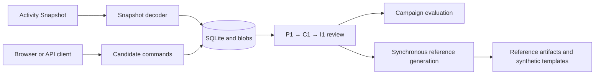

# Verification Planner architecture

The current service implements three authoring layers over immutable source
snapshots. Its built-in backend emits reference artifacts; executable simulation,
formal execution and automatic coverage closure are future work. See
[service operation](verification-service-overall.md) for setup and
[the backlog](verification-planner-backlog.md) for remaining requirements.

## Ownership and reading order

| Boundary | Source | Responsibility |
| --- | --- | --- |
| HTTP composition | `testplan-service/src/testplan_service/api/app.py` and `api/routes_*.py` | Request models, routes, error translation, static UI and SSE |
| Source imports | `integrations/snapshot_decoder.py` | Container validation and source/occurrence projection |
| Authoring | `application/command_handler.py`, `domain/operations.py`, `domain/validation.py` | Candidate batches, record relations, hierarchy/dependency invariants |
| Review | `application/review_engine.py` | Readiness diagnostics and frozen P1/C1/I1 payloads |
| Evidence | `application/coverage_service.py`, `domain/coverage_evaluator.py` | Profiles, campaigns, import staging, status and gaps |
| Implementation | `domain/test_ir.py`, `domain/recipe_validation.py` | IR declarations and the currently supported preflight checks |
| Generation | `application/generation_runner.py`, `domain/plugins/` | Checkpoint inputs, capability validation, reference bundle and artifacts |
| Persistence | `storage/sqlite_repo.py`, `storage/blob_store.py` | Durable records, transactions, content-addressed bytes |
| Browser | `ui/static/` | Standalone forms and projections; no React/Node build requirement |

The service has no runtime import of the Spec Editor's semantic model. A plan
keeps source provenance through its snapshot, locators and occurrence scopes.
Imports do not execute source content. Installed plugins are trusted Python
code: `OutputWriter` constrains emitted artifact paths and byte totals, but does
not sandbox plugin execution in a separate process.

## Persistence and review

`SqlitePlanRepository` stores snapshots, plans, typed record JSON, source audits,
key counters, command replay responses, events, checkpoints, profiles, campaigns,
runs, observations, reports, generation jobs, artifacts and producer manifests.
WAL and foreign keys are enabled. Command transactions recheck the draft
revision at the final write boundary. Human-readable keys and immutable IDs have
different purposes; references use IDs.

Blobs are addressed by SHA-256 and written through a temporary staging file
followed by replacement. The path layout has one hash-prefix directory. A
checkpoint's canonical content digest identifies the frozen payload; it is not
a cryptographic signature or proof of verification quality.

## Generation limits

Generation runs synchronously in the request path. Successful jobs with matching
checkpoint, plugin/version and input digest can be reused. Job records survive
restart, but there is no background queue, interruption recovery worker or
cooperative cancellation token in the plugin contract. A cancellation status
update must not be described as guaranteed interruption of running Python code.

The reference plugin explicitly advertises `executable: false` and
`produces_hdl: false`. It emits canonical IR/bindings, readable recipes, a
producer manifest, synthetic result template and validation report. Synthetic
results are fixture evidence and cannot establish DUT verification.

## Verification

Run `uv run python -m pytest testplan-service/tests -q`. The three acceptance
modules cover source/plan authoring, coverage/evidence and reference generation.
Passing those tests proves their exercised cases; it does not prove every
previously proposed AST construct, scalability target or browser interaction.
Use OpenAPI and the Pydantic models as field/route references rather than
maintaining duplicate schema tables in documentation.
