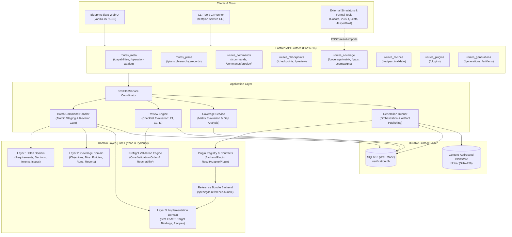
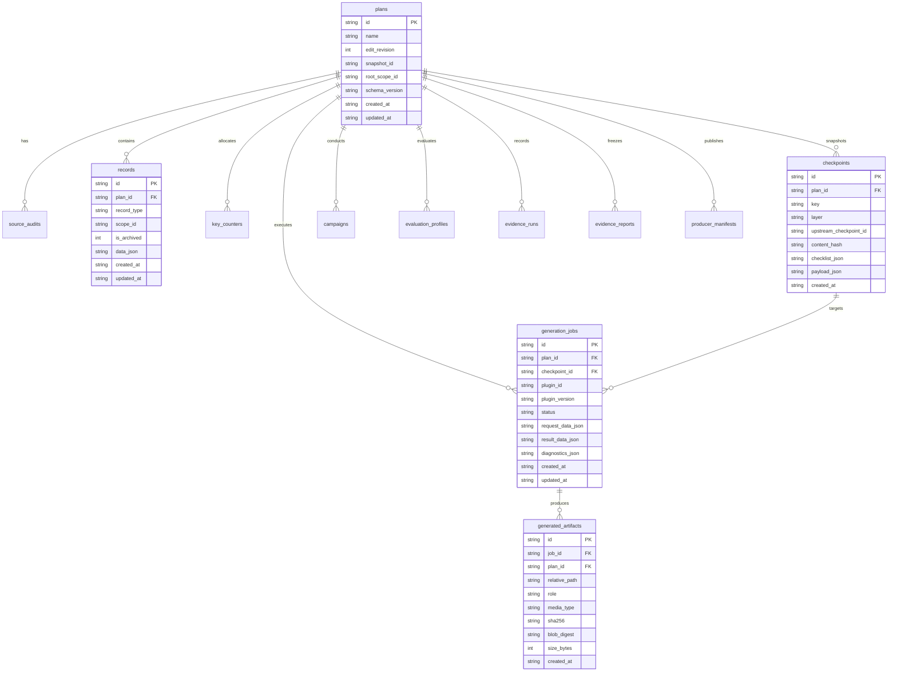

# Verification Planner (`testplan-service`) Architecture Specification

**Status**: Active Production Architecture  
**Service Name**: `testplan-service`  
**Product Title**: **Verification Planner**  
**Default Network Port**: `6016`  
**Storage Architecture**: Self-contained SQLite (WAL Mode) + Content-Addressed Blob Storage  

---

## 1. Executive Summary & Design Tenets

**Verification Planner** (`testplan-service`) is an independent, specification-first verification planning, coverage tracking, and test implementation service for hardware designs. It provides hardware architects and verification engineers with a human-auditable, rigorous environment for capturing requirements, authoring atomic verification intents, mapping coverage objectives, tracking simulation evidence, and lowering neutral test specifications into backend tool bundles.

### Guiding Principles

1. **Independent Self-Containment**: `testplan-service` maintains zero runtime dependencies on the Spec Editor, Circuit Designer, or AI Assistant. It operates through clean API contracts and standard Activity Snapshot containers (`spec2gds.activity-snapshot.v1+zip`).
2. **Three-Layer Decoupled Verification Model**:
   - **Layer 1 (Test Plan)**: Audited requirements, sections, atomic verification intents, and Checkpoint P1.
   - **Layer 2 (Coverage & Evidence)**: Coverage objectives (6 families), intent-evidence policies, evidence campaigns, result imports, gap analysis, Checkpoint C1, and frozen reports.
   - **Layer 3 (Implementation & Generation)**: Target bindings, backend configurations, neutral Test IR v1 AST, preflight validation, Checkpoint I1, and pluggable backend generators.
3. **Deterministic & Content-Addressed Persistence**:
   - SQLite in WAL mode with content-addressed SHA-256 blob storage.
   - Plans, checkpoints, and reports are keyed by cryptographically reproducible canonical JSON digests.
4. **Immutable Multi-Layer Checkpoints**:
   - Upstream edits never mutate frozen baselines.
   - Checkpoint sequence strictly enforces:
     $$\text{Plan Checkpoint (P1)} \longrightarrow \text{Coverage Checkpoint (C1)} \longrightarrow \text{Implementation Checkpoint (I1)}$$
5. **Deterministic Evidence & Status Resolution**:
   - Status precedence strictly follows:
     $$\text{Fail} > \text{Blocked} > \text{Satisfied} > \text{Waived} > \text{Open} > \text{Not evaluated}$$
6. **Professional Blueprint Slate Interface**:
   - Cohesive visual hierarchy using high-density slate tokens (`#081f33`, `#f7f9fc`, `#102a43`, `#007c89`, `#1d64c8`, `#6550a1`).

---

## 2. System Architecture & Component Interactions



---

## 3. The Three Verification Layers

### Layer 1: Verification Plan (Intent Specification)

Layer 1 establishes human-audited behavioral verification requirements bound to design sources.

- **Activity Snapshot v1 Decoder**: Ingests deterministic `.spec` or `.zip` snapshots containing IP-XACT component definitions, memory maps, registers, and narrative sections.
- **Source Section Audit**: Every section in the imported specification snapshot is audited with explicit disposition:
  - `requirements_captured`: Linked to one or more formal requirement records.
  - `informational`: Non-normative context (requires rationalization).
  - `out_of_scope`: Explicitly excluded from test scope (requires rationalization).
- **Requirements Capture**: Atomic statements with source locators (`snapshot_id`, `section_id`, `entity_ref`, `text_range`, `section_digest`).
- **Hierarchical Sections & Atomic Intents**:
  - Sections organize intents with default priorities (`critical`, `high`, `medium`, `low`).
  - Intents specify preconditions, triggers, expected behaviors, and explicit observable checklist items.
- **Authoring Lifecycle**: `draft` $\rightarrow$ `ready` $\rightarrow$ `blocked`. An intent cannot transition to `ready` without active links to audited requirements with `verify` disposition.
- **Checkpoint P1 (Plan Baseline)**:
  - Validates 100% source section audit coverage, zero open blocking issues, and zero unmapped requirements.
  - Creates an immutable, SHA-256 content-hashed baseline.

### Layer 2: Coverage & Evidence Mapping

Layer 2 maps verification intents to evidence-gathering objectives, tracks simulation and formal results, and computes closure metrics.

- **Coverage Dimensions & Bins**: Discrete value spaces, ranges, and state spaces with status (`required`, `optional`, `excluded`).
- **Coverage Families (6 Types)**:
  1. `Scenario`: Cross-product stimulus combinations and operational state traverses.
  2. `Functional`: Explicit protocol handshakes, buffer thresholds, and interface states.
  3. `Correctness`: Scoreboard integrity checks, data payload consistency, and invariant assertions.
  4. `Property`: SVA / formal assertions and temporal properties.
  5. `Structural`: Line, branch, toggle, and FSM branch coverage.
  6. `Mutation`: Fault injection and mutant detection coverage.
- **Intent-Evidence Policies (`IntentEvidencePolicy`)**:
  - Maps an atomic intent to one or more evidence branches.
  - **Checking Requirement Rule**: Every branch must contain at least one checking/correctness/property objective alongside stimulus/scenario objectives (`checking_missing` blocker rule).
- **Evaluation Profiles**: Parameterized DUT instances, frequency targets, and test environments.
- **Evidence Campaigns & Runs**:
  - Campaigns bound to Checkpoint C1 isolate evidence sets.
  - Results ingested via normalized `verification.results.v1` payloads.
  - Passing runs never overwrite earlier failures without formal review dispositions (`invalid_tool_run` or `superseded_after_fix`).
- **Gap Analysis Engine**: Computes 16 deterministic typed verification gaps (e.g., `unmapped_intent`, `bin_uncovered`, `failure_unresolved`).
- **Checkpoint C1 & Evidence Reports**: Immutable baselines locking coverage models and freezing signed milestone reports.

### Layer 3: Implementation, Test IR & Backend Plugins

Layer 3 bridges high-level verification intent with executable testbench code and formal properties through a language-neutral intermediate representation.

- **Target Binding Sets (`TargetBindingSet`)**:
  - Binds logical signal names used in test intents to physical top-level or hierarchical RTL nets.
  - Defines clock configurations (period in picoseconds, edge), reset polarity (active high/low), and port permission gates (`read_only` vs `full_access`).
- **Backend Configurations (`BackendConfiguration`)**:
  - Associates plans and recipes with specific generator plugins, version pins, and tool arguments.
- **Test IR v1 AST (`TestIR`)**:
  - Language-neutral, executable AST describing sequence steps, variables, and checks:
    - Declarations: `ClockDecl`, `ResetDecl`, `PortDecl`, `VariableDecl`, `ConstraintBlock`.
    - Operational Steps: `drive`, `sample`, `wait_cycles`, `wait_condition`, `check`, `assert_property`, `cover_property`, `fork_join`, `loop`, `conditional`, `call_sequence`, `log_message`, `memory_load`, `memory_store`.
    - Expressions: Binary expressions, unary operations, bit slices, concatenated literals, function calls.
- **Preflight Validation Engine (`RecipeValidator`)**:
  - Enforces strict compile-time verification invariants:
    1. **Core Validation Order**: Enforces step sequencing rules.
    2. **Output Drive Rejection**: Strictly forbids driving ports configured as DUT outputs or read-only bindings.
    3. **Uninitialized Sample Guard**: Disallows sampling variables before initialization.
    4. **Tautology & Contradiction Guard**: Detects redundant or statically unsatisfiable assertions.
    5. **Parallel Driver Conflict**: Disallows concurrent conflicting drives in parallel `fork_join` threads.
    6. **Reachability Analysis**: Flags dead steps following unbounded loops or unconditional checks.
- **Checkpoint I1 (Implementation Baseline)**:
  - Cryptographically references upstream Coverage Checkpoint C1.
  - Freezes recipes, binding sets, and backend configurations into an immutable release candidate digest.
- **Backend Plugin System**:
  - Strict abstract contract `BackendPlugin` (`describe`, `validate`, `lower`, `generate`).
  - Sandboxed `OutputWriter` restricting file emissions to bounded sizes and sanitized paths.
  - Built-in Reference Bundle Backend: `spec2gds.reference.bundle` (v1.0.0). Emits deterministic bundles containing `test-ir.json`, `target-bindings.json`, `recipe.md`, `producer-manifest.json`, `synthetic-result-template.json`, and `validation-report.json`.
- **Generation Runner**:
  - Idempotent orchestration engine caching executions against input digest hashes.
  - Emits persisted file artifacts into the content-addressed `BlobStore` and publishes `ProducerManifest` records.

---

## 4. Persistence Architecture & Database Schema

The service uses a single SQLite database (`verification.db`) maintained in Write-Ahead Logging (`WAL`) mode with foreign key integrity enabled.

### Database Schema Overview



### Blob Storage Model

- Binary and large content artifacts (source snapshot packages, generation file outputs, export bundles) are stored in a dedicated `BlobStore`.
- The storage layout uses two-level prefix directories derived from the SHA-256 hash:
  `{storage_dir}/blobs/{hash[:2]}/{hash[2:4]}/{hash}`
- Writes are staged via atomic rename operations to prevent partial file writes during process interrupts.

---

## 5. REST API Surface Reference

All endpoints are hosted under `/api/verification/v1`:

### 1. Discovery & Metadata
- `GET /capabilities`: Discovery contract reporting service version, active layers (`layer_1_plan`, `layer_2_coverage`, `layer_3_implementation`), and schema versions.
- `GET /operation-catalog`: Catalog of all typed batch command operations.
- `GET /health`: Health and storage status.

### 2. Snapshots & Plans
- `POST /source-imports`: Ingest Activity Snapshot v1 package.
- `POST /bundle-imports`: Stage `.vplan` verification bundle archive.
- `POST /bundle-imports/{staging_id}/commit`: Commit staged bundle (`create` or `import_as_copy`).
- `POST /plans`: Create plan bound to a snapshot.
- `GET /plans`: List all plans.
- `GET /plans/{id}`: Retrieve plan header, active snapshot view, and checkpoints.
- `GET /plans/{id}/hierarchy`: Scope hierarchy tree with descendant counts.
- `GET /plans/{id}/records`: Query canonical records (`requirement`, `section`, `intent`, `issue`, `objective`, `dimension`, `policy`, `exclusion`, `recipe`, `target_binding_set`, `backend_configuration`).

### 3. Batch Commands & Checkpoints
- `POST /plans/{id}/commands`: Transactional batch command execution with `base_edit_revision` optimistic lock.
- `POST /plans/{id}/commands?preview=true`: Dry-run preview returning diffs and diagnostics without persisting.
- `POST /plans/{id}/checkpoints/preview`: Evaluate checklist and blockers for layer (`plan`, `coverage`, or `implementation`).
- `POST /plans/{id}/checkpoints`: Commit immutable Checkpoint (`P1`, `C1`, `I1`).
- `GET /plans/{id}/checkpoints`: List checkpoints.
- `GET /plans/{id}/checkpoints/{chk_id}`: Retrieve specific checkpoint and frozen payload.

### 4. Coverage & Evidence (Layer 2)
- `GET /plans/{id}/coverage/matrix`: Full coverage matrix and status rollup.
- `GET /plans/{id}/coverage/gaps`: Deterministic gap analysis.
- `GET /plans/{id}/coverage/trace`: Full upstream/downstream verification trace.
- `POST /plans/{id}/profiles`, `GET /plans/{id}/profiles`: Create/list evaluation profiles.
- `POST /plans/{id}/campaigns`, `GET /plans/{id}/campaigns`: Create/list evidence campaigns.
- `POST /plans/{id}/campaigns/{camp_id}/commands`: Campaign commands (`run.include`, `waiver.create`, etc.).
- `POST /plans/{id}/result-imports`: Stage verification run results.
- `POST /plans/{id}/result-imports/{staging_id}/commit`: Commit run results into campaign.
- `POST /plans/{id}/evidence-reports`, `GET /plans/{id}/evidence-reports`: Freeze/list milestone reports.

### 5. Implementation & Backend Plugins (Layer 3)
- `GET /plugins`: List registered backend and result adapter plugins.
- `POST /plans/{id}/recipes/{recipe_id}/validate`: Preflight validate recipe against target binding and Core Validation Order.
- `POST /plans/{id}/generations/preview`: Preview generation inputs, capabilities, and preflight diagnostics.
- `POST /plans/{id}/generations`: Execute generation job against Checkpoint I1.
- `GET /plans/{id}/generations`: List generation jobs.
- `GET /plans/{id}/generations/{job_id}`: Get generation job status, diagnostics, and artifact descriptors.
- `POST /plans/{id}/generations/{job_id}/cancel`: Cancel queued or running generation job.
- `GET /plans/{id}/artifacts/{artifact_id}`: Stream raw generated artifact content with proper MIME type.
- `GET /plans/{id}/producer-manifests/{digest}`: Retrieve published producer manifest.

---

## 6. Blueprint Slate User Experience

The user interface delivers a high-density, professional CAD experience modeled after the **Blueprint Slate** design language:

```
+--------------------------------------------------------------------------------------------------+
|  VERIFICATION PLANNER   [ Plan: FIFO Signoff v1 (r5)  v ]               [ Review P1 ] [ Export ] |
+--------------------------------------------------------------------------------------------------+
|  [ 1 · Test Plan ]   [ 2 · Coverage & Evidence ]   [ 3 · Implementation (Active) ]               |
+--------------------------------------------------------------------------------------------------+
|  Location: Root > sync_fifo > Full Boundary                                                  r5  |
+----------------------+---------------------------------------------------+-----------------------+
| HIERARCHY (280px)    | CENTER WORKSPACE (Fluid)                          | INSPECTOR (360px)     |
| [Search tree...]     | + Recipe   + Target Binding   Review (I1) Generate| [Details|Source|Hist] |
|                      +---------------------------------------------------+                       |
| v sync_fifo (8)      | Recipes Table:                                    | Selected: RCP-1       |
|   > Reset (2)        | - RCP-1: Full Write Rejection (Ready)             | Title: Full Write Rej |
|   v Boundaries (4)   |   Kind: Scenario | Backend: ref.bundle            | Kind: Scenario        |
|     - Full write (2) |   Binding: Primary RTL Target                     | Target: Primary RTL   |
|     - Empty read (2) |   Upstream: C-1 | Preflight: Passed (6 steps)     | Preflight: 0 Errors   |
|   > Normal Ops (2)   |                                                   |                       |
|                      | Target Bindings:                                  | Observable Checks:    |
|                      | - BND-1: Primary RTL (clk, rst_n, 8 ports)        | - full == 1           |
|                      |                                                   | - count == 4          |
|                      | Generation Jobs:                                  | - wr_data preserved   |
|                      | - Job 88f2: I-1 -> ref.bundle (Succeeded, 6 files)|                       |
+----------------------+---------------------------------------------------+-----------------------+
| 12 intents · 8 requirements · 3 recipes · 1 binding set                  | Snapshot: sha256:b12  |
+--------------------------------------------------------------------------------------------------+
```

### Key UI Features
- **Dynamic Layer Switching**: Switch between Test Plan, Coverage Matrix, and Implementation Workspaces without losing hierarchy selection.
- **Recipe Editor Modal**: Interactive AST step builder and JSON editor with live preflight validation feedback.
- **Target Binding Studio**: Port-to-signal mapping with clock frequency, reset polarity, and read/write permission configuration.
- **Generation Inspector**: One-click preview of generation capabilities, execution logging, and direct code viewer for generated artifacts.

---

## 7. Verification & Acceptance Test Suite

The service is validated by an automated acceptance test suite in `tests/`:

| Test Suite | Scenarios | Coverage Focus |
|---|---|---|
| `test_layer1_acceptance.py` | L1-01 through L1-15 (14 tests) | Snapshot ingest, audit dispositions, requirement capture, intent authoring, cycle detection, P1 checkpoints, `.vplan` export/import. |
| `test_layer2_acceptance.py` | L2-01 through L2-20 (20 tests) | 6 coverage families, bins & exclusions, intent policies, checking requirement rule, evaluation profiles, campaigns, results import, status precedence, gap engine, C1 checkpoints, frozen reports. |
| `test_layer3_acceptance.py` | L3-01 through L3-17 (13 tests) | Target bindings, backend configurations, Test IR AST validation (Core Validation Order, output drive rejection, uninitialized samples, tautology guards), I1 checkpoints, backend plugin contract, reference bundle generation, synthetic result templates, backend switching invariance. |
| **Total** | **47 Acceptance Tests** | **100% Pass Rate across all 3 verification layers** |

---

## 8. Deployment & Service Execution

### Installation with `uv`

```bash
# Navigate to repository root
cd /home/ankdesh/explore/spec2gds

# Sync dependencies in virtual environment
uv sync
```

### Running the Verification Planner Service

```bash
# Launch service on default port 6016
uv run python -m testplan_service.cli --host 127.0.0.1 --port 6016 --storage-dir verification-data/
```

Access the interactive web application at:
`http://127.0.0.1:6016/`

### Running the Test Suite

```bash
# Run all 47 acceptance tests across Layers 1, 2, and 3
uv run pytest testplan-service/tests
```
