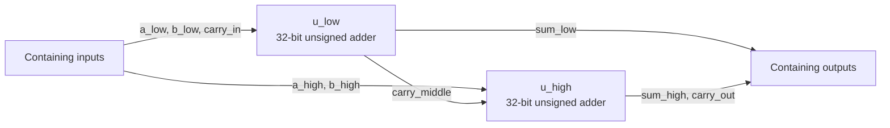

# Input pack: Reusable hierarchical 64-bit adder

Composite definition reference: `add64`. Containing Component name: **Reusable hierarchical 64-bit adder**.
Internal Design name: **Reusable hierarchical 64-bit adder implementation**. Instance IDs below are exact;
service-generated IDs for Components and Designs are recorded during creation.

## Complete containing interface

| Port ID | Direction | Range to enter | Bits | Description |
| --- | --- | --- | ---: | --- |
| `a` | `in` | `63:0` | 64 | Unsigned operand; low half is bits 31:0. |
| `b` | `in` | `63:0` | 64 | Second unsigned operand. |
| `cin` | `in` | leave blank (scalar) | 1 | Incoming carry. |
| `sum` | `out` | `63:0` | 64 | Low 64 result bits. |
| `cout` | `out` | leave blank (scalar) | 1 | Final carry bit 64. |

## Complete explanation to copy

```text
Purpose
Add two 64-bit unsigned operands by reusing the same 32-bit adder definition twice.

Requirements and behavior
R1: u_low adds operand bits 31:0 and cin. Its carry drives only u_high.cin. R2: u_high adds bits 63:32 and the middle carry. sum joins high and low results in that order; cout comes from u_high. The structure is combinational.

Structure
u_low: 32-bit unsigned adder.
u_high: 32-bit unsigned adder.

Interface and wiring
Use the physical wire ports and named connection table from this input pack. A row is one signal with one driver and the listed sinks. Slices name the exact hardware bit indices.

Corner cases and integration assumptions
FFFFFFFFFFFFFFFF + 1 + 0 gives sum=0 and cout=1. A carry from bit 31 must reach bit 32. Do not duplicate the add32 definition or replace the hierarchy with a flat 64-bit behavioral expression.

Diagram reading order
Put u_low before u_high in reading order. Label carry_middle and show low/high slices near their endpoints. External operands enter from the left and result leaves to the right; no text covers terminals.

Verification boundary
The saved interfaces and connections, the Circuit, and generated hierarchy must agree. Generate from the saved containing Component and run make lint on the published project. No functional simulation is claimed.
```

Copy this explanation into the containing Component. For the internal Design,
copy the same text and prepend: `This Design implements the containing Component
Reusable hierarchical 64-bit adder; its boundary ports are that Component's interface.`

## Child definitions and instances

| Exact instance ID | Definition input pack | Definition reference |
| --- | --- | --- |
| `u_low` | [32-bit unsigned adder](add32.md) | add32 |
| `u_high` | [32-bit unsigned adder](add32.md) | add32 |

Create each distinct definition once through Spec Editor. If a linked definition
is composite, create its internal Design and connections recursively. Reuse the
definition for repeated instances. These are setup inputs, not dependencies on
the scored result of another case.

## Endpoint-to-endpoint connections

`top` denotes the containing Component's boundary, not an extra instance. A source
is a parent input or child output; a sink is a child input or parent output.
Use the exact slices; unsliced endpoints use their full width. Every table row
is one logical net, including rows with multiple sinks. No implicit width
conversion, clock, reset, constant, or register can be inferred from narrative.

| Net name | Driver | Sinks | Bits |
| --- | --- | --- | ---: |
| `a_low` | `top.a[31:0]` | `u_low.a` | 32 |
| `a_high` | `top.a[63:32]` | `u_high.a` | 32 |
| `b_low` | `top.b[31:0]` | `u_low.b` | 32 |
| `b_high` | `top.b[63:32]` | `u_high.b` | 32 |
| `carry_in` | `top.cin` | `u_low.cin` | 1 |
| `carry_middle` | `u_low.cout` | `u_high.cin` | 1 |
| `sum_low` | `u_low.sum` | `top.sum[31:0]` | 32 |
| `sum_high` | `u_high.sum` | `top.sum[63:32]` | 32 |
| `carry_out` | `u_high.cout` | `top.cout` | 1 |

## Expected logical overview

This is the reference architecture at this level, not a screenshot or a required
pixel layout. Clock and reset fan-out are omitted from this overview only; the
complete table above remains the connection authority. A child composite has
its own linked overview and full connection table.



## Authoring and expected structure

1. Create the containing Component, its explanation, and every boundary wire port.
2. Create its internal Design and bind that Design as the Component implementation.
   This is a required designer capability. If there is no UI path, record a
   capability gap here; do not create the link through an API or archive edit.
3. Add the named child instances from the definition table. Open the writable
   internal Circuit and enter editing state.
4. Create the connection rows through browser controls. For fan-out, extend the
   same logical net. For a sliced bus, map source and destination bit offsets
   independently. Missing controls or unsupported mapping are findings.
5. Arrange the Circuit as described below, Save to Spec, and reopen both views.
6. Keep the containing Component and Design SystemVerilog Sections intentionally
   absent: their implementation is the explicit hierarchy and wiring. The linked
   behavioral leaf Components each require their supplied SystemVerilog body.
7. Generate from the containing Component. Expect structural module instances
   and direct wiring, plus each reachable leaf body; no placeholder tie-offs.

At this level expect **2 instances** and **9 named nets**.
The port table has **5 boundary ports**. Count repeated definitions
once; inspect nested levels separately. There must be no unconnected required
endpoint, extra driver, omitted slice, unexplained conversion, or unexpected leaf.

## Layout and exports

Put u_low before u_high in reading order. Label carry_middle and show low/high slices near their endpoints. External operands enter from the left and result leaves to the right; no text covers terminals.

Use readable Component names and exact instance and port identities. Keep labels
inside their cards, keep terminals reachable, and preserve connection meaning
while routing. SVG/PNG must show the saved layout, current overlay visibility,
and readable labels. Portable circuit output must preserve this level's graph.

Return to the [catalogue](../README.md).
