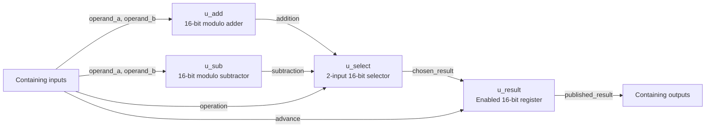

# Input pack: Registered selectable 16-bit add/subtract datapath

Composite definition reference: `addsub16`. Containing Component name: **Registered selectable 16-bit add/subtract datapath**.
Internal Design name: **Registered selectable 16-bit add/subtract datapath implementation**. Instance IDs below are exact;
service-generated IDs for Components and Designs are recorded during creation.

## Complete containing interface

| Port ID | Direction | Range to enter | Bits | Description |
| --- | --- | --- | ---: | --- |
| `clk` | `in` | leave blank (scalar) | 1 | Rising-edge input clock. |
| `reset` | `in` | leave blank (scalar) | 1 | Synchronous active-high reset; highest priority. |
| `enable` | `in` | leave blank (scalar) | 1 | Capture selected arithmetic result. |
| `a` | `in` | `15:0` | 16 | First unsigned operand. |
| `b` | `in` | `15:0` | 16 | Second unsigned operand. |
| `subtract` | `in` | leave blank (scalar) | 1 | Zero selects addition; one selects subtraction. |
| `result` | `out` | `15:0` | 16 | Registered modulo-65536 result. |

## Complete explanation to copy

```text
Purpose
Select addition or subtraction and capture the result in one enabled register stage.

Requirements and behavior
R1: subtract=0 selects a+b; subtract=1 selects a-b. Both operations wrap to 16 bits. R2: The result register captures on enabled rising edges, clears synchronously on reset, and holds when disabled.

Structure
u_add: 16-bit modulo adder.
u_sub: 16-bit modulo subtractor.
u_select: 2-input 16-bit selector.
u_result: Enabled 16-bit register.

Interface and wiring
Use the physical wire ports and named connection table from this input pack. A row is one signal with one driver and the listed sinks. Slices name the exact hardware bit indices.

Corner cases and integration assumptions
No signed-overflow or carry output is specified. 0-1 yields FFFF. Changing subtract while disabled must not change the registered result.

Diagram reading order
Place arithmetic blocks in two parallel rows, the selector to their right, and the result register last. Label the selector branches Add (0) and Subtract (1).

Verification boundary
The saved interfaces and connections, the Circuit, and generated hierarchy must agree. Generate from the saved containing Component and run make lint on the published project. No functional simulation is claimed.
```

Copy this explanation into the containing Component. For the internal Design,
copy the same text and prepend: `This Design implements the containing Component
Registered selectable 16-bit add/subtract datapath; its boundary ports are that Component's interface.`

## Child definitions and instances

| Exact instance ID | Definition input pack | Definition reference |
| --- | --- | --- |
| `u_add` | [16-bit modulo adder](add16.md) | add16 |
| `u_sub` | [16-bit modulo subtractor](sub16.md) | sub16 |
| `u_select` | [2-input 16-bit selector](mux16x2.md) | mux16x2 |
| `u_result` | [Enabled 16-bit register](reg16.md) | reg16 |

Create each distinct definition once through Spec Editor. If a linked definition
is composite, create its internal Design and connections recursively. Reuse the
definition for repeated instances. These are setup inputs, not dependencies on
the scored result of another case.

## Endpoint-to-endpoint connections

`top` denotes the containing Component's boundary, not an extra instance. A source
is a parent input or child output; a sink is a child input or parent output.
Use the exact slices; unsliced endpoints use their full width. Every table row
is one logical net, including rows with multiple sinks. No implicit width
conversion, clock, reset, constant, or register can be inferred from narrative.

| Net name | Driver | Sinks | Bits |
| --- | --- | --- | ---: |
| `operand_a` | `top.a` | `u_add.a`, `u_sub.a` | 16 |
| `operand_b` | `top.b` | `u_add.b`, `u_sub.b` | 16 |
| `addition` | `u_add.y` | `u_select.d0` | 16 |
| `subtraction` | `u_sub.y` | `u_select.d1` | 16 |
| `operation` | `top.subtract` | `u_select.sel` | 1 |
| `chosen_result` | `u_select.y` | `u_result.din` | 16 |
| `clock` | `top.clk` | `u_result.clk` | 1 |
| `reset` | `top.reset` | `u_result.reset` | 1 |
| `advance` | `top.enable` | `u_result.enable` | 1 |
| `published_result` | `u_result.dout` | `top.result` | 16 |

## Expected logical overview

This is the reference architecture at this level, not a screenshot or a required
pixel layout. Clock and reset fan-out are omitted from this overview only; the
complete table above remains the connection authority. A child composite has
its own linked overview and full connection table.



## Authoring and expected structure

1. Create the containing Component, its explanation, and every boundary wire port.
2. Create its internal Design and bind that Design as the Component implementation.
   This is a required designer capability. If there is no UI path, record a
   capability gap here; do not create the link through an API or archive edit.
3. Add the named child instances from the definition table. Open the writable
   internal Circuit and enter editing state.
4. Create the connection rows through browser controls. For fan-out, extend the
   same logical net. For a sliced bus, map source and destination bit offsets
   independently. Missing controls or unsupported mapping are findings.
5. Arrange the Circuit as described below, Save to Spec, and reopen both views.
6. Keep the containing Component and Design SystemVerilog Sections intentionally
   absent: their implementation is the explicit hierarchy and wiring. The linked
   behavioral leaf Components each require their supplied SystemVerilog body.
7. Generate from the containing Component. Expect structural module instances
   and direct wiring, plus each reachable leaf body; no placeholder tie-offs.

At this level expect **4 instances** and **10 named nets**.
The port table has **7 boundary ports**. Count repeated definitions
once; inspect nested levels separately. There must be no unconnected required
endpoint, extra driver, omitted slice, unexplained conversion, or unexpected leaf.

## Layout and exports

Place arithmetic blocks in two parallel rows, the selector to their right, and the result register last. Label the selector branches Add (0) and Subtract (1).

Use readable Component names and exact instance and port identities. Keep labels
inside their cards, keep terminals reachable, and preserve connection meaning
while routing. SVG/PNG must show the saved layout, current overlay visibility,
and readable labels. Portable circuit output must preserve this level's graph.

Return to the [catalogue](../README.md).
