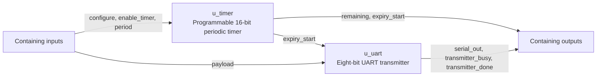

# Input pack: Timer-triggered UART status transmitter

Composite definition reference: `status_tx`. Containing Component name: **Timer-triggered UART status transmitter**.
Internal Design name: **Timer-triggered UART status transmitter implementation**. Instance IDs below are exact;
service-generated IDs for Components and Designs are recorded during creation.

## Complete containing interface

| Port ID | Direction | Range to enter | Bits | Description |
| --- | --- | --- | ---: | --- |
| `clk` | `in` | leave blank (scalar) | 1 | Rising-edge input clock. |
| `reset` | `in` | leave blank (scalar) | 1 | Synchronous active-high reset; highest priority. |
| `load` | `in` | leave blank (scalar) | 1 | Capture a new timer period and restart. |
| `enable` | `in` | leave blank (scalar) | 1 | Enable periodic timer progression. |
| `period_in` | `in` | `15:0` | 16 | Timer period in enabled edges. |
| `status` | `in` | `7:0` | 8 | Payload sampled when the UART accepts an irq start. |
| `timer_count` | `out` | `15:0` | 16 | Remaining timer count. |
| `irq` | `out` | leave blank (scalar) | 1 | Timer expiry pulse, including events ignored by a busy UART. |
| `tx` | `out` | leave blank (scalar) | 1 | UART serial output. |
| `busy` | `out` | leave blank (scalar) | 1 | UART busy. |
| `done` | `out` | leave blank (scalar) | 1 | UART completion pulse. |

## Complete explanation to copy

```text
Purpose
Send current status bytes periodically over UART while keeping timer and transmission behavior explicit.

Requirements and behavior
R1: The timer runs independently of UART busy. Its registered irq drives UART start. The UART samples status on the next rising edge that observes irq=1 while previously idle. R2: An irq pulse is ignored when UART busy is one immediately before the edge that samples it; there is no retry queue. R3: Reset clears the timer and aborts the UART to idle high. UART rate is fixed at 16 clk cycles per bit.

Structure
u_timer: Programmable 16-bit periodic timer.
u_uart: Eight-bit UART transmitter.

Interface and wiring
Use the physical wire ports and named connection table from this input pack. A row is one signal with one driver and the listed sinks. Slices name the exact hardware bit indices.

Corner cases and integration assumptions
A period shorter than a frame causes irq pulses sampled while busy to be dropped. If an irq is generated on the UART completion edge, it can be accepted on the next edge because the UART is then idle. Disabling the timer does not abort a frame. Loading period zero disables future expiry.

Diagram reading order
Place timer before UART. Label the irq/start link and add a readable note: IRQ pulses sampled while busy are dropped. Keep configuration and status-data entry points distinct.

Verification boundary
The saved interfaces and connections, the Circuit, and generated hierarchy must agree. Generate from the saved containing Component and run make lint on the published project. No functional simulation is claimed.
```

Copy this explanation into the containing Component. For the internal Design,
copy the same text and prepend: `This Design implements the containing Component
Timer-triggered UART status transmitter; its boundary ports are that Component's interface.`

## Child definitions and instances

| Exact instance ID | Definition input pack | Definition reference |
| --- | --- | --- |
| `u_timer` | [Programmable 16-bit periodic timer](timer16.md) | timer16 |
| `u_uart` | [Eight-bit UART transmitter](uart_tx.md) | uart_tx |

Create each distinct definition once through Spec Editor. If a linked definition
is composite, create its internal Design and connections recursively. Reuse the
definition for repeated instances. These are setup inputs, not dependencies on
the scored result of another case.

## Endpoint-to-endpoint connections

`top` denotes the containing Component's boundary, not an extra instance. A source
is a parent input or child output; a sink is a child input or parent output.
Use the exact slices; unsliced endpoints use their full width. Every table row
is one logical net, including rows with multiple sinks. No implicit width
conversion, clock, reset, constant, or register can be inferred from narrative.

| Net name | Driver | Sinks | Bits |
| --- | --- | --- | ---: |
| `clock` | `top.clk` | `u_timer.clk`, `u_uart.clk` | 1 |
| `reset` | `top.reset` | `u_timer.reset`, `u_uart.reset` | 1 |
| `configure` | `top.load` | `u_timer.load` | 1 |
| `enable_timer` | `top.enable` | `u_timer.enable` | 1 |
| `period` | `top.period_in` | `u_timer.period_in` | 16 |
| `remaining` | `u_timer.count` | `top.timer_count` | 16 |
| `expiry_start` | `u_timer.irq` | `top.irq`, `u_uart.start` | 1 |
| `payload` | `top.status` | `u_uart.data` | 8 |
| `serial_out` | `u_uart.tx` | `top.tx` | 1 |
| `transmitter_busy` | `u_uart.busy` | `top.busy` | 1 |
| `transmitter_done` | `u_uart.done` | `top.done` | 1 |

## Expected logical overview

This is the reference architecture at this level, not a screenshot or a required
pixel layout. Clock and reset fan-out are omitted from this overview only; the
complete table above remains the connection authority. A child composite has
its own linked overview and full connection table.



## Authoring and expected structure

1. Create the containing Component, its explanation, and every boundary wire port.
2. Create its internal Design and bind that Design as the Component implementation.
   This is a required designer capability. If there is no UI path, record a
   capability gap here; do not create the link through an API or archive edit.
3. Add the named child instances from the definition table. Open the writable
   internal Circuit and enter editing state.
4. Create the connection rows through browser controls. For fan-out, extend the
   same logical net. For a sliced bus, map source and destination bit offsets
   independently. Missing controls or unsupported mapping are findings.
5. Arrange the Circuit as described below, Save to Spec, and reopen both views.
6. Keep the containing Component and Design SystemVerilog Sections intentionally
   absent: their implementation is the explicit hierarchy and wiring. The linked
   behavioral leaf Components each require their supplied SystemVerilog body.
7. Generate from the containing Component. Expect structural module instances
   and direct wiring, plus each reachable leaf body; no placeholder tie-offs.

At this level expect **2 instances** and **11 named nets**.
The port table has **11 boundary ports**. Count repeated definitions
once; inspect nested levels separately. There must be no unconnected required
endpoint, extra driver, omitted slice, unexplained conversion, or unexpected leaf.

## Layout and exports

Place timer before UART. Label the irq/start link and add a readable note: IRQ pulses sampled while busy are dropped. Keep configuration and status-data entry points distinct.

Use readable Component names and exact instance and port identities. Keep labels
inside their cards, keep terminals reachable, and preserve connection meaning
while routing. SVG/PNG must show the saved layout, current overlay visibility,
and readable labels. Portable circuit output must preserve this level's graph.

Return to the [catalogue](../README.md).
