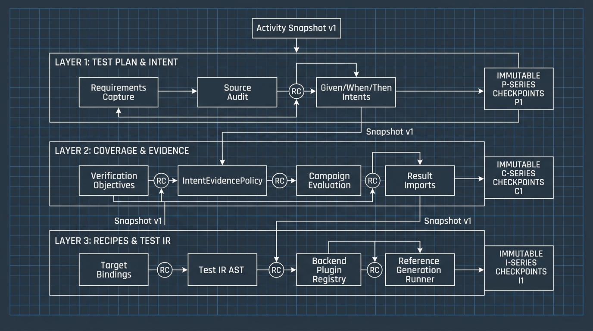
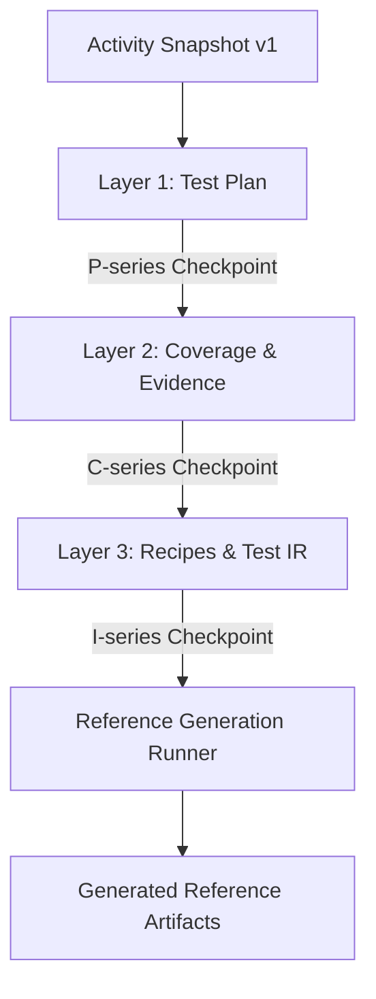

# Verification Planner

Verification Planner (`testplan-service`) manages structured verification planning, coverage tracking, and reference artifact generation for hardware designs.



## 1. System Architecture and Operation

Verification Planner runs as an independent Python FastAPI service with an integrated web UI.

### System Boundaries
- **Service Port**: Defaults to port `6016` (`127.0.0.1`).
- **Input Source**: Imports immutable **Activity Snapshot v1** packages.
- **Storage**: Stores metadata in SQLite WAL (`verification.db`) and files in a content-addressed blob directory (`blobs/`).
- **Isolation**: Operates independently from live Spec and Circuit editing processes.

### Run Verification Planner

From the repository root, run the service with the project virtual environment:

```bash
uv sync
uv run testplan-service --host 127.0.0.1 --port 6016 --storage-dir verification-data
```

To run the verification test suite:

```bash
uv run python -m pytest testplan-service/tests -q
```

The browser UI is served at `/` and `/ui`.
API documentation is accessible at `/docs`.

---

## 2. The Three-Layer Verification Model



### Layer 1: Test Plan (Verification Intent)
Layer 1 captures human-reviewed verification intent against an immutable hardware snapshot:
- **Source Audit**: Audits specification sections as `captured`, `informational`, or `out_of_scope`.
- **Requirements**: Contains atomic statements linked to exact source locators.
- **Intents**: Structured verification items using `Given / When / Then` format with expected observations.
- **Checkpoints (P-series)**: Freezes reviewed requirements and intent structure (for example, `P1`). Subsequent draft edits do not modify frozen checkpoints.

### Layer 2: Coverage and Evidence Mapping
Layer 2 maps reviewed intents to explicit verification objectives and evaluates imported test results:
- **Objectives**: Categorized into scenario, functional, correctness, property, structural, and mutation families.
- **IntentEvidencePolicy**: Requires at least one checking objective for every verification intent. Scenario hits alone do not satisfy an intent.
- **Result Imports**: Ingests normalized `verification.results.v1` result payloads with strict provenance tracking.
- **Checkpoints (C-series)**: Freezes objectives and policy mappings against an upstream P-series checkpoint (for example, `C1`).

### Layer 3: Recipes, Test IR, and Generation
Layer 3 links reviewed coverage to test recipes, signal bindings, and backend plugins:
- **Target Bindings**: Maps semantic observation names to physical signal names, clock domains, and access permissions.
- **Test IR**: Structured intermediate representation declaring clock domains, reset polarity, port widths, sequence steps, and assert checks.
- **Backend Plugins**: Extensible code generators. Includes `spec2gds.reference.bundle` version 1.0.0.
- **Checkpoints (I-series)**: Freezes reviewed recipes, signal bindings, and plugin configurations (for example, `I1`).

---

## 3. Evaluator Precedence and Evidence Rules

Layer 2 evaluates results using strict deterministic precedence:

$$\text{fail} > \text{blocked} > \text{satisfied} > \text{waived} > \text{open} > \text{not\_evaluated}$$

- **Failure Retention**: A passing rerun never erases an earlier failing run.
- **Explicit Dispositions**: Removing a failure requires a documented `invalid_run` or `superseded_after_fix` disposition.
- **Waivers**: Waivers record deliberate omissions and cannot suppress unresolved test failures.
- **Zero Denominators**: A metric with an unknown or zero denominator never evaluates to full coverage.

---

## 4. Reference Generation and Artifacts

The built-in reference backend plugin (`spec2gds.reference.bundle`) emits standard verification artifacts:
- `test-ir.json`: Normalized Test IR AST.
- `target-bindings.json`: Signal and terminal connection mappings.
- `recipe.md`: Human-readable test execution instructions.
- `producer-manifest.json`: Tool provenance and execution metadata.
- `synthetic-result-template.json`: Result template for testbench integration.
- `validation-report.json`: Semantic consistency and IR validation results.

Execution of hardware simulation (Verilator, VCS, Questa, or cocotb) occurs outside Verification Planner.
Results import back into Layer 2 through standard result import endpoints.
